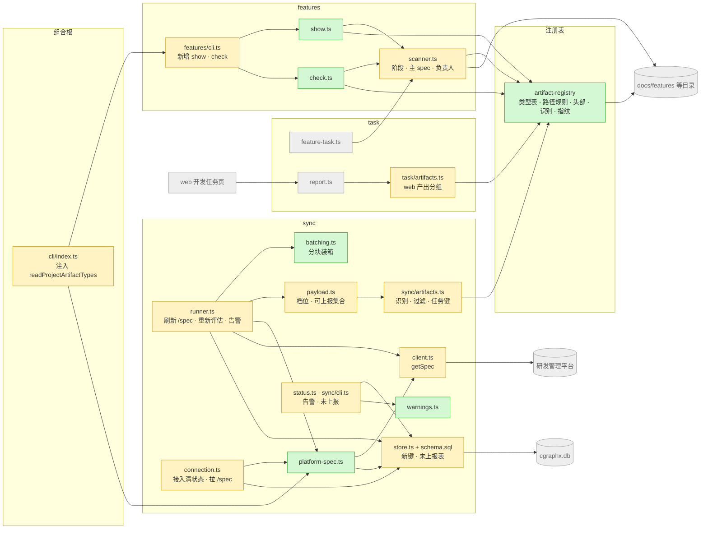
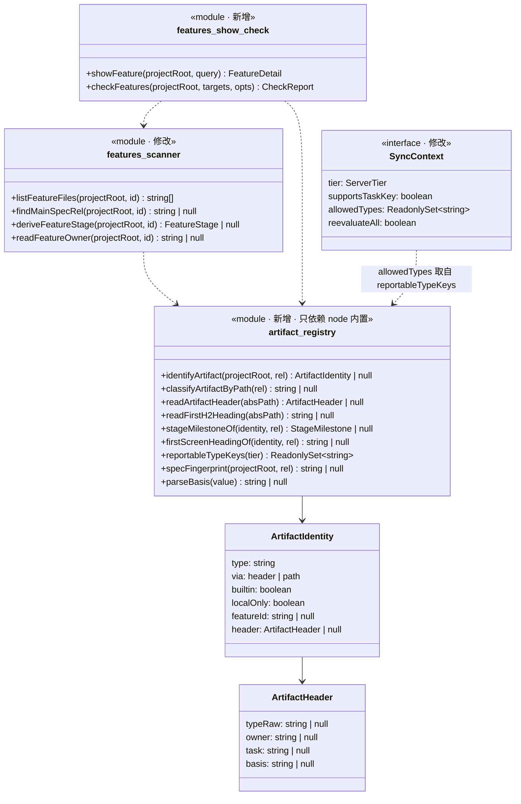
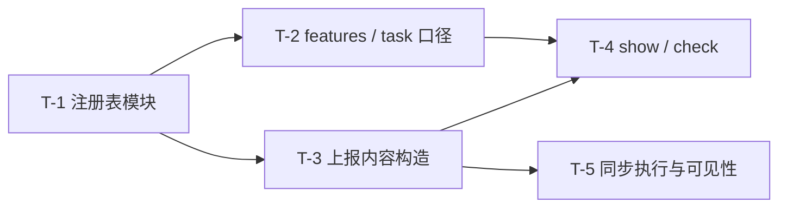

# 实现计划: 产物注册表与头部规范

> 产物: plan
> 依据: spec@b2dd47f
> feature-id: 2026-10-18-产物注册表与头部规范
> 负责人: liulongfei
> 日期: 2026-10-18

## 设计预览

新建共享模块 `src/core/artifact-registry/`,集中定义「文件 → 产物类型」的全部口径:内置类型表、路径规则、头部解析、spec 指纹、按档位的类型集合。features 的阶段与负责人、web 的产出分组、sync 的上报都改成经它的门面识别产物;features 新增 `show` / `check` 两个命令;sync 按服务端档位过滤类型、带任务键、拉取本项目类型表,并让告警和未上报产出在 `sync status` 里看得到。

**需要你重点看的**(改错了代价最大,其余可略读)

| # | 决策 | 为什么难回头 |
|---|---|---|
| 1 | 注册表独立成 `src/core/artifact-registry/`,只依赖 node 内置模块;features / task / sync 只经它的门面认产物,features 仍不依赖 task / sync | 注册表一旦反向依赖某个子系统(如读库),三方共用就成环;边界破了之后各处会重新各写一份口径 |
| 2 | sync 的新状态只加表(`sync_unreported_artifacts`)和 `sync_state` 新键,**不升 `SYNC_SCHEMA_VERSION`**(数据规范例外) | 本机 agent hook 跑的是旧版全局 cgraphx,遇到更高版本会抛错、停止同步;版本号写进库后无法回退 |
| 3 | `features check` 的退出码(0 / 1 / 2)与 `--json` 结构 | skill瘦身 要拿它接门禁;接入后再改字段或退出码,所有已部署项目的 hook 都要跟着改 |

**架构**——看颜色:绿色新增,黄色修改,灰色是已有且不动的邻居;注意注册表只指向文件,不指向库,features 也没有箭头指向 sync。



**主流程:一轮同步**——看三处新增:档位 1.3 才拉 `/spec`、「重新评估基准」变化时全部会话重建、集合外的产出进未上报表而不发送。

```mermaid
sequenceDiagram
  participant R as runner.ts
  participant S as store.ts
  participant PS as platform-spec.ts
  participant C as client.ts
  participant P as 研发管理平台
  participant PL as payload.ts
  participant A as sync/artifacts.ts
  participant G as artifact-registry
  R->>S: getStatus → serverProtocolVersion
  R->>R: serverTier()
  alt 档位 1.3
    R->>PS: refreshPlatformSpec
    PS->>C: getSpec(remoteUrl)
    C->>P: GET /spec
    alt 成功
      PS->>S: setPlatformSpec
      PS-->>R: 本项目类型标识
    else 任何失败
      PS-->>R: null(本轮按 19 个默认类型)
    end
  end
  R->>PL: createSyncContext(tier, projectTypes)
  R->>S: getBasis
  Note over R: basisOf(ctx) 与库里不同 → ctx.reevaluateAll = true,全部会话进候选
  loop 每个候选会话
    R->>PL: buildSessionPayload
    PL->>A: collectSessionArtifacts
    A->>G: identifyArtifact(头部优先,路径兜底)
    A-->>PL: artifacts(集合内,带任务键) / unreported(集合外)
    R->>S: replaceUnreported(会话, unreported)
  end
  R->>C: postIngest(只发内容有变化的会话)
  C->>P: POST /ingest
  P-->>R: warnings / taskKeys / protocolVersion
  R->>S: 本轮收到告警 → setLastWarnings;整轮成功 → setBasis
```

**类图**——看注册表对外只给纯函数和纯数据,features 的新命令只经 scanner 与注册表取数,sync 的上下文多了档位、可上报集合和重新评估标记。



**关键取舍**

| 选了 | 没选 | 为什么 |
|---|---|---|
| 注册表用 TS 常量表 | 随包 JSON 数据文件 | 类型检查保护登记项;不用改 copy-assets、不用运行时解析;skill瘦身 登记首屏标题时改一行常量 |
| 「重新评估基准」= 映射版本 + 档位 + 可上报集合的哈希,存 `sync_state`,变化时全量重建一次 | 每轮全量重建 / 每会话各存一份基准 | 只在变化后多付一次重建;平时候选判定照旧,补报仍然自动发生 |
| `features check` 的本项目类型表经 CLI 组合根注入 | features 直接读 sync 的库或缓存文件 | features 不依赖 sync;新增状态仍只放 sync 自有表与键(spec §13) |

## 基本信息

- 来源 spec:`docs/features/2026-10-18-产物注册表与头部规范/产物注册表与头部规范-spec.md`(指纹 `b2dd47f`)。spec 是唯一契约;本 plan 的任务标注对应条款,有疑义读 spec 原文。
- 需求阶段由 `cgraphx features` 从产物自动派生,不手填。

## 目标与范围

落地 spec §3–§12:产物注册表与识别规则;头部读取范围;负责人口径;依据与过期;首屏校验;`features show` / `features check`;本地阶段改读注册表;平台上报的档位、可上报集合、任务键、`/spec`、告警与未上报产出可见、重新评估补报;发布记录的登记与上报。

## 明确不包含

- skill 模板改写与门禁接入(归 skill瘦身);`assets/claude-template/` 下任何文件都不改。
- web 页面改动;`features list` 的列与阶段名。
- 存量知识补报;在本地计算「实现」「知识经验」环节。
- 测试任务:单元测试走 `/write-unit-test-spec` → `/write-unit-test-code`;实现期只保证既有测试不被弄红。
- 知识库条目、代码地图的更新:交付收尾时由 `/knowledge-write`、`/code-map-write` 处理。

## 计划文件清单

| 文件 | 状态 |
|---|---|
| `产物注册表与头部规范-index.md` | 本文件 |
| `产物注册表与头部规范-02-backend.md` | T-1 ~ T-5 全部任务 |
| `-01-schema.md` | 不单列:唯一的表结构变更(sync 新增一张表,包内 SQLite)随 T-5;不涉及目标项目业务库的 Schema 变更约定 |
| `-03-frontend.md` | 不涉及:web 页面不改 |

## 总任务清单

| 任务 | 内容 | 对应 spec | 依赖 | 独立提交 |
|---|---|---|---|---|
| T-1 | 新建产物注册表模块 `src/core/artifact-registry/` | §3.1–§3.3、§4.1–§4.2、§6.1、§7(登记)、§10(里程碑)、§11.1(类型集合) | — | 是 |
| T-2 | 本地口径改读注册表:features 阶段派生、主 spec 与负责人、task 产出分组 | §3.4、§4.1(读取范围)、§5、§10、§13 | T-1 | 是 |
| T-3 | 上报内容构造改读注册表:档位、可上报集合、任务键、未上报产出、本项目类型表缓存 | §3.2(上报)、§3.3、§11.1、§11.2、§11.5、§11.7 | T-1 | 是 |
| T-4 | 新命令 `features show` / `features check` 与组合根注入 | §6.2、§6.3、§7、§8、§9、§14 | T-1、T-2、T-3 | 是 |
| T-5 | 同步执行:拉取 `/spec`、重新评估补报、告警与未上报产出可见、runner 拆分 | §11.1(刷新)、§11.3、§11.4、§11.6、§13、§14 | T-3 | 是 |

spec 覆盖核对:§1–§2 为范围与术语;§12 发布记录的登记与上报由 T-1(类型表)、T-3(1.3 起上报)承载,生成归 skill瘦身;§15 验收 #1–#7、#14 在各任务完成条件中落实,#8–#13(档位、映射、告警、补报、档位升级补报、发布记录)需要假平台,由交付后的单元测试流程验收(见「交付收尾」);§16、§17 由「必须严格执行的契约」与各任务约束承载;§18 不阻塞本计划。

## 全局依赖图



## 推荐执行顺序与批次

串行执行:批 1 → 批 2 → 批 3 → 批 4 → 批 5,都在主工作区里跑。每批一个会话,每批只做一个任务。

| 批次 | 任务 | 前置批次 |
|---|---|---|
| 批 1 | T-1 | — |
| 批 2 | T-2 | 批 1 |
| 批 3 | T-3 | 批 1 |
| 批 4 | T-4 | 批 2、批 3 |
| 批 5 | T-5 | 批 3 |

批 2 与批 3、批 4 与批 5 改的文件互不重叠,但不并行:各任务的验证依赖主工作区才有的东西(gitignored 的 `.cgraphx/` 库与接入配置;T-4 还要读本需求的 spec 与 plan),独立 worktree 里没有;同一工作区并行又会互相覆盖 `dist/`。开工前先提交本需求的 spec 与 plan。

### 每批的执行会话启动语

批 1:

```text
/implementation 执行 docs/features/2026-10-18-产物注册表与头部规范/plan/产物注册表与头部规范-02-backend.md 的 T-1,只做 T-1。
开工前读:plan index(同目录 产物注册表与头部规范-index.md)的「必须严格执行的契约」「提交规范」「允许局部工程适配的范围」「Plan 冲突上报规则」四节,02-backend.md 的 T-1 全文,以及 T-1「强制引用」列出的 docs/guides 规范;条款有疑义时读 spec 原文对应章节。
只改 T-1「涉及范围」列出的文件;「完成条件」全部满足后按 index「提交规范」提交本任务的文件,不 push。
```

批 2 ~ 批 5:同上,把两处 `T-1` 换成 `T-2` / `T-3` / `T-4` / `T-5`。

全部完成后回 Claude 做 `/code-review`。

## 必须严格执行的契约

以下契约跨任务共享,各任务正文中引用处逐字重复;任何一处改动都要同步改所有引用。

### C-1 注册表门面 `src/core/artifact-registry/index.ts`(T-1 产出;T-2 / T-3 / T-4 消费)

`projectRelPath` / `rel` 一律是项目相对 POSIX 路径(`/` 分隔,不以 `./` 开头)。

```ts
// 常量
export const FEATURES_DIR_POSIX = 'docs/features';
export const SEDIMENT_TYPE_ROOTS: Readonly<{
  knowledge: 'docs/knowledge/';
  schema_knowledge: 'docs/schema-knowledge/';
  code_map: 'docs/code-map/';
  design_map: 'docs/design-map/';
}>;
export const SEDIMENT_DIR_PREFIXES: readonly ['docs/knowledge/', 'docs/schema-knowledge/', 'docs/code-map/', 'docs/design-map/'];
export const ARTIFACT_TYPE_KEY_PATTERN: RegExp; // /^[a-z0-9_]{1,64}$/
export const BASIS_PATTERN: RegExp;             // /^spec@([0-9a-fA-F]{7,40})$/
export const TASK_VALUE_PATTERN: RegExp;        // /^T-\d+$/
export const HEADER_SCAN_LINES = 30;
export const ARTIFACT_MAPPING_VERSION = 2;      // 路径规则或识别口径变化时 +1
export const OWNER_SOURCE_TYPES: readonly ['spec', 'handoff'];

// 类型
export type ArtifactPhase = 'design' | 'plan' | 'test' | 'release' | 'knowledge' | 'delivery';
export type ReportTier = '1.0' | '1.2' | '1.3';
export type StageMilestone = 'spec_like' | 'plan_index' | 'report';
export interface BuiltinArtifactType {
  key: string;
  name: string;
  defaultPhase: ArtifactPhase | null;   // handoff 为 null
  minTier: ReportTier | null;           // handoff 为 null:本地专用,不上报
  requiresBasis: boolean;
  firstScreen: { heading: string; planIndexOnly: boolean } | null;
}
export interface ArtifactHeader {
  typeRaw: string | null;  // `> 产物:` 去首尾空白后的原值;没有该行为 null;空值为 ''
  owner: string | null;    // 空值记 null,下同
  task: string | null;
  basis: string | null;
}
export interface ArtifactIdentity {
  type: string;
  via: 'header' | 'path';
  builtin: boolean;
  localOnly: boolean;
  featureId: string | null;
  header: ArtifactHeader | null;
}

// 函数
export const BUILTIN_ARTIFACT_TYPES: readonly BuiltinArtifactType[];
export function getBuiltinArtifactType(key: string): BuiltinArtifactType | undefined;
export function isValidArtifactTypeKey(key: string): boolean;
export function featureIdOf(projectRelPath: string): string | null;
export function isTopLevelFeatureFile(projectRelPath: string): boolean;
export function isPlanIndexPath(projectRelPath: string): boolean;
export function classifyArtifactByPath(projectRelPath: string): string | null;
export function readArtifactHeader(absPath: string): ArtifactHeader | null;   // 只认 .md / .html;读不了或扩展名不对返回 null
export function readFirstH2Heading(absPath: string): string | null;
export function identifyArtifact(projectRoot: string, projectRelPath: string): ArtifactIdentity | null;
export function stageMilestoneOf(identity: ArtifactIdentity, projectRelPath: string): StageMilestone | null;
export function firstScreenHeadingOf(identity: ArtifactIdentity, projectRelPath: string): string | null;
export function reportableTypeKeys(tier: ReportTier): ReadonlySet<string>;
export function specFingerprint(projectRoot: string, projectRelPath: string): string | null; // 40 位小写十六进制
export function parseBasis(value: string): string | null;                     // 合法返回小写十六进制前缀
export function basisMatches(prefix: string, fullHash: string): boolean;
```

### C-2 features 扫描器对内契约 `src/core/features/scanner.ts`(T-2 产出;T-4 消费)

```ts
export function listFeatureFiles(projectRoot: string, featureId: string): string[];      // 目录下全部普通文件,项目相对 POSIX 路径,递归,升序;目录不存在 → []
export function findMainSpecRel(projectRoot: string, featureId: string): string | null;  // spec §5 主 spec 认定,返回项目相对 POSIX 路径
export function deriveFeatureStage(projectRoot: string, featureId: string): FeatureStage | null;
export function readFeatureOwner(projectRoot: string, featureId: string): string | null; // 签名不变,口径改为 spec §5
export function readFeatureTask(projectRoot: string, featureId: string): string | null;  // 签名不变
```

### C-3 sync 上下文与构造结果(T-3 产出;T-5 消费)

```ts
// src/core/sync/version.ts
export type ServerTier = '1.0' | '1.1' | '1.2' | '1.3';
export function serverTier(version: string | null): ServerTier;
// protocolAtLeast(v,'1.3') → '1.3';≥ '1.2' → '1.2';≥ '1.1' → '1.1';其余(含 null、不合法)→ '1.0'

// src/core/sync/types.ts
export const ARTIFACT_TASK_KEY_PROTOCOL_VERSION = '1.2';
export const PROJECT_SPEC_PROTOCOL_VERSION = '1.3';
export type ArtifactType = string;
export interface IngestArtifact {
  type: string; path: string; action: 'create' | 'modify';
  commitHash: string | null; branch: string | null; ts: string;
  taskKey?: string;
}
// IngestWarning 联合类型新增:{ kind: 'artifact_type_unknown'; path: string; type: string }
export interface UnreportedArtifact { type: string; path: string } // path 为仓库相对路径

// src/core/sync/artifacts.ts
export function reportableTypesFor(tier: ServerTier, projectTypes: readonly string[] | null): ReadonlySet<string>;
// '1.0' | '1.1' → reportableTypeKeys('1.0');'1.2' → reportableTypeKeys('1.2');
// '1.3' → projectTypes !== null ? new Set(projectTypes) 去掉本地专用类型 : reportableTypeKeys('1.3')

// src/core/sync/payload.ts
export interface SyncContext {
  /* 既有字段不变,另有: */
  tier: ServerTier;
  supportsTaskKey: boolean;              // tier !== '1.0'
  allowedTypes: ReadonlySet<string>;     // reportableTypesFor(tier, projectTypes)
  reevaluateAll: boolean;                // createSyncContext 恒置 false,由 runner 改写
}
export async function createSyncContext(
  projectRoot: string,
  opts?: { tier?: ServerTier; projectTypes?: readonly string[] | null },  // 缺省 tier '1.0'、projectTypes null
): Promise<SyncContext>;
export interface BuiltSession { /* 既有字段不变,另有: */ unreported: UnreportedArtifact[] }
```

### C-4 本项目类型表缓存(T-3 产出;T-4、T-5 消费)

```ts
// src/core/sync/types.ts
export interface PlatformSpecCache {
  fetchedAt: string;
  artifactTypes: Array<{ key: string; name: string; phase: string }>;
}
// src/core/sync/store.ts —— sync_state 键 'platform_spec'
export function getPlatformSpec(db: SqliteDatabase): PlatformSpecCache | null;
export function setPlatformSpec(db: SqliteDatabase, cache: PlatformSpecCache, now: string): void;
// src/core/sync/platform-spec.ts,并由 src/core/sync/index.ts 导出
export function readCachedProjectArtifactTypes(projectRoot: string): string[] | null; // 未初始化 / 无缓存 / 任何异常 → null,绝不抛
```

### C-5 features 命令注册(T-4 产出)

```ts
// src/core/features/cli.ts
export interface FeaturesCommandDeps {
  readProjectArtifactTypes?: (projectRoot: string) => readonly string[] | null;
}
export function registerFeaturesCommands(program: Command, deps?: FeaturesCommandDeps): void;
// src/cli/index.ts
registerFeaturesCommands(program, { readProjectArtifactTypes: readCachedProjectArtifactTypes });
```

### C-6 sync 新状态(T-3 加 `platform_spec`;T-5 加其余)

- `sync_state` 新键:`platform_spec`(C-4)、`warnings` = `{ at: string; items: IngestWarning[] }`、`basis` = string。
- 新表,追加进 `src/core/sync/schema.sql`,**不升 `SYNC_SCHEMA_VERSION`**:

```sql
CREATE TABLE IF NOT EXISTS sync_unreported_artifacts (
  client_session_id TEXT NOT NULL,
  type TEXT NOT NULL,
  path TEXT NOT NULL,
  PRIMARY KEY (client_session_id, type, path)
);
```

- `basisOf(ctx)` = `sha256(stableStringify({ mapping: ARTIFACT_MAPPING_VERSION, tier: ctx.tier, allowed: [...ctx.allowedTypes].sort() }))`。

### C-7 `features check --json` 结构(T-4 产出;skill瘦身 门禁消费)

```ts
type CheckCode =
  | 'missing_type' | 'invalid_type' | 'missing_owner' | 'missing_basis' | 'invalid_basis'
  | 'invalid_task' | 'first_screen' | 'stale' | 'unknown_type' | 'type_path_mismatch';
interface CheckFinding { level: 'fail' | 'warn'; path: string; code: CheckCode; message: string; fix: string | null } // path 为项目相对 POSIX 路径
interface CheckReport { ok: boolean; checkedFiles: number; failures: number; warnings: number; findings: CheckFinding[] }
```

退出码:有失败 1;只有警告或全部通过 0;目标指向的目录或文件不存在 2。本需求的每条结果都给出 `fix`(spec §9 要求给改法);类型保留 `string | null` 以便日后扩展。

## 实现手段决策

均无 spec 信封外的业务可观察后果,plan 自主,拍板即锁定。

| # | 决策 | 选项 | 选择与理由 |
|---|---|---|---|
| 1 | 注册表放哪 | 新模块 `src/core/artifact-registry/` / 放进 features | 新模块:features、task、sync 三方共用,放 features 会为认产物引入 sync → features 依赖,且 features 职责膨胀;形态参照 `src/core/agents/`(门面 + 内部文件,无 cli) |
| 2 | 注册表形态 | TS 常量表 / 随包 JSON | TS 常量表:见「关键取舍」 |
| 3 | 本项目类型表缓存 | `sync_state` 新键 / `.cgraphx/*.json` 文件 | `sync_state` 新键:spec §13 要求新增状态只进 sync 自有表或字段 |
| 4 | `features check` 怎么拿到本项目类型表 | 组合根注入 / features 读库 / 读缓存文件 | 组合根注入:见「关键取舍」 |
| 5 | 重新评估怎么触发 | 基准指纹 / 每轮全量 / 每会话存基准 | 基准指纹:见「关键取舍」;只在整轮成功后写入,中途失败下一轮重来 |
| 6 | 未上报产出存哪 | 新表 / `sync_state` 大对象 | 新表:按会话替换、按类型汇总都是一条 SQL |
| 7 | sync schema 版本 | 升版本 / 只加表不升 | 只加表不升(规范例外,见「适用规范」) |
| 8 | spec 指纹怎么算 | 调 `git hash-object` / 进程内计算 | 优先 `git hash-object`(与 spec §6.1 逐字一致,含 git 的换行过滤);git 不可用时进程内按同算法(`sha1("blob <字节数>\0" + 内容)`)计算 |
| 9 | runner.ts 超 600 行 | 拆出分块装箱 / 不拆 | 拆:现 614 行已超规范,本次再加逻辑;分块与装箱的纯函数移到 `batching.ts` |
| 10 | `sync status` 的待上报会话数 | 含「仅因重新评估进候选」的会话 / 不含 | 不含:重新评估不等于有待发送内容;升级后不会一下显示全部会话积压 |
| 11 | 读 `HEAD` 文件集 | `git ls-tree -r -z --name-only HEAD -- docs/features` / 逐文件 `git cat-file -e` | 一次 `ls-tree`;必须带 `-z`,否则中文路径被转义成 `\344…` |

## 执行方式建议

满足 `/subagent-implement` 的条件:跨注册表 / features / task / sync 等 ≥ 3 个相互独立的模块,预估变更文件约 33 个,任务按依赖可独立派任。按本轮约定改为人工分批:每批一个会话跑 `/implementation`(其他 agent 或第三方模型),全部完成后回 Claude 做 `/code-review`。

## 适用规范

| 规范 | 章节 | 用于 |
|---|---|---|
| `docs/guides/coding-standards.md` | 边界与结构 · 选型(偏离社区默认)· 错误与日志 | 全部任务 |
| `docs/guides/interface-standards.md` | 命令注册 · 输出 · 退出码 | T-4(新命令)、T-5(`sync status` / `sync now` 输出) |
| `docs/guides/data-standards.md` | 模型层 · DDL 层 · ORM 映射约定 | T-3(`sync_state` 新键)、T-5(新表) |
| `docs/guides/git-standards.md` | 提交消息规范 · 提交前检查点 | 已结晶进下方「提交规范」 |

规范例外:`data-standards.md`「DDL 层」要求「表结构变更 = schema.sql 追加 + 加版本号」。本需求只追加 `sync_unreported_artifacts` 表、**不升 `SYNC_SCHEMA_VERSION`**:`ensureSyncSchema` 发现库里版本比自己新就抛错,本机 agent hook 跑的旧版全局 cgraphx 会因此停止同步;沿用 task 子系统 2026-10-18「只加表、不升版本」的先例。`data-standards.md`「Schema 变更约定」约束目标项目业务库,本需求不适用。

规范例外:`interface-standards.md`「命令注册」写定 `register<子系统>Commands(program: Command): void`。本需求为 features 增加可选的第二个参数 `deps?: FeaturesCommandDeps`,由组合根注入本项目类型表的读取函数,避免 features 依赖 sync;不传时行为与原签名一致,既有调用不受影响。

## 提交规范

格式 `type(scope): 中文描述`。补充说明用「——」,并列用「+」,数值对比用「→」;不带票据号。非琐碎提交写 body:第一行写背景(问题或动机),其后用「-」逐条列要点。

| 任务 | 提交主题 |
|---|---|
| T-1 | `feat(artifact-registry): 产物注册表——内置类型、路径规则、头部解析与 spec 指纹` |
| T-2 | `feat(features): 阶段派生与负责人口径改读产物注册表` |
| T-3 | `feat(sync): 上报产物改读注册表——按服务端档位过滤类型 + 产出带任务键` |
| T-4 | `feat(features): 新增 features show / check——产出目录全貌与新产物校验` |
| T-5 | `feat(sync): 协议 1.3 适配——拉取本项目类型表 + 类型补配后自动补报 + 告警与未上报产出可见` |

提交前检查点(对照 `git diff --cached` 逐项判断,命中则报告用户):

- 与 TS 同放的运行时资产未登记 `scripts/copy-assets.cjs`(本需求不新增运行时资产;`schema.sql` 已在清单内)。
- `src/core` 出现对 `src/cli` / `src/web` 的 import。
- `schema.sql` 丢失 `IF NOT EXISTS`。
- timeline hook 链路出现未 await 的 DB 写入 / 抛错不吞。
- `vitest.config.ts` 的 `TZ: 'UTC'` 被改。
- 被注释掉的命令注册 / hook 接入项。
- 写死的魔法值:绝对路径、密钥、阈值、版本号写进源码(注册表常量与协议版本常量按契约定义在常量处,不算)。
- 新增 TODO / FIXME。
- 只暂存本任务「涉及范围」里的文件,不 `git add -A`。

## 允许局部工程适配的范围

- 模块内部的函数拆分、辅助函数命名、正则的组织方式。
- 同一轮同步内按路径缓存识别结果、批量计算指纹等性能手段。
- 终端输出的列宽与对齐(文案内容按契约)。
- 错误类的内部实现与消息措辞(须带修复提示,契约里写明的文案除外)。

以上之外一律按 plan 执行。

## Plan 冲突上报规则

plan 与 spec 冲突、与代码现实冲突、或按 plan 做会弄红既有测试且无法在本任务范围内修正时,停下,不自行变通,输出:

```text
PLAN_CONFLICT: <任务编号> <冲突点>
plan / spec 原文:<引用>
代码现实:<文件:行 + 现状>
建议:<方案>
```

## 关键风险与防跑偏约束

| 风险 | 约束 |
|---|---|
| 对 1.1 及以下服务端发出 13 类以外的类型,整批 `validation_failed`、会话被隔离 | `reportableTypesFor` 在档位 1.0、1.1 只返回 13 个基础类型;本地专用类型在任何档位都不进集合 |
| 测试报告后缀漏匹配,漏派生「已验证」 | 路径规则逐条照 T-1 表,保留全部旧名 |
| 旧文件的负责人、任务读取口径被改动 | 不带 `> 产物:` 的文件继续走现有 `readHeaderMeta` 与任务行读取逻辑,不改其行为 |
| 类型表或档位变化后不补报 | 候选判定加 `reevaluateAll`(T-5);基准只在整轮成功后写入 |
| 同一仓库新旧 cgraphx 交替同步 | 只加表、不升版本;旧版只认 `connection` / `status` 两键,新键对它无影响;全局 cgraphx 升级后自然收敛 |
| 已上报文件后来加头部改了类型 | 平台按(会话, 类型, 路径)幂等,会留下新旧两条记录;属可接受的边界,不做清理 |

## 交付收尾

全部任务完成并通过 `/code-review` 后:

- `/knowledge-write`:更新「features 需求阶段派生」「平台上报」两条(「产物类型只按路径映射」等表述失效),按需新增「产物注册表」条目。
- `/code-map-write`:刷新「平台上报」「开发任务绑定」「开发任务浏览」三个视图(相关代码已变)。
- `/write-delivery-guide`:生成交付讲解。
- 单元测试:`/write-unit-test-spec` → `/write-unit-test-code`。spec §16 要求 1.1 / 1.2 / 1.3 三个档位都有测试覆盖;spec §15 #8–#13(档位、映射、告警、补报、档位升级补报、发布记录)用本地假平台验收,写法参照 `__tests__/core/sync/protocol-version.test.ts`。

## 待确认项

无阻塞本计划的待确认项。spec §18 的平台侧需求不影响本计划。
