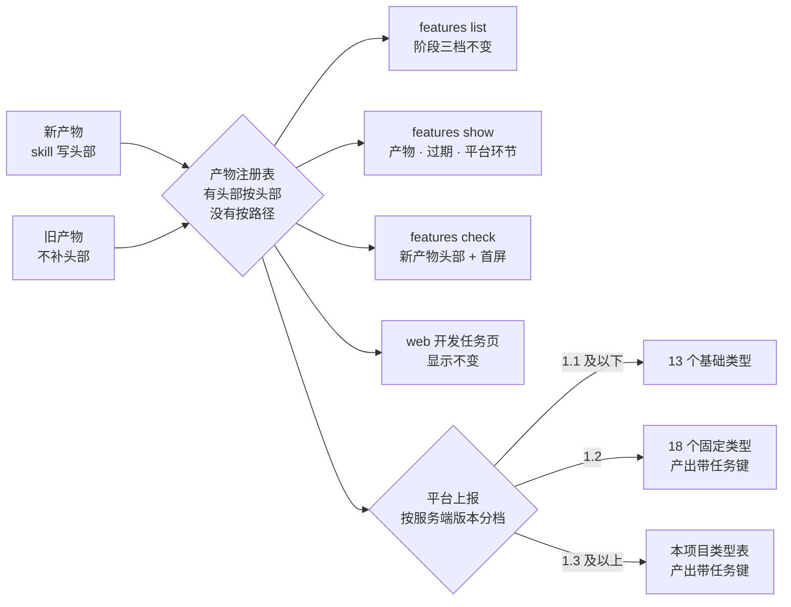

# 规格说明: 产物注册表与头部规范

> 产物: spec
> feature-id: 2026-10-18-产物注册表与头部规范
> 负责人: liulongfei
> 日期: 2026-10-18

## 一图看懂

产物有哪些类型、放在哪、头部写什么,只在一张**产物注册表**里定义。新产物由 skill 写统一头部(`> 产物:` 等),旧产物不动、按路径识别;`features list` 的阶段、web 开发任务页、平台上报都按这张表认产物。新增 `cgraphx features show <id>`:看一个产出目录有哪些产物、哪些因 spec 改动而过期、平台环节还缺什么;新增 `cgraphx features check`:校验新产物的头部与首屏。上报按服务端协议版本分三档,1.3 起按本项目类型表上报,平台没配置的类型在 `sync status` 里看得到、补配后自动补报。

平台协议见 cgraphx-server 仓库 `docs/client-integration/`(下称「平台协议」)。skill 模板的改写(写头部、首屏结论、发布记录步骤)与门禁接入归 `2026-10-18-skill瘦身`,它依赖本 spec 定下的头部格式与 `features check`。



| 场景 | 用户看到什么 | 例子 |
|---|---|---|
| 写完 plan 后 spec 又改了一条规则 | `features show` 把 plan 标为过期,给出 spec 新旧指纹 | `过期 plan/积分发放-index.md  spec 已变(3f9a1c2 → 8d0e4b1)` |
| 新写的 spec 没有 `> 产物:`,或首个二级标题不是「一图看懂」 | `features check` 列出文件、原因和改法,退出码非 0 | skill瘦身 接入门禁后,这次提交会被拦 |
| 已有的产出目录 | 照常识别,不要求补头部,不显示过期 | 「任务自动关联-spec.md」仍认成 spec |
| 连 1.3 服务端,写了交付讲解 | 按 `delivery_brief` 上报,带任务键 | 平台任务详情的「交付文档」环节出现「积分发放-交付讲解.md」 |
| 头部写 `> 产物: review_record`,项目没配置该类型 | 不上报;`sync status` 列为未上报产出;管理员补配后下一轮自动补报 | `未上报产出 review_record ×2(积分-评审记录.md 等)` |
| 连 1.1 服务端 | 只报 13 个基础类型,整批不会被拒 | 交付讲解、收口档案不上报 |
| 确认上线后写了发布记录 | 连 1.3 时平台任务显示「已发布」;本地阶段不变 | 平台阶段「已测试」→「已发布」 |
| 平台回执带告警 | `sync now` 逐条列出;后台同步收到的告警在 `sync status` 里能看到 | `binding_pending:任务键 2026-10-18-积分发放 尚未声明,该段挂起` |

## 1. 目标与范围

### 1.1 目标

让「这个文件是什么产物」只有一个答案:类型、路径规则、头部字段、首屏要求集中登记,本地视图与平台上报都从这一处派生。新产物带上类型、负责人与依据,spec 改动后能看出哪些下游产物过期。客户端按平台协议 1.2 / 1.3 准确声明产物类型——平台不解析内容,声明错了,完整度与阶段就照错的算。

### 1.2 包含范围

- 产物注册表:内置类型(§3.2)、识别规则(§3.3);features 阶段派生、web 产出分组、平台上报三处改读它(§3.4)。
- 头部规范:位置与格式、四个字段、各类产物的字段要求(§4)。
- 负责人口径收为一处(§5)。
- `> 依据:` 与过期判定(§6);首屏结论要求的登记与校验(§7)。
- 新命令 `cgraphx features show`(§8)、`cgraphx features check`(§9)。
- 平台协议 1.2 / 1.3 的客户端适配(§11);发布记录的产物契约(§12)。

### 1.3 非目标

- skill 模板改写(写头部、首屏结论、`/end` 的发布记录步骤、交付提示的环节提醒)与 `features check` 接入提交门禁:归 skill瘦身。
- 旧产物补头部、改名。
- 补报存量知识文件:平台资产页只列有任务归属的知识经验产出,补报无归属的产出在资产页上看不到。另向平台提需求「资产页纳入无归属的知识经验产出」,平台支持后客户端另立需求补报。
- 本地阶段改名(对齐平台的已设计 / 已测试)或新增「已发布」。
- web 页面改版;`features list` 新增列。
- 在本地计算平台的「实现」「知识经验」环节。
- 产出目录外的自定义类型(如 `docs/adr/`)。
- `> 需求:` 头部:平台需求由管理员给任务打标签,协议没有需求字段;业务编号在 feature-id 里。
- 在会话开始时提示回执告警。
- 校验 UI 截图与结果 JSON 是否在同一个 commit 提交(平台协议的要求;提示归 run-ui-test 模板)。

## 2. 术语

| 术语 | 含义 |
|---|---|
| 产物 | 研发流程产出的文档类文件,按类型登记在注册表;代码不是产物(平台由 commit 承载) |
| 类型标识 | 平台 `type` 的取值,如 `spec`、`plan`;规则同平台:小写字母、数字、下划线,长 1–64 |
| 内置类型 | 注册表登记的类型,带路径规则(§3.2) |
| 本地专用类型 | 只在本地识别、任何档位都不上报的内置类型;目前只有交接文件 `handoff` |
| 项目自定义类型 | 头部写了合法类型标识、但不是内置类型;由平台项目管理员在本项目类型表里配置 |
| 产出目录 | `docs/features/<feature-id>/`,一个任务的产出 |
| 主 spec | 产出目录顶层、类型为 `spec` 的文件;多个时按 §5 取一个 |
| 派生产物 | 依据主 spec 写出的产物,头部带 `> 依据:`(§4.3) |
| 头部 | 产物开头的 `> 字段: 值` 行块(§4.1) |
| spec 指纹 | 主 spec 当前内容的哈希前缀(§6.1) |
| 过期 | 派生产物记录的 spec 指纹与主 spec 当前指纹不一致 |
| 新产物 | 当前 HEAD 里还没有的产出目录文件(未跟踪,或只在暂存区) |
| 首屏结论 | 产物开头先给出的结论节,如 spec 的「一图看懂」 |
| 服务端档位 | 按同步状态里记录的服务端协议版本划分的能力档位(§11.1) |
| 可上报类型集合 | 当前档位下允许发送的类型(§11.1) |

## 3. 产物注册表

### 3.1 登记内容

每个内置类型登记:类型标识、显示名、路径规则(可多条,含旧名)、头部字段要求(§4.3)、默认平台环节(取平台默认类型表,只供 `features show` 展示,不上报)、起始上报档位、计入的本地阶段里程碑(§10)、首屏结论要求(§7)。负责人来源(主 spec → 交接文件,§5)也由注册表定义。注册表是这些口径的唯一定义处,别处不得另写一份。

### 3.2 内置类型

`<目录>` = `docs/features/<feature-id>/`;`*` 为任意不含 `/` 的文件名前缀。

| 类型标识 | 显示名 | 路径规则 | 默认环节 | 起始上报档位 |
|---|---|---|---|---|
| `spec` | 规格说明 | `<目录>/*-spec.md`、`<目录>/spec.md`(不含下列各类测试规格) | 设计 | 1.0 |
| `wireframe` | 线框 | `<目录>/*-线框-v<N>.html` | 设计 | 1.0 |
| `prd` | 需求文档 | `<目录>/*-需求文档.md` | 设计 | 1.2 |
| `design_doc` | 设计文档 | `<目录>/*-设计文档.md`、`<目录>/*-设计文档.html` | 设计 | 1.2 |
| `plan` | 实现计划 | `<目录>/plan/` 下的文件 | 规划 | 1.0 |
| `api_test_spec` | 接口测试规格 | `<目录>/*-接口测试-spec.md`;旧名 `<目录>/*-api-spec.md` | 测试 | 1.0 |
| `api_test_report` | 接口测试报告 | `<目录>/*-接口测试报告.md`;旧名 `<目录>/*-测试报告.md`;`<目录>/*-接口测试验证.jsonl` | 测试 | 1.0 |
| `unit_test_spec` | 单元测试规格 | `<目录>/*-单元测试-spec.md` | 测试 | 1.0 |
| `unit_test_report` | 单元测试报告 | `<目录>/*-单元测试报告.md` | 测试 | 1.0 |
| `ui_test_spec` | UI 测试用例规格 | `<目录>/ui功能测试/*-ui功能测试-spec.md` | 测试 | 1.0 |
| `ui_test_report` | UI 测试报告 | `<目录>/ui功能测试/` 下的 `*-ui功能测试报告.xlsx`、`*-ui功能测试报告.md`(存量)、`*-ui功能测试结果.json` | 测试 | 1.0 |
| `release_record` | 发布记录 | `<目录>/*-发布记录.md` | 发布 | 1.3 |
| `knowledge` | 知识库 | `docs/knowledge/` 下的文件 | 知识经验 | 1.0 |
| `code_map` | 代码地图 | `docs/code-map/` 下的文件 | 知识经验 | 1.0 |
| `design_map` | 设计地图 | `docs/design-map/` 下的文件 | 知识经验 | 1.0 |
| `schema_knowledge` | 表结构知识 | `docs/schema-knowledge/` 下的文件 | 知识经验 | 1.0 |
| `delivery_brief` | 交付讲解 | `<目录>/*-交付讲解.md` | 交付文档 | 1.2 |
| `closure_record` | 收口档案 | `<目录>/*-收口档案.md` | 交付文档 | 1.2 |
| `api_doc` | 接口文档 | `<目录>/*-接口文档.html` | 交付文档 | 1.2 |
| `handoff` | 交接文件 | `<目录>/*-交接提示词.md` | —(本地专用) | 不上报 |

- 路径规则按后缀从具体到一般匹配:各类测试规格先于 `spec`;`-接口测试报告.md` 与旧名 `-测试报告.md` 都认。
- `ui功能测试/` 下的截图不是产物:平台从结果 JSON 读截图(平台协议「UI测试结果格式」)。
- 产出目录里不命中任何规则、也没有合法头部的文件不是产物(如 `实测/*.json`、`验收记录.md`):不上报、不参与阶段,`features show` 列为「其他文件」。

### 3.3 识别规则

| 文件 | 规则 |
|---|---|
| 产出目录内(任意深度)的 md / html | 头部有合法 `> 产物:` → 按头部类型;否则按路径规则 |
| 产出目录内的其他文件(xlsx、json、jsonl 等) | 只按路径规则 |
| 产出目录外 | 只按路径规则(四个沉淀目录);头部不生效 |

| `> 产物:` 的取值 | 结果 |
|---|---|
| 内置类型标识 | 该类型 |
| 合法类型标识,但不是内置类型 | 项目自定义类型(上报见 §11.2) |
| 不合法(含大写、中文、空值等) | 视为没写,退回路径规则 |

- 头部类型与路径规则结果不一致时,以头部为准。
- 本地专用类型 `handoff` 在任何情况下都不上报,即使平台本项目类型表里有同名类型。

### 3.4 三处口径改读注册表

| 使用方 | 改读什么 | 用户可见行为 |
|---|---|---|
| features 阶段派生 | 各阶段里程碑对应的类型与文件(§10) | 不变;新产物按头部识别也能计入 |
| web 开发任务页的产出分组 | 「需求文档 / 知识库 / 数据库结构 / 业务图」四组的目录判定;「接口测试」(`docs/bruno/`)、`.sql` 归「数据库结构」、其余归「代码」的判定不变 | 不变 |
| 平台上报 | 类型识别、可上报类型集合(§11) | 见 §11.5 |

## 4. 头部规范

### 4.1 位置与格式

md:第一个一级标题之后的第一组连续引用行;标题与引用行之间可以有空行,遇到非引用、非空的行即结束。文件开头的 YAML frontmatter(如收口档案)不影响,头部仍在一级标题之后。

```markdown
# 实现计划: 积分发放

> 产物: plan
> 依据: spec@3f9a1c2
```

html:文件前 30 行内、第一个含 `> 字段: 值` 行的 HTML 注释,注释内的写法与 md 相同。

```html
<!--
> 产物: api_doc
> 依据: spec@3f9a1c2
-->
```

- 字段与值之间用半角或全角冒号都认;同一字段出现多次取第一条。
- 头部里的其他字段(`> feature-id:`、`> 日期:`、`> 主任务:` 等)照旧可写,注册表与校验不管。
- `> 产物:`、`> 依据:` 只从头部读。`> 负责人:`、`> 任务:` 在带 `> 产物:` 的文件里只从头部读;不带 `> 产物:` 的旧文件沿用现行口径(在文件前 30 行内查找,取值规则不变)。

### 4.2 字段

| 字段 | 取值 | 规则 |
|---|---|---|
| `> 产物:` | 类型标识,如 `spec`、`plan`、`review_record` | 合法性见 §3.3 |
| `> 负责人:` | 负责人本人的 `git config user.name`,逐字一致 | 只在主 spec、交接文件上生效(§5) |
| `> 任务:` | 平台任务编号 `T-<n>` | 可选;只在主 spec 上生效;只在关联平台上已有的任务时写 |
| `> 依据:` | `spec@<指纹>` | 指纹见 §6.1;只指向本产出目录的主 spec |

### 4.3 各类产物的字段要求(新产物)

| 产物 | 产物 | 负责人 | 任务 | 依据 |
|---|---|---|---|---|
| 主 spec | 必填 | 必填 | 可选 | — |
| 交接文件 | 必填 | 必填 | — | — |
| plan(index 与各分文件,md) | 必填 | — | — | 必填 |
| 接口 / 单元 / UI 测试规格 | 必填 | — | — | 必填 |
| 测试报告(md) | 必填 | — | — | 必填 |
| 交付讲解、收口档案 | 必填 | — | — | 必填 |
| 需求文档、设计文档、接口文档 | 必填 | — | — | 必填 |
| 发布记录、线框 | 必填 | — | — | — |
| 项目自定义类型 | 必填 | — | — | — |
| xlsx / json / jsonl 产物 | 无头部,按路径识别 | | | |
| 知识库、代码地图、设计地图、表结构知识 | 不加头部,按目录识别 | | | |

- 「依据 必填」只在产出目录有主 spec 时成立;没有主 spec 的目录不要求。
- 负责人与任务是整个产出目录的属性,只写一处;其他产物上多写的 `> 负责人:` / `> 任务:` 不生效。
- 旧产物(HEAD 里已有、头部没有 `> 产物:` 的文件)不补头部,永久按路径识别,不参与过期判定。

## 5. 负责人与任务口径

- 产出目录负责人 = 主 spec 的 `> 负责人:`;主 spec 不存在或没写 → 交接文件的 `> 负责人:`(多个交接文件按文件名长度升序、同长按字典序取第一个);都没有 → 无负责人。
- `features list`(含 `--mine`、`--owner`)、`features sync`、`features show`、任务负责人判定与任务声明共用这一口径。`features list` 不再回退到 plan index 头部:只有 plan、没有主 spec 和交接文件的目录,负责人显示 `-`,也不生成目录任务。
- 主 spec 的认定:产出目录顶层、类型为 `spec` 的文件(按 §3.3 识别,测试规格不算);多个时按文件名长度升序、同长按字典序,取第一个读得出负责人的,都读不出取第一个。
- `> 任务:` 只读主 spec,行为不变。

## 6. 依据与过期

### 6.1 spec 指纹

- 指纹 = 主 spec 当前内容按 git 文件内容哈希算出的十六进制串,与 `git hash-object <主 spec>` 结果一致;包括工作区里尚未提交的修改。
- 头部写 `spec@` + 指纹前 7 位(可多写,7–40 位);比对时按前缀匹配当前完整哈希。
- `features show` 显示主 spec 当前指纹,供写依据时取用。那一版 spec 提交过的话,能用指纹在 git 历史里找回原文、对比改动。

### 6.2 过期判定

| 情况 | 结果 |
|---|---|
| 记录的指纹与主 spec 当前指纹一致 | 未过期 |
| 不一致(含未提交的修改、改错别字) | 过期,显示「spec 已变(旧 → 新)」 |
| 产出目录没有主 spec | 不判定,显示「无主 spec」 |
| `> 依据:` 格式不合法 | 不判定,显示「依据格式不对」 |
| 产物没有 `> 依据:`(旧产物、不需要依据的类型) | 不判定 |

### 6.3 过期的后果

只在 `features show` 标出、`features check` 给警告;不拦提交,不影响阶段与上报。复核后把依据改成当前指纹即解除。每次查询时实时比对,不落盘。

## 7. 首屏结论

每类产物开头先给结论。要求登记在注册表;校验由注册表驱动:某类型登记了首屏标题,新产物就按「首个二级标题必须是该标题」校验;新增类型只需登记,不改校验逻辑。

| 产物 | 首屏先给的结论 | 校验 |
|---|---|---|
| spec | 「一图看懂」:做完之后用户看到什么、能做什么 | 本任务启用:首个二级标题为「一图看懂」 |
| plan index(`plan/` 下的 index 文件) | 「设计预览」:架构、主流程、数据结构、关键取舍 | 本任务启用:首个二级标题为「设计预览」 |
| 交接文件 | 本任务范围与下一步 | skill瘦身 落模板后登记 |
| 测试规格(接口 / 单元 / UI) | 覆盖范围:测哪些功能点或场景、各多少条 | 同上 |
| 测试报告(md) | 结论:通过 / 失败 / 跳过各多少,能否交付 | 同上 |
| 交付讲解 | 一句话交付了什么,加改动全景 | 同上 |
| 收口档案 | 历时与实际投入、交付结论 | 同上 |
| 需求文档 | 一句话需求,加业务流程图 | 同上 |
| 设计文档 | 架构总览与关键取舍 | 同上 |
| 接口文档 | 接口清单:方法、路径、用途 | 同上 |
| 发布记录 | 版本号或 tag、上线时间 | 同上 |

线框、xlsx / json / jsonl 产物不设首屏结论。

## 8. `cgraphx features show <feature-id>`

一个产出目录的全貌。每次实时计算,不写任何文件。

- 参数:feature-id 先精确匹配,没有再按子串匹配;唯一命中即展示,多个命中列出候选并以非 0 退出,无命中提示用 `features list --q` 查找。可选 `[project-path]`、`--json`(内容与文本输出相同)。
- 输出四段:

| 段 | 内容 |
|---|---|
| 概要 | feature-id、负责人(无则 `-`)、任务(`> 任务:` 的值,没有不显示)、本地阶段(§10)、主 spec 当前指纹 |
| 产物 | 每个产物一行:类型(显示名 + 标识;自定义类型只显示标识)、目录内相对路径、识别方式(头部 / 路径)、依据状态(§6.2;不需要依据的显示 `—`) |
| 平台环节 | 按默认类型表把产物归到 设计 / 规划 / 测试 / 发布 / 交付文档:有产物列出,没有显示 `—`;任务类型按「需求开发」估,必需环节(设计、测试)没有产物时显示「✗ 缺(必需)」;实现、知识经验写「由 commit 和会话承载,以平台为准」;项目自定义类型单列「环节以平台配置为准」;本地专用类型不进环节 |
| 其他文件 | 产出目录里不是产物的文件(可按子目录合并计数) |

```text
$ cgraphx features show 2026-10-18-积分发放
feature-id  2026-10-18-积分发放
负责人      liulongfei
阶段        已规划
spec 指纹   8d0e4b1

产物
  规格说明 spec      积分发放-spec.md          路径
  实现计划 plan      plan/积分发放-index.md    头部   过期:spec 已变(3f9a1c2 → 8d0e4b1)
  交接文件 handoff   积分发放-交接提示词.md    头部   —

平台环节(按默认类型表;任务类型按「需求开发」估)
  设计      ✓  积分发放-spec.md
  规划      ✓  plan/积分发放-index.md
  测试      ✗  缺(必需)
  发布      —
  交付文档  —
  实现、知识经验:由 commit 和会话承载,以平台为准
```

## 9. `cgraphx features check [目标...]`

校验新产物的头部与首屏,供门禁或 hook 调用(接入归 skill瘦身)。每次实时计算,不写任何文件。

- 参数:不带目标时校验全部产出目录;目标可以是一个或多个 feature-id 或文件路径;项目根按当前目录解析,与其他 features 命令一致;`--json` 输出同样内容。
- 校验对象:产出目录内识别为产物(§3.3)、能写头部的 md / html 文件;其他文件不查。
- 新产物 = 当前 HEAD 里还没有的文件(未跟踪,或只在暂存区)。

| 级别 | 情况 |
|---|---|
| 失败 | 新产物没有合法的 `> 产物:` |
| 失败 | 新的主 spec / 交接文件没有 `> 负责人:` |
| 失败 | 新的派生产物没有 `> 依据:`,或不是 `spec@<7–40 位十六进制>`(产出目录有主 spec 时) |
| 失败 | 新的主 spec 写了 `> 任务:`,但不是 `T-<n>` |
| 失败 | 新产物属于已启用首屏校验的类型(§7),首个二级标题不是登记的标题 |
| 失败 | HEAD 里已有、带 `> 产物:` 的文件,已写字段(产物、依据、任务)格式不合法 |
| 警告 | 产物过期(§6) |
| 警告 | 未知类型:既不是内置类型,也不在最近一次从平台拉到的本项目类型表里(从没拉到过时只按内置类型判断) |
| 警告 | 头部类型与文件名规则不一致 |
| 不查 | HEAD 里已有、头部没有 `> 产物:` 的旧文件 |

- 每条结果给出文件、原因和改法(如「补 `> 产物: spec`」「依据改为 `spec@8d0e4b1`」)。
- 退出码:有失败为 1;只有警告或全部通过为 0;目标指向的目录或文件不存在为 2。
- 不在 git 仓库内时无法区分新旧,所有文件按「HEAD 里已有」处理:只查带 `> 产物:` 的文件的字段格式。

## 10. 本地阶段派生

阶段名、优先级(已验证 > 已规划 > 已规格)、`--stage` 取值不变;里程碑文件改由注册表识别,新产物按头部识别也能计入。

| 阶段 | 产出目录里有 |
|---|---|
| 已验证 | 测试报告:`api_test_report`、`unit_test_report` 的 md 报告(含旧名),`ui_test_report` 的 xlsx / md 报告;结构化结果(json、jsonl)不算 |
| 已规划 | `plan/` 下的 index 文件(`*-index.md` 或 `index.md`) |
| 已规格 | 顶层的规格类文件:`spec`、`api_test_spec`、`unit_test_spec`(沿用现行口径) |
| 未规格(显示 `-`) | 以上都没有 |

## 11. 平台上报

### 11.1 服务端档位

档位取同步状态里最近一次记录的服务端协议版本(`connect` / `ingest` 响应),按「主.次」数值比较;版本缺失按 1.0。

| 档位 | 可上报类型集合 | 产出任务键 | `/spec` |
|---|---|---|---|
| 1.1 及以下 | 13 个基础类型(起始上报档位为 1.0 的类型) | 不带 | 不调用 |
| 1.2 | 18 个固定类型(默认类型表去掉 `release_record`) | 带 | 不调用 |
| 1.3 及以上 | 最近一次 `/spec` 返回的本项目类型表;本轮拉取失败时为 19 个默认类型 | 带 | 每轮同步前刷新 |

- 本地专用类型在任何档位都不在集合内。
- 只发送类型在集合内的产出;集合外的不发送,记为「未上报产出」(§11.4)。
- 产出的 `type` 字段由 13 类枚举放宽为字符串;产出不带环节字段。

### 11.2 项目自定义类型

头部声明的项目自定义类型,只在档位 ≥ 1.3 且该类型在本项目类型表里时上报;否则不发送,记为未上报产出。

### 11.3 `/spec`

- 时机:档位 ≥ 1.3 时,接入成功后拉一次,之后每轮同步上报前刷新。
- 只用其中的本项目类型表(类型标识、显示名、所属环节);遇到不认识的环节标识忽略。
- 拉取失败(404、网络错误、任何错误码、响应不合法):本轮按 19 个默认类型上报;不暂停、不计为同步失败。
- 记入同步状态:类型数、最近成功刷新时间。

### 11.4 告警与未上报产出

- `sync now`:逐条列出本轮收到的告警。
- `sync status`:
  - 最近一次收到告警的时间与明细。前台、后台同步收到的都记录;新一轮收到告警时替换,没收到告警的轮次不清空。
  - 当前的未上报产出,按类型汇总(类型标识、条数、一条示例路径),提示「请联系项目管理员配置该产物类型」。
  - 档位 ≥ 1.3 时显示本项目类型数与最近刷新时间。
- 接入(`sync connect`)时清空告警与未上报产出的记录。

| 告警 | 显示 |
|---|---|
| `binding_ineffective` | 绑定段未生效(任务不存在 / 不能归属 / 已关闭),附 bindingId |
| `path_dropped` | 路径不安全,平台已丢弃,附路径 |
| `binding_pending` | 任务键尚未声明,该段挂起,附任务键 |
| `task_key_declared_by_other` | 任务键已由他人声明,本人会话按协作计入 |
| `task_declaration_invalid` | 任务声明不合法,已丢弃,附原因 |
| `artifact_type_unknown` | 本项目未配置该产物类型,这条产出已丢弃,附类型与路径,提示联系项目管理员 |
| 其他(将来新增) | 原样显示种类与字段 |

### 11.5 映射变化(相对现状)

| 对象 | 现状 | 改后 |
|---|---|---|
| UI 截图 `ui功能测试/*.png` | 按 `ui_test_report` 上报 | 不再上报 |
| 旧名接口测试规格 `*-api-spec.md` | 误报为 `spec` | 按 `api_test_spec` 上报 |
| 无前缀的 `spec.md` | 不上报 | 按 `spec` 上报 |
| 交付讲解、收口档案、接口文档、需求文档、设计文档 | 不上报 | 档位 ≥ 1.2 时按对应类型上报 |
| 发布记录 | — | 档位 ≥ 1.3 且在本项目类型表里时按 `release_record` 上报 |
| 头部声明了类型的文件 | 按路径 | 按头部类型 |
| 产出目录内产出的任务键 | 不带 | 档位 ≥ 1.2 时带 `taskKey` = 所在产出目录的 feature-id;只作平台「跨任务产出」提示,不影响归属,与 `> 任务:` 无关;目录外的产出不带 |

已上报到平台的截图记录保留(协议没有删除),只是不再新增。

### 11.6 重新评估与补报

以下变化发生后,下一轮同步重新评估全部会话的产出,只重报内容有变化的会话,用户不用做任何事:

| 变化 | 例子 |
|---|---|
| 服务端档位变化 | 服务端从 1.1 升到 1.2:历史会话里的交付讲解补报 |
| 本项目类型表变化 | 管理员补配 `review_record`:此前未上报的评审记录补报 |
| 升级 cgraphx 带来的映射变化 | 已上报会话的产出里去掉截图;新登记的类型补报 |

平台按(会话, 类型, 路径)幂等,重报不重复计数。被 `artifact_type_unknown` 丢弃的产出,在类型补配后经由上面的重新评估补报。

### 11.7 不变

- 上报对象逐字段正向构造;新增的上报字段只有产出 `taskKey`。
- 交接文件不上报;代码不作为产出;产出不带环节。
- `commitHash`、`action`、`ts` 等其余字段口径不变;UI 测试结果 JSON 的格式不变(已符合平台公开格式 v1)。

## 12. 发布记录

| 项 | 契约 |
|---|---|
| 文件 | `<目录>/<前缀>-发布记录.md`,头部 `> 产物: release_record` |
| 内容 | 至少有版本号或 tag、上线时间;可附关联 commit、分支、发布说明;同一任务多次发布,追加在同一文件 |
| 生成 | 只有确认已上线才写:平台只看类型,写了任务就显示「已发布」;没上线不写;发布晚于收口的,之后单独补写。由 `/end` 收口时询问并生成(模板改动归 skill瘦身) |
| 上报 | 档位 ≥ 1.3 且在本项目类型表里时上报 |
| 本地 | 阶段不变;`features show` 的平台环节「发布」列出该文件 |

## 13. 兼容性

| 对象 | 要求 |
|---|---|
| 已有产出目录文件 | 不改名、不补头部;按路径永久识别;不参与过期判定;`features check` 不查 |
| `features list` | 列、阶段名、`--stage` 取值不变;阶段结果与改前一致(新产物按头部识别的除外);负责人去掉 plan index 兜底 |
| web 开发任务页 | 产出分组与标签不变 |
| 平台协议 | 只用已发布字段;产出 `taskKey` 与新类型按档位发送 |
| 1.1 及以下服务端 | 只发 13 个基础类型,不带产出任务键;与现状的差别只在 13 类之内:截图不再上报,旧名 `-api-spec.md` 改按 `api_test_spec`、无前缀 `spec.md` 按 `spec` 上报,头部声明了类型的文件按头部类型上报 |
| 本地库 | 新增状态只放进 sync 自有的表或字段,不升 timeline / task / markdown 的 schema 版本;旧版全局 cgraphx 打开库不报错 |

## 14. 异常与边界

| 场景 | 行为 |
|---|---|
| `> 产物:` 不合法(大写、中文、空值) | 视为没写,按路径识别;新产物 check 失败 |
| 头部类型与文件名规则不一致 | 以头部为准;check 警告 |
| 产出目录外的文件写了头部 | 不生效,按路径识别 |
| 产出目录没有主 spec | 派生产物不要求依据;show 显示「无主 spec」,不判过期 |
| 有多个主 spec 候选 | 按 §5 取一个,依据指向它 |
| 依据的指纹在 git 历史里找不到 | 照常按不一致判过期 |
| 头部读取失败(权限、编码) | 当作没有头部,按路径识别 |
| 同步时文件已删除 | 按路径识别;从未进 commit 的已删文件不上报(现行) |
| `/spec` 返回空类型表 | 本轮不发送任何产出,全部记为未上报产出 |
| `/spec` 返回不认识的环节标识 | 忽略 |
| 自定义类型,档位低于 1.3 | 不上报,记为未上报产出 |
| 平台类型表里有 `handoff` | 交接文件仍不上报 |
| `features show` 的 feature-id 不存在 | 提示用 `features list --q` 查找,退出码非 0 |

## 15. 验收标准

1. **唯一事实源**:同一文件在 `features show`、本地阶段、web 产出分组、平台上报中的类型判断一致;改注册表一处,各处同时生效。
2. **旧产物零变化**:本仓库 `docs/features/` 下现有全部目录,`features list` 的阶段与负责人与改前一致。
3. **头部识别**:新建 `<目录>/积分-回归记录.md`,头部 `> 产物: unit_test_report` → `features show` 识别为单元测试报告(识别方式「头部」),阶段变为已验证。
4. **过期**:plan 写入当前指纹 → 未过期;spec 改一个字(不提交)→ `features show` 标过期并显示新旧指纹;依据改为新指纹 → 不再过期。
5. **check 头部**:新 spec 缺 `> 产物:` → 退出码 1,指出文件与改法;补齐后 → 0;HEAD 里已有、没有 `> 产物:` 的旧 spec 不报;只有过期时退出码 0。
6. **check 首屏**:新 spec 的首个二级标题不是「一图看懂」、新 plan index 的不是「设计预览」→ 失败。
7. **负责人一致**:同一目录在 `features list --mine` 与任务负责人判定中负责人相同;只有 plan 的目录显示 `-`。
8. **档位**:模拟 1.1 服务端,只发 13 个基础类型、不带产出任务键;1.2 发 18 类、带任务键、不调 `/spec`;1.3 调 `/spec` 并按本项目类型表过滤,自定义类型在表里才发;`/spec` 返回 404 时按 19 类发送,同步成功。
9. **映射**:截图不再上报;`*-api-spec.md` 按 `api_test_spec` 上报;交付讲解在 1.2 下按 `delivery_brief` 上报并带任务键。
10. **告警可见**:回执带告警 → `sync now` 逐条列出;后台同步后 `sync status` 显示告警明细;`artifact_type_unknown` 带「联系项目管理员」提示。
11. **补报**:类型表不含 `review_record` → 不发送,`sync status` 显示为未上报产出;类型表加入后,下一轮同步在没有新事件的情况下也补报该产出。
12. **档位升级补报**:同步状态的协议版本从 1.1 变为 1.2 后,下一轮补报历史会话里的交付讲解。
13. **发布记录**:`*-发布记录.md` 在 1.3 下按 `release_record` 上报,在 1.2 下不发送;本地阶段不变。
14. **show 输出**:四段齐全;`--json` 含同样内容。

## 16. Plan 编写约束

- 分层:注册表不得依赖 task / sync / timeline / db;features 仍不建库,不得依赖 task / sync。`features check` 要读的本项目类型表,其存取方式不能让 features 引用 sync,方案由 plan 定。
- 取消「平台上报的产物映射与本地 web 产出分类相互独立、不得互相引用」的旧约束:两者都改为依赖注册表,各自不再写死路径规则。
- 校验逻辑由注册表驱动:新增类型或首屏标题只改登记,不改校验逻辑。
- 对 1.1 及以下服务端绝不发送 13 个基础类型以外的类型(会整批 `validation_failed`,会话被隔离);三个档位都要有测试覆盖。
- 同步的候选判定目前只看新事件、绑定变化、待推送;§11.6 的三类变化必须能触发重新评估,否则补报不会发生。
- 路径规则保留全部旧名后缀;「测试报告」少匹配一个后缀,就会漏派生「已验证」。
- 白名单正向构造与发送前的路径安全断言不变。
- 不升 timeline / task / markdown 的 schema 版本;新运行时资产(如有)登记进 `scripts/copy-assets.cjs`。
- 执行方式:实现交给其他 agent 或第三方模型,每批一个会话跑 `/implementation`,全部完成后回 Claude 做 `/code-review`;plan 的每个任务要自包含,并附每批的执行会话启动语。
- 交付收尾时更新知识库「features 需求阶段派生」「平台上报」两条:「产物类型只按路径映射」「映射表只在一处定义」等表述会改变。

## 17. 不可留到实现期的决策

以下已在本 spec 锁定,plan 与实现不得改动:头部的位置、格式与字段读取范围(§4.1);各类产物的字段要求(§4.3);内置类型、路径规则与识别优先级(§3);负责人与主 spec 的认定(§5);指纹算法、依据格式与过期判定(§6);首屏校验的启用范围(§7);新产物的定义、失败与警告的划分、退出码(§9);本地阶段里程碑(§10);服务端档位、可上报类型集合、`/spec` 失败时的退路、任务键语义、重新评估的触发条件(§11);发布记录契约(§12)。

## 18. 待确认项

1. 平台侧需求「资产页纳入无归属的知识经验产出」何时、由谁在 cgraphx-server 提出;本任务不依赖它。
