# 规格说明: 版本流程与需求副本

> 产物: spec
> feature-id: 2026-10-27-版本流程与需求副本
> 负责人: liulongfei
> 日期: 2026-10-27

## 功能方案

> 原样收录 clarify 终确认的功能方案;业务要变,回 clarify 改,再同步这一节。
> 本需求负责 F1~F4、F7~F10;F11 Claude Code 记忆迁进知识库归 `2026-10-27-记忆迁进知识库`,编号沿用讨论稿。

**一句话**:原来发版时各需求的提交糅在一个分支上，审核看不出有没有夹带，冲突也难解;几个 agent 并行时，改动还会落到同一个分支。这次加一套可选的流程：每个版本开一个版本分支，每个需求在自己的写时复制副本里做、做完合入，发版前出一份审核报告再合进主干;副本里的会话和提交照样记进主项目。另外加一条命令，把 Claude Code 的自动记忆迁进知识库，然后关掉自动记忆。

**业务口径**

| 编号 | 口径 | 怎么判定 | 算 / 不算(例子) | 依据 |
|---|---|---|---|---|
| K1 | 副本 | 经 F7 开出、在主目录登记过的目录 | 算:cgraphx@订单导出;不算：自己用 cp 复制的目录、git worktree | 新定 |
| K2 | 副本里的会话 | 会话开始时所在的目录在副本里 | 在 cgraphx@订单导出 里开的会话算，中途 cd 到别处也还算;在主目录开、只读过副本里文件的不算 | timeline 每条记录都带所在目录;新定 |
| K3 | 已合入 | 需求分支自己做过提交(开副本以后在这个分支上做的;同步进来的不算),而且这些提交都已经在它要合入的分支里(开了版本是 dev/2.0.11,没开是 main) | 合入后没再提交 → 已合入;合入后只在副本里同步过 → 仍是已合入;合入后又提交了 1 笔 → 未合入，差 1 个提交;刚开出来还没提交过(同步过也一样)→ 不算已合入，是「还没有提交」 | git 能直接判断;开副本时登记当时的提交(D19);新定 |
| K5 | 疑似夹带 | 本版本里没声明、又不属于所在需求的改动 | 算：直接提交在 dev/2.0.11 上、不是 chore(release): 开头的提交(绕过了拦截);订单导出的合入里改了积分发放需求目录下的文件;订单导出的合入改了 src/points/ 下的积分代码，而它 plan 的「涉及范围」只有 src/order/(没有 plan 的按 spec 写到的模块判)。不算:chore(release): 开头的提交(单列为「已声明的版本级提交」);开版本前已进主干的提交(单列);版本开发期间从主干同步进来的提交(单列为「同步主干」);本需求自己的需求目录，以及知识库、DDL 知识、本需求的接口测试用例这类流程产物;plan 和 spec 都没写范围的需求，报告标「未声明范围」,不判夹带 | 沿用 F3 报告示例和 F8 边界 ①;plan 的任务清单本来就列每个任务的涉及范围;新定 |
| K6 | 敏感改动 | 改了表结构、依赖清单或配置的文件 | 算:.sql 文件;package.json、pom.xml 这类依赖清单;.env、.env.example 这类配置。不算：只改代码和文档 | 沿用 F3 报告示例;新定 |
| K7 | 缺陷 | 本版本合入的需求，测试报告里没通过的用例;加上需求第一次合入之后的修复 | 算：订单导出接口测试报告里 2 个没通过的用例;订单导出第 2 次合入带进来的 fix 提交。不算：第一次合入前、开发过程中的 fix 提交(如 /dev-impl-subagent 统一验证后的修复);需求缺测试报告(记进风险) | 接口、单元、UI 三种测试报告已登记在产物注册表;/dev-impl-subagent 统一验证后的修复按规定提交成 fix(<scope>);新定 |
| K8 | 版本分支 | 名字是「dev/数字.数字.数字」的分支 | 算:dev/2.0.11、dev/2.1.0;不算:dev/zhangsan、develop、main | F1 开出的分支都是这个格式;新定 |
| K9 | 没提交的改动 | 改了没提交的已跟踪文件，加上新建了没被 git 跟踪的文件;被 git 忽略的不算 | 算：改了 src/order/routes.ts 没提交;新建的 src/order/export.ts 还没 git add。不算:.env、node_modules 这类被忽略的。副本合入、删除前按 K9 查;主目录这一侧只查改了没提交的已跟踪文件，没被跟踪的新文件不拦，也不带进副本 | git 能直接列出;新定 |

**用户会这样用**(以开了版本为例;标黄的是这次新增的)

```mermaid
%%{init: {"theme": "base", "themeVariables": {"primaryColor": "#F1F1F1", "primaryBorderColor": "#181818", "primaryTextColor": "#000000", "lineColor": "#181818", "clusterBkg": "#FFFFFF", "clusterBorder": "#181818", "edgeLabelBackground": "#FFFFFF"}, "flowchart": {"curve": "stepAfter"}}}%%
flowchart TB
  subgraph 系统
    o1(打 tag v2.0.10<br/>拉出 dev/2.0.11):::changed
    o2("复制出副本 cgraphx@订单导出<br/>拉出 feat/订单导出 登记归属"):::changed
    o3(会话和提交记进主项目<br/>归到订单导出):::changed
    o4(预演合并<br/>合入 dev/2.0.11):::changed
    o5(出发版审核报告并提交):::changed
    o6(合入 main):::changed
  end
  subgraph 你在副本里
    c1(到副本目录开新会话):::changed
    c2(澄清 spec 实现 code-review)
  end
  subgraph 你在主目录
    s((" ")):::start --> u1(发完 2.0.10<br/>输入 /release-start):::changed
    u2(输入 /dev-start 订单导出):::changed
    u3(输入 /dev-merge 订单导出):::changed
    u4(发版那天先改好版本号<br/>再输入 /release-review):::changed
    u5(看结论 说发):::changed
    r1([发布 2.0.11<br/>清理已合入的副本 再开下个版本])
  end
  u1 --> o1 --> u2 --> o2 --> c1 --> c2 --> o3 --> u3 --> o4 --> u4 --> o5 --> u5 --> o6 --> r1
  classDef start fill:#181818
  classDef changed fill:#FFF3B0
```



**功能点**

| 编号 | 功能点 | 类别 | 行为链(已锁定) | 边界 | 落地依据 |
|---|---|---|---|---|---|
| F1 | 开版本 | 核心 | 发完 2.0.10,在 main 上输入 /release-start → 读出 package.json 里的版本号 2.0.10 → 在 main 当前提交上打 tag v2.0.10(说明「发布 2.0.10」)→ 拉出 dev/2.0.11(K8)并切过去 → 回报「已打 v2.0.10,开始 2.0.11」;tag 和分支只建在本地，推不推远程由你定 | ① 不在 main 上，或工作区有改了没提交的文件 → 停下，不打 tag、不建分支(没被跟踪的新文件不拦) ② v2.0.10 已经存在 → 不重打，直接用 ③ 上个版本分支 dev/2.0.10 还没合进 main → 停下「dev/2.0.10 还没发，先跑 /release-review」 ④ 仓库里一个 tag 都没有 → 默认打在最近一次改版本号的提交上，打之前给你确认 ⑤ 读不到版本号 → 问你刚发的版本号 ⑥ 下个版本号默认末位加一，你说「下个版本是 2.1.0」就开 dev/2.1.0 ⑦ 下个版本分支 dev/2.0.11 已经存在、已合进 main(发 2.0.11 前没改版本号，读到的还是 2.0.10)→ 停下「dev/2.0.11 已经发过了，版本号还是 2.0.10:发版前没改版本号?」 | package.json 版本 2.0.10;仓库里 0 个 tag;最近一次改版本号是 3f7f4f6,之后 main 上还有 9 个提交(正是边界 ④) |
| F2 | 需求合入 | 核心 | 需求在自己的副本(K1)里、在 feat/订单导出 上做 → 做完、/code-review 过了，在主目录的会话里输入 /dev-merge 订单导出 → 从副本取回 feat/订单导出，先预演合并，不动工作区 → 没冲突就用合并提交合入主目录当前所在的分支(开了版本是 dev/2.0.11,没开是 main),说明「合入需求：订单导出」→ 回报「已合入：3 个提交，改了 7 个文件;副本留到发版后清理」;在副本的会话里输入 /dev-merge → 先从主目录取最新的 dev/2.0.11 合进 feat/订单导出，有冲突就地解决、提交 → 提示「可以合入了：到主目录的会话里输入 /dev-merge 订单导出」 | ① 预演有冲突 → 分支不动，列出冲突文件和各自撞上的已合入需求(「src/order/routes.ts:积分发放 也改过」),提示「到副本会话里输入 /dev-merge,同步最新的 dev/2.0.11、就地解决冲突，再回主目录合入」 ② 副本里有没提交的改动(K9)→ 停下，提示先在副本里提交 ③ 合入后在副本里又修了 bug → 再跑一次 /dev-merge,说明「合入需求：订单导出(第 2 次)」,审核报告里归同一个需求;副本里没有新提交(K3 已合入)→ 不合，回「已经合入过了，副本里没有新的提交」 ④ 主目录有改了没提交的文件 → 停下，提示先提交或收好(没被跟踪的新文件不拦) ⑤ 跨版本没做完 → 副本留着，发版后直接合进下个版本分支;副本里同步时取的就是新的版本分支 ⑥ 主目录在版本分支(K8)上时直接做需求 → /dev-impl、/dev-impl-subagent 开跑前停下，提示先 /dev-start 开副本;直接 git commit 也当场拦下，只放行合并提交和 chore(release): 开头的整版改动(改版本号、主目录里写的知识库和 DDL 知识、发版审核报告),审核报告里单列;拦截装在 git 上，不支持 hooks 的 agent、终端里手敲的提交都拦得住 ⑦ 主目录在 main 上，开过版本流程、还没退出(发完版还没跑 /release-start)→ 停下问「刚发完版，还没开下个版本。要合进下个版本，先跑 /release-start;这次直接合进 main,说『合进 main』;以后都不按版本走，说『不再按版本走』」;说「合进 main」只合这一次，下次还问;说「不再按版本走」→ 卸掉提交拦截，以后在 main 上 /dev-merge 不再问 | 副本整仓复制，带完整的 git 仓库，主目录能直接从副本取回分支;开副本时登记过主目录，副本也能从主目录取版本分支;本机 git 2.50.1 能不动工作区预演合并;现有提交钩子没管自定义钩子目录(用 husky 的项目会失效),这次一起改 |
| F3 | 发版审核 | 核心 | 发版那天，先在 dev/2.0.11 上以「chore(release): 版本号 2.0.10→2.0.11」改好版本号，输入 /release-review → 以 v2.0.10 为起点出审核报告，存成 docs/releases/v2.0.11-发版审核.md,并以「chore(release): 2.0.11 发版审核报告」提交：结论(可以发 / 有风险 / 不能直接合);按需求列出提交数、文件数、增删行数和测试情况;疑似夹带(K5);已声明的版本级提交;同步主干(版本开发期间合进来的主干提交);两个需求都改了的文件;敏感改动(K6);和主干合并的预演;缺陷(K7);版本号改了没有;不在本版本的需求(还在副本里没合入的，带副本路径和差几个提交)→ 对话里给结论和摘要;你说「发」进 F4,说「先不发」什么都不动 | ① 还没合入任何需求 → 只回一句「dev/2.0.11 还没有合入任何需求」 ② 预演有冲突 → 结论写「不能直接合」,列出冲突文件和涉及的需求 ③ 合入的分支找不到需求目录(如 fix/登录超时)→ 照常列出，标「未关联需求目录」 ④ 需求缺测试，或测试报告里有没通过的用例 → 记进风险和缺陷，不拦发版 ⑤ 上个版本 tag 和版本分支起点之间的主干提交 → 单列「开版本前已进主干、本版本首次发布」,不算夹带 ⑥ 版本号还是 2.0.10 → 记进风险，提示以「chore(release): 版本号 2.0.10→2.0.11」提交 ⑦ 需求没声明涉及范围(K5)→ 报告标「未声明范围」 | 本机 git 能预演冲突;需求的平台环节能查到(如「测试 ✗ 缺(必需)」);接口、单元、UI 三种测试报告已登记;plan 的任务清单列了涉及范围;timeline 记的提交约六成能对上会话，只用来给疑似夹带补一句是哪个会话提交的 |
| F4 | 合入主干 | 核心 | 审核结论不是「不能直接合」,你说「发」→ 切到 main,用合并提交合入 dev/2.0.11,说明「发布 2.0.11:合入 订单导出、退款、积分发放」→ 不打 tag、不发布、不推送(版本号已在版本分支上改好)→ 列出可以清理的副本(F9)→ 提示「发布照你们现在的流程走;发完跑 /release-start」 | ① 审核之后版本分支又合入了新需求 → 报告过期，提示重跑 /release-review,这次不合 ② 版本开发期间 main 上有了不在版本分支里的提交 → 预演没冲突照常合入，合并说明里列出这几笔;有冲突就停下 ③ 工作区有改了没提交的文件 → 停下(没被跟踪的新文件不拦) | main 上已有「Merge branch 'feat/…'」这样的合并提交;git merge 不触发提交钩子(实测),合入、发布的合并提交要另外记录(F8) |
| F7 | 开副本 | 核心 | 在主目录的会话里输入 /dev-start 订单导出 → 当场定好需求目录名 2026-10-27-订单导出(业务 ID、标题按 dev-spec 的命名规则确认)→ 在主目录旁边复制出 cgraphx@订单导出(写时复制：本项目 4.1 GB 约 1 秒，几乎不占空间;依赖包、.env 这类被忽略的本地文件一起复制，不用重装;没被跟踪的文件不带过去，这个需求在主目录里还没提交的文件(如讨论稿)移进副本)→ 副本里建好需求目录，从主目录当前所在的分支拉出 feat/订单导出(bug 修复用 fix/)→ 副本的会话、提交、任务归属记进主目录，登记「cgraphx@订单导出 → 2026-10-27-订单导出」(F8);知识库索引和「我的需求」索引副本自己建 → 给启动语「在 /Users/smdnk/objects/ai/cgraphx@订单导出 开新会话，输入 /dev-clarify」(已经澄清过的，输入 /dev-spec);之后 /dev-spec 直接复用这个需求目录;在主目录澄清完再 /dev-handoff 的，每个交接目标各开一个副本：讨论稿移进主任务的副本，其他副本的交接文件照抄本会话负责的那几行功能方案和共享背景，不再指向别的需求目录;在副本里交接(同一个需求换个会话)不开新副本 | ① 主目录有改了没提交的文件 → 停下并列出来(不然副本会带走这些改动);没被跟踪的新文件不拦，也不带进副本 ② 这个需求的副本已经有了 → 不重建，直接给启动语 ③ 交接的需求之间有依赖(积分兑换 要用 积分发放 写的流水)→ 各开一个副本、都从当前分支拉;积分发放 合入后，在 积分兑换 的副本会话里输入 /dev-merge 同步一次再联调 ④ 磁盘不支持写时复制(Linux 的 ext4、外接的 HFS+ 盘)→ 先问「这块盘不能快速复制，要整份复制 4.1 GB,继续吗?」 ⑤ 副本里有写死主目录路径的东西(如 Python 的 .venv)→ 开完提示在副本里重建 | 实测写时复制克隆本项目(4.1 GB、7881 个文件)用 1.15 秒，可用空间只少约 5 MB;实测项目现有的忽略规则盖不住数据链接,git 会把它当新文件提交，开副本时只在副本自己的仓库里忽略;dev-spec 遇到已建好的需求目录直接复用;/dev-handoff 现在就是一个交接目标一个需求目录 |
| F8 | 副本数据归属主项目 | 核心 | 在副本里开会话、改代码、提交 → 会话、工具调用、提交、任务归属都记进主目录的数据;知识库索引和「我的需求」索引各个目录自己建 → 副本里的会话(K2)归副本登记的需求;在主目录为它澄清、交接的会话，交接文件写进了副本，也归到这个需求 → /dev-merge 的「合入需求」、F4 的「发布」这两种合并提交也记进主目录的数据，同样靠 git 钩子，不靠 agent → 在主目录按需求查(任务绑定、/doc-report、平台上报):都在「订单导出」下，文件显示成项目内路径 docs/features/…,不是副本的绝对路径 → 主目录的 cgraphx features list 也列出副本里在做的需求，标「在副本 cgraphx@订单导出」→ 副本删了，这些记录照样在、照样归属;副本里新写的知识，这个副本马上能召回，别处等它随需求合入、同步之后才召回得到;换成不支持 hooks 的 agent,在副本里的提交照样记下、归到需求，提问和工具调用记不到(和在不在副本里无关) | ① 副本里的会话改了别的需求的目录 → 照样归副本的需求,F3 列为疑似夹带(K5) ② 用 cgraphx task 显式绑定过的会话 → 以显式绑定为准 ③ 不算副本的目录(K1)→ 照旧记进它自己的库，不进主项目 ④ 主目录挪了位置或改了名 → 副本里的记录写不进去,hook 照常放行、不影响开发;cgraphx 命令提示「副本关联的主项目不在 /Users/smdnk/objects/ai/cgraphx 了」 | cgraphx 从当前目录往上找第一个已初始化的目录当项目根，会顺着链接走;任务归属和平台上报都按项目根换算文件路径，要补上按副本根换算;平台按 git 远程地址认项目，副本整仓复制，远程地址相同;知识库索引里同一个项目内路径只存一条，建索引是清空重建，读正文按当前目录找文件，所以各建各的;git merge 只触发合并钩子、不触发提交钩子(实测),现有记录漏了全部合并提交 |
| F9 | 副本清理 | 支撑 | F4 合入 main 之后(没开版本时接在 /dev-merge 之后)列出副本:「cgraphx@订单导出、cgraphx@积分发放 已合入(K3),可以删;cgraphx@导出优化 还差 2 个提交没合入，留着，跟到下个版本;cgraphx@会员积分 还没有提交，留着;删掉这 2 个已合入的副本吗?」→ 你说删 → 删除这些副本目录，登记和数据都留着(F8);平时在主目录说「删副本 订单导出」也行，先做同样的检查 | ① 副本里有没提交的改动(K9)→ 不删，列出来「cgraphx@订单导出 有 2 个文件没提交」 ② 副本目录已经被手动删掉 → 列表里标「已不在」,不报错 | git 能判断需求分支是不是已经在目标分支里;删副本只删副本目录和里面那个链接本身，主目录的数据不受影响 |
| F10 | 流程按需启用 | 核心 | 不跑 /release-start、也不跑 /dev-start 的项目一切照旧，默认就在主分支上开发:/dev-impl-subagent 开跑前不再问要不要建分支，和 /dev-impl 一样直接在当前分支上做;不装版本分支的提交拦截 → 在 main 上跑 /release-start 才按版本走(F1~F4),第一次跑时才装上提交拦截(F2 ⑥)→ 副本单独也能用：主目录在哪个分支上,/dev-start 就从哪个分支拉,/dev-merge 就合回哪个分支(没开版本、主目录在 main 上:/dev-start 订单导出 → 副本从 main 拉 feat/订单导出 → /dev-merge 合回 main)→ 不想再用：发完这一版不再跑 /release-start,在 main 上 /dev-merge 停下问时回答「不再按版本走」(F2⑦) | ① 项目里本来就有 dev/ 开头的分支(如 dev/zhangsan)→ 只认版本分支(K8),其余照旧 ② 一个版本做到一半想退出 → 主目录切回 main,/dev-merge 停下问时回答「不再按版本走」就算退出;dev/2.0.11 和副本都留着，不自动删 ③ 没开版本时用副本 → /dev-merge 合完直接问要不要删这个副本(没有 F4 那一步) | F1~F4 和副本都由命令触发，不跑就不发生;/dev-impl-subagent 现在开跑前在 main/master 上会停下问要不要建分支,/dev-impl 没有这一步 |
| — | 同目录下的提交与合并(原 F5) | ✂️ | 不做：并行改成每个需求一个副本，同一目录里不再有多个需求 | — | — |
| — | 文件租约(原 F6) | ✂️ | 不做：理由同上 | — | — |
| — | 线上修复回流 | 建议新增 ✂️ | 不做：从发版 tag 拉修复分支、合进主干再合回当前版本分支，默认砍 | — | — |
| — | 发版说明 | 建议新增 ✂️ | 不做：用审核报告生成本版本的 CHANGELOG 段落、回填收口档案，默认砍 | — | — |
| — | 多个版本同时开发 | 边界外 | 不做：同一时间只有一个正在开发的版本 | — | — |
| — | 发布本身 | 边界外 | 不做:npm publish、部署、推送远程照现有流程 | — | — |

**F1 开版本怎么走**

```mermaid
%%{init: {"theme": "base", "themeVariables": {"primaryColor": "#F1F1F1", "primaryBorderColor": "#181818", "primaryTextColor": "#000000", "lineColor": "#181818", "clusterBkg": "#FFFFFF", "clusterBorder": "#181818", "edgeLabelBackground": "#FFFFFF"}, "flowchart": {"curve": "stepAfter"}}}%%
flowchart TB
  subgraph 系统
    q1{{在 main 上 且没有<br/>改了没提交的文件?}}:::changed
    q2{{上个版本分支<br/>已合进 main?}}:::changed
    o1(读出版本号 2.0.10<br/>读不到就问你):::changed
    q3{{dev/2.0.11 已存在<br/>且已合进 main?}}:::changed
    o2(在 main 当前提交打 tag v2.0.10<br/>已存在就直接用<br/>一个 tag 都没有时先给你确认打在哪):::changed
    o3(拉出 dev/2.0.11 并切过去<br/>版本号默认末位加一 可以改):::changed
  end
  subgraph 你
    s((" ")):::start --> u1(发完 2.0.10<br/>在 main 上输入 /release-start):::changed
    r1([停下 提示先切回 main<br/>提交或收好改动])
    r2([停下 dev/2.0.10 还没发<br/>先跑 /release-review])
    r4([停下 dev/2.0.11 已经发过<br/>发版前没改版本号?])
    r3([已打 v2.0.10 开始 2.0.11])
  end
  u1 --> q1
  q1 -- 否 --> r1
  q1 -- 是 --> q2
  q2 -- 否 --> r2
  q2 -- 是 --> o1 --> q3
  q3 -- 是 --> r4
  q3 -- 否 --> o2 --> o3 --> r3
  linkStyle 0,1,3,5,6,8,9,10 stroke:#2E7D32,stroke-width:2px
  classDef start fill:#181818
  classDef changed fill:#FFF3B0
```



**F2 需求合入怎么走**(以开了版本为例)

```mermaid
%%{init: {"theme": "base", "themeVariables": {"primaryColor": "#F1F1F1", "primaryBorderColor": "#181818", "primaryTextColor": "#000000", "lineColor": "#181818", "clusterBkg": "#FFFFFF", "clusterBorder": "#181818", "edgeLabelBackground": "#FFFFFF"}, "flowchart": {"curve": "stepAfter"}}}%%
flowchart TB
  subgraph 系统
    q1{{在哪个会话里?}}:::changed
    o0(从主目录取最新的 dev/2.0.11<br/>合进 feat/订单导出<br/>有冲突就地解决 提交):::changed
    q2{{主目录有改了<br/>没提交的文件?}}:::changed
    q3{{副本里有<br/>没提交的改动?}}:::changed
    o1(从副本取回 feat/订单导出<br/>预演合并 不动工作区):::changed
    q4{{有冲突?}}:::changed
    o2(合并提交合入 dev/2.0.11<br/>说明 合入需求：订单导出):::changed
  end
  subgraph 你
    s((" ")):::start --> u1(需求做完 code-review 过了<br/>输入 /dev-merge 订单导出):::changed
    r0([可以合入了<br/>到主目录的会话里输入 /dev-merge 订单导出])
    r1([停下 先提交或收好改动])
    r2([停下 先在副本里提交])
    r3([列出冲突文件和撞上的需求<br/>到副本里输入 /dev-merge 同步后再合])
    r4([已合入 3 个提交 改了 7 个文件<br/>副本留到发版后清理])
  end
  u1 --> q1
  q1 -- 副本 --> o0 --> r0
  q1 -- 主目录 --> q2
  q2 -- 有 --> r1
  q2 -- 没有 --> q3
  q3 -- 有 --> r2
  q3 -- 没有 --> o1 --> q4
  q4 -- 有 --> r3
  q4 -- 没有 --> o2 --> r4
  linkStyle 0,1,4,6,8,9,11,12 stroke:#2E7D32,stroke-width:2px
  classDef start fill:#181818
  classDef changed fill:#FFF3B0
```



**F4 合入主干怎么走**

```mermaid
%%{init: {"theme": "base", "themeVariables": {"primaryColor": "#F1F1F1", "primaryBorderColor": "#181818", "primaryTextColor": "#000000", "lineColor": "#181818", "clusterBkg": "#FFFFFF", "clusterBorder": "#181818", "edgeLabelBackground": "#FFFFFF"}, "flowchart": {"curve": "stepAfter"}}}%%
flowchart TB
  subgraph 系统
    q1{{审核之后<br/>又合入了新需求?}}:::changed
    q2{{工作区有改了<br/>没提交的文件?}}:::changed
    o1(预演合进 main):::changed
    q3{{有冲突?}}:::changed
    o2(切到 main 用合并提交合入 dev/2.0.11<br/>说明写合入了哪些需求<br/>main 上多出的提交一并列出):::changed
    o3(列出已合入的副本<br/>问你删不删):::changed
  end
  subgraph 你
    s((" ")):::start --> u1(审核结论不是不能直接合<br/>你说发):::changed
    r1([报告过期<br/>重跑 /release-review 这次不合])
    r2([停下 先提交或收好改动])
    r3([停下 列出冲突文件])
    r4([不打 tag 不发布 不推送<br/>发布照现有流程<br/>发完跑 /release-start])
  end
  u1 --> q1
  q1 -- 是 --> r1
  q1 -- 否 --> q2
  q2 -- 有 --> r2
  q2 -- 没有 --> o1 --> q3
  q3 -- 是 --> r3
  q3 -- 否 --> o2 --> o3 --> r4
  linkStyle 0,1,3,5,6,8,9,10 stroke:#2E7D32,stroke-width:2px
  classDef start fill:#181818
  classDef changed fill:#FFF3B0
```



**F7 开副本怎么走**

```mermaid
%%{init: {"theme": "base", "themeVariables": {"primaryColor": "#F1F1F1", "primaryBorderColor": "#181818", "primaryTextColor": "#000000", "lineColor": "#181818", "clusterBkg": "#FFFFFF", "clusterBorder": "#181818", "edgeLabelBackground": "#FFFFFF"}, "flowchart": {"curve": "stepAfter"}}}%%
flowchart TB
  subgraph 系统
    q1{{主目录有改了<br/>没提交的文件?}}:::changed
    q2{{这个需求的副本<br/>已经有了?}}:::changed
    q3{{这块盘能写时复制?}}:::changed
    o1("复制出 cgraphx@订单导出 约 1 秒<br/>没跟踪的文件不带过去<br/>这个需求的讨论稿移进副本"):::changed
    o2(副本里建好需求目录<br/>从主目录当前的分支拉出 feat/订单导出):::changed
    o3(会话 提交 任务归属记进主目录<br/>登记 副本对应 订单导出):::changed
  end
  subgraph 你
    s((" ")):::start --> u1(在主目录的会话里<br/>输入 /dev-start 订单导出<br/>确认需求目录名):::changed
    r1([停下 列出这些文件])
    r2([直接给启动语])
    r3([先问 要整份复制 4.1 GB 继续吗])
    r4([启动语 到副本目录开新会话<br/>输入 /dev-clarify])
  end
  u1 --> q1
  q1 -- 有 --> r1
  q1 -- 没有 --> q2
  q2 -- 有了 --> r2
  q2 -- 没有 --> q3
  q3 -- 不能 --> r3
  q3 -- 能 --> o1 --> o2 --> o3 --> r4
  linkStyle 0,1,3,5,7,8,9,10 stroke:#2E7D32,stroke-width:2px
  classDef start fill:#181818
  classDef changed fill:#FFF3B0
```



**体验决策**:

- 版本分支上不直接提交需求改动，当场拦下;整个版本的改动(改版本号、主目录里写的知识库和 DDL 知识、发版审核报告)以 chore(release): 开头提交，放行并在审核报告里单列(F2)。
- 合入冲突在副本里解决：在副本里输入 /dev-merge,先同步版本分支、就地解决冲突，版本分支上只有干净的合入(F2)。
- 版本号在版本分支上改，发版审核前提交;审核时发现没改就记进风险(F1、F3)。
- 发版审核报告存成文件 docs/releases/v2.0.11-发版审核.md,由 /release-review 自己提交到版本分支，以后能查当时审过什么(F3)。
- 合入主干用合并提交，不压成一笔，每个需求的提交在 main 上都追得到(F4)。
- 副本放在主目录旁边，命名「项目目录名@文件前缀」;主目录里没被跟踪的文件不带进副本(F7)。
- 知识跟着分支走：副本里新写的知识，合入、同步之后别处才召回得到(F8)。
- 清理副本直接删除，不进废纸篓;删之前按 K9 查过没提交的改动(F9)。
- 整套流程按需启用，副本单独也能用;不用时默认在主分支上开发(F10)。

## 怎么实现

### 总览

| 部分 | 做成什么 | 对应 |
|---|---|---|
| replica 子系统(新) | `cgraphx replica create / list / remove`:开、列、删副本,写登记 | F7、F9;K1、K3、K9 |
| release 子系统(新) | `cgraphx release guard`:装上 / 卸掉版本分支的提交拦截 | F2⑥、F10 |
| precommit-check(模板 hooks) | agent 发出的 `git commit` 在版本分支上按 D12 先拦一道 | F2⑥ |
| 钩子片段写入(基础层,新) | `src/core/git-hooks.ts`:按标记写入 / 删除钩子片段,钩子目录跟随 core.hooksPath;只写不被 git 跟踪的钩子文件(仓库外的共用目录、被跟踪的、链接、非 shell 都不写;仓库里提交了片段的算已装上),写进过哪些文件记在登记里,换了钩子目录、卸载时按登记清掉;会话开始时按登记补回缺了的片段,补不上的提示一次(D33) | F2⑥、F8 |
| 数据目录解析(`src/core/directory.ts`) | 副本里经 `.cgraphx/shared` 找到主目录的数据目录 | F8 |
| timeline | 记合并提交;钩子改用 git-hooks 写入,会话开始钩子按登记补回缺了的钩子片段,补不上的在会话开始提示一次(D33⑥) | F8 |
| task / sync / features | 路径按主目录 + 登记过的副本换算;副本会话归登记的需求;主目录列出副本里的需求 | F8 |
| markdown / web | 知识库索引固定用本地库;web 在副本里分开两个连接 | F8 |
| 新 skill | release-start(F1)、release-review(F3、F4、F9)、dev-start(F7)、dev-merge(F2、F9、F10③) | F1~F4、F7、F9、F10 |
| 改 skill 与文档 | dev-impl-subagent、dev-impl、dev-handoff、dev-spec、doc-report;FLOW-MAP、模板 CLAUDE.md、cgraphx-guide;本仓库 CLAUDE.md | F2⑥、F7、F8、F10 |

| # | 决策 | 选择 | 没选的(为什么) | 理由(依据) | 影响面 |
|---|---|---|---|---|---|
| D1 🔒 | 模块边界 | 新增两个轻形态子系统(门面 + cli + errors + types + constants,无库表):replica 管副本的开、列、删和登记(登记是文件,见 D19),release 管提交拦截;钩子片段的写入抽成基础层 `src/core/git-hooks.ts`,timeline 和 release 共用。依赖方向:task、sync、features → replica;replica、release 只依赖基础层(directory、db、git-hooks)、agents 门面(取各 agent 的配置目录名)和 git 命令 | 挂在 features 下——features 只做需求目录树的派生视图,开副本要复制整仓、改 git;挂在 task 下——task 管会话归属,副本是目录;副本也只在 skill 里用 shell 做——登记格式、数据链接、删除前的核对要和 F8 的读取方一致,写在 skill 里没法测 | CLAUDE.md「skill 是主体,程序给不可替代的能力」与子系统形态约定;features 子系统无库 | `src/cli/index.ts` 注册两组命令;本仓库 CLAUDE.md 架构一节补两个子系统 |
| D2 | 版本流程放哪 | F1~F4 由 release-start、release-review、dev-merge 在 skill 里用 git 命令完成;程序只做 git 和 skill 做不了的:副本的开、列、删与登记,钩子片段的写入 | 做成 `cgraphx release start / review` 子命令先算好事实——事实全部来自 git,几条命令就能取到(见 F3 取法表),报告还要人复核,多一套程序要维护 | git 2.50.1 自带不动工作区的合并预演、按第一父链列提交 | 四个新 skill 写明用到的命令 |

### 细节方案:F1 开版本

| # | 决策 | 选择 | 没选的(为什么) | 理由(依据) | 影响面 |
|---|---|---|---|---|---|
| D3 | 主干、版本号、tag | 主干是 `main`,没有 main、有 master 时用 master;版本号读主干上 `package.json` 的 version;tag 名 `v<版本号>`,打带说明的 tag:`git tag -a v2.0.10 -m "发布 2.0.10"` | 轻量 tag——不带说明,F1 要写「发布 2.0.10」;另外读 pom.xml 等清单——F1 只锁定了 package.json,读不到走 F1⑤ 问 | F1 行为链;package.json 版本 2.0.10 | release-start |
| D4 | F1 边界的判定 | ① 当前分支(`git symbolic-ref --short HEAD`)是主干,且 `git status --porcelain --untracked-files=no` 为空;③ 本地任一 K8 分支不是主干的祖先(`git merge-base --is-ancestor <分支> main` 不成立)就停下并点名;④ 仓库没有 tag 时,候选提交取 `git log -1 --format=%H -G'"version"' -- package.json`,确认后再打;⑦ 下个版本分支已存在且是主干的祖先就停下 | ③ 只查 dev/<当前版本号>——发版前没改版本号时查不到(正是 ⑦ 的情形) | F1 边界 ①③④⑦;K8、K9;同一时间只有一个在做的版本 | release-start |
| D5 | 拦截什么时候装 | release-start 每次都跑 `cgraphx release guard`(幂等):第一次装上,之后片段被钩子管理工具冲掉了就补回(平时由 D33⑥ 在会话开始时补);装过的记号记在仓库本地 git 配置 `cgraphx.releaseGuard`(区分新装和补回),卸载时删掉。另记「按版本走」的记号 `cgraphx.releaseFlow`(本地 git 配置):`cgraphx release guard` 每次都写,拦截没装上(D33 不写的几种情况)也写;F2⑦ 据它判断主目录在主干上时要不要停下问;`cgraphx release guard --remove`、`cgraphx uninstall` 连同拦截一起清掉 | 只在第一次装——husky 这类工具重装依赖时会重写钩子文件,拦截静默失效;「按版本走」不另记、看本地有没有已合进主干的版本分支——想退出就得删掉旧的版本分支,留着版本分支打补丁的团队会一直被问 | F10「第一次跑时才装上提交拦截」;F2⑦;D33 | release-start;dev-merge |

### 细节方案:F2 需求合入

| # | 决策 | 选择 | 没选的(为什么) | 理由(依据) | 影响面 |
|---|---|---|---|---|---|
| D6 | 从副本取分支 | 主目录 `git fetch --no-tags <副本路径> <需求分支>`,只用 FETCH_HEAD;不把副本加成远程,不在主目录建需求分支 | `git remote add`——sync 用 `git branch -r --contains` 判断提交是否已推到远程,副本远程会让没推送的提交被当成已推送;在主目录建同名分支——删副本时还要清,分支越积越多 | `src/core/sync/git.ts` isOnRemote | dev-merge |
| D7 | 预演与冲突归属 | `git merge-tree --write-tree --name-only HEAD FETCH_HEAD`:退出码 1 即有冲突,输出里列出冲突文件;每个冲突文件用 `git log --first-parent --merges --format=%s <版本起点>..HEAD -- <文件>` 找出改过它的「合入需求：X」,即撞上的需求(F2①);撞上的是同步主干的合并(D13)时说「主干上的改动也改过」;版本起点的取法见 F3 取法表 | `git merge --no-commit` 再回滚——动工作区,F2 要求不动 | merge-tree --write-tree 要 git 2.38 以上,本机 2.50.1 | dev-merge;git 版本要求见全局约束 |
| D8 | 合并说明 | `git merge --no-ff -m "合入需求：<标题>" FETCH_HEAD`,标题 = 需求目录名去掉日期段;同一需求第 2 次起写「合入需求：<标题>(第 N 次)」,N = 版本起点(取法见 F3 取法表)以来同标题的合入数 + 1;没开版本时写法相同 | 只写分支名——F3 要按需求归组,分支名和需求目录对不上(fix/ 分支、改过名的) | F2 行为链与 ③;F3 归组(D13) | dev-merge;release-review |
| D9 | 副本里同步 | 副本里输入 `/dev-merge`:主目录路径从 `.cgraphx/shared` 链接读出,取主目录当前所在的分支(`git -C <主目录> symbolic-ref --short HEAD`),`git fetch --no-tags <主目录> <分支>` 后 `git merge --no-ff FETCH_HEAD`;有冲突就地解决、提交 | 取登记时的起点分支——跨版本时同步不到新的版本分支(F2⑤) | F2 行为链与 ⑤ | dev-merge |
| D10 | 合入带进知识文件 | 合入或同步的改动里有 `docs/knowledge/` 下的文件 → 合完问一句要不要在这个目录跑 `cgraphx docs index` | 自动跑——knowledge-write 规定没经确认不跑 docs index | knowledge-write 红线 3;F8「合入、同步之后才召回得到」 | dev-merge |
| D11 | 实现前查版本分支 | dev-impl、dev-impl-subagent 开跑前看当前分支,匹配 K8(`^dev/[0-9]+\.[0-9]+\.[0-9]+$`)就停下,提示先 `/dev-start <需求>` | 只靠提交拦截——改完提交时才被拦,白改一轮 | F2⑥ | 两个 skill 的开跑前 |
| D12 | 提交拦截 | commit-msg 钩子里一段纯 shell:当前分支匹配 K8、没有 MERGE_HEAD、提交说明第一行有内容的(跳过 `#` 开头的注释行和空行)不以 `chore(release):` 开头 → 退出 1,提示「dev/2.0.11 是版本分支:需求改动到副本里做(/dev-start <需求>);整个版本的改动以 chore(release): 开头提交」;不匹配 K8 的分支一行判断就放行。agent 发出的 `git commit` 另在提交前钩子 precommit-check(PreToolUse,matcher `Bash`)里先拦一道,不经 git 的钩子目录:项目按版本走(D5 的 `cgraphx.releaseFlow` 为 true)、当前分支匹配 K8、没有 MERGE_HEAD、命令里没有 `chore(release):` → 拒绝,提示同上,带 `CGRAPHX_PRECOMMIT_REVIEWED=1`、`--no-verify` 也拒绝;说明写在 `-F` 文件或编辑器里时认不出 `chore(release):`,提示改用 `-m` 写在命令里 | pre-commit——这时还没有提交说明,认不出 chore(release):;片段里调 cgraphx——每次提交多起一个 node 进程,PATH 里没有 cgraphx 的图形客户端会被拦死;只用 Claude Code 的 PreToolUse——终端和不支持 hooks 的 agent 拦不住;只用 commit-msg——D33 不保证的场景里装不上(如 husky 5~8 团队提交了 `.husky/commit-msg`),agent 加 `--no-verify` 就跳过 | 临时仓库实测:`git merge --no-ff` 会跑 commit-msg,此时有 MERGE_HEAD;冲突后用 `git commit` 收尾时也有 MERGE_HEAD;`--no-verify` 能绕过,F3 把绕过的列为疑似夹带;在编辑器里写说明时,钩子拿到的文件里注释还没去掉——用注释开头的提交模板时,第一行是注释,git 最后存的说明在注释下面(临时仓库实测);precommit-check 已在 agent 的每条 `git commit` 前跑提交门禁和产物检查,`cgraphx install` 给 Claude Code、CodeBuddy 都装,所以要看「按版本走」的记号——没跑过 /release-start 的项目里已有的 dev/x.y.z 分支不拦(D36) | release 子系统;`cgraphx uninstall` 一并删除;模板 hooks 的 precommit-check |

命令契约:

| 命令 | 参数 | 输出 | 失败 |
|---|---|---|---|
| `cgraphx release guard` | `--remove` 卸掉,连同「按版本走」的记号(D5);`--json` | 片段所在的钩子文件(`hookPath`),以及这次是新装、已在、更新还是补回(`status`:`installed` / `present` / `updated` / `repaired`;片段是仓库里提交的也算 `present`);`--remove` 时 `removed` / `absent`,片段提交在仓库里删不了时 `unsupported`(`reason` 为 `tracked`);没写时 `status` 为 `unsupported`,`reason` 说原因——`not_shell`(不是 shell 脚本)、`outside_repo`(钩子目录在仓库外)、`symlink`(钩子文件是链接)、`tracked`(钩子文件被 git 跟踪),链接、被跟踪时 `lines` 带上要加的几行;`unsupported` 时带 `notice`,即给人看的那句提示,和不带 `--json` 时打在 stderr 的相同(D33) | 不在 git 仓库内 |

### 细节方案:F3 发版审核

| # | 决策 | 选择 | 没选的(为什么) | 理由(依据) | 影响面 |
|---|---|---|---|---|---|
| D13 | 按需求归组 | 版本分支第一父链上的合并提交,第二个父提交已经在主干里的是「同步主干」(版本开发期间把主干上的热修复合进来):报告单列一节,写它带进了主干上的哪些提交;不归到需求,不进疑似夹带、两个需求都改了的文件、敏感改动,F3①「还没合入任何需求」也不算它。其余合并提交,说明是「合入需求：X」「合入需求：X(第 N 次)」的归到需求 X;X 在 `docs/features/` 下找不到对应目录,或合并说明不是这个格式(手动合并)→ 照常列出,标「未关联需求目录」(F3③) | 按 timeline 的会话归属归组——只有约六成提交对得上会话;同步主干的合并也按说明归组——说明是 git 默认的「Merge branch 'main' …」,会被列成一个未关联需求目录的需求,热修复的文件和行数都算到它头上 | 合并说明格式(D8);timeline 提交与会话的对应率 | release-review |
| D14 | 越界改代码怎么判(K5 第三类) | skill 读该需求 plan index「任务清单」的涉及范围,没有 plan 读 spec 写到的模块,判合入改的代码文件在不在里面;两样都没写范围 → 标「未声明范围」,不判 | 程序按路径前缀比对——涉及范围是自然语言(如「`src/core/features/` 4 个文件」),写不成可比对的规则 | plan index 任务清单「涉及范围」列;K5 | release-review |
| D15 | 结论 | 预演有冲突 →「不能直接合」;否则「风险」一节不空 →「有风险」;否则「可以发」。进「风险」的:版本号没改(F3⑥)、需求缺测试和测试有没通过的用例(F3④)、疑似夹带;敏感改动、两个需求都改了的文件、未关联需求目录、未声明范围只列出,不进风险 | 敏感改动也算风险——改表、改依赖是需求的正常内容,几乎每版都有,结论会一直是「有风险」 | F3 行为链与 ②④⑥⑦ | release-review |
| D16 | 报告存放 | `docs/releases/v<版本号>-发版审核.md`,头部记版本分支、起点 tag、审核时版本分支的最新提交(F4 判断过期用);不写 `> 产物:`、不登记进产物注册表、不上报平台;写完以 `chore(release): <版本号> 发版审核报告` 提交 | 登记成产物类型上报——审核报告属于整个版本,平台的产物都挂在需求下 | 体验决策:报告存成文件、由 /release-review 自己提交;产物注册表按需求目录识别 | release-review |

取法(都在主目录执行;`<起点>` 是版本起点:版本分支第一父链上最早一个不在主干里的提交,它的第一个父提交——`git rev-list --first-parent dev/2.0.11 --not main --` 输出的最后一行是 C,起点 = `C^1`;没有输出时起点就是 dev/2.0.11;命令报错(主干名不对、项目根有叫 `main` 的文件或目录)就停下,不当成没有输出。不用 `git merge-base main dev/2.0.11`:把主干合进版本分支之后,它会移到主干的热修复上(临时仓库实测)。D7、D8 的版本起点同此):

| 报告项 | 取法 |
|---|---|
| 起点 tag | `git describe --tags --abbrev=0 --match 'v[0-9]*' <起点>` |
| 版本分支上的提交 | `git log --first-parent --format='%H%x09%P%x09%s' <起点>..dev/2.0.11`:有两个父提交的是合并——第二个父提交在主干里(`git merge-base --is-ancestor <第二个父提交> main` 成立)的是同步主干(D13),其余是合入;只有一个父提交的是直接提交 |
| 每次合入的提交数、文件、增删行 | 合入 M:`git rev-list --count --no-merges "M^1..M^2"`(副本里同步产生的合并提交不算);`git diff --numstat "M^1" M` |
| 疑似夹带(K5) | ① 直接提交里不以 `chore(release):` 开头的;② 合入改了别的需求目录 `docs/features/<别的需求>/`;③ D14。不判:本需求目录,`docs/knowledge/`、`docs/schema-knowledge/`、`docs/code-map/`、`docs/design-map/`,本需求的 `docs/bruno/<服务>/<本需求前缀>/` 和 bruno 的公共文件(`bruno.json`、`environments/`) |
| 已声明的版本级提交 | 直接提交里以 `chore(release):` 开头的 |
| 同步主干 | 每个同步主干的合并 M:`git log --format='%h %s' "M^1..M^2"`,即它带进来的主干提交 |
| 两个需求都改了的文件 | 各需求合入文件的交集 |
| 敏感改动(K6) | 合入改到的:`*.sql`;依赖清单 `package.json`、`package-lock.json`、`pnpm-lock.yaml`、`yarn.lock`、`pom.xml`、`build.gradle(.kts)`、`go.mod`、`go.sum`、`requirements*.txt`、`pyproject.toml`、`Cargo.toml`、`Cargo.lock`;配置 `.env*` |
| 和主干合并的预演 | `git merge-tree --write-tree --name-only main dev/2.0.11` |
| 测试情况与缺陷(K7) | `cgraphx features show <需求>` 的测试环节(「缺(必需)」即缺测试),以及它列出的接口、单元、UI 测试报告里没通过的用例;第 2 次起的合入带进的提交里,说明以 `fix` 开头的 |
| 版本号 | `git show dev/2.0.11:package.json` 的 version 对比起点 tag |
| 开版本前已进主干 | `git log --format='%h %s' <起点 tag>..<起点>` |
| 不在本版本的需求 | `cgraphx replica list --json` 里在用、没合入的 |
| 疑似夹带是哪个会话提交的 | `cgraphx timeline query --type git_commit --since <起点日期> --limit 10000` 按 hash 对 session_id;对不上不写 |

报告骨架:

```markdown
# 发版审核: 2.0.11

> 版本分支: dev/2.0.11 · 起点: v2.0.10 · 审核时最新提交: 3f9c2e1 · 日期: 2026-11-03

## 结论

有风险:积分发放缺单元测试;订单导出的合入改了 src/points/award.ts,它的 plan 只写了 src/order/。

## 本版本的需求

| 需求 | 合入 | 提交 | 文件 | 增删行 | 测试 |
|---|---|---|---|---|---|
| 订单导出 | 2 次 | 4 | 9 | +312 −40 | 接口 12 个全过;单元缺 |
| fix/登录超时 | 1 次 | 1 | 1 | +3 −1 | 未关联需求目录 |

## 疑似夹带
## 已声明的版本级提交
## 同步主干
## 两个需求都改了的文件
## 敏感改动
## 和主干合并的预演
## 缺陷
## 版本号
## 开版本前已进主干、本版本首次发布
## 不在本版本的需求
## 风险
```

### 细节方案:F4 合入主干

| # | 决策 | 选择 | 没选的(为什么) | 理由(依据) | 影响面 |
|---|---|---|---|---|---|
| D17 | 报告过期 | 报告头部记的最新提交之后,版本分支第一父链上又出现了合入(两个父提交)→ 过期;只多了 `chore(release):` 提交(审核报告本身、补改版本号)不算 | 比较版本分支最新提交是否等于记录值——报告自己的提交就会让它变 | F4① | release-review |

合入用 `git checkout main` 后 `git merge --no-ff dev/2.0.11`,说明照 F4 行为链;F4② 时正文逐行列出 `git log --format='%h %s' dev/2.0.11..main`;预演同 D7。无其他新决策。

### 细节方案:F7 开副本

| # | 决策 | 选择 | 没选的(为什么) | 理由(依据) | 影响面 |
|---|---|---|---|---|---|
| D18 🔒 | 副本的数据布局 | 副本的 `.cgraphx/` 是普通目录,只放副本自己的知识库索引(`cgraphx.db`)、「我的需求」索引(`my-features.md`)和 `.gitignore`;另放一个符号链接 `.cgraphx/shared` 指向主目录的 `.cgraphx/`,其余数据都经它读写主目录(D24) | 副本的 `.cgraphx` 整个做成链接——实测 macOS 上在副本里 `rm -rf .cgraphx/` 会把主目录的 `.cgraphx/` 整个删掉,现有忽略规则也盖不住这个链接,副本自己的两份索引还得另找地方;只链 `cgraphx.db`——知识库索引和时间线同在这一个库里,会被一起共用,锁文件这类每次新建的文件也链不了;库里按工作目录分区——知识库的每条查询都要带分区条件,漏一处就串,「我的需求」是文件,分区不了 | 「副本的数据链回主目录」由用户指定;F8 的两个例外;markdown_*、timeline_*、task_* 同在 `.cgraphx/cgraphx.db` | 链接在已被忽略的 `.cgraphx/` 里,副本不用另加忽略规则;在副本里 `cgraphx uninstall`、`rm -rf .cgraphx/` 只删副本自己的(Node `fs.rmSync` 实测不跟随链接) |
| D19 🔒 | 登记 | 主目录 `.cgraphx/replicas/<副本目录名>.json`,一个副本一个文件,格式见下;删副本只填 `removedAt`,文件保留;开副本时记下 `baseCommit`(开副本那一刻的提交),K3 据它只数需求分支自己做的提交;另记下 `movedFiles`(开副本时从主目录这个需求目录移进副本的文件),sync 据它给开副本之前在主目录写的这些文件定根(D29);以前的登记没有这两个字段时,K3 按旧取法,sync 按文件此刻在哪推断 | 库里建表——features 无库,主目录列出副本里的需求就要开库,副本里判断「是不是登记过的副本」得先连主库;一个总 JSON——两个会话同时开副本会互相覆盖 | K1;F8「副本删了,这些记录照样在、照样归属」 | replica 写;directory(D24)、task、sync、features 读 |
| D20 | 怎么复制 | macOS 复制前先判断:目标目录(主目录的上级)和主目录在同一个卷上,且这个卷是 APFS(`/usr/bin/stat -f %Sd` 取设备、`/sbin/mount` 取文件系统类型),才用 `cp -cR`(APFS 克隆),不满足或判断不了就返回 `no_cow` 和需要的空间;Linux 用 `cp -R --reflink=always`,克隆失败就删掉半成品,返回 `no_cow`;skill 问过用户后带 `--full-copy` 重跑(普通 `cp -R`);Windows 返回 `unsupported_platform` | macOS 也只看复制命令失没失败——`cp -c` 遇到跨卷或不支持克隆的盘会退成整份复制、命令照样成功,F7④ 的先问就落空;用 Node 的 `COPYFILE_FICLONE_FORCE` 先克隆一个文件试试——macOS 上一律返回 ENOSYS | 实测 `cp -cR` 克隆本项目 4.1 GB、7881 个文件用 1.15 秒,可用空间只少约 5 MB;macOS `man cp`:`-c` 在跨文件系统或目标不支持克隆时退回 copyfile(2);F7④ | replica create |
| D21 | 复制后的整理 | 依次:① 副本里删掉没被跟踪的文件(`git ls-files --others --exclude-standard`),三类除外:`docs/features/<feature-id>/` 下的(移进副本);各 agent 的配置目录(如 `.claude/`)里开副本时没被跟踪的部分(`git ls-files --others --exclude-standard --directory -- <配置目录>` 列出的每一项,照原样写、不加末尾 `/`;仓库完全不跟踪这个目录时就是整个目录),和 cgraphx 的数据目录 `.cgraphx/`——写进副本自己的 `.git/info/exclude`,按被忽略的本地文件处理,一起带过去、K9 也不算它们;之后在配置目录里没写进 exclude 的位置新建的文件,照常算没提交的改动(K9);② 清空副本 `.cgraphx/` 里除 `.gitignore` 以外的内容(克隆带过来的是主目录的数据;`.gitignore` 原样保留,没有才建),建空的本地库和 `shared` 链接;③ 副本里从当前提交 `git checkout -b <需求分支>`,建 `docs/features/<feature-id>/`;④ 找已知的写死路径:`pyvenv.cfg` 里写着主目录路径 → 警告在副本里重建虚拟环境;⑤ 写登记(`movedFiles` 记下第 ① 步留下的、这个需求目录下没被跟踪的文件);⑥ 最后删掉主目录 `docs/features/<feature-id>/` 下没被跟踪的文件(移进副本);被忽略的文件留在主目录(副本里已有一份),主目录留下的空目录和被忽略的文件不影响按 feature-id 找需求目录(D26 先找副本)。①~⑤ 失败:删掉副本目录和登记,主目录不动;⑥ 删不掉的文件列进 warnings。知识库索引和「我的需求」索引由 dev-start 接着在副本里跑 `cgraphx docs index`、`cgraphx features sync` 建 | 整个配置目录写进 exclude——仓库跟踪了配置目录的一部分(如团队共用的 `.claude/commands/`)时,副本里在那里新建的文件 git 看不见,合入时不带、删副本时不拦,会丢;写成带末尾 `/` 的目录模式——`.claude` 是链接时匹配不上,会被当成没被跟踪的文件删掉;复制前先在主目录挑文件逐个拷——丢了整目录克隆的速度;扫一遍被忽略的文件找主目录路径——依赖目录动辄几 GB,F7⑤ 只要求提示已知情形;把主目录这个需求目录里被忽略的文件也删掉、目录删干净——只剩副本里一份,K9 不看被忽略的文件,删副本时跟着丢,空子目录 git 不列也删不干净 | F7 行为链与 ①⑤;K9;agent 配置目录里是 hook 配置,删了副本会话就记不下来(F8);`openMarkdownDb` 要求库文件已存在 | replica create;dev-start |
| D22 | 名字从哪来 | 副本目录 `<主目录名>@<文件前缀>`,放在主目录的上级目录;需求分支 `feat/<文件前缀>`,bug 修复 `fix/<文件前缀>`;feature-id、文件前缀和分支由 skill 按 dev-spec 第 0 步确认后传入(`--prefix`、`--branch`),replica 只校验 feature-id 和前缀都是单段目录名、不含敏感字符;副本目录名已登记给别的需求(副本在用、已删都算)→ 拒绝,返回 `name_taken`,dev-start 提示给新需求换个标题或加业务 ID;同一个需求删了副本再开照旧 | 目录名撞上已删的副本时照开——登记按目录名一个文件,会覆盖旧需求的登记,旧会话重新算归属时就算到了新需求头上;replica 自己按命名规范推 feature-id——要读 feature-standards.md,命名规则就有了两份;replica 自己从 feature-id 去掉日期段算前缀——日期段解析在 features 子系统,D1 不让 replica 依赖 features | 体验决策「项目目录名@文件前缀」;仓库现有分支 feat/<中文需求名>;dev-spec 第 0 步 | replica create;dev-start;dev-spec 第 0 步「目录已由 /dev-handoff 建立 → 直接复用」补上 /dev-start |
| D23 | dev-handoff 何时开副本 | 主目录在版本分支上 → 每个交接目标开一个副本;不在版本分支上、登记里有在用的副本 → 默认开,写交接文件前说一句,用户说不开就照旧;没开过副本 → 照旧,不提;在副本里交接(同一个需求换个会话)不开新副本。开副本时先开副本(讨论稿随主任务的需求目录移进主任务的副本),再把交接文件写进各副本的需求目录;非主任务的交接文件照抄本会话负责的功能方案行和共享背景,不再指向主任务目录;启动语写成「在 <副本路径> 开新会话，输入：先读 … 再继续。」 | 每次交接都问开不开——不用副本的项目每次多一问,不符合 F10 的「一切照旧」 | F7 交接一句;F10;dev-handoff 现在非主任务的交接文件指向主任务目录 | dev-handoff |

登记文件(`<主目录>/.cgraphx/replicas/cgraphx@订单导出.json`):

```json
{
  "name": "cgraphx@订单导出",
  "path": "/Users/smdnk/objects/ai/cgraphx@订单导出",
  "featureId": "2026-10-27-订单导出",
  "branch": "feat/订单导出",
  "baseBranch": "dev/2.0.11",
  "baseCommit": "98218c5ec46954b00ef01bd775aa237043169716",
  "movedFiles": [
    "docs/features/2026-10-27-订单导出/订单导出-讨论稿-v1.md",
    "docs/features/2026-10-27-订单导出/订单导出-讨论稿-v2.md"
  ],
  "createdAt": "2026-10-27T08:00:00.000Z",
  "removedAt": null
}
```

命令契约(`create`、`remove` 在主目录执行;`list` 在副本里也能跑,经链接读主目录的登记):

| 命令 | 参数 | 输出(`--json`) | 失败(`code`) |
|---|---|---|---|
| `cgraphx replica create <feature-id>` | `--prefix <文件前缀>`、`--branch <分支>`(都必填)、`--full-copy`、`--json` | `name, path, featureId, branch, baseBranch, created, movedFiles, warnings`;副本已在 → `created: false`,其余照登记(F7②) | `not_main_dir`(不在主目录执行:在副本里、未初始化、项目根不是独立 git 仓库的根——含 worktree 与子模块、主目录处于 detached HEAD)、`dirty_main`(带 `files`,F7①)、`no_cow`(带 `requiredBytes`,F7④)、`target_exists`(目标目录已存在、不是登记过的副本)、`name_taken`(副本目录名已登记给别的需求,D22)、`unsupported_platform` |
| `cgraphx replica list` | `--all`(含已删除)、`--json` | 每个副本:`name, path, featureId, branch, state`(`present` / `missing` / `removed`)、`merged`(K3;还没有提交时为 false、`ahead` 为 0;git 出错判断不了时为 null)、`ahead`(需求分支自己做的提交里还没合入的个数)、`dirty`(K9 文件列表) | — |
| `cgraphx replica remove <名称或 feature-id>` | `--json` | `name, state` | `dirty`(带 `files`,F9①)、`not_found`、`unsafe_target`(D35) |

K3、K9 的取法:

- K9:副本一侧 `git -C <副本> status --porcelain --untracked-files=no` 加 `git -C <副本> ls-files --others --exclude-standard`;主目录一侧只看前者。
- K3:`git ls-remote <副本路径> refs/heads/<需求分支>` 取最新提交 → 主目录 `git fetch --no-tags --no-write-fetch-head <副本路径> <需求分支>` 取回对象 → 需求分支自己做的提交数 = `git rev-list --count --first-parent --no-merges <最新提交> ^<baseCommit>`(同步进来的提交在合并的第二个父提交那边,不算)→ 为 0:还没有提交(`merged` 为 false、`ahead` 为 0);否则 `ahead` = `git rev-list --count --first-parent --no-merges <最新提交> ^<baseCommit> ^<主目录当前分支>`(排除一侧照常沿全部父提交标记,合入后又同步时同步产生的合并提交由 `--no-merges` 去掉),为 0 即已合入。副本只用 /dev-merge 同步(产生合并提交);用 git pull、默认的 git merge 快进同步过时,同步进来的主干提交落在第一父链上,会被当成需求分支自己做的——没有自己的提交也判成已合入,主目录还没取到那些提交时判成差 N 个;dev-start、dev-handoff 开出副本时在回复里补一句「副本里同步主目录的分支只用 /dev-merge」,dev-merge 也写明。登记里没有 `baseCommit` 时照旧:`git merge-base --is-ancestor <最新提交> <主目录当前分支>` 成立即已合入,不成立时 `git rev-list --count <主目录当前分支>..<最新提交>` 就是差几个提交。副本已不在时不判;git 出错判断不了时 `merged` 为 null。

### 细节方案:F8 副本数据归属主项目

| # | 决策 | 选择 | 没选的(为什么) | 理由(依据) | 影响面 |
|---|---|---|---|---|---|
| D24 | 数据目录解析 | `directory.ts` 新增「数据目录」:`<根>/.cgraphx/shared` 是链接,且链接目标下的 `replicas/<根的目录名>.json` 存在、`path` 等于根、`removedAt` 为空 → 数据目录 = 链接目标的真实路径;链接目标不存在 → 仍返回它,共用数据写不进(F8④),写共用数据的地方这时不建目录、不写;没登记 → 用自己的 `.cgraphx/`(F8③);没有链接 → 自己的 `.cgraphx/`。共用库(timeline、task、sync 的表)、timeline 的轮次文件、task 的接口配置、sync 的锁 / 触发 / 存活文件、db-query 的连接配置和日志都改走它;知识库索引、「我的需求」索引、`isInitialized` 照旧看自己的 `.cgraphx/` | 只认链接、不查登记——手动复制的副本也会写进主目录,违反 F8③;解析放进 replica——db 基础层就要反过来依赖子系统 | `db/index.ts` getDatabasePath;`timeline/turn-state.ts`、`dbquery/config.ts`、`dbquery/logging.ts` 直接拼 `.cgraphx`;`sync/lock.ts`、`sync/hooks.ts`、`task/source.ts` 走 getCodeGraphDir | 上列各处;markdown 的库路径固定本地;web 在副本里知识库页面用本地库、时间线和任务页面用数据目录的库,在主目录仍一个连接 |
| D25 | 以主目录为准 | task、sync 的读写在副本里执行时,先把项目根换成主目录(数据目录的上级)再算,结果和在主目录执行一样 | 按执行目录算——上报进程会顺手全量刷新任务归属,在副本里算会把主目录会话的文件都当成目录外,清掉它们的归属 | `sync/runner.ts:408` 调 refreshAutoBindings;`task/hooks.ts` 的 Stop hook | task、sync 的入口 |
| D26 | 路径什么时候换算 | 读取时换算:timeline 照旧原样记绝对路径和 cwd;读取方按「主目录 + 全部登记过的副本(含已删除)」换算,取包含该路径的最长根,得出项目内路径;判断文件在不在、读文件头都在那个根里做,根已不在就到主目录里找;按 feature-id 找需求目录时先找登记了这个 feature-id、目录还在的在用副本,没有再找主目录——和 D30 同一口径,副本里那份是正在改的 | 写入时换算——要改写工具参数,丢原始信息,timeline 的 hook 还得读登记;按 feature-id 找需求目录先找主目录——开副本后主目录常留下空壳(被忽略的文件、空子目录),副本 spec 头部的任务声明读不到 | 现有换算都在读取方:`task/auto-binding.ts` toProjectRelative、`task/artifacts.ts` normalizeProjectFile、`sync/paths.ts` createPathResolver | 三处改成多根换算;登记保留,副本删了旧记录照样换算 |
| D27 | 副本会话的归属(K2) | 会话第一条事件的 cwd 在登记过的副本里 → 自动派生直接取该副本登记的需求,强度记「写」(确定),起点 = 会话第一条事件,不再看它读写了哪些文件(F8①);显式绑定照现有截止规则优先(F8②)。主目录的会话照旧按 R1~R7 派生,路径和需求目录按 D26 找 | 副本会话也按读写的文件派生——改了别的需求目录会被改归过去,违反 F8①;要求需求目录先有负责人头部——刚开的副本还没有 spec,澄清阶段的会话会落空 | K2;`deriveSessionAutoBinding`;平台对还没声明的任务键返回 binding_pending,声明到了再归属 | task_auto_sessions 不加列;派生多一个「会话根」输入 |
| D28 🔒 | 副本里没对上会话的提交 | 本地:提交的 cwd 在副本里、session_id 为空 → `cgraphx task show <需求>` 把它算进副本登记的需求;上报:每个副本一个会话 `cgraphx-replica-<远程地址哈希前 16 位>-<副本名哈希前 8 位>`,只带这些提交和一段指向该需求的绑定(起点 = 第一个提交);主目录的终端提交照旧挂仓库终端会话 | 并进仓库终端会话——平台把终端会话算未归属,且一个会话只能分段绑定,几个副本的提交交错时分不开;沿用 `cgraphx-terminal-` 前缀——平台可能按前缀认终端会话 | F8「换成不支持 hooks 的 agent,在副本里的提交照样记下、归到需求」;`sync/payload.ts` terminalSessionId;平台接入 spec:终端会话平台算未归属 | sync 的会话构造;task 报告;见待确认项 |
| D29 | 上报 | 从副本触发的上报换成主目录跑(同一把锁、同一份进度);git 查询先在主目录仓库,查不到这个提交再到它所在副本的仓库(副本还在时);目录任务声明按 D26 找需求目录;产出只认同一个根里的提交,开副本之前在主目录写、列在登记 `movedFiles` 里的文件算那个副本的(读文件头、找提交都在副本里),不看文件此刻在不在主目录 | 副本里各跑各的——两份进度,同一批记录会重复上报;按文件此刻在不在主目录推断移进副本的文件——合入后文件回到主目录,产出翻成没有提交的 modify、一直等推送;放宽成「提交在这个根的历史里就认」——合入之前文件不在主目录时仍要推断 | `sync/payload.ts` createSyncContext;`task/feature-task.ts` listMyFeatureTaskDeclarations;`sync/git.ts`;临时仓库实测:按此刻推断时,合入并推送后主目录会话的产出从 create 加副本里的提交变成 modify、提交为空 | sync;replica create 写 `movedFiles` |
| D30 | 主目录列出副本里的需求 | 主目录的 `features list` / `features sync` 另外列出在用副本(未删、目录在)登记的需求,阶段和负责人从副本的目录树取;同一 feature-id 主目录里也有时只出一行,取副本那份;表格「目录」列写 `docs/features/<id>(在副本 cgraphx@订单导出)`,JSON 只在副本里的需求上加 `replica: { name, path }`,主目录自己的条目不带这个字段(没有副本的项目输出不变);my-features.md 这一行链到副本里的主 spec。副本里只列副本自己的目录树 | 两行都出——同一需求出现两次,阶段还可能不同 | F8 行为链;`features/sync.ts` 的链接相对 `.cgraphx/` | features 门面与 CLI 输出(只加字段) |
| D31 | 主目录挪走后的提示 | 非隐藏的 cgraphx 命令启动时,当前项目的 `shared` 链接目标不在 → stderr 一行「副本关联的主项目不在 <链接目标的上级目录> 了」,命令照常执行;hook 不打 | 每个子系统各自报——同一句话写好几处 | F8④ | `src/cli/index.ts` |
| D32 🔒 | 合并提交怎么记 | timeline 安装时加 post-merge 片段,复用 `timeline-git-commit-hook`;记录时 HEAD 有两个以上父提交 → 记成 git_commit,`commit_files` 为空、增删行为 0,`metadata.merge = { parents, files, insertions, deletions }`(相对第一父提交);快进不记:post-merge 运行时读 `git reflog -1 --format=%gs HEAD`,含 `: Fast-forward` 就是快进(快进到别人做的合并提交时 HEAD 也有两个父提交,只看父提交数会把别人的合并记成本机的;带 `-m` 的快进写成「…: Fast-forward (no commit created; -m option ignored)」,所以按「含」判断,不按结尾),读不到 reflog 时才退回看父提交数;同一 hash 已有记录不再记;冲突后用 `git commit` 收尾走 post-commit,同样按合并提交记 | 新事件类型 git_merge——现在读提交的地方(/doc-report、sync、web)都看不到;快进只看 HEAD 的父提交数——git pull 快进到同事在 GitLab 上做的合并提交时会记成本机合并;快进看合并提交在不在远程分支上——从本机目录取分支再合并(副本)没有远程分支可比;把合并带进的文件写进 commit_files——需求的文件会再算一遍产出,记到执行合并的会话头上 | 实测 `git merge --no-ff` 只触发 post-merge;临时仓库在 post-merge 里实测:pull 快进到别人的合并提交时 reflog 是「pull -q: Fast-forward」、HEAD 有两个父提交,本机合并是「merge <分支>: Merge made by the 'ort' strategy.」;「Fast-forward」是 git merge 源码里不做翻译的字串;合并提交上 `git diff-tree` 输出为空;`timeline/hooks.ts` readGitCommitInfo | timeline 钩子安装与记录;隐藏命令数不变 |
| D33 | 钩子装在哪 | `src/core/git-hooks.ts` 把片段写进 `git rev-parse --git-path hooks`(已跟随 core.hooksPath);片段紧跟 shebang 插入(没有 shebang 就放最前),原有内容照常执行;写进已有的钩子文件后设为可执行(和 2.0.10 一样)。钩子目录同时在工作区内和 git 目录内时(在 bare 仓库目录里建的 worktree)按更深的那个算。只写不被 git 跟踪的钩子文件,按钩子的情况依次判断:① 钩子目录既不在工作区内、也不在 git 目录内(core.hooksPath 指向仓库外的共用目录)→ 不写,输出提示,卸载也不动这个目录;② 钩子文件(是链接时看它指向的文件)不是 shell 脚本(shebang 不是 sh、bash、zsh、dash、ksh;没有 shebang 而内容含 NUL 字节的按二进制算)→ 不写,输出提示,不给要加的几行;③ 钩子文件是符号链接 → 不写:它指向的文件里已经有这段片段 → 算已装上(`present`);没有 → 输出要加的几行,并说清它指向哪里(链接悬空时按链接里写的路径说)、加进去的后果(指向被跟踪的文件会随提交给全组,指向仓库外会影响所有用它的仓库);④ 钩子文件或链接指向的文件被 git 跟踪(文件不在工作区里也按 git 判断,不新建)→ 不写:工作区这份里有这段片段 → 算已装上(`present`,团队提交的、自己照提示加了没提交的都算);没有 → 输出要加的几行(原因 `tracked`)。卸载看暂存区里那份(`git show :<路径>`):有 → 是团队提交的,一行不删,提示这几行提交在仓库里、要去掉就从仓库里删;没有、而工作区这份里有 → 是本机没提交的(2.0.10 顺着链接追加的、自己加了没提交的),删掉;⑤ 钩子文件不存在 → 新建,建在工作区里的写进 `.git/info/exclude`;之后队友提交了同名钩子、拉取时被换掉,就按 ④ 处理;卸载删掉文件时一并删掉 exclude 那一行;⑥ 装上的片段登记在 `<git 公共目录>/cgraphx/` 里:哪个钩子、哪几行、写进过哪些文件。装上(含补装)之后,登记里同一个工作区或 git 目录下、不是这次写的文件里的片段一并删掉(同样按 ②~④ 判断能不能动,只剩 shebang 就删掉文件和 exclude 那一行),换了 core.hooksPath(如 husky 8 升到 9)后旧目录里的片段不留着;别的 worktree 里的文件只在卸载时删。文件归谁按 git 自己的判断(在文件所在目录取公共目录和工作区根),不按路径前缀:worktree 可以建在主工作区里(如 `.claude/worktrees/`)或 bare 仓库目录里;属于别的仓库的(副本整仓复制时带过去的登记)、目录已不在的,从登记里去掉,装、卸都不碰。卸载按登记删掉所有文件里的片段,再删登记。timeline 的会话开始钩子按登记补回缺了的片段(husky 9 每次装依赖都重写 `.husky/_/` 下的钩子、新开的 worktree、被别的工具覆盖),补装同样按 ①~⑤ 判断;补不上的,在会话开始的提示里说一次原因和要加的几行(和平台上报失败的提示同一个通道),并删掉这条登记,不再每次重试。旧版本留在 `.git/hooks` 里的提交记录片段:钩子目录不是 `.git/hooks`(两边都解析链接后再比较)、而且新片段已经装上时才删;`.git/hooks` 解析后在 git 目录外(链到共用目录)不动;卸载时钩子文件链接到本仓库里没被跟踪的文件,删掉其中 cgraphx 的片段,链到被跟踪的文件按 ④,链到仓库外不动。`cgraphx install` / upgrade 时补上缺了的提交记录片段(提交拦截由 D5 补) | 继续写 `.git/hooks/`——设了 core.hooksPath 的项目(如用 husky)提交记录和拦截都不生效;追加在文件末尾——原钩子以 exec 结尾时片段永远跑不到;仓库外的共用目录照写、片段先认项目——改的是全机共用的目录,卸载时不知道别的项目还用不用;被跟踪的钩子文件写入后提交给全组——不用 cgraphx 的同事在版本分支上直接提交也会被拦;被跟踪的钩子文件照写、本机配 clean / smudge 过滤规则藏起改动——写入时改的权限位会被暂存进索引、末尾没有换行的文件一经检出就一直显示改过、团队自己提交的片段会被当成本机改动删掉、切分支或换钩子目录后卸载撤不干净、多个 worktree 共用一套规则,`git archive` 还会把片段打进包里;被跟踪的钩子文件只用 `git update-index --skip-worktree` 藏起改动——别人改了这个文件后 pull、切分支都报本地改动会被覆盖,而 git status 什么都看不出来;被跟踪的文件里只要有标记就删——团队照提示加进去并提交的拦截,会被任何一个人的卸载删掉;被跟踪的文件一律不碰——2.0.10 顺着链接追加的旧片段删不掉,文件一直显示改过,卸载后照样记提交;登记只记哪个钩子、哪几行——换了 core.hooksPath 后旧目录里的片段迁不走也卸不掉,husky 9 的 `.husky/_/h` 照样执行旧的 `.husky/commit-msg`,回答「不再按版本走」之后拦截还在;卸载时扫一遍常见的钩子目录——lefthook、自定义目录猜不全;只靠 `cgraphx install`、`/release-start` 补装——husky 9 每次装依赖都冲掉片段,要等到下次才补回;补不上时每次会话静默重试——拦截和提交记录悄悄失效,每次会话开始多四五十毫秒;记下补不上的状态和文件指纹、文件变了再试——多存一份状态,只换来文件恢复可写时自动补回 | 实测 `--git-path hooks` 跟随 core.hooksPath;`timeline/installer.ts:155、249` 写死 `.git/hooks`;临时仓库实测过滤规则下的权限位暂存、末尾换行、团队片段被删、卸载残留、`git archive` 带出片段,`--skip-worktree` 下 pull 报「Your local changes … would be overwritten」;husky 9 的安装每次重写 `.husky/_/` 下全部钩子,`.husky/_/h` 执行 `.husky/<钩子名>`(husky 8.0.3 → 9.1.7 实测);钩子目录被跟踪、团队又已有同名钩子时(如 husky 5~8 的 commitlint `commit-msg`)这一个钩子装不上,提交拦截没装上时发版审核照样把版本分支上的直接提交列进疑似夹带(K5);临时仓库实测:链接指向被跟踪的文件时团队提交的拦截被卸载删掉,队友提交同名钩子后会话开始补装每次 7 次 git 调用、什么都不提示,bare 仓库目录里建的 worktree 的钩子目录也在 git 公共目录下;exclude 和登记都在 `.git/` 里,只影响本机;片段都在时会话开始多一次 git 调用,缺几条补几条 | timeline 安装 / 卸载 / 会话开始钩子;release guard(`--remove` 多一种 `unsupported`);本机的 `.git/info/exclude`、`<git 公共目录>/cgraphx/`(登记多记写进过的文件) |
| D34 | /doc-report 按需求出报告 | 按需求出报告时,会话和产出取 `cgraphx task show <需求>`(路径已换算);按时间窗出报告时,副本里的绝对路径按 `cgraphx replica list` 换成项目内路径再写 | 改 timeline query / stats 的输出路径——没有副本的项目输出也会变 | F8「在主目录按需求查(任务绑定、/doc-report、平台上报)…文件显示成项目内路径」;doc-report 现在只读 timeline | doc-report |
| D38 | 需求的本机任务行 | 「需求 → 本机任务行」只有一处规则:主 spec 头部声明了平台编号 → 接口任务(本机没有占位时补建),否则 → 目录任务;会话派生到需求时、全量刷新给在用副本的需求补行时都走它。全量刷新(task 命令、sync)时对账:登记过副本的需求(在用、已删都算),主 spec 头部现在声明了平台编号、读取侧认这个声明(目录有负责人)、它的目录任务还没有平台编号 → 按上面的规则补上声明的那条任务(副本删了也补),再删掉这条目录任务;按 feature-id 查这类需求的任务时先看头部声明。没开过副本的需求不对账、查法不变(全局约束) | 副本会话等需求目录有了 spec 才建任务行——spec 写出之前 `task show <需求>` 查不到副本里的会话和提交(D28);只改查找顺序——`task list`、web 任务页留着一条空任务;已有平台编号的也删——平台上已建的任务对不上 | 目录任务不能手动绑定,`task_sessions` 只引用 `task_items`;自动绑定按 feature-id 存在 `task_auto_sessions`,读取时按头部解析;临时仓库实测:副本会话第一轮 Stop 就建出目录任务,spec 声明 T-123 后 `task show <需求>` 落到这条空任务 | task 的派生、全量刷新、按 feature-id 查找;`task_feature_tasks` 会删行(只删没有平台编号的) |

钩子片段(D33)只保证高频场景:没设 core.hooksPath(`.git/hooks`)、husky 5~8(`.husky`,团队可能跟踪着 `.husky/commit-msg`)、husky 9(`.husky/_`)、副本(各用自己的 `.git`)、从 2.0.10 升级。下面这些不保证,出了问题记作已知限制,不再为它们加机制:同一个仓库的多个 git worktree(含 Claude Code 在 `.claude/worktrees/` 下开的)之间的登记、迁移和 exclude;钩子目录在子模块里;钩子文件是链接,或 `.git/hooks` 整个是链接;钩子文件不是 UTF-8 编码,或提交时末尾没有换行;钩子文件写不进(权限);用 `chmod -x` 停用的钩子;只差大小写的 cwd;装上之后钩子才变得装不上(队友提交了同名钩子、钩子目录换到仓库外)——会话开始的提示只保证给出一次,旧位置留下的片段可能要手动删。提交拦截在这些场景里装不上时,agent 发出的提交仍由 D12 的提交前钩子拦下。

### 细节方案:F9 副本清理

| # | 决策 | 选择 | 没选的(为什么) | 理由(依据) | 影响面 |
|---|---|---|---|---|---|
| D35 🔒 | 删之前核对什么 | `replica remove` 删之前逐条核对:登记过且没删;目录就是登记的 path,不是主目录、也不是主目录的上级;目录名是 `<主目录名>@…`;目录里的 `.cgraphx/shared` 指向本主目录的 `.cgraphx/`;K9 没有改动。任一条不符就不删(`unsafe_target` / `dirty`);删除不跟随链接;删完填 removedAt。目录已经没了 → 只填 removedAt,state 为 `missing`(F9②) | 只核对登记——登记文件的 path 被改错就可能删到别处 | F9 行为链与 ①②;体验决策:直接删除,不进废纸篓 | replica remove;dev-merge、release-review |

F9 列副本用 `cgraphx replica list --json` 的 K3 结果,分四种说:已合入(可以删)、差几个提交、还没有提交、判断不了(`merged` 为 null);后三种都留着,不放进可删的那组。无其他新决策。

### 细节方案:F10 流程按需启用

| # | 决策 | 选择 | 没选的(为什么) | 理由(依据) | 影响面 |
|---|---|---|---|---|---|
| D36 | skill 怎么改 | dev-impl-subagent 删掉「在 main 或 master 上先停下问要不要建分支」(开跑前第 1 步、停下问用户表第一行、红线 2),换成 D11 的版本分支检查;dev-impl 加同样的检查;`cgraphx install` 不装提交拦截,只由 release-start 装(D5) | install 时就装拦截——没跑过 /release-start 的项目里已有的 dev/x.y.z 分支也会被拦 | F10 行为链;dev-impl-subagent SKILL.md 开跑前第 1 步、停下问用户表、红线 2 | 两个 skill;install |
| D37 | 文档口径 | FLOW-MAP 单列一节「版本流程(可选)」:/release-start → 每个需求 /dev-start →(副本里澄清到 /code-review)→ /dev-merge → /release-review → 说「发」→ 发布后 /release-start,写明不用就照旧;模板 CLAUDE.md 主线后加一句可选流程;cgraphx-guide 的使用指南和 skill 一览加四个 skill;本仓库 CLAUDE.md 的 skill 命名约定加 `release-` 发版 | 写进主线——不用版本流程的项目读主线会以为必须走 | F10;FLOW-MAP 现有按流程分节 | FLOW-MAP、模板 CLAUDE.md、cgraphx-guide(md、html、skill 一览)、本仓库 CLAUDE.md |

### 全局约束

- 没开版本、没开副本的项目:除 D32(记合并提交)、D33(钩子跟随 core.hooksPath、会话开始时补回缺了的片段)对所有项目生效外,features、task、sync、docs、web 的行为和输出不变。
- 在副本里,会删共用数据的操作(如 `timeline uninstall --purge`)直接拒绝,提示到主目录执行。
- 需要 git 2.38 以上(合并预演用 `merge-tree --write-tree`);更低版本时 dev-merge、release-review 提示升级后停下。
- 副本只支持 macOS 和 Linux;Windows 上的副本、副本和主目录同时起服务的端口冲突不在本需求。
- skill 只改 `assets/claude-template/` 下的源文件,根目录 `.claude/` 是部署出来的运行环境,不手改;没有改名,`deprecated-assets.json` 不变;新子系统没有 schema.sql,`scripts/copy-assets.cjs` 不变。
- 交付时 CHANGELOG「Unreleased」记一条;本仓库 CLAUDE.md 架构一节补 replica、release、数据目录解析;知识库补「需求副本」「版本分支」两条(走 `/knowledge-write`)。

## 设计验收

| # | 对应 | 验收点 | 怎么验 |
|---|---|---|---|
| 1 | 全局约束 | 本仓库(没有副本)改动前后 `features list --json`、`task list --json` 输出一致 | 改前改后各跑一次,diff |
| 2 | D18 | 在副本里 `rm -rf .cgraphx/`、`cgraphx uninstall` 之后,主目录 `.cgraphx/` 完好 | 临时目录 |
| 3 | D24 | 登记过的副本、手动复制的副本(带链接、没登记)、主目录挪走后的副本,共用数据分别落到主目录、它自己、哪儿都不落 | 单元测试 |
| 4 | D24 | 主目录和副本各一个会话同时写事件,不丢、不报库锁 | 两个进程并发写 |
| 5 | D25、D26 | 在副本里和在主目录里跑全量归属刷新,结果相同;删掉副本后再跑,归属不变 | 单元测试 |
| 6 | D29 | 副本会话上报的产出路径都是项目内路径,不含副本的绝对路径 | 单元测试(payload) |
| 7 | D32 | `--no-ff` 合并记一条带 `metadata.merge` 的提交;冲突后 `git commit` 收尾也记;快进不记,含快进到别人做的合并提交、带 `-m` 的快进;同一 hash 不重复 | 临时仓库 |
| 8 | D33 | core.hooksPath 指向 `.husky/_` 时,post-commit、post-merge、commit-msg 片段都写进那里并会执行;原钩子以 exec 结尾时片段照样执行 | 临时仓库 |
| 9 | D12 | dev/2.0.11 上普通提交被拒,`chore(release):` 放行,合并提交和冲突收尾放行;feat/ 分支、dev/zhangsan 不受影响 | 临时仓库 |
| 10 | D35 | remove 指向主目录、主目录的上级、未登记的目录、链接不指向本主目录的目录时都拒绝,一个文件都不删 | 单元测试 |
| 11 | D27 | 登记 5 个副本时,Stop hook 刷新本会话仍在 50ms 预算内;另有 300 条已删登记时,多出的耗时不超过 5ms(每条已删登记每轮约 15µs,随条数线性增长) | 计时 |
| 12 | D20 | 本项目开副本(写时复制)5 秒内完成 | 计时 |
| 13 | 全局约束 | `npm run build`、`npm test` 通过 | 命令 |
| 14 | D33① | core.hooksPath 指向仓库外的目录时,三个片段都不写、提示原因;卸载不动那个目录 | 临时仓库(全局配置指向临时文件) |
| 15 | D33④ | 被跟踪的钩子文件不写:`release guard` 返回 `unsupported`、`reason` 为 `tracked`,带要加的几行和 `notice`;钩子文件、索引、git status 都不变。团队把这几行提交进仓库后再跑,报 `present`;`--remove` 不删这几行,返回 `unsupported` 并说明。工作区里有自己加了没提交的片段时报 `present`、不删,卸载时删掉;被跟踪的钩子在工作区里不存在时也不新建 | 临时仓库 |
| 16 | D33③⑤ | 钩子文件是链接时不写、链接目标不变,提示写明指向哪里(链接悬空时也写明);在工作区里新建的钩子文件写进 `.git/info/exclude`,卸载后文件和这一行都删掉 | 临时仓库 |
| 17 | D21 | 仓库跟踪了 `.claude/` 的一部分时,副本里在被跟踪的位置新建的文件出现在 git status 里,删副本前按 K9 拦下;`.claude` 是链接时副本里照样保留 | 临时仓库 |
| 18 | K3、D19 | 刚开、没提交过但同步过、已合入后又同步、合入后又提交、提交过没合入五种情况,分别判为还没有提交、还没有提交、已合入、差 1 个、差 1 个 | 临时仓库 |
| 19 | D13、F3 取法 | 版本开发期间把主干合进版本分支后,起点仍是开版本的点;这次合并只出现在「同步主干」,不进本版本的需求和各项统计 | 临时仓库 |
| 20 | D5 | `cgraphx release guard` 拦截没装上时也写 `cgraphx.releaseFlow`;`--remove` 后记号和拦截都清掉 | 临时仓库 |
| 21 | D12 | 用注释开头的提交模板写 `chore(release):` 说明时放行 | 临时仓库 |
| 22 | D22 | 副本目录名已登记给别的需求(副本已删)时 create 返回 `name_taken`,旧登记不变 | 单元测试 |
| 23 | D33 旧片段 | `.git/hooks` 链到仓库外的共用目录时,安装、卸载都不改共用目录里的文件;链到仓库里的目录时重装报 `present`;钩子目录在仓库外、新片段没装上时,`.git/hooks` 里的旧片段不删;卸载时 2.0.10 顺着链接写进仓库里文件的旧片段被删掉,钩子文件是链接、`.git/hooks` 整个目录链进仓库两种都删 | 临时仓库 |
| 24 | D33⑥ | husky 9 重装依赖冲掉 `.husky/_/` 里的片段后,下一次会话开始补回;队友提交了同名钩子(变成被跟踪)后不再写,下一次会话开始提示一次原因、删掉这条登记,之后不再重试;卸载后不再补 | 临时仓库 |
| 25 | D21⑥、D26 | 主目录需求目录里被忽略的文件开副本后仍在主目录;主目录留下空壳(被忽略的文件、空子目录)时,按 feature-id 找需求目录取副本那份,副本 spec 头部声明的任务读得到 | 临时仓库 |
| 26 | D33⑥ | husky 8(core.hooksPath=.husky)时装的拦截,升级到 husky 9(.husky/_)后再装:`.husky/commit-msg` 里的片段删掉,只剩 shebang 时连文件和 exclude 那一行一起删;之后 `--remove` 两处都不留。core.hooksPath 从 `.githooks` 换到 `.husky/_` 后 `cgraphx uninstall`,`.githooks` 里的片段也删掉 | 临时仓库(husky 8.0.3、9.1.7) |
| 27 | D33②④ | 被跟踪的非 shell 钩子(如 python 脚本)报 `not_shell`,不给要加的几行;在 bare 仓库目录里建的 worktree,工作区里被跟踪的钩子按 ④ 不写,会话开始也不写回 | 临时仓库 |
| 28 | D38 | 副本会话在 spec 写出之前建出目录任务;spec 声明 `> 任务: T-123` 后,下一次全量刷新删掉这条目录任务,`task show <需求>` 落到 T-123;副本删掉以后才声明的同样补上 T-123,会话和提交落到它;目录任务已有平台编号、spec 没有负责人时不删 | 临时仓库 |
| 29 | D29、D19 | 主目录会话写好 spec,/dev-start 移进副本,副本里提交,/dev-merge 合入主目录并推送:这个会话的产出始终是 create,带副本里那笔提交;副本删掉之后也不变 | 临时仓库 |
| 30 | D33⑥ | 副本里 `cgraphx release guard --remove`、`cgraphx uninstall` 只删副本的片段,主目录的照旧;worktree 建在主工作区的 `.claude/worktrees/` 下时,在主目录装不迁走它的片段,在主目录卸载两边都删 | 临时仓库 |
| 31 | D12 | agent 那一道:按版本走的项目在 dev/2.0.11 上,agent 发出的普通 `git commit` 被 precommit-check 拒绝,带 `--no-verify`、`CGRAPHX_PRECOMMIT_REVIEWED=1` 也拒绝,不用装 commit-msg 片段;命令里带 `chore(release):`、有 MERGE_HEAD 时放行;没按版本走、feat/ 分支、dev/zhangsan、detached HEAD 不拦 | 单元测试(临时仓库里跑钩子脚本) |

## 待确认项

- D28【待确认】平台对「只有提交、没有事件、带一段绑定」的会话能否照常归到任务,需平台侧确认;不能的话退回:副本里没对上会话的提交照旧挂仓库终端会话(平台算未归属),本地 `task show` 仍归到需求。不阻塞成文和实现,发版前确认。
- 以下情形这次不处理,记下待后续确认:
  - 主目录的 `.cgraphx` 本身是链接(如链到别的盘)时,副本推出的主目录是链接目标的上级目录,副本里经主目录换算的功能(`replica list`、task、sync、多根换算)都会失效。
  - 副本的本地库被删、`shared` 链接还在时跑 `cgraphx install`(`cgraphx upgrade` 也会自动跑):schema 打进主目录的共用库,本地库建不出来;主目录同时已挪走时,还会在旧位置重建 `.cgraphx/`。
  - 主目录经符号链接路径打开(如 macOS 的 `/tmp`)且登记了副本时,从主目录和从副本触发的上报,路径换算可能不同;Claude Code 记录的是物理路径,基本触发不了。
  - 事件的所在目录为空串时,在副本里和在主目录里执行 `cgraphx task show` 结果不同;现有记录路径上基本出现不了空串。
  - 路径换算把根下 `..foo` 这类以 `..` 开头的子目录误判成在根外,对上报结果没有影响。
  - 副本用 git pull、默认的 git merge 快进同步过主干时,K3 把同步进来的主干提交当成需求分支自己做的(没有自己的提交也判成已合入;主目录还没取到那些提交时判成差 N 个)。副本只用 /dev-merge 同步,dev-start、dev-handoff、dev-merge 写明;要判准得改用副本里需求分支的 reflog 认提交,这次不做。
