# 功能方案: 版本流程与需求副本(讨论稿 v1)

> 讨论稿，不是契约：人终确认的那一版由 `/dev-spec` 原样收录为 spec 第一节，之后以 spec 为准，本文件不再维护。

**一句话**:原来发版时各需求的提交糅在一个分支上，审核看不出有没有夹带，冲突也难解;几个 agent 并行时，改动还会落到同一个分支。这次加一套可选的流程：每个版本开一个版本分支，每个需求在自己的写时复制副本里做、做完合入，发版前出一份审核报告再合进主干;副本里的会话和提交照样记进主项目。另外加一条命令，把 Claude Code 的自动记忆迁进知识库，然后关掉自动记忆。

**业务口径**

| 编号 | 口径 | 怎么判定 | 算 / 不算(例子) | 依据 |
|---|---|---|---|---|
| K1 | 副本 | 经 F7 开出、在主目录登记过的目录 | 算:cgraphx@订单导出;不算：自己用 cp 复制的目录、git worktree | 新定 |
| K2 | 副本里的会话 | 会话开始时所在的目录在副本里 | 在 cgraphx@订单导出 里开的会话算，中途 cd 到别处也还算;在主目录开、只读过副本里文件的不算 | timeline 每条记录都带所在目录;新定 |
| K3 | 已合入 | 副本里需求分支的最新提交，已经在它要合入的分支里(开了版本是 dev/2.0.11,没开是 main) | 合入后没再提交 → 已合入;合入后又提交了 1 笔 → 未合入，差 1 个提交 | git 能直接判断;新定 |
| K4 | 记忆的去向 | 按记忆讲的内容分三处：项目里的决策、规则、教训 → 知识库;每轮都要守的项目约定 → 项目 CLAUDE.md 的「项目约定」;只关于个人的偏好 → 本人的 ~/.claude/CLAUDE.md | 「code-subsystem 分支不并入 main」→ 知识库，作为决策;「正式材料不写防御性措辞」→ 知识库，作为规则，写汇报、对外文档时召回;「提交前先跑 npm test」这类 → 项目 CLAUDE.md;「回复用中文」→ 本人的 ~/.claude/CLAUDE.md | 本项目 3 条记忆实读;知识库在开工时按需召回，每轮都要守的规则放进去会时灵时不灵;新定 |
| K5 | 疑似夹带 | 本版本里没声明、又不属于所在需求的改动 | 算：直接提交在 dev/2.0.11 上、不是 chore(release): 开头的提交(绕过了拦截);订单导出的合入里改了积分发放需求目录下的文件。不算:chore(release): 开头的提交(单列为「已声明的版本级提交」);开版本前已进主干的提交(单列) | 沿用 F3 报告示例和 F8 边界 ①;新定 |
| K6 | 敏感改动 | 改了表结构、依赖清单或配置的文件 | 算:.sql 文件;package.json、pom.xml 这类依赖清单;.env、.env.example 这类配置。不算：只改代码和文档 | 沿用 F3 报告示例;新定 |
| K7 | 缺陷 | 本版本合入的需求，测试报告里没通过的用例，加上本版本的修复提交 | 算：订单导出接口测试报告里 2 个没通过的用例;提交说明以 fix 开头的 3 笔提交。不算：需求缺测试报告(记进风险) | 接口、单元、UI 三种测试报告已登记在产物注册表;沿用 F3 报告示例;新定 |
| K8 | 版本分支 | 名字是「dev/数字.数字.数字」的分支 | 算:dev/2.0.11、dev/2.1.0;不算:dev/zhangsan、develop、main | F1 开出的分支都是这个格式;新定 |

**用户会这样用**(以开了版本为例;标黄的是这次新增的)

```mermaid
%%{init: {"theme": "base", "themeVariables": {"primaryColor": "#F1F1F1", "primaryBorderColor": "#181818", "primaryTextColor": "#000000", "lineColor": "#181818", "clusterBkg": "#FFFFFF", "clusterBorder": "#181818", "edgeLabelBackground": "#FFFFFF"}, "flowchart": {"curve": "stepAfter"}}}%%
flowchart TB
  subgraph 系统
    o1(打 tag v2.0.10<br/>拉出 dev/2.0.11):::changed
    o2("复制出副本 cgraphx@订单导出<br/>拉出 feat/订单导出 登记归属"):::changed
    o3(会话和提交记进主项目<br/>归到订单导出):::changed
    o4(预演合并<br/>合入 dev/2.0.11):::changed
    o5(出发版审核报告):::changed
    o6(合入 main):::changed
  end
  subgraph 你在副本里
    c1(到副本目录开新会话):::changed
    c2(澄清 spec 实现 code-review)
  end
  subgraph 你在主目录
    s((" ")):::start --> u1(发完 2.0.10<br/>输入 /release-start):::changed
    u2(输入 /dev-start 订单导出):::changed
    u3(输入 /dev-merge 订单导出):::changed
    u4(发版那天<br/>输入 /release-review):::changed
    u5(看结论 说发):::changed
    r1([发布 2.0.11<br/>清理已合入的副本 再开下个版本])
  end
  u1 --> o1 --> u2 --> o2 --> c1 --> c2 --> o3 --> u3 --> o4 --> u4 --> o5 --> u5 --> o6 --> r1
  classDef start fill:#181818
  classDef changed fill:#FFF3B0
```

**功能点**

| 编号 | 功能点 | 类别 | 行为链(已锁定) | 边界 | 落地依据 |
|---|---|---|---|---|---|
| F1 | 开版本 | 核心 | 发完 2.0.10,在 main 上输入 /release-start → 读出 package.json 里的版本号 2.0.10 → 在 main 当前提交上打 tag v2.0.10(说明「发布 2.0.10」)→ 拉出 dev/2.0.11(K8)并切过去 → 回报「已打 v2.0.10,开始 2.0.11」;tag 和分支只建在本地，推不推远程由你定 | ① 不在 main 上，或工作区有没提交的改动 → 停下，不打 tag、不建分支 ② v2.0.10 已经存在 → 不重打，直接用 ③ 上个版本分支 dev/2.0.10 还没合进 main → 停下「dev/2.0.10 还没发，先跑 /release-review」 ④ 仓库里一个 tag 都没有 → 默认打在最近一次改版本号的提交上，打之前给你确认 ⑤ 读不到版本号 → 问你刚发的版本号 ⑥ 下个版本号默认末位加一，你说「下个版本是 2.1.0」就开 dev/2.1.0 | package.json 版本 2.0.10;仓库里 0 个 tag;最近一次改版本号是 3f7f4f6,之后 main 上还有 9 个提交(正是边界 ④) |
| F2 | 需求合入 | 核心 | 需求在自己的副本(K1)里、在 feat/订单导出 上做 → 做完、/code-review 过了，在主目录的会话里输入 /dev-merge 订单导出 → 从副本取回 feat/订单导出，先预演合并，不动工作区 → 没冲突就用合并提交合入主目录当前所在的分支(开了版本是 dev/2.0.11,没开是 main),说明「合入需求：订单导出」→ 回报「已合入：3 个提交，改了 7 个文件;副本留到发版后清理」 | ① 预演有冲突 → 分支不动，列出冲突文件和各自撞上的已合入需求(「src/order/routes.ts:积分发放 也改过」),给一句副本会话用的话「把 dev/2.0.11 的最新内容合进 feat/订单导出，解决冲突后提交」;副本里解决完，回主目录再跑 /dev-merge ② 副本里有改了没提交的文件 → 停下，提示先在副本里提交 ③ 合入后在副本里又修了 bug → 再跑一次 /dev-merge,说明「合入需求：订单导出(第 2 次)」,审核报告里归同一个需求 ④ 在副本的会话里输入 /dev-merge → 提示「合入在主目录做」 ⑤ 跨版本没做完 → 副本留着，发版后直接合进下个版本分支 ⑥ 主目录在版本分支(K8)上时直接做需求 → /dev-impl、/dev-impl-subagent 开跑前停下，提示先 /dev-start 开副本;直接 git commit 也当场拦下，只放行合并提交和 chore(release): 开头的整版改动(如「chore(release): 版本号 2.0.10→2.0.11」,审核报告单列);拦截装在 git 上，不支持 hooks 的 agent、终端里手敲的提交都拦得住 | 副本整仓复制，带完整的 git 仓库，主目录能直接从副本取回分支;本机 git 2.50.1 能不动工作区预演合并;现有提交钩子没管自定义钩子目录(用 husky 的项目会失效),这次一起改 |
| F3 | 发版审核 | 核心 | 发版那天在 dev/2.0.11 上输入 /release-review → 以 v2.0.10 为起点出审核报告，存成 docs/releases/v2.0.11-发版审核.md:结论(可以发 / 有风险 / 不能直接合);按需求列出提交数、文件数、增删行数和测试情况;疑似夹带(K5);已声明的版本级提交;两个需求都改了的文件;敏感改动(K6);和主干合并的预演;缺陷(K7);不在本版本的需求(还在副本里没合入的，带副本路径和差几个提交)→ 对话里给结论和摘要;你说「发」进 F4,说「先不发」什么都不动 | ① 还没合入任何需求 → 只回一句「dev/2.0.11 还没有合入任何需求」 ② 预演有冲突 → 结论写「不能直接合」,列出冲突文件和涉及的需求 ③ 合入的分支找不到需求目录(如 fix/登录超时)→ 照常列出，标「未关联需求目录」 ④ 需求缺测试，或测试报告里有没通过的用例 → 记进风险和缺陷，不拦发版 ⑤ 上个版本 tag 和版本分支起点之间的主干提交 → 单列「开版本前已进主干、本版本首次发布」,不算夹带 | 本机 git 能预演冲突;需求的平台环节能查到(如「测试 ✗ 缺(必需)」);接口、单元、UI 三种测试报告已登记;timeline 记的提交约六成能对上会话，只用来给疑似夹带补一句是哪个会话提交的 |
| F4 | 合入主干 | 核心 | 审核结论不是「不能直接合」,你说「发」→ 切到 main,用合并提交合入 dev/2.0.11,说明「发布 2.0.11:合入 订单导出、退款、积分发放」→ 不改版本号、不打 tag、不发布、不推送 → 列出可以清理的副本(F9)→ 提示「改版本号和发布照你们现在的流程走;发完跑 /release-start」 | ① 审核之后版本分支又合入了新需求 → 报告过期，提示重跑 /release-review,这次不合 ② 版本开发期间 main 上有了不在版本分支里的提交 → 预演没冲突照常合入，合并说明里列出这几笔;有冲突就停下 ③ 工作区有没提交的改动 → 停下 | main 上已有「Merge branch 'feat/…'」这样的合并提交;timeline 按提交 hash 记录，合并提交能对上 |
| F7 | 开副本 | 核心 | 在主目录的会话里输入 /dev-start 订单导出 → 在主目录旁边复制出 cgraphx@订单导出(写时复制：本项目 4.1 GB 约 1 秒，几乎不占空间;依赖包、.env、被忽略的本地文件一起复制，不用重装)→ 副本里从主目录当前所在的分支拉出 feat/订单导出(bug 修复用 fix/)→ 副本的数据链回主目录，登记「cgraphx@订单导出 → 2026-10-27-订单导出」(F8)→ 给启动语「在 /Users/smdnk/objects/ai/cgraphx@订单导出 开新会话，输入 /dev-clarify」;在主目录澄清完再 /dev-handoff 的，每个交接目标各开一个副本，交接文件直接写进副本，启动语带上副本路径;在副本里交接(同一个需求换个会话)不开新副本 | ① 主目录有改了没提交的文件 → 停下并列出来(不然副本会带走这些改动);没被 git 跟踪的文件不拦 ② 这个需求的副本已经有了 → 不重建，直接给启动语 ③ 交接的需求之间有依赖(积分兑换 要用 积分发放 写的流水)→ 各开一个副本、都从当前分支拉;积分发放 合入后，在 积分兑换 的副本里同步一次再联调 ④ 磁盘不支持写时复制(Linux 的 ext4、外接的 HFS+ 盘)→ 先问「这块盘不能快速复制，要整份复制 4.1 GB,继续吗?」 ⑤ 副本里有写死主目录路径的东西(如 Python 的 .venv)→ 开完提示在副本里重建 | 实测写时复制克隆本项目(4.1 GB、7881 个文件)用 1.15 秒，可用空间只少约 5 MB;实测项目现有的忽略规则盖不住数据链接,git 会把它当新文件提交，开副本时只在副本自己的仓库里忽略;/dev-handoff 现在就是一个交接目标一个需求目录 |
| F8 | 副本数据归属主项目 | 核心 | 在副本里开会话、改代码、提交 → 会话、工具调用、提交都记进主目录的数据 → 副本里的会话(K2)归副本登记的需求;在主目录为它澄清、交接的会话，交接文件写进了副本，也归到这个需求 → 在主目录按需求查(任务绑定、/doc-report、平台上报):都在「订单导出」下，文件显示成项目内路径 docs/features/…,不是副本的绝对路径 → 主目录的 cgraphx features list 也列出副本里在做的需求，标「在副本 cgraphx@订单导出」→ 副本删了，这些记录照样在、照样归属;知识库索引不共用：副本里新写的知识，这个副本马上能召回，别处等它随需求合入、同步之后才召回得到;换成不支持 hooks 的 agent,在副本里的提交照样记下、归到需求，提问和工具调用记不到(和在不在副本里无关) | ① 副本里的会话改了别的需求的目录 → 照样归副本的需求,F3 列为疑似夹带(K5) ② 用 cgraphx task 显式绑定过的会话 → 以显式绑定为准 ③ 不算副本的目录(K1)→ 照旧记进它自己的库，不进主项目 ④ 主目录挪了位置或改了名 → 副本里的记录写不进去,hook 照常放行、不影响开发;cgraphx 命令提示「副本关联的主项目不在 /Users/smdnk/objects/ai/cgraphx 了」 | cgraphx 从当前目录往上找第一个已初始化的目录当项目根，会顺着链接走;任务归属和平台上报都按项目根换算文件路径，要补上按副本根换算;平台按 git 远程地址认项目，副本整仓复制，远程地址相同;知识库索引里同一个项目内路径只存一条，读正文按当前目录找文件，所以不能共用 |
| F9 | 副本清理 | 支撑 | F4 合入 main 之后(没开版本时接在 /dev-merge 之后)列出副本:「cgraphx@订单导出、cgraphx@积分发放 已合入(K3),可以删;cgraphx@导出优化 还差 2 个提交没合入，留着，跟到下个版本;删掉这 2 个已合入的副本吗?」→ 你说删 → 删除这些副本目录，登记和数据都留着(F8);平时在主目录说「删副本 订单导出」也行，先做同样的检查 | ① 副本里有改了没提交的文件 → 不删，列出来「cgraphx@订单导出 有 2 个文件没提交」 ② 副本目录已经被手动删掉 → 列表里标「已不在」,不报错 | git 能判断需求分支是不是已经在目标分支里;删副本只删副本目录和里面那个链接本身，主目录的数据不受影响 |
| F10 | 流程按需启用 | 支撑 | 不跑 /release-start、也不跑 /dev-start 的项目一切照旧，默认就在主分支上开发:/dev-impl-subagent 开跑前不再问要不要建分支，和 /dev-impl 一样直接在当前分支上做;不装版本分支的提交拦截 → 在 main 上跑 /release-start 才按版本走(F1~F4),第一次跑时才装上提交拦截(F2 ⑥)→ 副本单独也能用：主目录在哪个分支上,/dev-start 就从哪个分支拉,/dev-merge 就合回哪个分支(没开版本、主目录在 main 上:/dev-start 订单导出 → 副本从 main 拉 feat/订单导出 → /dev-merge 合回 main)→ 不想再用：发完这一版不再跑 /release-start,主目录留在 main 上 | ① 项目里本来就有 dev/ 开头的分支(如 dev/zhangsan)→ 只认版本分支(K8),其余照旧 ② 一个版本做到一半想退出 → 主目录切回 main 就算退出;dev/2.0.11 和副本都留着，不自动删 ③ 没开版本时用副本 → /dev-merge 合完直接问要不要删这个副本(没有 F4 那一步) | F1~F4 和副本都由命令触发，不跑就不发生;/dev-impl-subagent 现在开跑前在 main/master 上会停下问要不要建分支,/dev-impl 没有这一步 |
| F11 | Claude Code 记忆迁进知识库 | 支撑 | 在项目里输入 /knowledge-migrate → 读出这个项目在 Claude Code 里攒下的自动记忆(本项目 3 条)→ 按去向(K4)列迁移清单，可以改去向，也可以划掉某条 → 你说「迁」→ 进知识库的按 /knowledge-write 的写法写入、校验、建索引，进 CLAUDE.md 的追加到末尾 → 关掉你在这个项目里的 Claude Code 自动记忆 → 回报「迁了 3 条：知识库 2 条，你的 CLAUDE.md 1 条;自动记忆已关，原来的记忆文件留在原处，不再加载」→ 之后在对话里说「以后都这样做」,agent 当场问「要记进知识库吗?」,要就走 /knowledge-write | ① 知识库里已有讲同一件事的条目 → 合进那一条，不新建;两边说法矛盾 → 停下，摆出两段原文问以哪个为准 ② 记忆里提到的分支、文件已经不在了 → 清单里标「可能过期」,默认不迁 ③ 这个项目没有记忆 → 只关自动记忆，回一句「没有要迁的记忆」 ④ 自动记忆关掉之前开的副本(K1)里也攒了记忆 → 一起列进清单 ⑤ 主目录在版本分支(K8)上 → 提示到副本里跑，知识文件随那个需求合入 | 本机 Claude Code 2.1.204 有自动记忆开关，关掉后不读也不写自动记忆目录，可以只对本人生效;每条记忆带类型(本项目 1 条项目类、2 条反馈类)和「为什么、怎么用」两段;知识库有决策、规则、教训等条目类型，也有按类型和核心概念合并的规则;知识库里没有讲 code-subsystem 的条目;feat/code-subsystem 分支还在 |
| — | 同目录下的提交与合并(原 F5) | ✂️ | 不做：并行改成每个需求一个副本，同一目录里不再有多个需求 | — | — |
| — | 文件租约(原 F6) | ✂️ | 不做：理由同上 | — | — |
| — | 副本共用 Claude Code 记忆 | 建议新增 ✂️ | 不做：记忆迁进自己的知识库(F11),再关掉自动记忆 | — | — |
| — | 接入时提示迁移记忆 | 建议新增 ✂️ | 不做:install 或会话开始时提示还有没迁的记忆，默认砍 | — | — |
| — | 线上修复回流 | 建议新增 ✂️ | 不做：从发版 tag 拉修复分支、合进主干再合回当前版本分支，默认砍 | — | — |
| — | 发版说明 | 建议新增 ✂️ | 不做：用审核报告生成本版本的 CHANGELOG 段落、回填收口档案，默认砍 | — | — |
| — | 多个版本同时开发 | 边界外 | 不做：同一时间只有一个正在开发的版本 | — | — |
| — | 发布本身 | 边界外 | 不做：改版本号、npm publish、部署、推送远程照现有流程 | — | — |

**F1 开版本怎么走**

```mermaid
%%{init: {"theme": "base", "themeVariables": {"primaryColor": "#F1F1F1", "primaryBorderColor": "#181818", "primaryTextColor": "#000000", "lineColor": "#181818", "clusterBkg": "#FFFFFF", "clusterBorder": "#181818", "edgeLabelBackground": "#FFFFFF"}, "flowchart": {"curve": "stepAfter"}}}%%
flowchart TB
  subgraph 系统
    q1{{在 main 上<br/>工作区干净?}}:::changed
    q2{{上个版本分支<br/>已合进 main?}}:::changed
    o1(读出版本号 2.0.10<br/>读不到就问你):::changed
    o2(在 main 当前提交打 tag v2.0.10<br/>已存在就直接用<br/>一个 tag 都没有时先给你确认打在哪):::changed
    o3(拉出 dev/2.0.11 并切过去<br/>版本号默认末位加一 可以改):::changed
  end
  subgraph 你
    s((" ")):::start --> u1(发完 2.0.10<br/>在 main 上输入 /release-start):::changed
    r1([停下 提示先切回 main<br/>提交或收好改动])
    r2([停下 dev/2.0.10 还没发<br/>先跑 /release-review])
    r3([已打 v2.0.10 开始 2.0.11])
  end
  u1 --> q1
  q1 -- 否 --> r1
  q1 -- 是 --> q2
  q2 -- 否 --> r2
  q2 -- 是 --> o1 --> o2 --> o3 --> r3
  linkStyle 0,1,3,5,6,7,8 stroke:#2E7D32,stroke-width:2px
  classDef start fill:#181818
  classDef changed fill:#FFF3B0
```

**F2 需求合入怎么走**(以开了版本为例)

```mermaid
%%{init: {"theme": "base", "themeVariables": {"primaryColor": "#F1F1F1", "primaryBorderColor": "#181818", "primaryTextColor": "#000000", "lineColor": "#181818", "clusterBkg": "#FFFFFF", "clusterBorder": "#181818", "edgeLabelBackground": "#FFFFFF"}, "flowchart": {"curve": "stepAfter"}}}%%
flowchart TB
  subgraph 系统
    q1{{在主目录的会话里?}}:::changed
    q2{{副本里都提交了?}}:::changed
    o1(从副本取回 feat/订单导出<br/>预演合并 不动工作区):::changed
    q3{{有冲突?}}:::changed
    o2(合并提交合入 dev/2.0.11<br/>说明 合入需求：订单导出):::changed
  end
  subgraph 你
    s((" ")):::start --> u1(需求做完 code-review 过了<br/>输入 /dev-merge 订单导出):::changed
    r1([提示合入在主目录做])
    r2([停下 先在副本里提交])
    r3([列出冲突文件和撞上的需求<br/>到副本里同步版本分支 解决后再合])
    r4([已合入 3 个提交 改了 7 个文件<br/>副本留到发版后清理])
  end
  u1 --> q1
  q1 -- 否 --> r1
  q1 -- 是 --> q2
  q2 -- 否 --> r2
  q2 -- 是 --> o1 --> q3
  q3 -- 是 --> r3
  q3 -- 否 --> o2 --> r4
  linkStyle 0,1,3,5,6,8,9 stroke:#2E7D32,stroke-width:2px
  classDef start fill:#181818
  classDef changed fill:#FFF3B0
```

**F4 合入主干怎么走**

```mermaid
%%{init: {"theme": "base", "themeVariables": {"primaryColor": "#F1F1F1", "primaryBorderColor": "#181818", "primaryTextColor": "#000000", "lineColor": "#181818", "clusterBkg": "#FFFFFF", "clusterBorder": "#181818", "edgeLabelBackground": "#FFFFFF"}, "flowchart": {"curve": "stepAfter"}}}%%
flowchart TB
  subgraph 系统
    q1{{审核之后<br/>又合入了新需求?}}:::changed
    q2{{工作区干净?}}:::changed
    o1(预演合进 main):::changed
    q3{{有冲突?}}:::changed
    o2(切到 main 用合并提交合入 dev/2.0.11<br/>说明写合入了哪些需求<br/>main 上多出的提交一并列出):::changed
    o3(列出已合入的副本<br/>问你删不删):::changed
  end
  subgraph 你
    s((" ")):::start --> u1(审核结论不是不能直接合<br/>你说发):::changed
    r1([报告过期<br/>重跑 /release-review 这次不合])
    r2([停下 先提交或收好改动])
    r3([停下 列出冲突文件])
    r4([不改版本号 不打 tag 不推送<br/>改版本号和发布照现有流程<br/>发完跑 /release-start])
  end
  u1 --> q1
  q1 -- 是 --> r1
  q1 -- 否 --> q2
  q2 -- 否 --> r2
  q2 -- 是 --> o1 --> q3
  q3 -- 是 --> r3
  q3 -- 否 --> o2 --> o3 --> r4
  linkStyle 0,1,3,5,6,8,9,10 stroke:#2E7D32,stroke-width:2px
  classDef start fill:#181818
  classDef changed fill:#FFF3B0
```

**F7 开副本怎么走**

```mermaid
%%{init: {"theme": "base", "themeVariables": {"primaryColor": "#F1F1F1", "primaryBorderColor": "#181818", "primaryTextColor": "#000000", "lineColor": "#181818", "clusterBkg": "#FFFFFF", "clusterBorder": "#181818", "edgeLabelBackground": "#FFFFFF"}, "flowchart": {"curve": "stepAfter"}}}%%
flowchart TB
  subgraph 系统
    q1{{主目录有改了<br/>没提交的文件?}}:::changed
    q2{{这个需求的副本<br/>已经有了?}}:::changed
    q3{{这块盘能写时复制?}}:::changed
    o1("在主目录旁边复制出 cgraphx@订单导出<br/>本项目 4.1 GB 约 1 秒"):::changed
    o2(副本里从主目录当前的分支<br/>拉出 feat/订单导出):::changed
    o3(副本的数据链回主目录<br/>登记 副本对应 订单导出):::changed
  end
  subgraph 你
    s((" ")):::start --> u1(在主目录的会话里<br/>输入 /dev-start 订单导出):::changed
    r1([停下 列出这些文件])
    r2([直接给启动语])
    r3([先问 要整份复制 4.1 GB 继续吗])
    r4([启动语 到副本目录开新会话<br/>输入 /dev-clarify])
  end
  u1 --> q1
  q1 -- 有 --> r1
  q1 -- 没有 --> q2
  q2 -- 有了 --> r2
  q2 -- 没有 --> q3
  q3 -- 不能 --> r3
  q3 -- 能 --> o1 --> o2 --> o3 --> r4
  linkStyle 0,1,3,5,7,8,9,10 stroke:#2E7D32,stroke-width:2px
  classDef start fill:#181818
  classDef changed fill:#FFF3B0
```

**体验决策**:

- 版本分支上不直接提交需求改动，当场拦下;整个版本的改动以 chore(release): 开头声明后放行，审核报告里单列(F2)。
- 合入冲突在副本里解决，版本分支上只有干净的合入(F2)。
- 发版审核报告存成文件 docs/releases/v2.0.11-发版审核.md,随发版一起提交，以后能查当时审过什么(F3)。
- 合入主干用合并提交，不压成一笔，每个需求的提交在 main 上都追得到(F4)。
- 副本放在主目录旁边，命名「项目目录名@文件前缀」(F7)。
- 知识跟着分支走：副本里新写的知识，合入、同步之后别处才召回得到(F8)。
- 清理副本直接删除，不进废纸篓;删之前查过有没有没提交的改动(F9)。
- 整套流程按需启用，副本单独也能用;不用时默认在主分支上开发(F10)。
- 只关本人的 Claude Code 自动记忆，队友各迁各关(F11)。
