# 规格说明: 记忆迁进知识库

> 产物: spec
> feature-id: 2026-10-27-记忆迁进知识库
> 负责人: liulongfei
> 日期: 2026-10-27

## 功能方案

> 原样收录 clarify 终确认的功能方案(讨论稿 `docs/features/2026-10-27-版本流程与需求副本/版本流程与需求副本-功能方案-v2.md` 中本需求负责的部分;F1~F4、F7~F10 归 `2026-10-27-版本流程与需求副本`);业务要变,回 clarify 改,再同步这一节。

**一句话**:原来发版时各需求的提交糅在一个分支上，审核看不出有没有夹带，冲突也难解;几个 agent 并行时，改动还会落到同一个分支。这次加一套可选的流程：每个版本开一个版本分支，每个需求在自己的写时复制副本里做、做完合入，发版前出一份审核报告再合进主干;副本里的会话和提交照样记进主项目。另外加一条命令，把 Claude Code 的自动记忆迁进知识库，然后关掉自动记忆。

**业务口径**

| 编号 | 口径 | 怎么判定 | 算 / 不算(例子) | 依据 |
|---|---|---|---|---|
| K1 | 副本 | 经 F7 开出、在主目录登记过的目录 | 算:cgraphx@订单导出;不算：自己用 cp 复制的目录、git worktree | 新定 |
| K4 | 记忆的去向 | 按记忆讲的内容分三处：项目里的决策、规则、教训 → 知识库;每轮都要守的项目约定 → 项目根目录的 CLAUDE.md(cgraphx 托管块以外，随仓库共享);只关于个人的偏好 → 本人的 ~/.claude/CLAUDE.md | 「code-subsystem 分支不并入 main」→ 知识库，作为决策;「正式材料不写防御性措辞」→ 知识库，作为规则，写汇报、对外文档时召回;「提交前先跑 npm test」这类 → 项目根目录的 CLAUDE.md;「回复用中文」→ 本人的 ~/.claude/CLAUDE.md | 本项目 3 条记忆实读;知识库在开工时按需召回，每轮都要守的规则放进去会时灵时不灵;.claude/CLAUDE.md 里的 cgraphx 托管块升级时整块重写，写进去的会丢;新定 |
| K8 | 版本分支 | 名字是「dev/数字.数字.数字」的分支 | 算:dev/2.0.11、dev/2.1.0;不算:dev/zhangsan、develop、main | F1 开出的分支都是这个格式;新定 |

**用户会这样用**(以开了版本为例;标黄的是这次新增的)

```mermaid
%%{init: {"theme": "base", "themeVariables": {"primaryColor": "#F1F1F1", "primaryBorderColor": "#181818", "primaryTextColor": "#000000", "lineColor": "#181818", "clusterBkg": "#FFFFFF", "clusterBorder": "#181818", "edgeLabelBackground": "#FFFFFF"}, "flowchart": {"curve": "stepAfter"}}}%%
flowchart TB
  subgraph 系统
    o1(打 tag v2.0.10<br/>拉出 dev/2.0.11):::changed
    o2("复制出副本 cgraphx@订单导出<br/>拉出 feat/订单导出 登记归属"):::changed
    o3(会话和提交记进主项目<br/>归到订单导出):::changed
    o4(预演合并<br/>合入 dev/2.0.11):::changed
    o5(出发版审核报告并提交):::changed
    o6(合入 main):::changed
  end
  subgraph 你在副本里
    c1(到副本目录开新会话):::changed
    c2(澄清 spec 实现 code-review)
  end
  subgraph 你在主目录
    s((" ")):::start --> u1(发完 2.0.10<br/>输入 /release-start):::changed
    u2(输入 /dev-start 订单导出):::changed
    u3(输入 /dev-merge 订单导出):::changed
    u4(发版那天先改好版本号<br/>再输入 /release-review):::changed
    u5(看结论 说发):::changed
    r1([发布 2.0.11<br/>清理已合入的副本 再开下个版本])
  end
  u1 --> o1 --> u2 --> o2 --> c1 --> c2 --> o3 --> u3 --> o4 --> u4 --> o5 --> u5 --> o6 --> r1
  classDef start fill:#181818
  classDef changed fill:#FFF3B0
```

**功能点**

| 编号 | 功能点 | 类别 | 行为链(已锁定) | 边界 | 落地依据 |
|---|---|---|---|---|---|
| F11 | Claude Code 记忆迁进知识库 | 核心 | 在项目里输入 /knowledge-migrate(主目录、副本里都行)→ 读出这个项目在 Claude Code 里攒下的自动记忆：主目录的，加上各副本(K1)的(本项目 3 条)→ 按去向(K4)列迁移清单，可以改去向，也可以划掉某条 → 你说「迁」→ 进知识库的按 /knowledge-write 的写法写入、校验、建索引;进项目约定的写到项目根目录的 CLAUDE.md;进个人设置的追加到本人的 ~/.claude/CLAUDE.md 末尾 → 关掉你在这个项目里的 Claude Code 自动记忆：写进主目录本人的本地设置，已有的副本一起关，之后开的副本跟着继承 → 回报「迁了 3 条：知识库 2 条，你的 CLAUDE.md 1 条;自动记忆已关，原来的记忆文件留在原处，不再加载」→ 之后在对话里说「以后都这样做」,agent 按 K4 问「记到哪：知识库 / 项目约定 / 你个人的设置」,选知识库就走 /knowledge-write | ① 知识库里已有讲同一件事的条目 → 合进那一条，不新建;两边说法矛盾 → 停下，摆出两段原文问以哪个为准 ② 记忆里提到的分支、文件已经不在了 → 清单里标「可能过期」,默认不迁 ③ 这个项目没有记忆 → 只关自动记忆，回一句「没有要迁的记忆」 ④ 自动记忆关掉之前开的副本里也攒了记忆 → 一起列进清单 ⑤ 在主目录跑、主目录又在版本分支(K8)上 → 迁出来的知识库和项目 CLAUDE.md 改动以 chore(release): 提交 | 本机 Claude Code 2.1.204 有自动记忆开关，关掉后不读也不写自动记忆目录，可以只对本人生效;每条记忆带类型(本项目 1 条项目类、2 条反馈类)和「为什么、怎么用」两段;知识库有决策、规则、教训等条目类型，也有按类型和核心概念合并的规则;知识库里没有讲 code-subsystem 的条目;feat/code-subsystem 分支还在;项目根目录的 CLAUDE.md 由仓库跟踪,cgraphx 不托管 |
| — | 副本共用 Claude Code 记忆 | 建议新增 ✂️ | 不做：记忆迁进自己的知识库(F11),再关掉自动记忆 | — | — |
| — | 接入时提示迁移记忆 | 建议新增 ✂️ | 不做:install 或会话开始时提示还有没迁的记忆，默认砍 | — | — |

**体验决策**:

- 只关本人的 Claude Code 自动记忆，队友各迁各关(F11)。

## 怎么实现

分工:skill `/knowledge-migrate` 编排整条链(列清单 → 定去向 → 写入 → 关记忆 → 提交 → 回报),全部用现成工具完成:读写文件、git、`node -e`、`cgraphx docs`,不新增 cgraphx 命令。去向、过期、同一件事、矛盾这些语义判断全归 agent。

依赖主任务 `2026-10-27-版本流程与需求副本`:④ 用它的副本登记——`cgraphx replica list --all --json` 列出全部副本,在副本里经 `.cgraphx/shared` 链接认出主目录(主任务 D9、D19)(本 spec D2、D8);⑤ 用它 F2 ⑥ 的提交放行规则(D11)。

### 细节方案:F11 Claude Code 记忆迁进知识库

| # | 决策 | 选择 | 没选的(为什么) | 理由(依据) | 影响面 |
|---|---|---|---|---|---|
| D1 | 程序做什么 | 不加命令、不加子系统:找记忆、读记忆、关记忆都由 skill 用现成工具完成(D2、D3、D8);程序只改两处:task 的 SessionStart 多一行去向提示(D9),`deprecated-assets.json` 删掉旧的 knowledge-migrate(D10) | 新增 `cgraphx memory` 命令组(`list` 列记忆、`disable` 关记忆):每人每个项目基本只跑一次,为一次性迁移加一个要长期维护、改名还得兼容的公开命令不划算;它要做的两件事是算目录名和改一两个 JSON 文件,一行 `node -e` 加现有读写工具就做得准 | 本仓库 CLAUDE.md「产品全貌」:skill 是主体,程序只补流程里不可替代的能力;D2 的编码只是一次字符替换 | 不新增命令和测试目录;本仓库 CLAUDE.md 的子系统清单不变 |
| D2 | 记忆目录在哪 | skill 按 Claude Code 2.1.204 的算法自己算:`<CLAUDE_CONFIG_DIR,缺省 ~/.claude>/projects/<编码>/memory/`。编码对象是目录的规范 git 根(`git rev-parse --git-common-dir` 的上一级,worktree 也归到主仓库;不在仓库里、或副本已经删了,就用目录路径本身);编码用 `node -e 'console.log(process.argv[1].replace(/[^a-zA-Z0-9]/g, "-"))' <路径>`,一个汉字、一个 `@` 各换成一个 `-`;编出来超过 200 个字符时 Claude Code 会截断再接哈希,改在 `~/.claude/projects/` 下按前 200 个字符的前缀找。本地设置或用户设置里配了 `autoMemoryDirectory` 的按配置走(本地优先)。要读的目录 = 主目录 + `cgraphx replica list --all --json` 列出的全部副本(`state` 为 `present`、`missing`、`removed` 的都算;还没有 `replica` 命令时只读主目录);在副本里跑时,主目录 = `.cgraphx/shared` 链接目标的上一级 | 按 `~/.claude/projects/<主目录的编码>-*` 通配找副本:会把别的项目也捞进来,本机就有 `-Users-smdnk-objects-ai-cgraphx-server`;扫会话记录里的 cwd 反查:会话记录按启动目录存、记忆按 git 根存,在子目录里开的会话对不上;只用本会话系统提示里的记忆路径:只有当前目录一个,记忆关掉后也就没有了 | Claude Code 2.1.204 安装包里的路径编码函数(截断长度 200)、记忆目录函数和 findCanonicalGitRoot;本项目的记忆在 `-Users-smdnk-objects-ai-cgraphx/memory/` | 跟着 Claude Code 未公开的实现走:清单抬头列出每个目录算出的记忆目录和它在不在,算法变了一眼能看出来。`@` 和中文都编成 `-`,同字数的副本名(cgraphx@订单导出、cgraphx@积分发放)落到同一个记忆目录 → 按记忆目录去重,一份只读一次。F9 只删副本目录,记忆目录还在 → 已删副本的记忆照样列出(④) |
| D3 | 读哪些文件 | 以记忆目录里的条目文件为准,逐个读 `.md` 原文,跳过索引 `MEMORY.md`;name、description、type 和「Why / How to apply」由 agent 读 | 按 `MEMORY.md` 索引读:索引每条只有一行摘要,Why 和 How to apply 在条目文件里;索引漏登的条目也要迁 | 本项目 3 条记忆和 `MEMORY.md` 实读 | 无 |
| D4 | 语义判断归谁 | 全归 agent,skill 写判法和例子:去向按 K4;记忆里提到的分支、文件逐个用 git 和文件系统核实,不在了标「可能过期」(②);同一件事按 knowledge-write「合并检查」找候选(`docs find --concept` / `--q`,没建索引就 grep)(①);说法矛盾在出清单时就摆出两段原文,不等到写入时 | 程序用正则抽分支名、文件名:记忆是自然语言,「code-subsystem 分支」不带 `feat/` 也指 feat/code-subsystem,正则认不全 | code-subsystem 那条记忆原文;knowledge-write「合并检查」三条件 | 清单的「备注」列承载这些标记(见下方文案) |
| D5 | 迁进知识库的条目 | 按 knowledge-write 写:一条记忆一个条目,或在已有条目里加带日期的小节(①);`document_type` 按内容取 decision / rule / lesson / mechanism;`source_type: work_context`;`owners` 取 git user.name;正文按 template-memory:Summary 写结论和什么时候该召回(带上召回时的口语词,如「写汇报、对外文档」),Context 写 Why,Reuse Guidance 写 How to apply,Evidence 一行「迁自 Claude Code 自动记忆 `<name>`(<日期>)」 | 新增 `source_type` 枚举值:validator 写死 5 个,加值要改 docs 校验;记忆原文整段贴进正文:里面的会话 id、修改时间是协作元信息,不是知识 | `SOURCE_TYPES`(`src/core/markdown/constants.ts:36`);本仓库 21 个条目里 16 个是 work_context;`find --q` 只匹配 title 和 Summary | Evidence 那一行是 D6 判「已迁过」的依据 |
| D6 | 重跑不重复迁 | 不另记迁移状态:重跑时在 `docs/knowledge/` 里找 Evidence 行写的记忆 name,找到就标「已迁过」,默认不迁;两处 CLAUDE.md 里已有同义一条的标「已有」,不重复写;各目录本地设置里自动记忆已经关过的,在清单抬头提一句 | 在 `.cgraphx/` 下记一份迁移记录:多一份要维护的状态,而且副本里迁的条目在副本的分支上、记录在主目录,两边对不齐 | D5 的 Evidence 行;① 本来就要判同一件事 | 在副本里迁过、还没合入就在主目录再跑,主目录的知识库里查不到 → 会再列一次(体验决策:知识跟着分支走),由抬头那句「自动记忆已经关过」提醒 |
| D7 | 项目约定、个人设置怎么写 | 项目约定写进当前目录的项目根目录 `CLAUDE.md`:有「## 项目约定」节就加在节末,没有就在文件末尾新建这一节;个人设置追加到 Claude Code 配置目录下 `CLAUDE.md`(缺省 `~/.claude/CLAUDE.md`)的末尾,文件没有就新建;都是一条一行「- 规则——为什么」 | 插到语义最近的已有节:每次落点不一样,队友读不出规律 | K4;根目录 `CLAUDE.md` 由仓库跟踪,本仓库现在没有「项目约定」节;本机还没有 `~/.claude/CLAUDE.md` | 无 |
| D8 | 怎么关自动记忆 | skill 对主目录和 `replica list` 里 `state` 为 `present` 的副本:在 `.claude/settings.local.json` 写 `"autoMemoryEnabled": false`,其余字段原样保留,文件没有就新建;`git check-ignore` 查不到忽略时,把 `/.claude/settings.local.json` 加进那个仓库的 `.git/info/exclude`;`git ls-files` 查到被跟踪的不写、JSON 坏了的不动,回报里写明原因。之后开的副本靠 F7 连被忽略的本地文件一起复制来继承 | 签入的 `.claude/settings.json`:会关掉队友的(违反体验决策);用户级 `~/.claude/settings.json`:关掉所有项目;环境变量 `CLAUDE_CODE_DISABLE_AUTO_MEMORY`:要改 shell 配置,不分项目;改项目 `.gitignore`:是被跟踪的改动,会拦下 /dev-start、/dev-merge(主任务 F7 ①、F2 ④);像 Claude Code 那样写全局 git 忽略文件:改的是本机所有仓库的配置 | Claude Code 2.1.204 判记忆开关:环境变量优先,其次是合并后设置里的 `autoMemoryEnabled`,缺省开;本机全局忽略里的 `**/.claude/settings.local.json` 是 Claude Code 自己建这个文件时写进去的,由 skill 先建这个文件时没人补;`.git/info/exclude` 在 `.git` 里,随副本整仓复制 | 已经开着的会话不撤回已加载的记忆 → 回报写「新开的会话起不再加载」;依赖主任务 F7 复制被忽略的本地文件 |
| D9 | 「以后都这样做」怎么问去向 | task 的 SessionStart 在本项目 `.claude/settings.local.json` 的 `autoMemoryEnabled` 为 false 时,在会话 id 那行后多注入一行提示(文案见下),只对 Claude Code;没关的项目输出逐字不变。这一行只讲去向,不提「还有没迁的记忆」(那是已砍的「接入时提示迁移记忆」) | 写进模板 CLAUDE.md 托管块:所有接入的项目每轮都带上,没迁的项目也变了行为,部署给 CodeBuddy 替换文字后意思也不对;knowledge-migrate 改成 model-invoked、description 里写「记住」「以后都这样做」:常驻描述多一条,没迁的项目说「记住」也会触发 | skill 版本落后提示就是这样接在会话 id 后的(`src/core/task/hooks.ts:36-41`);记忆关掉后 Claude Code 不再往系统提示里放记忆说明 | 判定只读一个小 JSON 文件,SessionStart 仍在 50ms 预算内;判定和文案都写在 task 的 hook 里 |
| D10 | skill 形态和名字 | 新建 `assets/claude-template/skills/knowledge-migrate/SKILL.md`,user-invoked(`disable-model-invocation: true`);写知识库时引用 /knowledge-write 的规则(frontmatter、Summary、合并检查),不复制一份;用户说「迁」同时算作建索引的确认(knowledge-write 红线 3)。从 `deprecated-assets.json` 删掉 `skills/knowledge-migrate` | 换个名字避开废弃清单:命令名 F11 已锁;留在清单里:清理在部署之后跑,新 skill 刚部署就被删掉 | `src/cli/installer/claude-assets.ts:162`(部署完才清理);旧 knowledge-migrate 做知识库分类的存量迁移,2026-10-19 瘦身时删除并登记,只有一个 SKILL.md(f7a9643);知识库「skill-invocation轴」:只有人手敲才跑 → user-invoked | skill 26→27 个(user-invoked 7→8);知识库「skill-invocation轴」「知识库分类体系」里「knowledge-migrate 已废弃」补一句「2026-10-27 起这个名字改作记忆迁移」;CHANGELOG 旧条目写着 `knowledge-migrate: no replacement`,由新条目说明重新启用 |
| D11 | 什么时候提交(⑤) | 只在主目录、当前分支是版本分支(K8)时提交:只提交本次写的知识库文件和项目根目录 `CLAUDE.md`,说明 `chore(release): Claude Code 记忆迁进知识库`;其余情况不提交,回报列出改了哪些文件 | 每次都提交:没开版本时提交归用户,knowledge-write 现在也不提交;副本里也提交:副本里的改动随需求自己的提交合入 | 主任务 F2 ⑥ 只放行 chore(release): 开头的整版改动;`docs/guides/git-standards.md` 的提交格式 | 依赖主任务的提交拦截;`~/.claude/CLAUDE.md` 和本地设置不在仓库里,不进提交 |
| D12 | 执行顺序和失败 | 说「迁」之后:写知识库条目 → 逐个 `docs validate` 到合法 → `docs index` → 写两处 CLAUDE.md → 关记忆(D8)→(⑤)提交 → 回报;关记忆之前任何一步失败就停下,回报写了哪些、没写哪些,记忆保持开着,修好重跑(已写的按 D6 标「已迁过」) | 先关记忆再写:写失败时记忆已经不加载,人却以为迁完了 | knowledge-write 流程第 5、7 步 | 无 |

文案的技术包装:

迁移清单在对话里给,以本项目为例。抬头先列读了哪些目录:

> 读了 1 个目录的记忆:主目录 → `~/.claude/projects/-Users-smdnk-objects-ai-cgraphx/memory/`(3 条)。

| # | 记忆 | 在哪 | 去向 | 怎么写 | 备注 |
|---|---|---|---|---|---|
| 1 | code-subsystem 分支不并入 main | 主目录 | 知识库 · 决策 | 新建 `docs/knowledge/code-subsystem分支不并入main.md` | |
| 2 | 正式材料不写防御性措辞 | 主目录 | 知识库 · 规则 | 新建 `docs/knowledge/正式材料不写防御性措辞.md` | 写汇报、对外文档时召回 |
| 3 | 回复用中文 | 主目录 | 你个人的设置 | 追加到 `~/.claude/CLAUDE.md` 末尾(文件还没有,新建) | |

清单后跟一句:「可以改去向(如「3 改成项目约定」),也可以划掉(如「划掉 2」);说「迁」就开始。」备注列的标记:「可能过期,默认不迁」(②)·「说法矛盾,待你定」(①,清单下面摆两段原文)·「已迁过,默认不迁」·「已有同义一条,不重复写」(D6)。

回报:

> 迁了 3 条:知识库 2 条,你的 CLAUDE.md 1 条;自动记忆已关(主目录),原来的记忆文件留在原处,新开的会话起不再加载。改了 `docs/knowledge/code-subsystem分支不并入main.md`、`docs/knowledge/正式材料不写防御性措辞.md`,没提交。

SessionStart 提示(D9,接在会话 id 那行后):

> 本项目已关 Claude Code 自动记忆:用户要你以后都照某个做法来时,先问记到哪——知识库(项目里的决策、规则、教训,走 /knowledge-write)/ 项目约定(每轮都要守的,写进项目根目录 CLAUDE.md)/ 你个人的设置(只关于本人的偏好,写进 ~/.claude/CLAUDE.md)。

迁移与兼容:

- 还留着旧 knowledge-migrate 的项目(2026-10-19 前装、之后没升级过):升级时 `skills/knowledge-migrate/SKILL.md` 同名覆盖成新内容;其余项目升级时新建。
- 没有 schema 和数据迁移;`scripts/copy-assets.cjs` 不变(新 skill 在模板目录下,随整个模板目录打包)。

### 全局约束

- 不新增 cgraphx 命令和子系统;程序侧只改 task 的 SessionStart(D9)和 `deprecated-assets.json`(D10)。
- 记忆文件只读:不删、不改、不挪,`MEMORY.md` 也不动。
- 只写本人的 `.claude/settings.local.json` 和 `.git/info/exclude`;不写签入的 `.claude/settings.json`、用户级 `settings.json`、项目 `.gitignore`;`cgraphx uninstall` 不碰 `autoMemoryEnabled`。
- 没关自动记忆的项目零变化:SessionStart 输出、模板 CLAUDE.md、knowledge-write 都不变;CodeBuddy 等其他 agent 零变化。
- skill 只改 `assets/claude-template/` 下的源文件;根目录 `.claude/` 是部署副本,不手改。
- FLOW-MAP「知识库」节、cgraphx-guide(SKILL.md、how-to-use、skills.html)加上 `/knowledge-migrate`;主任务也改这几处和 skill 总数,后合入的一方对齐总数。
- 交付时 CHANGELOG「Unreleased」记一条;知识库两条按 D10 补说明(走 `/knowledge-write`)。

## 设计验收

| # | 对应 | 验收点 | 怎么验 |
|---|---|---|---|
| 1 | D2、D3 | 在本仓库按 D2 算出的记忆目录是 `~/.claude/projects/-Users-smdnk-objects-ai-cgraphx/memory/`,读到 3 条,不含 `MEMORY.md`;`/Users/smdnk/objects/ai/cgraphx@订单导出` 编成 `-Users-smdnk-objects-ai-cgraphx-----` | 手动走一遍 |
| 2 | D2 | 两个同字数的副本编到同一个记忆目录时,清单里每条记忆只出一次;副本目录删了,它的记忆照样列出 | 主任务 F7 落地后手动走一遍 |
| 3 | D8 | 关记忆跑两次,第二次不改任何文件;`settings.local.json` 原有的 `env`、`permissions` 等字段逐字保留;文件不存在时新建;没被忽略时加进 `.git/info/exclude`,之后 `git status` 不再显示它;被跟踪的、JSON 坏的不动 | 手动走一遍(临时 git 仓库) |
| 4 | D9 | 本地设置 `autoMemoryEnabled` 为 false → SessionStart 输出含提示;没有这个设置 → 输出与改动前逐字相同;`--agent codebuddy` → 不含 | 单元测试 |
| 5 | D10 | 模板里存在的路径都不在 `deprecated-assets.json` 里;全新部署后 `.claude/skills/knowledge-migrate/SKILL.md` 存在 | 单元测试(读真实模板,同类问题以后也拦得住) |
| 6 | D6 | 本仓库迁完再跑一次:两条知识库记忆标「已迁过」,「回复用中文」标「已有同义一条」,默认都不迁 | 手动走一遍 |
| 7 | 全局约束 | 迁移前后,记忆目录里每个文件的内容和修改时间不变 | 迁前迁后 `ls -l` 加 `shasum` 对比 |
| 8 | 全局约束 | `npm run build`、`npm test` 通过 | 命令 |

## 待确认项

- 无
