# 功能方案: 业务与经验回写(讨论稿 v1)

> 讨论稿,不是契约:人终确认的那一版由 `/dev-spec` 原样收录为 spec 第一节,之后以 spec 为准,本文件不再维护。

**一句话**:原来 AI 第一次没做对、试几次才成,学到的东西随会话丢了,下次还得从头摸,人还得再指一遍路;这次让 AI 出错后先归因再回写——业务文档缺了、错了就改业务文档,不是业务事实的记成经验;干活的环节开工前都先读业务和经验,读到可能过期的文档先按代码核对。

**业务口径**

| 编号 | 口径 | 怎么判定 | 算 / 不算(例子) | 依据 |
|---|---|---|---|---|
| K1 | 第一次没成 | AI 第一次的做法没达到目标,换了做法(或照开发者说的改)才达到;没成的样子:命令或接口报错、测试不过、查出的数据不对、被开发者指出不对 | 算:加批次报 4003,改成先审核再加才成;开发者说「定时任务也在改状态」后才找全。不算:网络超时、原样重跑一次就成(做法没变);一次就成 | 新定(用户原话「一次不成功,多次试探后成功」) |
| K2 | 业务事实 | 讲业务本身:实体有哪些属性和状态、谁在什么时候改它、规则约束、流程的步骤和分支;换一种实现也还成立 | 算:审核通过后才能加批次;批次状态由 MQ 消费者回写。不算:测试环境网关要带 X-Gw-Token(环境);接口的时间要传毫秒时间戳(接口细节) | 沿用实体模板(定义、关键约束)和流程模板(触发与前置、状态流转、异常分支)的范围 |
| K3 | 经验 | 不是业务事实、但下次还会踩的做法:环境、工具、接口细节、排查路数、造数步骤;按情境分文档(如「测试环境接口调用」「活动造数」),一条一行:正确做法 —— 原来怎么错的 —— 来源;步骤多的写成一小段编号步骤 | 算:「调测试环境接口先拿网关 token,请求头用 X-Gw-Token —— 原来用 Authorization 被拒 —— 10-28 造数」。不算:手误;通用常识(401 是没登录) | 沿用知识库「教训」(lesson)类型,现有 4 篇教训条目就是这一类;web 上「教训」改叫「经验」;一行的写法沿用 SQL避坑 |
| K4 | 可能过期 | 实体或流程文档的更新日期之后,它写的代码入口文件有过提交 | 算:文档 10-01 更新,BatchService.java 10-25 有提交。不算:更新当天的提交(多半是同一次改的);文档没写代码入口(判断不了) | 文档头部的 related_code 和 updated(本仓库 23 篇条目都写了代码入口);代码地图已有同类判断;新定 |

例子里的派单系统(活动、批次、BatchService.java 等)是举例,不是真实项目。

**用户会这样用**(标黄的是这次新增的)

```mermaid
%%{init: {"theme": "base", "themeVariables": {"primaryColor": "#F1F1F1", "primaryBorderColor": "#181818", "primaryTextColor": "#000000", "lineColor": "#181818", "clusterBkg": "#FFFFFF", "clusterBorder": "#181818", "edgeLabelBackground": "#FFFFFF"}, "flowchart": {"curve": "stepAfter"}}}%%
flowchart TB
  subgraph agent
    a1(开工先读业务实体 流程和相关经验<br/>可能过期 K4 的先按代码核对):::changed
    a2(干活)
    q1{{第一次就成了 K1?}}:::changed
    a3(换做法 直到成)
    q2{{第一次为什么没成?}}:::changed
    a4(列出要改的业务文档<br/>和要改的那句话):::changed
    a5(追加到对应情境的经验文档<br/>汇报里说一句):::changed
  end
  subgraph 开发者
    s((" ")):::start --> u1(交给 agent 一个活<br/>改 bug 实现功能 造数)
    r0([照常交付 不记])
    u2(看汇报<br/>对业务文档的改动说「改」):::changed
    r1([业务文档改好<br/>下次读业务不再错])
    r2([经验记下<br/>下次开工一起读到])
    r3([不改文档<br/>汇报里说明原因])
  end
  u1 --> a1 --> a2 --> q1
  q1 -- 是 --> r0
  q1 -- 否 --> a3 --> q2
  q2 -- 业务文档缺了或错了 K2 --> a4 --> u2 --> r1
  q2 -- 不是业务事实 K3 --> a5 --> r2
  q2 -- 手误 常识 或文档写了没读 --> r3
  classDef start fill:#181818
  classDef changed fill:#FFF3B0
```

**功能点**

| 编号 | 功能点 | 类别 | 行为链(已锁定) | 边界 | 落地依据 |
|---|---|---|---|---|---|
| F1 | 出错归因回写 | 核心 | AI 干活第一次没成(K1)、后来成了 → 汇报末尾列「第一次没成的地方」,每处一行:没成的样子 —— 原因 —— 归到哪(如「加批次报 4003 —— 活动要审核通过才能加批次 —— 归业务」)→ 归业务(K2)的列出要改的文档和那句话(「活动(实体)· 关键约束:+ 审核通过后才能加批次」),开发者说「改」,AI 改好并校验 → 归经验(K3)的直接追加到对应情境的经验文档,汇报里说一句「经验『测试环境接口调用』追加 1 条」 | ① 文档里写了、这次没读 → 不改文档,只说「是没读到『活动』实体」 ② 文档写错了(不只是缺)→ 改正那句,文末带日期注明原来写的是什么 ③ 这个实体或流程还没有文档 → 问一句「『活动』还没有业务文档,先建一份草稿吗」 ④ SQL 写法错 → 照旧记进 SQL避坑;表字段含义、表间关系 → 照旧记进 DISCOVERED 块 ⑤ 拿不准归业务还是归经验 → 两种归法都摆出来,开发者定 ⑥ 经验里已有同一件事 → 不重复加,已有那条说错了就改那条;还没有这个情境的经验文档 → 新建一份 ⑦ 澄清、写 spec 时开发者纠正的业务事实 → 先写进 spec,实现收尾时一起回写 | 实体模板有「关键约束与陷阱」,流程模板有「触发与前置」「主链路与状态流转」「异常分支」,能接住业务回写;knowledge-write 的维护规则(带日期追加、合并检查、写完校验);SQL避坑「不问、汇报里说一句」的先例 |
| F2 | 开工先读业务和经验 | 支撑 | 实现(dev-impl、dev-impl-subagent)、接口测试(api-case、api-run)、UI 测试(ui-case、ui-run)开工时:有 spec 的,按 spec 里提到的业务实体,直接读这些实体、流程文档和相关经验;没有 spec 的(直接修 bug、临时造数),先派召回子 agent 按任务找 → 开工先说一句「读了:活动(实体)、活动创建(流程);经验『测试环境接口调用』2 条」 | ① 知识库里没有相关条目 → 说一句「知识库没有相关条目」,照常开工 ② 召回结果里经验单列一组,不占实体、流程的名额 | 现在开工前召回知识库的只有 dev-clarify、dev-spec、dev-plan、audit-login-security;召回子 agent 每个概念取 1~2 份文档、实体优先;docs show 读正文会记为本次任务的参考 |
| F3 | 业务文档体检 | 建议新增 ➕ | agent 读一份实体或流程文档时,可能过期(K4)的在正文前多一行「可能过期:BatchService.java 在文档更新后改过 3 次,最近一次 10-25」→ agent 先按代码核对这份文档再用 → 核对没出入,把文档更新日期改成今天,提示消失;有出入,走 F1 改文档 | ① 文档没写代码入口 → 不提示 ② 代码入口文件已删除或改名 → 提示「代码入口 BatchService.java 已不存在」 ③ 经验、决策等其他类型的文档 → 这次不查 | 文档头部有 related_code(文件级路径)和 updated;代码地图已经用 git 比对代码入口来判断过期 |
| — | 旁路模型 | 边界外 | 不做:经验由干活的 agent 当场归因回写,不另挂模型事后从会话记录整理 | — | — |
| — | 新功能带来的业务沉淀 | 边界外 | 照旧:dev-impl 收尾问新实体、新口径要不要沉淀 | — | — |
| — | SQL避坑、DISCOVERED 块 | 边界外 | 照旧:SQL 写法错记 SQL避坑,表字段含义、表间关系记 DISCOVERED 块;F1 归因到这两类时照旧写进去 | — | — |

**体验决策**:

- 改业务文档先给开发者看,说「改」才改;经验直接记,汇报里说一句(F1)。
- 没有 spec 时派召回子 agent 做语义匹配,宁可多等一会儿,不按字面查漏掉(F2)。
- 过期提示只给 agent,在它读文档时出现;cgraphx web 不标(F3)。
