# 规格说明: UI集成测试与流程脚本

> 产物: spec
> feature-id: 2026-10-29-UI集成测试与流程脚本
> 负责人: liulongfei
> 日期: 2026-10-30

## 功能方案

> 原样收录 clarify 终确认的功能方案(讨论稿 v2);业务要变,回 clarify 改,再同步这一节。

**一句话**:原来 UI 测试只看页面、不验数据,而且每次都由 agent 从头摸索页面;这次把 `ui-case` / `ui-run` 升级成浏览器集成测试——写操作做完后还要核实数据库和 Redis;agent 第一次测某个业务流程时边探索边写成 Playwright 脚本,以后直接跑脚本,页面局部改了只修那一步、缺的步骤只补那几步;脚本也能不经 agent 单独跑。

**业务口径**

| 编号 | 口径 | 怎么判定 | 算 / 不算(例子) | 依据 |
|---|---|---|---|---|
| K1 | 一步成功 | 做完这一步,在这一步的等待时间内看到它的成功标志:进了下一个页面、该出现的内容出现了或按钮变得可点、出现成功提示;等待时间默认 10 秒,本来就慢的步骤(导出、生成报表)在脚本里单独定,最长 60 秒 | 算:点「下一步」后出现「活动规则」标题;点「导出」后 40 秒出现「导出完成」(脚本给这一步定了 60 秒)。不算:点了没报错,但 10 秒内页面没变化;一直在转圈 | 新定(用户原话「记录每一步成功的经验」) |
| K2 | 可修的失败 / 功能出错 | 脚本某一步失败时:这件事在页面上还能做成、只是做法变了 → 可修,只改这一步;系统给出错误结果 → 功能出错,记失败、不改脚本;两种都说得通 → 问开发者。加载变慢:60 秒内等得到的算可修,调长这一步的等待;超过 60 秒还没出来,问开发者 | 可修:「下一步」改名「保存并继续」;多了必填项「活动类型」;多了一个确认弹窗;页面变慢,30 秒才出来。功能出错:提交后提示「系统异常」;格式填对了还提示格式错误;数据核实不符。问开发者:「新建」按钮不见了(可能挪了位置,也可能是权限出错);导出等了 60 秒还没完成 | 沿用 Playwright 修复流程的分法(改定位、改等待算技术修复,分不清有意改动还是回归就问人);新定:数据不符一律算功能出错、等待上限 60 秒 |
| K3 | 写操作用例 | 用例里有一步会新增、修改、删除数据,或改状态(提交、审核、发布、上下架);预期会被拒绝的写操作也算,核实的是数据没被改 | 算:新建活动、编辑活动、审核通过、下架;会留导出记录的「导出」;报名超上限(预期提示「名额已满」)、无权限审核。不算:列表筛选、查看详情、只下载文件不留记录的导出 | 沿用 api-run「写接口必须查库」的范围,换成页面操作的说法;新定:预期被拒绝的也算 |
| K4 | 流程 | 一个角色从固定的入口页出发,做成一件业务事或打开一个业务页面查看的一串页面操作;按做成的事命名,多条用例共用 | 算:「活动创建」= 运营在活动列表点「新建」,到提示「提交成功」;「查看活动详情」= 在活动列表搜到活动、点开详情;「登录」也算一个流程。不算:单个按钮(并进它所在的流程);「建活动 → 审核 → 报名」一整串(那是一条用例,由 3 个流程组成,见 F7) | 新定 |
| K5 | 数据核实通过 | 用例写的每个核实点都对上:查到预期的行数,写明的字段值相等,没写的字段不查;预期被拒绝的写操作:本次没有新增、字段还是原值;时间字段只看是否落在本次执行期间;异步写入每 2 秒查一次,最多等 30 秒;缓存:该有的键在且值对,该失效的键查不到或已是新值,还是旧值才算失败 | 算:activity 表按本次活动名查到 1 行,status=0,create_time 10:30:05(本次在 10:30–10:31 执行);提示「名额已满」后 signup 表没有本次用户的新行;activity:detail:1024 查不到,或查到 name 已是「测试活动-改」。不算:同名查到 2 行(重复提交);status=1;30 秒内没查到;activity:detail:1024 还是旧名「测试活动-1029-1430」 | 沿用 api-run 核实规范(新增查新行、更新查字段、删除查消失);新定:被拒绝、时间、异步、缓存 |
| K6 | 脚本跑通 | 生成或修改后,不经 agent 单独连跑 2 遍都过;首测中途遇到功能出错(K2)时,出错之前的那几步连跑 2 遍都能走到出错处,就算这几步跑通;用例会用掉人工准备的数据、这些数据又没法用流程造(F8)时,跑 1 遍过就算,脚本里标「每次跑前要备数据」 | 算:2 遍都过;首测第 4 步提示「系统异常」,第 1–3 步 2 遍都走到了第 4 步;「审核通过活动」用的是人工准备的待审核活动,跑 1 遍过,标「每次跑前要备:待审核活动 1 个」。不算:第 1 遍过、第 2 遍在第 3 步超时(先修等待);要 agent 中途帮一把才过 | 新定 |

例子里的活动、审核、表名和缓存键名都是举例,不是真实项目。

**用户会这样用**(标黄的是这次新增或改动的)

```mermaid
%%{init: {"theme": "base", "themeVariables": {"primaryColor": "#F1F1F1", "primaryBorderColor": "#181818", "primaryTextColor": "#000000", "lineColor": "#181818", "clusterBkg": "#FFFFFF", "clusterBorder": "#181818", "edgeLabelBackground": "#FFFFFF"}, "flowchart": {"curve": "stepAfter"}}}%%
flowchart TB
  subgraph agent
    a1(按用例调用流程脚本<br/>前置数据先用流程造 F8<br/>多个角色依次跑 F7):::changed
    a2(没有脚本 边探索边写 F1<br/>有脚本 直接跑<br/>只修失败那步 缺的步骤补上 F2):::changed
    a3(每个写操作之后核实<br/>数据库和 Redis F3 F4):::changed
  end
  subgraph 测试同学
    s2((" ")):::start --> t1(一条命令跑脚本<br/>不经 agent F9):::changed
    q1{{全部通过?}}:::changed
    r2([回归通过]):::changed
    r3([失败交给开发者<br/>跑 /ui-run 判断和修]):::changed
  end
  subgraph 开发者
    s1((" ")):::start --> u1(跑 /ui-case 生成用例<br/>确认数据核实点 F5):::changed
    u2(跑 /ui-run)
    r1([看 xlsx 报告<br/>含数据核实和脚本情况 F6]):::changed
  end
  u1 --> u2 --> a1 --> a2 --> a3 --> r1
  t1 --> q1
  q1 -- 是 --> r2
  q1 -- 否 --> r3
  classDef start fill:#181818
  classDef changed fill:#FFF3B0
```



**功能点**

| 编号 | 功能点 | 类别 | 行为链(已锁定) | 边界 | 落地依据 |
|---|---|---|---|---|---|
| F1 | 首次测试边探索边生成脚本 | 核心 | 开发者跑 `/ui-run`,用例要用的流程(K4)还没有脚本 → 第一次用时在 `docs/playwright/` 生成测试工程(依赖、配置、查库和查缓存的辅助、使用说明),装依赖和浏览器前先问一句 → agent 按用例步骤逐步探索页面,每步见到成功标志(K1)才往下走 → 每走通一步写进该流程的脚本:一步一段,注释写成功标志和坑(如「活动时间是日期范围组件,不能直接输入,先点开始日再点结束日」)→ 用例脚本调用流程脚本、填本用例的数据,预期表现和数据核实(F3、F4)写在对应那一步之后(如第 6 步提交后)→ 单独跑通(K6)才算记下;报告写「流程『活动创建』:新生成 6 步」 | ① 一步换了 3 种找法还没成 → 停下问开发者,如「第 3 步找不到『报名上限』,页面上有个收起的『高级设置』,要展开找吗?」;指的路写进注释,下次不再问 ② 「登录」也是流程:遇到验证码或 SSO,请开发者在弹出的浏览器里登一次,登录状态存本机,之后脚本直接用,过期了再找人 ③ 账号密码不进脚本,从本机配置读;别人跑要配自己的账号 ④ 项目原来就有 Playwright 也照样放 `docs/playwright/`、用自己的配置;项目原有的测试命令和 CI 跑不到这些脚本 ⑤ 换环境按环境名整套切换:入口地址(后台、H5 各一个)、查库连接、Redis 连接、账号一起换,环境名沿用 local / staging / production;`/ui-run` 开跑前把本次环境的整套配置列出来请开发者确认 ⑥ 中途遇到功能出错(K2)→ 出错前的几步照记,出错那步在脚本里标「待修复后补全」;功能修好后再跑,从这一步接着探索 | Playwright MCP 每做一步都回报实际执行的代码(本机 0.0.83 已核实);Playwright 1.64 自带「计划 → 生成 → 修复」流程;api-case 首次接入在 `docs/bruno/` 生成骨架、环境分 local / staging / production、密钥留空由人填(同类先例);提交门禁只查 `docs/features/`;装了 cgraphx 就有 Node(cgraphx 要求 Node 22.5 以上) |
| F2 | 复测直接跑脚本,只修失败的那一步 | 核心 | 用例已有脚本 → agent 直接跑脚本,不再逐步探索 → 全过 → 「通过」,脚本情况「直接跑通」→ 某步失败 → 按 K2 判断:可修 → 停在这一步看当前页面,只改这一步,跑通(K6)后存回脚本,报告写「修了第 4 步:『下一步』→『保存并继续』」;功能出错 → 记失败,脚本不动;分不清 → 停下问开发者 | ① 数据核实不符 → 一律算功能出错,不改脚本里的预期;开发者说「需求变了」才改 ② 用例改过(重跑过 `/ui-case`)→ 这条用例的脚本按新用例重新生成,流程脚本照用 ③ 修过或补过共用流程 → 报告列出用到它、这次没跑的用例,建议跑一遍,不自动跑 ④ 同一步修了 3 次还不成 → 停下问开发者指路(同 F1 ①);从这一步起后面都对不上 → 从这一步起重新探索,前面的步骤照用 ⑤ 功能出错的用例照旧只报告:不重跑、不修代码、不改用例 ⑥ 用例要做的操作流程脚本里还没有(如新需求加的「报名上限」)→ 跑之前只探索缺的这几步,补进流程脚本,不需要的用例照旧不走;报告写「流程『活动创建』补了 2 步」 | Playwright 修复流程:让失败的用例停在出错处、看页面、改定位、重跑;「分不清有意改动还是回归 → 停下问人」是它的原规则(本机 1.64 已核实) |
| F3 | 写操作核实数据库 | 核心 | 写操作用例(K3)做完那一步、页面出现预期结果(成功,或预期的拒绝提示)→ 按用例写的核实点查库,如提交后 activity 表按本次活动名「测试活动-1029-1430」查到 1 行,status=0(草稿),activity_rule 表查到它的 1 行,signup_limit=100;报名超上限提示「名额已满」后,signup 表没有本次用户的新行 → 全对上(K5)→ 通过;任一不对 → 「失败-数据核实」,写明「预期 status=0,实际 1」→ 核实写在脚本里,用 cgraphx 只读查库(和 db-query 共用连接配置),单独跑(F9)也验数据 | ① 本机没配查库连接、或核实时连不上 → 记「失败-环境」,备注「未配置查库连接,数据未核实」;`/ui-run` 开跑前先提示并给配置示例 ② 异步写入(MQ 消费后才落库)→ 按 K5 每 2 秒查一次,最多等 30 秒 ③ 一个用例涉及多个库(微服务)→ 每个核实点写明查哪个连接 | `cgraphx db query` 支持 MySQL、PostgreSQL 和 HTTP 只读接口,可输出 JSON;api-run 已有查库核实规范 |
| F4 | 写操作核实 Redis | 核心 | 写操作之后按用例写的核实点查 Redis,如编辑活动保存后,键 activity:detail:<活动 id> 查不到或已是新值;发布后集合 activity:online 里有这个活动 id → 对上算过(K5);对不上 → 「失败-数据核实」,写明「预期 activity:detail:1024 不再是旧值,实际还是『测试活动-1029-1430』,3540 秒后过期」→ 由 cgraphx 新增只读 Redis 查询,连接和查库配在一起,只放行读命令 | ① 键名带 id → 用本次查库拿到的 id 拼 ② 进程内缓存(Caffeine 这类,不在 Redis 里)→ 外部查不到,用例里不写这类核实点 ③ 没配 Redis 连接或连不上 → 同 F3 ① ④ 只读:查值、查剩余过期时间、按前缀找键;写命令一律拒绝 | cgraphx 现在没有任何 Redis 支持,要新增;查库连接配置可以加一类 Redis 连接;依赖约束只禁原生依赖和 wasm,纯 JS 的 Redis 客户端可用 |
| F5 | 用例里写明数据核实点 | 支撑 | 跑 `/ui-case` 生成用例,每条用例都写「走的流程」(如「活动创建」「查看活动详情」,已有脚本 / 还没有);写操作用例(K3)另加「数据核实」:第几步之后查哪张表的哪几个字段、哪个缓存键,如「第 6 步提交后:activity 按本次活动名查到 1 行,status=0;Redis 键 activity:list 查不到或已是新值」→ 用例清单交开发者确认时,流程和核实点一起列出;改过的以开发者为准 | ① spec 没写数据怎么落 → 按表结构和代码推断,标「推断」,确认时重点看 ② 只读用例 → 只写「走的流程」,不写数据核实 ③ 缓存键在代码里拼出来 → 写成模式,如 activity:detail:{活动 id} ④ 本地没有表结构 → 按 db-query 的规矩连库查 | api-case 在 .bru 里写「// DB 预期」注释供 api-run 核实(同类先例);spec 有数据模型一节;`docs/schema-knowledge/` 有本地表结构 |
| F6 | 报告里带上数据核实和脚本情况 | 支撑 | `/ui-run` 跑完,xlsx 报告「用例」表每条用例多两列:数据核实(如「✓ activity.status=0;✗ activity_rule.signup_limit 预期 100,实际 0」)、脚本情况(「新生成 6 步」/「直接跑通」/「修了第 4 步:『下一步』→『保存并继续』」/「流程『活动创建』补了 2 步」)→ 核实了、对不上的用例,结果为新增的第 7 种状态「失败-数据核实」,红底 → 「汇总」表多一项它的计数;结果 JSON 升到 schemaVersion 2 | ① 只读用例 → 数据核实列写「不涉及」 ② 首测在第 4 步遇到功能出错 → 脚本情况写「记到第 3 步,第 4 步待修复后补全」 ③ 单独跑(F9)不生成这份 xlsx,也不会覆盖它 ④ 没配连接、数据没核实 → 结果记「失败-环境」,数据核实列写「未核实:未配置查库连接」 ⑤ 研发管理服务端先支持 schemaVersion 2,cgraphx 再发版 | 报告由 `cgraphx report ui-test` 从结果 JSON 生成,现有 6 种状态;结果 JSON 是研发管理服务端直接读的契约,改状态枚举要升 schemaVersion;汇总数字由读取方从用例结果自己算 |
| F7 | 一条用例串起多个流程和角色 | 建议新增 ➕ | 一条用例按顺序调用多个流程,每段用各自的账号:运营跑「活动创建」→ 审核员跑「活动审核」→ 用户在 H5 上跑「活动报名」→ 每换一个角色开一个独立的浏览器会话、用这个角色的登录状态,不退出重登 → 每段的写操作照 F3、F4 核实,如最后 signup 表新增 1 行、activity.signup_count 加 1 | ① 中间某段失败 → 后面几段不跑,报告写「第 2 段『活动审核』第 3 步失败」 ② 不同端入口不同(管理后台、H5)→ 每个环境里各配一个入口(F1 ⑤) ③ 登录说明按角色列账号:运营 admin、审核员 auditor、用户 13800138000 ④ 和 F8 的分工:用例对应的功能点覆盖到的流程按 F7 串,每段都算被测;功能点之外、只为造数据跑的按 F8 当前置。例:功能点「活动从创建到报名」三段都按 F7;功能点「报名上限」只管报名,建活动、审核走 F8 | 流程脚本是函数,可以按顺序调用(F1);Playwright 一个用例里能开多个互相隔离的浏览器会话;用例规格 §4 已有登录说明,改成按角色列 |
| F8 | 用流程脚本造前置数据 | 建议新增 ➕ | 用例需要前置数据,如测「审核通过活动」要先有一个待审核的活动 → ui-case 写数据前提时,能用流程造的优先写成「用流程造」,如「待审核活动 1 个:用流程『活动创建』造」,每遍自己造自己用 → 开跑前确认数据前提时列出「这 2 项由流程自动造,这 1 项需要你准备」→ 跑这条用例时先跑造数据的流程,再进被测步骤 | ① 造数据的流程失败 → 这条用例记「跳过」,备注「前置数据没造成:『活动创建』第 4 步失败」,不算被测功能失败 ② 页面上造不出来的数据(三个月前的历史订单、批量导入的数据)→ 照旧人工准备;会被用掉的,脚本标「每次跑前要备数据」(K6) ③ 造数据只看流程每一步成功(K1),不做数据核实 ④ 哪些流程算前置、哪些算被测,见 F7 ④ | 用例规格 §3 有数据前提清单(现在全是「待人工备」);流程脚本可以直接调用(F1) |
| F9 | 不经 agent 直接跑脚本 | 支撑 | 测试同学第一次在 `docs/playwright/` 装依赖和浏览器,按使用说明配好自己的账号、查库和 Redis 连接 → 跑某个需求:`npx playwright test cases/活动报名上限`;跑全部:`npx playwright test`;想看着跑加 `--headed` → 看 Playwright 自带的报告:每条用例每一步过没过,失败的有截图和执行回放 → 有失败交给开发者跑 `/ui-run` 判断并修脚本 | ① 没配账号 → 登录那步失败,提示「本机没配运营账号的密码,见使用说明」 ② 没配查库或 Redis 连接 → 写操作用例失败,提示「数据未核实:未配置查库连接」 ③ 遇到验证码或 SSO、本机还没有登录状态 → 提示先用 `--headed` 跑一次手动登录 ④ 不生成需求目录里的 xlsx,也不改脚本 ⑤ 换环境:指定环境名整套切换(入口、连接、账号一起换,同 F1 ⑤),如 `UI_ENV=staging npx playwright test` ⑥ 要人工备数据的用例 → 跑之前提示「这条用例每次跑前要备:待审核活动 1 个」 | Playwright 原生命令,自带报告和执行回放;用例脚本按需求分目录,和 `docs/bruno/` 按需求分一样 |
| — | 文字版操作手册 | 边界外 | 不做:脚本就是经验,坑写在脚本注释里,不另写一份文字手册(两份会不同步) | — | — |
| — | 配 CI 流水线 | 边界外 | 不做:脚本放进流水线也能跑,但这次不负责配 | — | — |
| — | 核实 MQ 消息、ES 索引、文件存储 | 边界外 | 不做:这次只核实数据库和 Redis | — | — |
| — | 清理测试数据 | 边界外 | 不做:查库查缓存都只读,测试产生的数据不删;要删就在用例里加删除步骤 | — | — |
| — | 视觉回归、跨浏览器、性能测试 | 边界外 | 维持现状,不做 | — | — |
| — | 测试中的经验和业务事实写进知识库 | 边界外 | 不做:业务事实(如「审核通过才能报名」)和跟页面无关的经验(环境、工具、造数、接口)归「业务与经验回写」需求;页面怎么操作的经验(换找法、指路、修步骤)只记在脚本里,那边不另记 | — | — |

**F1 首次测试怎么走**

```mermaid
%%{init: {"theme": "base", "themeVariables": {"primaryColor": "#F1F1F1", "primaryBorderColor": "#181818", "primaryTextColor": "#000000", "lineColor": "#181818", "clusterBkg": "#FFFFFF", "clusterBorder": "#181818", "edgeLabelBackground": "#FFFFFF"}, "flowchart": {"curve": "stepAfter"}}}%%
flowchart TB
  subgraph agent
    a1(按用例做下一步):::changed
    q1{{这一步的等待时间内<br/>见到成功标志 K1?}}:::changed
    a2(这一步写进流程脚本<br/>注释写成功标志和坑):::changed
    q2{{用例步骤做完了?}}:::changed
    a3(单独连跑 2 遍 K6):::changed
    q3{{是功能出错 K2?}}:::changed
    q4{{这一步换过<br/>3 种找法了?}}:::changed
  end
  subgraph 开发者
    s((" ")):::start --> u0(跑 /ui-run<br/>流程还没有脚本)
    u1(指路<br/>写进脚本注释):::changed
    r1([记下 报告写<br/>新生成 6 步]):::changed
    r2([记到上一步<br/>这一步标待修复后补全]):::changed
  end
  u0 --> a1 --> q1
  q1 -- 是 --> a2 --> q2
  q2 -- 否 下一步 --> a1
  q2 -- 是 --> a3 --> r1
  q1 -- 否 --> q3
  q3 -- 是 --> r2
  q3 -- 否 找不到做法 --> q4
  q4 -- 否 换一种找法 --> a1
  q4 -- 是 --> u1 --> a1
  classDef start fill:#181818
  classDef changed fill:#FFF3B0
  linkStyle 0,1,2,3,4,5,6,7 stroke:#2E7D32,stroke-width:2px
```



**F2 复测怎么走**

```mermaid
%%{init: {"theme": "base", "themeVariables": {"primaryColor": "#F1F1F1", "primaryBorderColor": "#181818", "primaryTextColor": "#000000", "lineColor": "#181818", "clusterBkg": "#FFFFFF", "clusterBorder": "#181818", "edgeLabelBackground": "#FFFFFF"}, "flowchart": {"curve": "stepAfter"}}}%%
flowchart TB
  subgraph agent
    q0{{用例要做的操作<br/>流程脚本里都有?}}:::changed
    a0(只探索缺的几步<br/>补进流程脚本):::changed
    a1(直接跑脚本):::changed
    q1{{页面步骤都过了?}}:::changed
    q2{{失败归哪类 K2?}}:::changed
    a2(停在这一步看当前页面<br/>只修这一步<br/>整条连跑 2 遍 K6):::changed
    a3(每个写操作之后核实<br/>数据库和 Redis K5):::changed
    q3{{数据对上了?}}:::changed
  end
  subgraph 开发者
    s((" ")):::start --> u1(跑 /ui-run<br/>用例已有脚本)
    u2(判定改版还是 bug<br/>或者指路):::changed
    r1([通过<br/>脚本情况 直接跑通<br/>或 修了 补了第几步]):::changed
    r2([失败-数据核实<br/>写明预期和实际]):::changed
    r3([失败 记原因<br/>脚本不动]):::changed
    r4([失败 你判定是 bug<br/>脚本不动]):::changed
  end
  u1 --> q0
  q0 -- 是 --> a1 --> q1
  q1 -- 是 --> a3 --> q3
  q3 -- 是 --> r1
  q3 -- 否 --> r2
  q0 -- 否 --> a0 --> a1
  q1 -- 否 --> q2
  q2 -- 可修 --> a2
  a2 -- 修好了 --> q1
  a2 -- 修 3 次还不成 --> u2
  q2 -- 功能出错 --> r3
  q2 -- 分不清 --> u2
  u2 -- 改版或已指路 --> a2
  u2 -- 是 bug --> r4
  classDef start fill:#181818
  classDef changed fill:#FFF3B0
  linkStyle 0,1,2,3,4,5,6 stroke:#2E7D32,stroke-width:2px
```



**体验决策**:

- 经验就是脚本:不另写文字手册,坑写在脚本注释里(F1、F2)。
- 脚本提交进仓库 `docs/playwright/`,团队共用;项目原有的测试命令和 CI 跑不到它,别人不装、不跑就不受影响(F1)。
- 首测卡住、复测同一步修 3 次不成,都停下问开发者;问过的写进脚本,下次不再问(F1、F2)。
- 复测修好或补上的步骤直接存回脚本,报告里写一句改了什么;改过共用流程,列出没跑到的用例,建议回归(F2)。
- 换环境整套切换,开跑前列出来请开发者确认(F1、F9)。
- 数据核实写进脚本,单独跑也验数据;没配连接记「失败-环境」,不算功能出错(F3、F6、F9)。
- Redis 由 cgraphx 新增只读查询,只放行读命令(F4)。
- 核实了、对不上用新增的第 7 种状态「失败-数据核实」;结果 JSON 升到 schemaVersion 2,研发管理服务端先支持再发版(F6)。
- 单独跑用 Playwright 原生命令,看 Playwright 自带的报告(F9)。

## 怎么实现

### 细节方案:F1 首次测试边探索边生成脚本

| # | 决策 | 选择 | 没选的(为什么) | 理由(依据) | 影响面 |
|---|---|---|---|---|---|
| D1 🔒 | 脚本工程目录 | `docs/playwright/` 自带 `package.json` 与 `playwright.config.ts`:`flows/<流程名>.ts` 一个流程一个文件(K4),`cases/<文件前缀>/<功能点名>.spec.ts` 一条用例一个文件,`support/` 放夹具、环境、查库查缓存、唯一名和截图辅助,`env/` 放环境配置(D7),`README.md` 是使用说明;项目原来有 Playwright 也不混放(F1 ④) | 放进项目原有测试目录、沿用其配置——团队原有命令和 CI 会顺带跑到;放 `.cgraphx/` 不提交——测试同学跑不了(F9) | `docs/bruno/<服务>/<需求前缀>/` 按需求分目录的先例;提交门禁只查 `docs/features/`(features/check.ts) | 目标项目多一个被跟踪目录。已知限制:项目原有 Playwright 配置的 testDir 覆盖到 `docs/` 时会扫到这些脚本,ui-run 首次搭建时检查并提示对方在自己的配置里加 testIgnore,不替它改 |
| D2 | 流程脚本写法 | 流程是导出的异步函数,入参为页面、本流程的输入、可选的步后钩子;每一步一个 `test.step('第 N 步:<步骤>')`,步内先操作、再断言这一步的成功标志(K1),注释写成功标志和坑;可选步骤按输入有没有给决定走不走;每步结束调用步后钩子,用例脚本借它把核实点放在对应那一步之后 | 一条用例一份完整脚本、不拆流程——同一流程多份拷贝,一次改版要改 N 处,F7、F8 也拼不起来;页面对象模式——按页面封装元素,和「按流程记经验」对不上 | Playwright `test.step` 在报告和 trace 里按步展示;K4 | ui-run 生成、修复、补步骤都按这个格式读写;`第 N 步` 是 reachedStep 和修复定位的依据 |
| D3 | 生成脚本的素材 | 探索用现有的 Playwright MCP,每一步取它回报的「Ran Playwright code」拼进流程脚本,再补成功标志断言和注释 | 用 Playwright 官方的 generator agent(`npx playwright init-agents`)——要往目标项目写 `.claude/agents` 和 `.mcp.json`,cgraphx 刻意不写 `.mcp.json` | 现实约束:MCP 每步回报执行代码;cgraphx 2.0 不写 `.mcp.json` | ui-run R0 照旧只校验 Playwright MCP,不新增 MCP 依赖 |
| D4 | 首次搭建测试工程 | 模板放 `assets/claude-template/skills/ui-run/assets/playwright/`;目标项目 `docs/playwright/package.json` 不存在时照模板生成,已存在不覆盖;`npm install` 和 `npx playwright install chromium` 先问再跑;`@playwright/test` 的版本在实现时取当时最新稳定版,写死在模板里 | 让人手工跑 `npm init playwright`——交互式,生成的结构和 D1 对不上 | api-case 首次生成 `docs/bruno/` 骨架、已存在不覆盖;`scripts/copy-assets.cjs` 整目录拷贝 `assets/claude-template/`,新模板自动随包 | 首次要下载依赖和浏览器 |
| D5 | 登录与登录状态 | 「登录」是 `flows/登录.ts`;每个环境每个角色的登录状态存 `.auth/<环境>-<角色>.json`(不提交);夹具发现缺失或过期时自动跑登录流程补上;遇到验证码或 SSO,ui-run 用 `--headed` 跑一个手动登录脚本,等人登完(最长 5 分钟)再存状态(F1 ②) | 每条用例都重新登录——慢,验证码每次都要找人 | Playwright storageState 机制 | 登录状态含会话凭据,只存本机(D7) |
| D6 | 待修复后补全(F1 ⑥) | 出错那一步保留已知的操作和成功标志断言(功能修好之前会如实失败),之后写约定注释 `// 待修复后补全:第 N 步起`;ui-run 读到这行就从第 N 步接着探索 | 整条用例标 fixme 跳过——单独跑时这个 bug 看不见了 | Playwright 修复规则:确认是 bug 才标 fixme | 无 |
| D7 🔒 | 环境与密钥 | `env/<环境>.json`(提交):各端的入口地址和设备、查库连接名、Redis 连接名、各角色的账号名;`env/<环境>.secret.json`(不提交):各角色的密码;`.auth/` 不提交;`docs/playwright/.gitignore` 忽略 `*.secret.json`、`.auth/`、`node_modules/`、`playwright-report/`、`test-results/`;环境名为 local / staging / production;环境变量 `UI_ENV` 选环境,缺省 local(F1 ⑤、F9 ⑤) | 密码放 `.cgraphx/`——脚本得先找项目根再读,测试同学多一处要配;密码放环境变量——多角色、多环境不好管 | `docs/bruno/environments/` 三档环境、密钥留空由人填的先例;用户偏好密钥只在本机 | 每人本机配一次 secret;ui-run 开跑前把本次环境的整套配置列出来请人确认 |
| D8 | 等待(K1、K2) | 配置里操作和断言的超时都是 10 秒;本来就慢的步骤在这一步的断言上单独写超时,最长 60 秒;脚本里不许用固定等待(`waitForTimeout`)和 `networkidle` | 全局超时调到 60 秒——每一步失败都要等满 60 秒才报 | Playwright 修复规则:不许用加等待修复 | ui-run 写脚本、修脚本时检查单步超时不超过 60 秒 |

流程脚本格式(D2,示意):

```ts
// flows/活动创建.ts
export async function 活动创建(page: Page, 输入: { 名称: string; 报名上限?: number }, 步后?: 步后钩子) {
  await test.step('第 1 步:进入活动列表点「新建」', async () => {
    // 成功标志:出现「新建活动」标题
    await page.getByRole('menuitem', { name: '活动管理' }).click();
    await page.getByRole('button', { name: '新建' }).click();
    await expect(page.getByRole('heading', { name: '新建活动' })).toBeVisible();
  });
  await 步后?.(1);
  if (输入.报名上限 !== undefined) {
    await test.step('第 4 步:展开「高级设置」填报名上限', async () => {
      // 坑:报名上限收在「高级设置」里,要先展开(10-29 首测开发者指路)
    });
    await 步后?.(4);
  }
}
```

### 细节方案:F2 复测直接跑脚本,只修失败的那一步

| # | 决策 | 选择 | 没选的(为什么) | 理由(依据) | 影响面 |
|---|---|---|---|---|---|
| D9 | 跑脚本的方式 | ui-run 在 `docs/playwright/` 下跑 `npx playwright test <用例文件> --workers=1`,同时输出 JSON 报告,从中读结果、步骤和注解 | 在 MCP 里逐步执行脚本里的操作——就没有「直接跑」的速度了 | Playwright JSON 报告含步骤与注解 | 无 |
| D10 | 连跑(K6) | 生成或修改后用 `--repeat-each=2` 连跑;带 `@每次备数据` 标签的用例只跑 1 遍;连跑不过先修等待条件,不加固定等待 | 连跑 3 遍——首测耗时再多一遍,收益小 | K6 | 首测和修复多花一遍时间 |
| D11 | 修复取证 | 先读失败现场:错误信息、Playwright 失败时自动保存的页面快照、trace;从快照能看出新做法就直接改;看不出,就用 Playwright MCP 运行代码片段的工具,把第 1 到 N-1 步的操作代码一次跑到出错前,再在当前页面探索第 N 步 | 接 Playwright 官方的 test MCP(test_debug)——目标项目要多装一个 MCP 服务;每次在 MCP 里从头逐步重放——慢 | 本机 Playwright 1.64 失败时写页面快照(errorContext);MCP 有 `browser_run_code_unsafe`(旧版叫 `browser_run_code`) | 不新增 MCP 依赖;两个工具名都要认 |
| D12 | 失败归类(K2 落地) | 先按失败现场对照下表归类,对不上再由 agent 判断;ui-run 与报告状态(F6)共用这张表 | 全交给 agent 自由判断——同类失败每次结论不一 | K2 | 报告状态映射见 D31 |
| D13 | 识别「用例改过」(F2 ②) | 用例脚本头部注释记这条用例在用例规格里的内容摘要;跑之前比对,不一致就按新用例重生成用例脚本,流程脚本照用 | 按文件修改时间判断——拉代码、切分支都会变 | 用例规格头部 `> 依据: spec@<sha>` 的同类做法 | 无 |
| D14 | 补步骤(F2 ⑥) | 用例要给的输入流程函数里没有(如「报名上限」)→ 只探索缺的步骤,作为可选步骤补进流程,入参加对应的可选字段;不传的用例照旧不走 | 复制一份流程改成新流程——同一件事两份脚本,以后改版要改两处 | D2 可选步骤约定 | 流程函数入参只增可选字段,已有用例不用改 |
| D15 | 共用流程的回归提示(F2 ③) | 改过或补过流程后,在 `cases/` 下找引用它的其他用例,本次没跑的写进结果 JSON 的 `notes`(D28),收尾时建议跑一遍 | 自动全跑一遍——要别的需求的数据前提,会拖慢本次测试,甚至失败 | F2 ③ | 无 |

失败归类(D12):

| 失败现场 | 归类 | 结果状态 |
|---|---|---|
| 定位不到元素,页面快照里有同义元素(改名、挪了位置) | 可修 | 修好后按重跑结果记 |
| 提示必填项没填,而这个字段脚本里没有 | 可修(多了必填项) | 同上 |
| 弹出脚本没处理的确认框 | 可修 | 同上 |
| 成功标志在 60 秒内出现,但超过了原来的等待 | 可修(调长等待) | 同上 |
| 出现错误提示(系统异常、格式错误等),而脚本填的值是对的 | 功能出错 | 失败-预期不符 |
| 数据核实对不上(K5) | 功能出错 | 失败-数据核实 |
| 脚本报「数据未核实」、服务连不上、浏览器崩溃 | 环境 | 失败-环境 |
| 登录流程失败 | 登录 | 失败-登录 |
| 元素不见了、快照里也没有同义元素;或 60 秒还没出来 | 问开发者 | 按开发者判定;修 3 次不成记 失败-元素缺失 |

### 细节方案:F3 写操作核实数据库

| # | 决策 | 选择 | 没选的(为什么) | 理由(依据) | 影响面 |
|---|---|---|---|---|---|
| D16 | 查库方式 | 脚本通过 `support/` 的查库函数调用 `cgraphx db query --profile <本环境查库连接> --sql <只读 SQL> --format json`;SQL 里的值由函数转义单引号后内联 | 脚本直接用 mysql2 / pg 连库——密码要进脚本侧,也没有只读保护 | `resolveProjectRoot` 从当前目录逐级向上找已初始化目录,在 `docs/playwright/` 下执行也能找到项目根;db query 从构造上只读、自动 LIMIT;退出码 2 配置错、4 连接失败 | 跑脚本的机器要装 cgraphx 并配好连接 |
| D17 | 核实结果的记录 | 每个核实点记一条测试注解(类型「数据核实」,内容为目标、预期、实际、是否对上);退出码 2、4 → 抛「数据未核实:<原因>」;对不上 → 断言失败,消息带预期和实际 | 只靠断言失败消息——对上的核实点在报告里看不到 | Playwright 注解会写进 JSON 报告 | ui-run 据此填结果 JSON 的 `dataChecks`、`dataNote`(D28) |
| D18 | 口径 K5 落地 | 只在 `support/` 的核实函数里实现一次,脚本不各写一遍:查到的行数和写明的字段相等;时间字段核对落在本条用例开始到结束之间;异步写入用轮询,每 2 秒一次、最多 30 秒;预期被拒绝的操作,执行前先查一次留底,执行后核对没有新行、字段还是原值;缓存失效类核实点查不到或已是新值都算过 | 每个脚本自己写比较逻辑——同一口径写 N 遍,改一处漏一处 | K5 | 所有用例脚本复用;F4 的缓存核实走同一套函数 |
| D19 | 定位本次的记录 | 测试数据用 `<名称>-MMDD-HHmmss` 的唯一名,查库按唯一名找;需要 id 时,从页面发出的请求的响应里取 | 查最新一行——并发跑或别人同时在测会查错 | K5「同名查到 2 行」算失败 | 无 |

### 细节方案:F4 写操作核实 Redis

| # | 决策 | 选择 | 没选的(为什么) | 理由(依据) | 影响面 |
|---|---|---|---|---|---|
| D20 🔒 | Redis 连接配置 | `.cgraphx/db-profiles.json` 新增 `"type": "redis"`,字段:host、port(默认 6379)、username(可选)、password(可选)、db(默认 0)、tls(默认 false)、description;`db query`、`db schema` 指定到 redis 连接时报「连接类型不符」,不建立连接;`default` 只指 SQL 连接;`db profiles` 照旧不输出密码 | 另开 `redis-profiles.json`——两个文件两处配,需求副本共用、禁用开关都要再做一遍 | config.ts 的 `VALID_DRIVERS`;`enabled: false` 与 `CGRAPHX_DB_QUERY_DISABLED` 已对整个文件生效;副本经 getDataDir 共用主目录的连接配置 | 用户本机配置文件多一类连接 |
| D21 🔒 | 命令 | `cgraphx db redis get <key>`:按键的类型取整个值和剩余过期时间;`cgraphx db redis keys --match <模式> [--limit 100]`:用 SCAN 按模式找键,上限 1000;`cgraphx db redis cmd <命令> [参数...]`:只放行白名单里的读命令;都带 `--profile`(只配了一个 redis 连接时可省),输出 JSON,退出码沿用 db 命令组(2 / 3 / 4 / 5) | 只给通用 `cmd`——查一个 hash 要先 TYPE 再 HGETALL,脚本里多写判断 | dbquery cli 已有退出码映射 | 脚本和 agent 直接调用,契约见下表 |
| D22 🔒 | 只读与模块边界 | Redis 归 dbquery 子系统(`src/core/dbquery/redis/`),共用连接配置、禁用开关、查询日志和错误层级,经 dbquery 门面导出;命令不在白名单 → 退出码 3,不发往 Redis;KEYS、SCAN(只经 `keys` 子命令)、MONITOR、SUBSCRIBE、CONFIG、EVAL 和所有写命令都不在白名单;日志记命令和键,不记值 | 新开 cache 子系统——配置、禁用、日志都要再做一份 | dbquery 已是「只读内省」子系统,safety.ts 在执行前拦截;分层约定 core 不依赖 cli | 新增白名单单测;db-query skill 补 Redis 用法 |
| D23 | Redis 客户端 | 用纯 JS 的 ioredis,执行命令时才加载;只支持单机(含 TLS、ACL 用户名);集群、哨兵报「暂不支持 Redis 集群和哨兵」 | 手写 RESP 协议——省一个依赖,但超时、TLS、协议边角都要自己兜 | 依赖约束只禁原生依赖和 wasm;mysql2、pg 也是现成驱动 | `package.json` 新增一个运行依赖 |

命令契约(D21):

| 命令 | 入参 | 输出(JSON) | 错误 |
|---|---|---|---|
| `cgraphx db redis get <key>` | key;`--profile` | `{ profile, key, exists, type, ttl, value, truncated, durationMs }`;不存在:`exists: false`、`type: "none"`、`ttl: -2`、`value: null`;string 为字符串,hash 为对象,list 和 set 为数组,zset 为带分数的数组;集合类超过 1000 个元素截断并 `truncated: true` | 2 连接不存在或类型不符;4 连不上、超时、子系统禁用;5 参数错 |
| `cgraphx db redis keys --match <模式>` | `--match` 必填;`--limit` 默认 100、上限 1000;`--profile` | `{ profile, keys, truncated, durationMs }` | 同上 |
| `cgraphx db redis cmd <命令> [参数...]` | 白名单内的读命令及其参数;`--profile` | `{ profile, command, reply, durationMs }`,数组结果超过 1000 项截断 | 3 不在白名单;其余同上 |

白名单(D22):GET、MGET、STRLEN、GETRANGE、EXISTS、TYPE、TTL、PTTL、HGET、HMGET、HGETALL、HLEN、HEXISTS、HKEYS、HVALS、LRANGE、LLEN、LINDEX、SMEMBERS、SISMEMBER、SMISMEMBER、SCARD、ZRANGE、ZRANGEBYSCORE、ZSCORE、ZCARD、ZRANK、ZCOUNT、XLEN、XRANGE、PING。

### 细节方案:F5 用例里写明数据核实点

| # | 决策 | 选择 | 没选的(为什么) | 理由(依据) | 影响面 |
|---|---|---|---|---|---|
| D24 | 用例规格格式 | §1 概览写默认环境和要用到的端(地址以 `env/<环境>.json` 为准,首次搭建时 ui-run 把 §1 的入口写进 local);§2 每条用例在五要素外加「前置」(F8,用哪个流程造)、「走的流程」(被测流程,按顺序标角色)、「数据核实」(写操作用例按步骤列核实点,推断的标「推断」);写操作用例(K3)由 ui-case 标出;§3 数据前提的状态多「用流程造」「每次跑前要备」两种;§4 按角色列账号,密码一律写「见本机 env/<环境>.secret.json」 | 另开一份核实点文件——用例和核实点分两处,确认时要对照两份 | `用例规格-format.md` 现有四节结构;api-case 把 DB 预期写在 .bru 里随用例走 | ui-case 的格式规范和范例改写 |
| D25 | 核实点从哪来 | 依次读 spec 的数据模型一节 → 本地 DDL(`docs/schema-knowledge/`)→ 代码(缓存键怎么拼、是否异步写入);没有依据的标「推断」 | 只读 spec——缓存键和异步写入 spec 里通常不写 | db-query「本地 DDL 优先、缺了连库」 | ui-case 开工多读 DDL 和代码 |
| D26 | 旧格式用例规格 | 没有「走的流程」「数据核实」的旧规格照样能跑:流程按步骤推断命名,写操作用例的核实点按 spec 推断并标「推断」,收尾建议重跑 `/ui-case` | 拒跑、要求先重跑 ui-case——已有用例规格的需求都跑不了 | api-run 在 .bru 没写 DB 预期时按接口语义推断的先例 | 无 |
| D27 | 流程名复用(K4) | ui-case 先列出 `docs/playwright/flows/` 已有的流程,同一件事沿用已有流程名,没有才起新名 | 每次按用例现起名——同一件事会出现「活动创建」「新建活动」两份脚本 | K4「多条用例共用」 | 无 |

### 细节方案:F6 报告里带上数据核实和脚本情况

| # | 决策 | 选择 | 没选的(为什么) | 理由(依据) | 影响面 |
|---|---|---|---|---|---|
| D28 🔒 | 结果 JSON v2 | 见下方数据格式 | 只新增可选字段、不升版本——知道这个写法后,用户仍选新增状态并升 v2(体验决策) | `UI_TEST_SCHEMA_VERSION = 1`、`UI_TEST_RESULTS` 六状态(report/constants.ts);契约规定改枚举必须升版本 | 研发管理服务端要先支持 v2 |
| D29 | 生成命令兼容 | `cgraphx report ui-test` 同时接受 v1 和 v2:v1 照现在的规则校验,xlsx 与现在完全一致;v2 按新规则校验,用新版式出表 | 只认 v2——已有的 v1 结果文件再生成报告会失败 | ui-test-result.ts 现在只认 schemaVersion 1 | report 模块的校验、汇总与出表按版本分支 |
| D30 | xlsx 新版式(v2) | 「用例」表在「执行到」之后加「数据核实」「脚本情况」两列;「失败-数据核实」红底;「汇总」表加环境、各端入口、「失败-数据核实」计数,`notes` 不为空时加「说明」行 | 数据核实单独一张表——看一条用例要对照两张表 | ui-test-workbook.ts 现有「汇总」「用例」两表结构 | 无 |
| D31 | 结果从哪来 | ui-run 读 Playwright 的 JSON 报告(结果、步骤、注解)和自己的生成、修复记录,写结果 JSON;状态按 D12 映射,跳过来自前置失败(D34)或用户取消;截图由脚本按功能点名存到 ui-run 传入的需求目录 `ui功能测试/`,单独跑时存 `test-results/` | 写一个自定义 reporter 直接产出结果 JSON——单独跑时也会产出,和「单独跑不出 xlsx」冲突;脚本情况也只有 ui-run 知道 | report-format.md 现行约定:JSON 由 agent 写、xlsx 由命令生成 | 截图文件名约定 `<功能点名>.png` 不变 |
| D32 | 发版顺序 | CHANGELOG 写明需要研发管理服务端先支持 v2;服务端支持之前,不发布包含本需求的版本 | — | 现实约束:服务端直接读这份 JSON,汇总由读取方自己算 | 发版时间受服务端排期影响,见待确认项 |

结果 JSON v2 数据格式(D28):

| 位置 | 字段 | 类型 | 相对 v1 |
|---|---|---|---|
| 顶层 | `schemaVersion` | 整数 | 固定 `2` |
| 顶层 | `featureId`、`executedAt`、`mode` | 同 v1 | 不变 |
| 顶层 | `entryUrl` | 字符串 | 不变,填主入口(`entries` 的第一项) |
| 顶层 | `environment` | 字符串 | 新增,必填:本次环境名 |
| 顶层 | `entries` | 对象(端名 → 地址) | 新增,必填,至少 1 项 |
| 顶层 | `notes` | 字符串数组 | 新增,必填,可为空数组:如共用流程改动提示(D15) |
| 用例 | `result` | 字符串 | 七状态:原六种加「失败-数据核实」 |
| 用例 | `dataChecks` | 数组,每项 `{ target, expected, actual, ok }` | 新增,必填;只读用例为空数组;`ok` 为 false 的项 `actual` 必填 |
| 用例 | `dataNote` | 字符串 | 新增,必填,可为空串:「不涉及」「未核实:未配置查库连接」 |
| 用例 | `scriptStatus` | 字符串 | 新增,必填:「新生成 6 步」「直接跑通」「修了第 4 步:…」「流程『活动创建』补了 2 步」「记到第 3 步,第 4 步待修复后补全」 |

视结果必填在 v1 基础上加一条:`失败-数据核实` 须至少有一项 `ok: false`,并填 `actual` 和 `reachedStep`。

### 细节方案:F7 一条用例串起多个流程和角色

| # | 决策 | 选择 | 没选的(为什么) | 理由(依据) | 影响面 |
|---|---|---|---|---|---|
| D33 | 角色会话与分段 | `support/` 提供按角色取页面的夹具:每个角色一个独立的浏览器上下文,带这个角色在本环境的登录状态(D5);H5 端按 `env` 里写的设备模拟手机;每段一个 `test.step('第 K 段:<角色> <流程>')`,段内步骤照常编号;某段失败后后面的段不执行,`actual` 写「第 2 段『活动审核』第 3 步失败」 | 同一个浏览器里退出重登——慢,会话还会串 | Playwright 多个浏览器上下文互相隔离 | `reachedStep` 记失败那一段里的步骤号 |

### 细节方案:F8 用流程脚本造前置数据

| # | 决策 | 选择 | 没选的(为什么) | 理由(依据) | 影响面 |
|---|---|---|---|---|---|
| D34 | 前置流程 | 前置流程包在 `test.step('前置:<要造的数据>')` 里,只断言每一步的成功标志、不调核实函数(F8 ③);失败时调用 `test.skip` 并写原因,结果记「跳过」(F8 ①);用人工准备、又会被用掉的数据的用例打 `@每次备数据` 标签,开头列出要备的数据(K6、F9 ⑥) | 前置失败也记失败——会把别的流程的问题算到被测功能头上 | F8 ①③、K6 | D10 按标签决定连跑次数 |

### 细节方案:F9 不经 agent 直接跑脚本

| # | 决策 | 选择 | 没选的(为什么) | 理由(依据) | 影响面 |
|---|---|---|---|---|---|
| D35 | 单独跑 | 配置的报告器是终端列表加 HTML 报告(`playwright-report/`,不提交);`UI_ENV` 选环境;缺 secret 或登录状态时报错并指向 README;要备数据的用例开头打印要备什么;不写 `docs/features/`、不改脚本;README 写首次配置(依赖、浏览器、secret、连接)和常用命令 | 由 cgraphx 包一层命令——用户已选原生命令(体验决策) | Playwright 原生报告与执行回放 | 无 |

### 细节方案:skill 与文档改写

| # | 决策 | 选择 | 没选的(为什么) | 理由(依据) | 影响面 |
|---|---|---|---|---|---|
| D36 | ui-run 工序 | R0 Playwright MCP 与 Node → R1 锁需求与用例,列出每条用例的流程和脚本状态(已有 / 要生成 / 要补步骤)→ R2 运行模式与环境,整套配置列出确认 → R3 服务就绪、连接检查(`cgraphx db profiles` 里有本环境的查库和 Redis 连接)、数据前提(流程造的和要人备的分开列)→ R4 测试工程(D4)与登录状态(D5)就绪 → R5 逐条用例:生成(F1)、补步骤(D14)、跑(D9)、修(D11)、连跑(D10)→ R6 写结果 JSON v2,跑 `cgraphx report ui-test`,收尾给共用流程回归建议 | — | 现行 R0–R6 | ui-run 的 SKILL.md 与 references 重写 |
| D37 | ui-run 硬规则 | 删「不验库」,改为「写操作必须核实数据,提示成功 ≠ 通过」;「不自动重跑」改为「功能出错不重跑,只在生成或修改脚本后按 K6 连跑」;保留「不修代码、不改用例」;新增「只写 `docs/playwright/` 和本需求的 `ui功能测试/`,不碰项目代码、项目原有的测试与配置、`.mcp.json`」 | — | F2 ⑤、F1 ④ | 无 |
| D38 | ui-case | 按 D24–D27 改写 SKILL.md 与 `用例规格-format.md`;最好案例换成「新建活动」「审核通过活动」两条,覆盖走的流程、前置、数据核实和按角色列账号 | — | 本仓库写 skill 直接展示最好案例的准则 | 无 |
| D39 | 同步改的文档 | FLOW-MAP 的「UI 功能测试流程」和依赖总览(去掉「不验库」,写明脚本目录与连跑);cgraphx-guide 的 SKILL.md 和页面里对 ui-run 的一句话;db-query SKILL.md 加 Redis 用法;CHANGELOG(含 D32 的发版前提) | — | grep「不验库」命中 FLOW-MAP、ui-run、ui-case、`用例规格-format.md` | 无 |

### 全局约束

- api-case、api-run 的行为不变。
- UI 测试产物的文件名约定不变:用例规格、结果 JSON、xlsx、截图 `<功能点名>.png`;需求阶段派生「有任一测试报告即已验证」不变;这次不新增产物登记类型(`docs/playwright/` 不登记)。
- 分层:Redis 查询在 `src/core/dbquery/` 内,不依赖 cli、web;cli 只做接线。
- 不引入原生依赖和 wasm;Node 22.5 以上。
- cgraphx 不写目标项目的 `.mcp.json`,不改目标项目自己的 `package.json`、测试配置和 CI。
- 查库、查缓存从构造上只读;账号密码、登录状态不进仓库。
- skill 只改 `assets/claude-template/` 下的源文件。

## 设计验收

| # | 对应 | 验收点 | 怎么验 |
|---|---|---|---|
| 1 | D22 | SET、DEL、FLUSHALL、KEYS、EVAL、CONFIG、MONITOR 等白名单外的命令退出码 3,且一条都没发到 Redis | 单元测试(假客户端记录收到的命令) |
| 2 | D20 | redis 连接用于 `db query`、`db schema` 时报类型不符、不建立连接;`db profiles` 不输出 redis 密码 | 单元测试 |
| 3 | D21 | `db redis get` 对 string、hash、list、set、zset、不存在六种情况输出结构正确;集合超过 1000 个元素截断并标 `truncated` | 单元测试(假客户端) |
| 4 | D29 | 现有 v1 结果 JSON 生成的 xlsx 与改动前一致 | 单元测试(对比改动前后的工作簿模型) |
| 5 | D28、D30 | v2 的「失败-数据核实」计入失败和汇总;「失败-数据核实」没有 `ok: false` 的核实点 → 退出码 2 | 单元测试 |
| 6 | D1、D7 | 示例项目里:根目录原有的 `npx playwright test` 跑不到 `docs/playwright/`;`*.secret.json`、`.auth/`、报告目录不出现在 `git status` | 手工验证(示例项目) |
| 7 | D10、D34 | 带 `@每次备数据` 标签的用例在 K6 连跑时只跑 1 遍;前置流程失败时用例记「跳过」 | 手工验证(示例项目) |
| 8 | D16、D17 | 本机没配查库连接时,脚本报「数据未核实」,ui-run 结果记「失败-环境」 | 手工验证(示例项目) |

## 待确认项

- 【待确认 · 找研发管理服务端负责人】服务端支持结果 JSON v2(新状态「失败-数据核实」和新字段)由谁改、什么时候改。影响发版时间(D32),不影响写 plan 和实现。
- 跨需求待办:「业务与经验回写」定稿时,在它的 K3「不算」里补一句「页面怎么操作的经验(已记在 UI 测试脚本里)」;本需求不改那份文件。
- 已知限制:Redis 集群和哨兵这次不支持(D23);项目原有 Playwright 配置的 testDir 覆盖 `docs/` 时,要对方自己加 testIgnore(D1)。
