# 功能方案: UI集成测试与流程脚本(讨论稿 v2)

> 讨论稿,不是契约:人终确认的那一版由 `/dev-spec` 原样收录为 spec 第一节,之后以 spec 为准,本文件不再维护。

**一句话**:原来 UI 测试只看页面、不验数据,而且每次都由 agent 从头摸索页面;这次把 `ui-case` / `ui-run` 升级成浏览器集成测试——写操作做完后还要核实数据库和 Redis;agent 第一次测某个业务流程时边探索边写成 Playwright 脚本,以后直接跑脚本,页面局部改了只修那一步、缺的步骤只补那几步;脚本也能不经 agent 单独跑。

**业务口径**

| 编号 | 口径 | 怎么判定 | 算 / 不算(例子) | 依据 |
|---|---|---|---|---|
| K1 | 一步成功 | 做完这一步,在这一步的等待时间内看到它的成功标志:进了下一个页面、该出现的内容出现了或按钮变得可点、出现成功提示;等待时间默认 10 秒,本来就慢的步骤(导出、生成报表)在脚本里单独定,最长 60 秒 | 算:点「下一步」后出现「活动规则」标题;点「导出」后 40 秒出现「导出完成」(脚本给这一步定了 60 秒)。不算:点了没报错,但 10 秒内页面没变化;一直在转圈 | 新定(用户原话「记录每一步成功的经验」) |
| K2 | 可修的失败 / 功能出错 | 脚本某一步失败时:这件事在页面上还能做成、只是做法变了 → 可修,只改这一步;系统给出错误结果 → 功能出错,记失败、不改脚本;两种都说得通 → 问开发者。加载变慢:60 秒内等得到的算可修,调长这一步的等待;超过 60 秒还没出来,问开发者 | 可修:「下一步」改名「保存并继续」;多了必填项「活动类型」;多了一个确认弹窗;页面变慢,30 秒才出来。功能出错:提交后提示「系统异常」;格式填对了还提示格式错误;数据核实不符。问开发者:「新建」按钮不见了(可能挪了位置,也可能是权限出错);导出等了 60 秒还没完成 | 沿用 Playwright 修复流程的分法(改定位、改等待算技术修复,分不清有意改动还是回归就问人);新定:数据不符一律算功能出错、等待上限 60 秒 |
| K3 | 写操作用例 | 用例里有一步会新增、修改、删除数据,或改状态(提交、审核、发布、上下架);预期会被拒绝的写操作也算,核实的是数据没被改 | 算:新建活动、编辑活动、审核通过、下架;会留导出记录的「导出」;报名超上限(预期提示「名额已满」)、无权限审核。不算:列表筛选、查看详情、只下载文件不留记录的导出 | 沿用 api-run「写接口必须查库」的范围,换成页面操作的说法;新定:预期被拒绝的也算 |
| K4 | 流程 | 一个角色从固定的入口页出发,做成一件业务事或打开一个业务页面查看的一串页面操作;按做成的事命名,多条用例共用 | 算:「活动创建」= 运营在活动列表点「新建」,到提示「提交成功」;「查看活动详情」= 在活动列表搜到活动、点开详情;「登录」也算一个流程。不算:单个按钮(并进它所在的流程);「建活动 → 审核 → 报名」一整串(那是一条用例,由 3 个流程组成,见 F7) | 新定 |
| K5 | 数据核实通过 | 用例写的每个核实点都对上:查到预期的行数,写明的字段值相等,没写的字段不查;预期被拒绝的写操作:本次没有新增、字段还是原值;时间字段只看是否落在本次执行期间;异步写入每 2 秒查一次,最多等 30 秒;缓存:该有的键在且值对,该失效的键查不到或已是新值,还是旧值才算失败 | 算:activity 表按本次活动名查到 1 行,status=0,create_time 10:30:05(本次在 10:30–10:31 执行);提示「名额已满」后 signup 表没有本次用户的新行;activity:detail:1024 查不到,或查到 name 已是「测试活动-改」。不算:同名查到 2 行(重复提交);status=1;30 秒内没查到;activity:detail:1024 还是旧名「测试活动-1029-1430」 | 沿用 api-run 核实规范(新增查新行、更新查字段、删除查消失);新定:被拒绝、时间、异步、缓存 |
| K6 | 脚本跑通 | 生成或修改后,不经 agent 单独连跑 2 遍都过;首测中途遇到功能出错(K2)时,出错之前的那几步连跑 2 遍都能走到出错处,就算这几步跑通;用例会用掉人工准备的数据、这些数据又没法用流程造(F8)时,跑 1 遍过就算,脚本里标「每次跑前要备数据」 | 算:2 遍都过;首测第 4 步提示「系统异常」,第 1–3 步 2 遍都走到了第 4 步;「审核通过活动」用的是人工准备的待审核活动,跑 1 遍过,标「每次跑前要备:待审核活动 1 个」。不算:第 1 遍过、第 2 遍在第 3 步超时(先修等待);要 agent 中途帮一把才过 | 新定 |

例子里的活动、审核、表名和缓存键名都是举例,不是真实项目。

**用户会这样用**(标黄的是这次新增或改动的)

```mermaid
%%{init: {"theme": "base", "themeVariables": {"primaryColor": "#F1F1F1", "primaryBorderColor": "#181818", "primaryTextColor": "#000000", "lineColor": "#181818", "clusterBkg": "#FFFFFF", "clusterBorder": "#181818", "edgeLabelBackground": "#FFFFFF"}, "flowchart": {"curve": "stepAfter"}}}%%
flowchart TB
  subgraph agent
    a1(按用例调用流程脚本<br/>前置数据先用流程造 F8<br/>多个角色依次跑 F7):::changed
    a2(没有脚本 边探索边写 F1<br/>有脚本 直接跑<br/>只修失败那步 缺的步骤补上 F2):::changed
    a3(每个写操作之后核实<br/>数据库和 Redis F3 F4):::changed
  end
  subgraph 测试同学
    s2((" ")):::start --> t1(一条命令跑脚本<br/>不经 agent F9):::changed
    q1{{全部通过?}}:::changed
    r2([回归通过]):::changed
    r3([失败交给开发者<br/>跑 /ui-run 判断和修]):::changed
  end
  subgraph 开发者
    s1((" ")):::start --> u1(跑 /ui-case 生成用例<br/>确认数据核实点 F5):::changed
    u2(跑 /ui-run)
    r1([看 xlsx 报告<br/>含数据核实和脚本情况 F6]):::changed
  end
  u1 --> u2 --> a1 --> a2 --> a3 --> r1
  t1 --> q1
  q1 -- 是 --> r2
  q1 -- 否 --> r3
  classDef start fill:#181818
  classDef changed fill:#FFF3B0
```

**功能点**

| 编号 | 功能点 | 类别 | 行为链(已锁定) | 边界 | 落地依据 |
|---|---|---|---|---|---|
| F1 | 首次测试边探索边生成脚本 | 核心 | 开发者跑 `/ui-run`,用例要用的流程(K4)还没有脚本 → 第一次用时在 `docs/playwright/` 生成测试工程(依赖、配置、查库和查缓存的辅助、使用说明),装依赖和浏览器前先问一句 → agent 按用例步骤逐步探索页面,每步见到成功标志(K1)才往下走 → 每走通一步写进该流程的脚本:一步一段,注释写成功标志和坑(如「活动时间是日期范围组件,不能直接输入,先点开始日再点结束日」)→ 用例脚本调用流程脚本、填本用例的数据,预期表现和数据核实(F3、F4)写在对应那一步之后(如第 6 步提交后)→ 单独跑通(K6)才算记下;报告写「流程『活动创建』:新生成 6 步」 | ① 一步换了 3 种找法还没成 → 停下问开发者,如「第 3 步找不到『报名上限』,页面上有个收起的『高级设置』,要展开找吗?」;指的路写进注释,下次不再问 ② 「登录」也是流程:遇到验证码或 SSO,请开发者在弹出的浏览器里登一次,登录状态存本机,之后脚本直接用,过期了再找人 ③ 账号密码不进脚本,从本机配置读;别人跑要配自己的账号 ④ 项目原来就有 Playwright 也照样放 `docs/playwright/`、用自己的配置;项目原有的测试命令和 CI 跑不到这些脚本 ⑤ 换环境按环境名整套切换:入口地址(后台、H5 各一个)、查库连接、Redis 连接、账号一起换,环境名沿用 local / staging / production;`/ui-run` 开跑前把本次环境的整套配置列出来请开发者确认 ⑥ 中途遇到功能出错(K2)→ 出错前的几步照记,出错那步在脚本里标「待修复后补全」;功能修好后再跑,从这一步接着探索 | Playwright MCP 每做一步都回报实际执行的代码(本机 0.0.83 已核实);Playwright 1.64 自带「计划 → 生成 → 修复」流程;api-case 首次接入在 `docs/bruno/` 生成骨架、环境分 local / staging / production、密钥留空由人填(同类先例);提交门禁只查 `docs/features/`;装了 cgraphx 就有 Node(cgraphx 要求 Node 22.5 以上) |
| F2 | 复测直接跑脚本,只修失败的那一步 | 核心 | 用例已有脚本 → agent 直接跑脚本,不再逐步探索 → 全过 → 「通过」,脚本情况「直接跑通」→ 某步失败 → 按 K2 判断:可修 → 停在这一步看当前页面,只改这一步,跑通(K6)后存回脚本,报告写「修了第 4 步:『下一步』→『保存并继续』」;功能出错 → 记失败,脚本不动;分不清 → 停下问开发者 | ① 数据核实不符 → 一律算功能出错,不改脚本里的预期;开发者说「需求变了」才改 ② 用例改过(重跑过 `/ui-case`)→ 这条用例的脚本按新用例重新生成,流程脚本照用 ③ 修过或补过共用流程 → 报告列出用到它、这次没跑的用例,建议跑一遍,不自动跑 ④ 同一步修了 3 次还不成 → 停下问开发者指路(同 F1 ①);从这一步起后面都对不上 → 从这一步起重新探索,前面的步骤照用 ⑤ 功能出错的用例照旧只报告:不重跑、不修代码、不改用例 ⑥ 用例要做的操作流程脚本里还没有(如新需求加的「报名上限」)→ 跑之前只探索缺的这几步,补进流程脚本,不需要的用例照旧不走;报告写「流程『活动创建』补了 2 步」 | Playwright 修复流程:让失败的用例停在出错处、看页面、改定位、重跑;「分不清有意改动还是回归 → 停下问人」是它的原规则(本机 1.64 已核实) |
| F3 | 写操作核实数据库 | 核心 | 写操作用例(K3)做完那一步、页面出现预期结果(成功,或预期的拒绝提示)→ 按用例写的核实点查库,如提交后 activity 表按本次活动名「测试活动-1029-1430」查到 1 行,status=0(草稿),activity_rule 表查到它的 1 行,signup_limit=100;报名超上限提示「名额已满」后,signup 表没有本次用户的新行 → 全对上(K5)→ 通过;任一不对 → 「失败-数据核实」,写明「预期 status=0,实际 1」→ 核实写在脚本里,用 cgraphx 只读查库(和 db-query 共用连接配置),单独跑(F9)也验数据 | ① 本机没配查库连接、或核实时连不上 → 记「失败-环境」,备注「未配置查库连接,数据未核实」;`/ui-run` 开跑前先提示并给配置示例 ② 异步写入(MQ 消费后才落库)→ 按 K5 每 2 秒查一次,最多等 30 秒 ③ 一个用例涉及多个库(微服务)→ 每个核实点写明查哪个连接 | `cgraphx db query` 支持 MySQL、PostgreSQL 和 HTTP 只读接口,可输出 JSON;api-run 已有查库核实规范 |
| F4 | 写操作核实 Redis | 核心 | 写操作之后按用例写的核实点查 Redis,如编辑活动保存后,键 activity:detail:<活动 id> 查不到或已是新值;发布后集合 activity:online 里有这个活动 id → 对上算过(K5);对不上 → 「失败-数据核实」,写明「预期 activity:detail:1024 不再是旧值,实际还是『测试活动-1029-1430』,3540 秒后过期」→ 由 cgraphx 新增只读 Redis 查询,连接和查库配在一起,只放行读命令 | ① 键名带 id → 用本次查库拿到的 id 拼 ② 进程内缓存(Caffeine 这类,不在 Redis 里)→ 外部查不到,用例里不写这类核实点 ③ 没配 Redis 连接或连不上 → 同 F3 ① ④ 只读:查值、查剩余过期时间、按前缀找键;写命令一律拒绝 | cgraphx 现在没有任何 Redis 支持,要新增;查库连接配置可以加一类 Redis 连接;依赖约束只禁原生依赖和 wasm,纯 JS 的 Redis 客户端可用 |
| F5 | 用例里写明数据核实点 | 支撑 | 跑 `/ui-case` 生成用例,每条用例都写「走的流程」(如「活动创建」「查看活动详情」,已有脚本 / 还没有);写操作用例(K3)另加「数据核实」:第几步之后查哪张表的哪几个字段、哪个缓存键,如「第 6 步提交后:activity 按本次活动名查到 1 行,status=0;Redis 键 activity:list 查不到或已是新值」→ 用例清单交开发者确认时,流程和核实点一起列出;改过的以开发者为准 | ① spec 没写数据怎么落 → 按表结构和代码推断,标「推断」,确认时重点看 ② 只读用例 → 只写「走的流程」,不写数据核实 ③ 缓存键在代码里拼出来 → 写成模式,如 activity:detail:{活动 id} ④ 本地没有表结构 → 按 db-query 的规矩连库查 | api-case 在 .bru 里写「// DB 预期」注释供 api-run 核实(同类先例);spec 有数据模型一节;`docs/schema-knowledge/` 有本地表结构 |
| F6 | 报告里带上数据核实和脚本情况 | 支撑 | `/ui-run` 跑完,xlsx 报告「用例」表每条用例多两列:数据核实(如「✓ activity.status=0;✗ activity_rule.signup_limit 预期 100,实际 0」)、脚本情况(「新生成 6 步」/「直接跑通」/「修了第 4 步:『下一步』→『保存并继续』」/「流程『活动创建』补了 2 步」)→ 核实了、对不上的用例,结果为新增的第 7 种状态「失败-数据核实」,红底 → 「汇总」表多一项它的计数;结果 JSON 升到 schemaVersion 2 | ① 只读用例 → 数据核实列写「不涉及」 ② 首测在第 4 步遇到功能出错 → 脚本情况写「记到第 3 步,第 4 步待修复后补全」 ③ 单独跑(F9)不生成这份 xlsx,也不会覆盖它 ④ 没配连接、数据没核实 → 结果记「失败-环境」,数据核实列写「未核实:未配置查库连接」 ⑤ 研发管理服务端先支持 schemaVersion 2,cgraphx 再发版 | 报告由 `cgraphx report ui-test` 从结果 JSON 生成,现有 6 种状态;结果 JSON 是研发管理服务端直接读的契约,改状态枚举要升 schemaVersion;汇总数字由读取方从用例结果自己算 |
| F7 | 一条用例串起多个流程和角色 | 建议新增 ➕ | 一条用例按顺序调用多个流程,每段用各自的账号:运营跑「活动创建」→ 审核员跑「活动审核」→ 用户在 H5 上跑「活动报名」→ 每换一个角色开一个独立的浏览器会话、用这个角色的登录状态,不退出重登 → 每段的写操作照 F3、F4 核实,如最后 signup 表新增 1 行、activity.signup_count 加 1 | ① 中间某段失败 → 后面几段不跑,报告写「第 2 段『活动审核』第 3 步失败」 ② 不同端入口不同(管理后台、H5)→ 每个环境里各配一个入口(F1 ⑤) ③ 登录说明按角色列账号:运营 admin、审核员 auditor、用户 13800138000 ④ 和 F8 的分工:用例对应的功能点覆盖到的流程按 F7 串,每段都算被测;功能点之外、只为造数据跑的按 F8 当前置。例:功能点「活动从创建到报名」三段都按 F7;功能点「报名上限」只管报名,建活动、审核走 F8 | 流程脚本是函数,可以按顺序调用(F1);Playwright 一个用例里能开多个互相隔离的浏览器会话;用例规格 §4 已有登录说明,改成按角色列 |
| F8 | 用流程脚本造前置数据 | 建议新增 ➕ | 用例需要前置数据,如测「审核通过活动」要先有一个待审核的活动 → ui-case 写数据前提时,能用流程造的优先写成「用流程造」,如「待审核活动 1 个:用流程『活动创建』造」,每遍自己造自己用 → 开跑前确认数据前提时列出「这 2 项由流程自动造,这 1 项需要你准备」→ 跑这条用例时先跑造数据的流程,再进被测步骤 | ① 造数据的流程失败 → 这条用例记「跳过」,备注「前置数据没造成:『活动创建』第 4 步失败」,不算被测功能失败 ② 页面上造不出来的数据(三个月前的历史订单、批量导入的数据)→ 照旧人工准备;会被用掉的,脚本标「每次跑前要备数据」(K6) ③ 造数据只看流程每一步成功(K1),不做数据核实 ④ 哪些流程算前置、哪些算被测,见 F7 ④ | 用例规格 §3 有数据前提清单(现在全是「待人工备」);流程脚本可以直接调用(F1) |
| F9 | 不经 agent 直接跑脚本 | 支撑 | 测试同学第一次在 `docs/playwright/` 装依赖和浏览器,按使用说明配好自己的账号、查库和 Redis 连接 → 跑某个需求:`npx playwright test cases/活动报名上限`;跑全部:`npx playwright test`;想看着跑加 `--headed` → 看 Playwright 自带的报告:每条用例每一步过没过,失败的有截图和执行回放 → 有失败交给开发者跑 `/ui-run` 判断并修脚本 | ① 没配账号 → 登录那步失败,提示「本机没配运营账号的密码,见使用说明」 ② 没配查库或 Redis 连接 → 写操作用例失败,提示「数据未核实:未配置查库连接」 ③ 遇到验证码或 SSO、本机还没有登录状态 → 提示先用 `--headed` 跑一次手动登录 ④ 不生成需求目录里的 xlsx,也不改脚本 ⑤ 换环境:指定环境名整套切换(入口、连接、账号一起换,同 F1 ⑤),如 `UI_ENV=staging npx playwright test` ⑥ 要人工备数据的用例 → 跑之前提示「这条用例每次跑前要备:待审核活动 1 个」 | Playwright 原生命令,自带报告和执行回放;用例脚本按需求分目录,和 `docs/bruno/` 按需求分一样 |
| — | 文字版操作手册 | 边界外 | 不做:脚本就是经验,坑写在脚本注释里,不另写一份文字手册(两份会不同步) | — | — |
| — | 配 CI 流水线 | 边界外 | 不做:脚本放进流水线也能跑,但这次不负责配 | — | — |
| — | 核实 MQ 消息、ES 索引、文件存储 | 边界外 | 不做:这次只核实数据库和 Redis | — | — |
| — | 清理测试数据 | 边界外 | 不做:查库查缓存都只读,测试产生的数据不删;要删就在用例里加删除步骤 | — | — |
| — | 视觉回归、跨浏览器、性能测试 | 边界外 | 维持现状,不做 | — | — |
| — | 测试中的经验和业务事实写进知识库 | 边界外 | 不做:业务事实(如「审核通过才能报名」)和跟页面无关的经验(环境、工具、造数、接口)归「业务与经验回写」需求;页面怎么操作的经验(换找法、指路、修步骤)只记在脚本里,那边不另记 | — | — |

**F1 首次测试怎么走**

```mermaid
%%{init: {"theme": "base", "themeVariables": {"primaryColor": "#F1F1F1", "primaryBorderColor": "#181818", "primaryTextColor": "#000000", "lineColor": "#181818", "clusterBkg": "#FFFFFF", "clusterBorder": "#181818", "edgeLabelBackground": "#FFFFFF"}, "flowchart": {"curve": "stepAfter"}}}%%
flowchart TB
  subgraph agent
    a1(按用例做下一步):::changed
    q1{{这一步的等待时间内<br/>见到成功标志 K1?}}:::changed
    a2(这一步写进流程脚本<br/>注释写成功标志和坑):::changed
    q2{{用例步骤做完了?}}:::changed
    a3(单独连跑 2 遍 K6):::changed
    q3{{是功能出错 K2?}}:::changed
    q4{{这一步换过<br/>3 种找法了?}}:::changed
  end
  subgraph 开发者
    s((" ")):::start --> u0(跑 /ui-run<br/>流程还没有脚本)
    u1(指路<br/>写进脚本注释):::changed
    r1([记下 报告写<br/>新生成 6 步]):::changed
    r2([记到上一步<br/>这一步标待修复后补全]):::changed
  end
  u0 --> a1 --> q1
  q1 -- 是 --> a2 --> q2
  q2 -- 否 下一步 --> a1
  q2 -- 是 --> a3 --> r1
  q1 -- 否 --> q3
  q3 -- 是 --> r2
  q3 -- 否 找不到做法 --> q4
  q4 -- 否 换一种找法 --> a1
  q4 -- 是 --> u1 --> a1
  classDef start fill:#181818
  classDef changed fill:#FFF3B0
  linkStyle 0,1,2,3,4,5,6,7 stroke:#2E7D32,stroke-width:2px
```

**F2 复测怎么走**

```mermaid
%%{init: {"theme": "base", "themeVariables": {"primaryColor": "#F1F1F1", "primaryBorderColor": "#181818", "primaryTextColor": "#000000", "lineColor": "#181818", "clusterBkg": "#FFFFFF", "clusterBorder": "#181818", "edgeLabelBackground": "#FFFFFF"}, "flowchart": {"curve": "stepAfter"}}}%%
flowchart TB
  subgraph agent
    q0{{用例要做的操作<br/>流程脚本里都有?}}:::changed
    a0(只探索缺的几步<br/>补进流程脚本):::changed
    a1(直接跑脚本):::changed
    q1{{页面步骤都过了?}}:::changed
    q2{{失败归哪类 K2?}}:::changed
    a2(停在这一步看当前页面<br/>只修这一步<br/>整条连跑 2 遍 K6):::changed
    a3(每个写操作之后核实<br/>数据库和 Redis K5):::changed
    q3{{数据对上了?}}:::changed
  end
  subgraph 开发者
    s((" ")):::start --> u1(跑 /ui-run<br/>用例已有脚本)
    u2(判定改版还是 bug<br/>或者指路):::changed
    r1([通过<br/>脚本情况 直接跑通<br/>或 修了 补了第几步]):::changed
    r2([失败-数据核实<br/>写明预期和实际]):::changed
    r3([失败 记原因<br/>脚本不动]):::changed
    r4([失败 你判定是 bug<br/>脚本不动]):::changed
  end
  u1 --> q0
  q0 -- 是 --> a1 --> q1
  q1 -- 是 --> a3 --> q3
  q3 -- 是 --> r1
  q3 -- 否 --> r2
  q0 -- 否 --> a0 --> a1
  q1 -- 否 --> q2
  q2 -- 可修 --> a2
  a2 -- 修好了 --> q1
  a2 -- 修 3 次还不成 --> u2
  q2 -- 功能出错 --> r3
  q2 -- 分不清 --> u2
  u2 -- 改版或已指路 --> a2
  u2 -- 是 bug --> r4
  classDef start fill:#181818
  classDef changed fill:#FFF3B0
  linkStyle 0,1,2,3,4,5,6 stroke:#2E7D32,stroke-width:2px
```

**体验决策**:

- 经验就是脚本:不另写文字手册,坑写在脚本注释里(F1、F2)。
- 脚本提交进仓库 `docs/playwright/`,团队共用;项目原有的测试命令和 CI 跑不到它,别人不装、不跑就不受影响(F1)。
- 首测卡住、复测同一步修 3 次不成,都停下问开发者;问过的写进脚本,下次不再问(F1、F2)。
- 复测修好或补上的步骤直接存回脚本,报告里写一句改了什么;改过共用流程,列出没跑到的用例,建议回归(F2)。
- 换环境整套切换,开跑前列出来请开发者确认(F1、F9)。
- 数据核实写进脚本,单独跑也验数据;没配连接记「失败-环境」,不算功能出错(F3、F6、F9)。
- Redis 由 cgraphx 新增只读查询,只放行读命令(F4)。
- 核实了、对不上用新增的第 7 种状态「失败-数据核实」;结果 JSON 升到 schemaVersion 2,研发管理服务端先支持再发版(F6)。
- 单独跑用 Playwright 原生命令,看 Playwright 自带的报告(F9)。
