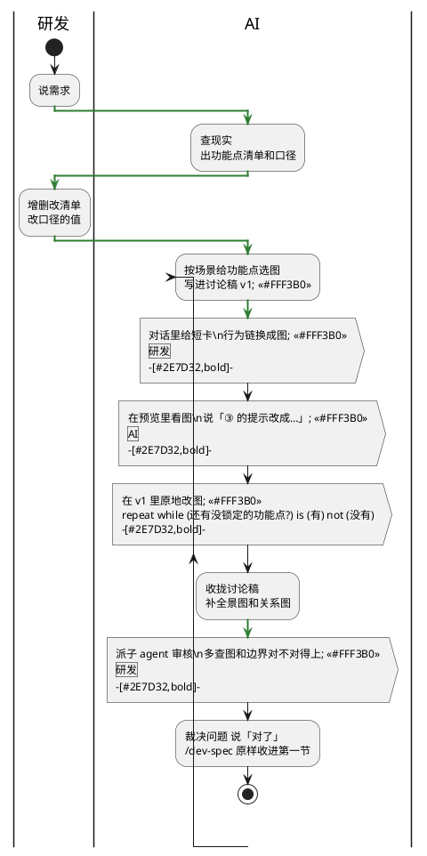
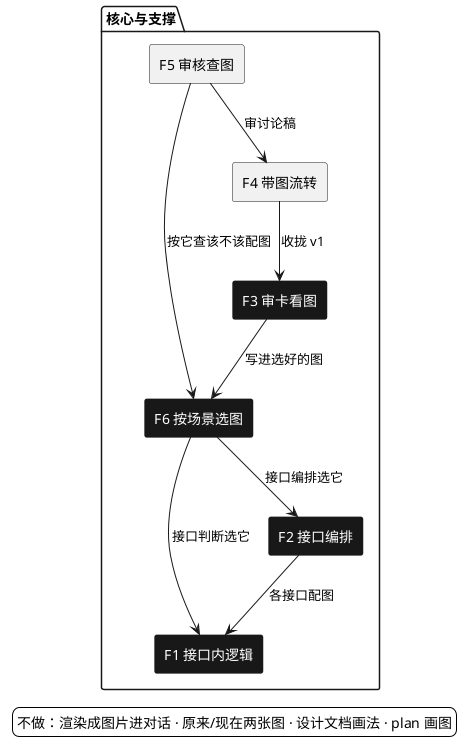
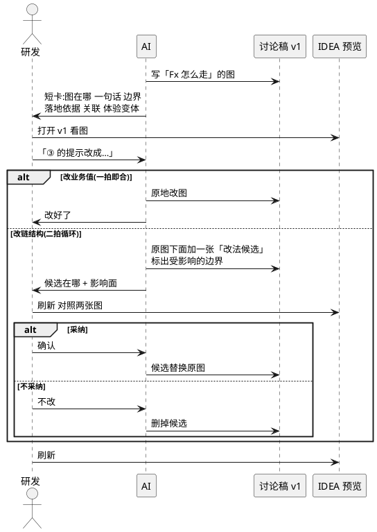
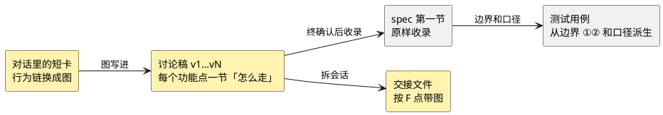
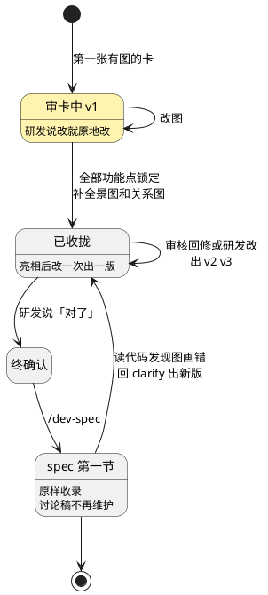
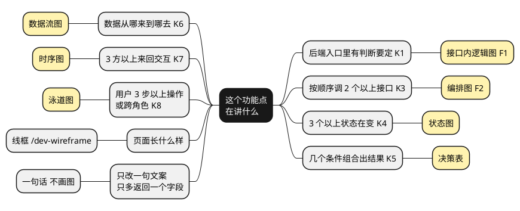
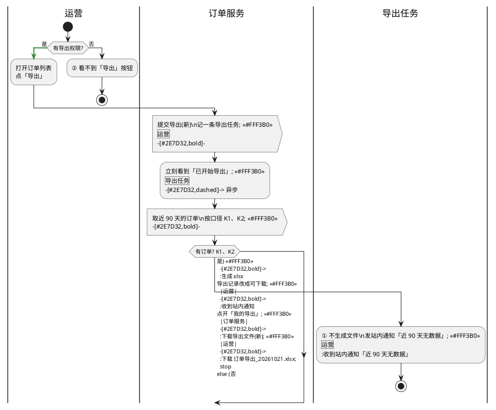
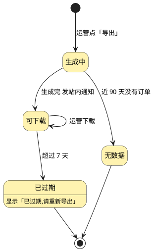

# 规格说明: 流程中澄清环节的功能点展示模式探索

> 产物: spec
> feature-id: 2026-10-31-流程中澄清环节的功能点展示模式探索
> 负责人: liulongfei
> 日期: 2026-10-31

## 功能方案

> 原样收录 clarify 终确认的功能方案(讨论稿 v2);业务要变,回 clarify 改,再同步这一节。

**一句话**:原来澄清时功能点都是文字卡,接口里的判断、几个接口的调用顺序读起来费劲;这次每个功能点按讲的东西配一种图(接口逻辑、接口编排、状态、决策表、数据流、时序、泳道),审卡时就在讨论稿里看图、改图,图随讨论稿进 spec。

**业务口径**

| 编号 | 口径 | 怎么判定 | 算 / 不算(例子) | 依据 |
|---|---|---|---|---|
| K1 | 接口类功能点 | 功能点里有后端入口(页面调的接口、给别的系统调的接口、定时任务、消息消费),而且这次要定入口里的判断:新入口本身有判断,或者给既有入口加判断、改判断 | 算:新增「校验联系人号码」;既有校验接口加一个「在黑名单?」;收到「支付成功」消息时,订单已取消就原路退款;每天 2 点对账,金额对不上的标异常并通知财务。不算:接口只多返回一个字段(卡片写一句「客户详情多返回地区名」);只改提示原文、判断不变;只改页面布局;只改任务几点跑、隔多久跑(时间线,按 F6② 用表) | 新定;参照设计文档「没有新判断的小改动写一句话,不画图」 |
| K2 | 接口内的逻辑 | 从入口被触发到处理完,只要会让调用方看到不同结果,或者造成不同结果(改成不同状态、发不同通知)的判断都画;既有接口照代码顺序,新接口由 AI 先排顺序(几个条件同时不满足时,用户看到的是先判断的那句提示) | 画:参数为空、开关、请求头缺字段、身份和权限、业务规则(营业员号码、黑名单)、调下游后看结果的判断(先查如意,查不到再查现网)、既有的判断(不标黄);任何一步抛异常合成一条 note。不画:日志、埋点、缓存、事务、重试、对象转换;几个字段校验返回同一句提示的合成一个判断 | 新定;参照设计文档「开关、参数校验、异常处理不能漏」 |
| K3 | 接口编排 | 一个功能点里按顺序调 2 个及以上接口,而且这次改了调用顺序,或者改了其中某个接口的判断;页面依次调、一个接口里调别的接口都算 | 算:提交订单时先校验联系人、再锁号码、再下单。不算:一个接口里先查如意、查不到再查现网,两边这次都不改(写成 F1 图里的一步);只调一个接口 | 新定 |
| K4 | 状态在变 | 一个东西(订单、工单、审批单)有 3 个及以上状态,这次新增状态,或改了状态之间怎么变 | 算:订单加「退款中」,已支付 → 退款中 → 已退款,退款失败回到已支付。不算:只有开 / 关两个状态;状态不变,只改某个状态下页面显示什么 | 新定 |
| K5 | 多条件组合 | 结果由 2 个及以上条件一起决定,组合出 4 种及以上结果,条件之间没有先后 | 算:会员等级(普通 / 黄金)× 渠道(App / 门店)→ 4 种积分倍率;角色 × 操作的权限表。不算:条件一个接一个判断、先判断的先返回(那是 K2,画接口内逻辑图) | 新定 |
| K6 | 数据去向 | 数据从哪来(表、文件、别的系统),经过哪几步加工,落到哪;这次改了来源、加工或去向 | 算:订单表 → 导出任务 → xlsx;CRM → 同步任务 → 客户表,这次多同步两个字段。不算:页面查一张表直接显示 | 新定 |
| K7 | 来回交互 | 3 方及以上(人或系统)之间有往返:回调、异步通知、审批来回,这次要定先后 | 算:提交支付 → 支付平台 → 回调订单服务 → 通知页面;提交审批 → 主管驳回 → 修改后重提。不算:一次请求里按顺序调完(那是 K3,画编排图) | 新定 |
| K8 | 用户一步步操作 | 用户在页面上做 3 步及以上操作,或跨 2 个及以上角色,系统每步有响应;里面有接口判断要定的,算 K1 | 算:运营点「导出」→ 立刻提示 → 收通知 → 下载。不算:点「刷新」→ 列表更新,写一句话 | 新定;现行是「核心点判断 3 个以上或跨角色才画行为链图」,这次放宽 |

**用户会这样用**(标黄的是这次新增或改的)



**功能点关系图**(图回答:谁支撑谁、哪些独立、哪些不做)



**功能点**

| 编号 | 类别 | 一句话 | 边界 |
|---|---|---|---|
| F1 | 核心 | 接口类功能点(K1)配一张接口内逻辑图:触发方(页面、别的系统、定时任务、消息)和服务两条泳道,判断按 K2 排,失败分支带提示原文和边界编号,改动标黄、正常路径标绿;有人等结果的汇回触发方,没人等结果的在服务泳道写造成的结果 | ① 超过 25 个框:新接口按段拆,改既有接口只画改动那段 ② 新接口没定名,写中文名加「(新)」 ③ 读不到代码的服务写成一步,文档也没有的标【待确认】 |
| F2 | 核心 | 有接口编排(K3)的功能点画编排图:一个接口一个框,画清失败后还调不调、要不要撤回(撤回有两种体验时先在卡片里选);和接口判断合起来不超过 25 个框就画成一张 | ① 同时调的画成并行分叉 ② 中间有异步,箭头标「异步」 ③ 编排图自己超过 25 个框,按页面或阶段拆 |
| F3 | 核心 | 画了图的功能点,审卡时就把图写进讨论稿 v1 原地改;对话里的短卡只把文字行为链换成图,边界、落地依据、关联、体验变体照旧;改链结构时新图先放在原图下面当候选,对照后再替换 | ① 改结构后边界编号跟着分支走,新分支接着编 ② 第一次给图附查看提示 ③ 没有需求目录,先按 dev-spec 定名 |
| F4 | 支撑 | 讨论稿里每个画了图的功能点一节「Fx 怎么走」,对话版只写一句话加「见讨论稿」;spec 第一节照收,拆会话时跟着 F 点走 | ① 单功能点和 bug 也留讨论稿,不画全景图和关系图;bug 只画「改后」 ② 引用的接口图归别的会话,两边都带 ③ 写 spec 发现图画错,回 clarify 出新版 |
| F5 | 支撑 | 对抗审核按决策表多查:图和卡片边界对不对得上,该配图的有没有配 | ① 画法问题不报 ② 【待确认】不报 ③ 图种选得不合适不报 |
| F6 | 核心 | 每个功能点按讲的东西(K1、K3–K8)选一种图;页面长什么样走 /dev-wireframe,只改一句文案的写一句话 | ① 最多占两种场景:先画主要的,另一种也有东西要定再加;编排配的接口图、超框拆出的图不算数 ② 时间线用表或编号步骤 ③ 超过 25 个框照 F1① 拆 |

**F1 接口内逻辑图怎么走**

审到接口类功能点(K1)时,按 K2 画。有人等结果的入口(页面、别的系统调用)照下面这张画:失败后处理一样的汇到 (A)、通过汇到 (B),处理不一样的(比如身份失效跳登录页)各用一个连接点、各写各的结果。用「校验联系人号码」举例:假设这次新加的是黑名单判断,所以标黄;图里的 ①–⑤ 是这个示例功能点卡片上的边界编号。

```plantuml
@startuml
skinparam backgroundColor #FFFFFF
skinparam Activity {
  BackgroundColor #F1F1F1
  BorderColor #181818
  FontColor #000000
}
skinparam Swimlane {
  BorderColor #181818
  TitleBackgroundColor #FFFFFF
  TitleFontColor #000000
}
skinparam ArrowColor #181818

|填单页面|
start
:输入联系人号码\n点「下一步」;
|so-service|
-[#2E7D32,bold]->
:校验联系人号码\nqrystaffCodeAndCustIdByPhone;
note right
  任何一步抛异常
  → ⑤ 校验失败,返回异常信息
end note
-[#2E7D32,bold]->
if (custId 或手机号为空?) then (是)
  :① 校验失败\n「…不可为空」;
  (A)
  detach
else (否)
  -[#2E7D32,bold]->
  if (本人手机号?\n先查如意 查不到再查现网) then (是)
    -[#2E7D32,bold]->
    :校验通过;
    (B)
    detach
  else (否)
    -[#2E7D32,bold]->
    if (开关 BLACK_PHONE_NEW_SWITCH = Y?) then (是)
      -[#2E7D32,bold]->
      if (请求头有 regionId?) then (是)
        -[#2E7D32,bold]->
        if (营业员手机号?) then (是)
          :③ 校验失败\n「…号码为营业员号码」;
          (A)
          detach
        else (否)
          -[#2E7D32,bold]->
        endif
      else (否)
        :② 校验失败\n「请求头regionId为空」;
        (A)
        detach
      endif
    else (否)
      -[#2E7D32,bold]->
    endif
    -[#2E7D32,bold]->
    if (在黑名单?) then (是) <<#FFF3B0>>
      :④ 校验失败\n「…不允许作为联系人」; <<#FFF3B0>>
      (A)
      detach
    else (否)
      -[#2E7D32,bold]->
      :校验通过;
      (B)
      detach
    endif
  endif
endif

|填单页面|
(B)
-[#2E7D32,bold]->
:进入下一步;
stop
(A)
:停在填单页\n提示失败原因;
stop
@enduml
```

没人等结果的入口(定时任务、消息),每个分支在服务泳道写它造成的结果,各自结束;处理失败写重试和最后怎么兜底。用「收到支付成功消息」举例:假设这次新加的是已取消订单原路退款,所以标黄。

```plantuml
@startuml
skinparam backgroundColor #FFFFFF
skinparam Activity {
  BackgroundColor #F1F1F1
  BorderColor #181818
  FontColor #000000
}
skinparam Swimlane {
  BorderColor #181818
  TitleBackgroundColor #FFFFFF
  TitleFontColor #000000
}
skinparam ArrowColor #181818

|支付平台|
start
:支付成功\n发「支付成功」消息;
|order-service|
-[#2E7D32,bold]->
:处理支付成功消息\nonPaySuccess;
note right
  处理抛异常
  → ③ 重试 3 次,仍失败进死信并告警
end note
-[#2E7D32,bold]->
if (订单待支付?) then (是)
  -[#2E7D32,bold]->
  :改成已支付\n记一条支付流水;
  stop
elseif (订单已支付?) then (是)
  :① 重复消息 直接确认\n不重复记流水;
  stop
else (已取消)
  :② 原路退款\n通知用户「订单已取消,款项原路退回」; <<#FFF3B0>>
  stop
endif
@enduml
```

**F2 接口编排图怎么走**

有接口编排(K3)的功能点,编排和各接口判断合起来超过 25 个框时,先画这张编排图,有判断的接口再各配一张 F1 的图。下面用「提交订单」举例:流程和接口名是编的,这次新加的是锁号码和下单失败后释放号码,所以标黄。

```plantuml
@startuml
skinparam backgroundColor #FFFFFF
skinparam Activity {
  BackgroundColor #F1F1F1
  BorderColor #181818
  FontColor #000000
}
skinparam Swimlane {
  BorderColor #181818
  TitleBackgroundColor #FFFFFF
  TitleFontColor #000000
}
skinparam ArrowColor #181818

|提交页面|
start
:核对号码和联系人\n点「提交订单」;
|so-service|
-[#2E7D32,bold]->
:提交订单 submitOrder;
-[#2E7D32,bold]->
:校验联系人号码\nqrystaffCodeAndCustIdByPhone\n判断见图 1;
-[#2E7D32,bold]->
if (校验通过?) then (否)
  :① 返回校验失败原因;
  (A)
  detach
else (是)
  -[#2E7D32,bold]->
  |res-service|
  :锁定号码 lockNumber; <<#FFF3B0>>
  |so-service|
  -[#2E7D32,bold]->
  if (锁定成功?) then (否) <<#FFF3B0>>
    :② 返回「号码已被占用」; <<#FFF3B0>>
    (A)
    detach
  else (是)
    -[#2E7D32,bold]->
    :创建订单 createOrder\n判断见图 2;
    -[#2E7D32,bold]->
    if (下单成功?) then (否)
      :③ 下单失败;
      |res-service|
      :释放号码 releaseNumber; <<#FFF3B0>>
      (A)
      detach
    else (是)
      |so-service|
      -[#2E7D32,bold]->
      :返回订单号;
    endif
  endif
endif
|提交页面|
-[#2E7D32,bold]->
:跳到支付页;
stop
(A)
:停在提交页\n提示失败原因;
stop
@enduml
```

**F3 审卡时就看图怎么走**

审卡时研发和 AI 怎么来回改图:



**F4 讨论稿、spec、交接都带图怎么走**

图最后流到哪些文件:



讨论稿从审卡到进 spec,状态怎么变:



**F5 审核查图怎么走**

审核子 agent 看到什么、算什么问题:

| 看到什么 | 算 | 回到 |
|---|---|---|
| 图上的分支、结果、编号和卡片边界对不上 | 矛盾 | 改卡 |
| 编排图写「判断见图 2」,却没有图 2 | 矛盾 | 改卡 |
| 既有接口画的判断和代码对不上 | 矛盾 | 改图 |
| 该配图的功能点没配图 | 遗漏 | 补图 |
| 判断只画了一条分支,或者失败没写调用方看到什么 | 遗漏 | 补分支 |
| 超框、颜色、泳道顺序 | 不报 | — |
| 标了【待确认】的判断 | 不报 | — |

**F6 按场景选图怎么走**



**不做**

- 渲染成图片放进对话:换台机器或换个 agent 就用不了;图仍是 Markdown 里的 PlantUML 源码,在预览里看
- 改既有接口时画「原来 / 现在」两张图:一张图上标黄就能看出改在哪
- doc-delivery 设计文档的环节图:画法不改,它照上线后的代码画
- plan 照旧不画图;历史讨论稿和 spec 不重画;cgraphx 程序与 web 不动

**体验决策**

- F1:图里照原样写接口名、开关名、请求头字段;新接口先写中文名加「(新)」,名字由 spec 定
- F2:编排用泳道活动图,不用时序图
- F3:对话里的卡片只把文字行为链换成图(图在哪、一句话),边界、落地依据、关联、体验变体照旧;审卡时图写进讨论稿 v1 原地改,改链结构时新图先当候选放在原图下面
- F6:每个功能点都按场景选图,支撑点也画

## 怎么实现

### 细节方案:F1 接口内逻辑图

| # | 决策 | 选择 | 没选的(为什么) | 理由(依据) | 影响面 |
|---|---|---|---|---|---|
| D1 🔒 | 新画法放哪 | 新增 `dev-clarify/references/功能点配图.md`:选图表(F6)、各图种另守的规则、样式头和样例都在这一份;`泳道图画法.md` 只在第一段后加一行「澄清讨论稿里各功能点的图(接口内逻辑图、编排图等)另守同目录 `功能点配图.md`;设计文档不适用」,其余不动 | 改 `泳道图画法.md` 本体(设计文档也把它当通用画法,25 个框、技术名、连接点会带进设计文档,违反第一节「不做」第 3 条);一种图一个文件(七个入口,AI 选图前要读一圈) | `doc-delivery/references/设计文档.md:178` 引用 `泳道图画法.md` 作通用画法;第一节「不做」第 3 条 | dev-clarify 新增 1 个参考文件;`泳道图画法.md` 多 1 行 |
| D2 | 连接点放哪 | 失败、通过的连接点 `(A)`、`(B)` 画在服务泳道的分支末尾,接 `detach`;图末尾切回触发方泳道,依次写 `(B)` → 结果 → `stop`、`(A)` → 结果 → `stop`;处理不一样的失败(身份失效跳登录页)用 `(C)`、`(D)`,各写各的结果 | 照用户原图,每个失败先切回调用方泳道再画 `(A)`(调用方泳道里散着五六个圈,高低不齐,看不出汇到哪);每个分支各自切回调用方写结果(现行写法,6 个失败就是 6 条横穿两条泳道的线) | 两种写法本机都渲染过;第一节「F1 接口内逻辑图怎么走」第一张图就是这种 | 接口内逻辑图、编排图 |
| D3 | 接口名、开关名怎么写 | 接口框写「中文名」换行「对外接口名」:HTTP 写方法加路径(`POST /api/orders/export`),RPC 或服务接口写方法名(`qrystaffCodeAndCustIdByPhone`);开关、请求头字段原样写进判断;新接口写「中文名(新)」,名字留给 spec 的接口契约;类名、行号、SQL 仍不写 | 只写 HTTP 路径(RPC 项目没有路径);写「类名.方法名」(太长,类名是实现细节) | 第一节体验决策 F1、F1②;用户原图 | 接口内逻辑图、编排图 |
| D4 | 没人等结果的入口怎么收尾 | 触发方泳道写触发源(定时任务写「每天 2 点触发」,消息写发消息的一方和消息名);每个分支在服务泳道写它造成的结果再 `stop`,不画连接点;处理抛异常写成 note:重试几次、最后怎么兜底 | 另画一条「结果」泳道收所有结果(多一条不属于任何一方的泳道);照样汇到 `(A)`、`(B)`(没人看这两个结果) | K1 含定时任务、消息消费;第一节「收到支付成功消息」样图,本机已渲染 | 接口内逻辑图 |

落地:

- `功能点配图.md`「接口内逻辑图」一节:规则写 K2 的取舍(从入口被触发到处理完,会让调用方看到不同结果、或造成不同结果的判断都画;既有接口照代码顺序,新接口由 AI 先排顺序;日志、埋点、缓存、事务、重试、对象转换不画),再写 D2–D4;样例原样搬第一节「校验联系人号码」「收到支付成功消息」两张。
- `dev-clarify/SKILL.md` ⓪ 第 2 条后补一句:接口类功能点要读到入口里的每个判断(开关、参数校验、调下游、异常处理),图照代码顺序画。

### 细节方案:F2 接口编排图

| # | 决策 | 选择 | 没选的(为什么) | 理由(依据) | 影响面 |
|---|---|---|---|---|---|
| D5 | 一节里几张图怎么对上 | 编排和各接口判断合起来不超过 25 个框画成一张;超了先画编排图,有判断的接口再各配一张接口内逻辑图;一节里有两张以上图时,每个代码块前一行写「**图 N 名称**」,编排图的接口框写「判断见图 N」;一个功能点的边界编号在几张图里接着编 | 用 PlantUML 的 `title` 写图名(没启用预览的人看不到);一律拆开(小编排也要在三张图之间来回翻) | K3;第一节 F2 和「提交订单」样图 | 编排图、讨论稿 |
| D6 | 异步怎么画 | 触发方先写马上看到什么,再用虚线箭头 `-[#2E7D32,dashed]-> 异步;` 接到后台泳道;后台做完回到触发方,写之后从哪知道结果(收到站内通知) | `fork` 两支并行(两支要汇合或 `detach`,多一根并行横杠,读起来像同时做两件事);普通箭头加 note「异步」(看不出哪一段不等) | F2②;本机渲染过讨论稿范例的订单导出编排图(见 F4) | 编排图、讨论稿范例 |

落地:

- `功能点配图.md`「编排图」一节:规则写 K3 的取舍、泳道按第一次被调的先后从左往右、撤回步骤画在做撤回的服务泳道(撤回有两种体验时卡片 🎭 先选,图只画选中的那种)、两个接口同时调用 `fork` / `fork again` / `end fork`,再写 D5、D6;样例原样搬第一节「提交订单」。

### 细节方案:F3 审卡时就看图

| # | 决策 | 选择 | 没选的(为什么) | 理由(依据) | 影响面 |
|---|---|---|---|---|---|
| D7 | 审卡中的 v1 写什么 | 第一张图写进 v1 时,文件只有标题、两行头注(不是契约;查看提示)、一行「审卡中,收拢时补齐其余各节」和各功能点的「Fx 怎么走」;收拢时删掉「审卡中」那行,补上一句话、口径、全景图、关系图、功能点表、不做、体验决策 | 一开始就照范例建全套骨架,没定的节写「待补」(半成品看着像定稿,收拢时容易漏补);审卡另起一个文件(第一节已定一份 v1 原地改) | 第一节 F3;讨论稿范例的结构 | dev-clarify ④⑤ |
| D8 | 改法候选怎么放 | 紧贴原图下面写一行「**改法候选(待确认,影响边界 ③ ④)**」,再接候选图;一个功能点同时只放一张候选;采纳就用候选替换原图、删掉这一行,不采纳就把候选和这一行一起删掉;候选不算新版本 | 候选另起文件(预览要多开一个页签);放在节末(和原图隔着说明文字,不好对照) | 第一节 F3、「F3 审卡时就看图怎么走」 | dev-clarify ④ |
| D9 | ④ 的卡片范例 | 换成短卡:第一行「图:<讨论稿文件名>「F1 订单导出怎么走」(编排图…)」,后面一句话、⚠️ 边界、⚓ 落地依据、🔗 关联、🎭 体验变体照旧,不再写文字行为链 | 保留文字卡,再加一张短卡对照(两种格式摆在一起,AI 会混着出) | 第一节体验决策 F3 | dev-clarify ④ |

落地:

- `dev-clarify/SKILL.md` ④:卡片范例按 D9 改;卡片规则加一条「图」:按 `功能点配图.md` 选图,写进讨论稿 v1 的「Fx 怎么走」,第一次给图附查看提示,改结构后边界编号跟着分支走、新分支接着往后编;「改稿两档」表里链结构那一行补上 D8 的候选写法。
- `dev-clarify/SKILL.md` ⑤「放哪」:v1 在审卡时第一张图就建(D7);收拢前原地改,收拢后改一次出一版。

### 细节方案:F4 讨论稿、spec、交接都带图

| # | 决策 | 选择 | 没选的(为什么) | 理由(依据) | 影响面 |
|---|---|---|---|---|---|
| D10 | 「Fx 怎么走」放哪 | 功能点短表之后、「不做」之前,按 F 编号排;每节一句说明,再接图;决策表直接用 Markdown 表 | 放进下半部分「供 spec 使用」(spec 第一节不收,图进不了契约);把图贴在短表的行里(表格里放不下代码块) | dev-spec 收录范围「一句话」到「非目标」 | 讨论稿、spec 第一节 |
| D11 | 和全景图重复时 | 单点图和全景图画的是同一件事(全景图已经把这个功能点的每一步都画全)时只留全景图,功能点短表那一行写「见用户会这样用」 | 照画一张一样的(两份要同步改,改一处漏一处) | K8;讨论稿范例「用户会这样用」已画全订单导出的用户操作 | 讨论稿 |
| D12 | 讨论稿范例怎么改 | 订单导出加两节:「F1 订单导出怎么走」编排图(运营、订单服务、导出任务三条泳道,含权限判断、异步、无数据)、「F2 导出记录查看怎么走」状态图(生成中、可下载、已过期、无数据),两张图见下;末尾「要单独画行为链图时…」那条说明删掉,改成指向 `功能点配图.md` | 换一个接口多的需求做范例(dev-spec、dev-handoff 的范例接着用订单导出、积分发放,换了要连着改) | 讨论稿范例现状;两张图本机已渲染 | 讨论稿范例 |
| D13 | spec、交接怎么收单点图 | dev-spec 第 1 步「只负责部分功能点」那句、dev-handoff「功能方案」那条都补:「Fx 怎么走」只收本会话负责的 F 点;编排图引用的接口图归别的会话时两边都收,图注写「图 2 归 <会话> 负责」;dev-handoff 两个范例的收录清单补上「F1、F2 怎么走」;dev-spec 第 1 步的画法指针补上 `功能点配图.md`;dev-spec 结构范例的第一节(现在和讨论稿范例上半部分逐字相同)同步加上「F1 订单导出怎么走」「F2 导出记录查看怎么走」两节,保持逐字相同 | 拆会话时整份讨论稿照收(别的会话的图混进来,spec 第一节和本会话的功能点对不上) | F4②;`dev-spec/SKILL.md` 第 1 步和结构范例(只改讨论稿范例一边,dev-spec 范例就成了「不照收」的反例);`dev-handoff/SKILL.md:137` 和两个范例 | dev-spec、dev-handoff |
| D14 | 对话版和情形表 | 对话版范例的功能点表「行为链」列改成一句话加「见讨论稿「Fx 怎么走」」;「讨论稿」那条规则改成画了图就有,一张图都没画才去掉;情形表的单功能点、bug 两行补:画了图就留讨论稿(只有「Fx 怎么走」,不画全景图和关系图),bug 只画「改后」,修的地方标黄,「现在」写一行文字 | 单功能点把图贴在对话里(对话不渲染 PlantUML,第一节「不做」第 1 条) | F4①;dev-clarify 情形表、对话版 | dev-clarify 澄清结果 |
| D20 | 没有 ⑤ 的需求怎么收尾 | 单功能点、bug 这类走不到 ⑤ 的需求,卡片画了图就留讨论稿;给澄清结果(⑦)之前,把对话版上半部分(一句话、口径、功能点表、不做、体验决策)写进讨论稿,删掉「审卡中」那行,只是不画全景图和关系图;写全之后再改,和收拢后一样改一次出一版 | 讨论稿只留「Fx 怎么走」,改 dev-spec、dev-handoff、dev-start 的收录规则(这三个 skill 都按「有讨论稿 = 完整功能方案」收,要连改三处,dev-start 还在本次范围外) | plan 审核:dev-spec 第 1 步、dev-handoff「功能方案」、dev-start 都直接按讨论稿收功能方案;F4① | dev-clarify 情形表、⑤「放哪」 |

讨论稿范例新增的两张图(本机 PlantUML 1.2026.9 渲染通过):

**F1 订单导出怎么走**



**F2 导出记录查看怎么走**



落地:

- `功能方案-讨论稿范例.md`:按 D10、D12 加两节;开头说明改成「讨论稿从审卡时第一张图起就有;各功能点的图照同目录 `功能点配图.md`,泳道画法见 `泳道图画法.md`,功能点关系图见文末」。
- `dev-clarify/SKILL.md` ⑤「画什么」:全景图、关系图、口径用表照旧;删掉「某个核心功能点判断多(3 个以上)或跨多个角色……单独给它画一张行为链图」,改成「各功能点的图审卡时已写进「Fx 怎么走」;收拢时照 `功能点配图.md` 核一遍有没有漏画,和全景图重复的删掉(D11)」;关系图规则里「也不替代泳道图/单点行为链图」改成「也不替代各功能点的图」。
- `dev-clarify/SKILL.md` 情形表、「走哪几步里没有 ⑤ 的不出讨论稿」那条、对话版范例和「讨论稿」规则:按 D14、D20 改。
- `dev-spec/SKILL.md`、`dev-handoff/SKILL.md`:按 D13 改。
- 措辞同步,只换说法,不动结构:

| 文件 | 原文 | 改成 |
|---|---|---|
| `assets/claude-template/CLAUDE.md` | 人审稿式改稿,结束时给《需求功能方案》,多功能点需求另写一份带 PlantUML 流程图的讨论稿 | 人审稿式改稿(每个功能点按场景配图,审卡时就写进 PlantUML 讨论稿),结束时给《需求功能方案》 |
| `assets/claude-template/FLOW-MAP.md` 第 14 行 | 多功能点需求另写 PlantUML 讨论稿 | 画了图的需求另有 PlantUML 讨论稿,审卡时就写 |
| 同上第 54 行 | 多功能点需求的流程图在讨论稿里 | 各功能点的图和全景图在讨论稿里 |
| 同上第 55 行 | clarify 出,多功能点需求才有,不登记 | clarify 出,画了图的需求才有,不登记 |
| `skills/cgraphx-guide/` 下 `SKILL.md`、`how-to-use.md`、`how-to-use.html`、`skills.html` | 多功能点需求另写一份带 PlantUML 流程图的讨论稿 | 每个功能点按场景配图,写进 PlantUML 讨论稿(HTML 只改文本节点) |
| `skills/dev-clarify/SKILL.md` description | 全部功能点锁定后收拢《需求功能方案》(多功能点需求写一份带 PlantUML 流程图的讨论稿) | 审卡时每个功能点按场景配图(接口逻辑、编排、状态、时序、数据流、决策表、泳道)写进讨论稿,全部功能点锁定后收拢《需求功能方案》 |

### 细节方案:F5 审核查图

| # | 决策 | 选择 | 没选的(为什么) | 理由(依据) | 影响面 |
|---|---|---|---|---|---|
| D15 | 审核 prompt 怎么加 | 不加维度,在现有四个维度里补例子:矛盾补「图上的分支、提示原文、编号和卡片边界对不上」「编排图写「判断见图 2」却没有图 2」「既有接口画的判断和代码对不上」;遗漏补「该配图的功能点没配图」「判断只画了一条分支,或者失败没写调用方看到什么(没人等结果的没写造成什么)」;「不报」补「画法问题、标【待确认】的判断、图种选得不合适」;工作流第 2 步补「逐张图对照卡片边界;该不该配图照 dev-clarify 的 `references/功能点配图.md`」 | 新开第五个维度「图」(四个维度按返工类型分,图的问题本来就是矛盾或遗漏) | `function-plan-reviewer-prompt.md` 的四个维度和关系图那条的写法 | 审核 prompt |

落地:`dev-clarify/function-plan-reviewer-prompt.md` 按 D15 改。

### 细节方案:F6 按场景选图

| # | 决策 | 选择 | 没选的(为什么) | 理由(依据) | 影响面 |
|---|---|---|---|---|---|
| D16 | 选图写在哪、怎么写 | `功能点配图.md` 开头一张选图表:场景 / 画什么 / 算 / 不算,九行(七种图,加「页面长什么样 → 提示 /dev-wireframe」「只改一句文案 → 一句话」);判定写成规则原文,例子取第一节口径表的算 / 不算,不引用本 spec 的 K 编号;表后三条:最多两种场景(编排配的接口图、超框拆出来的图不算数)、和全景图重复只留全景图(D11)、时间线用表或编号步骤 | 用第一节 F6 那张脑图(放不下算 / 不算的例子);写进 SKILL.md ④(SKILL.md 已经很长,选图和画法会分在两处) | 第一节 F6;K1、K3–K8 | `功能点配图.md` |
| D17 | 新图种的样式头 | 每种图一段逐字一致的样式头:状态图 `skinparam state` 灰底黑框,加 `hide empty description`;时序图 `skinparam sequence` 灰底黑框;数据流图用关系图那段 `skinparam rectangle`,加 `left to right direction`;决策表是 Markdown 表,没有样式头 | 所有图种共用一段(skinparam 按图种分,不通用);`<style>` 写法(和「流程中的图表升级」不选它的理由一样:旧版渲染器兼容性未知) | 「流程中的图表升级」spec D2;第一节的状态图、时序图、数据流图本机已渲染 | `功能点配图.md` 各节 |
| D18 | 标黄标绿用到哪 | 标黄(这次新增或改的):活动图标活动和判断,状态图标状态,数据流图标框,时序图标参与者,决策表加最后一列「这次」写「新增」或「改」;标绿只用在活动图(泳道图、接口内逻辑图、编排图) | 状态图、时序图也标绿(没有唯一的正常路径);时序图给消息上色(箭头太细,黄色看不清) | 第一节的状态图、数据流图已这样标 | 所有单点图 |
| D19 | 每种图的样例 | 接口内逻辑图、编排图用第一节的三张;另外四种各一张小样,用口径表里的例子:状态图画订单退款(待支付、已支付、退款中、已退款、已取消;退款失败回到已支付;退款中、已退款标黄);时序图画支付回调(页面、订单服务、支付平台;支付平台异步回调订单服务,订单服务通知页面;回调超时由订单服务主动去查,这一段用 `alt`);数据流图画订单导出(订单表 → 导出任务 → xlsx → 我的导出);决策表画会员等级 × 渠道 → 积分倍率(普通 App 1 倍、普通门店 1 倍、黄金 App 2 倍、黄金门店 1.5 倍,黄金两行这次新增) | 只给规则不给样例(AI 照样例画,只有规则会画得五花八门) | 项目约定「写 skill 直接展示最好案例」 | `功能点配图.md` |

`功能点配图.md` 的结构:

1. 一段话:审卡时按这里选图、画图,写进讨论稿「Fx 怎么走」;收拢时照这里核对;样式头、标黄标绿、判断写法这些通用的见 `泳道图画法.md`。
2. **选图**:D16 的表和三条。
3. **框数**:单点图不超过 25 个框(活动、判断、开始 / 结束算;连接点、note、合并菱形不算),全景图仍是 15;超了新接口按段拆成两张,改既有接口只画改动那段、前后各留一个判断,其余合成一个框「其余 N 个判断不变」,编排图按页面或阶段拆。
4. **接口内逻辑图**、5. **编排图**:见 F1、F2 落地。
6. **状态图**、7. **时序图**、8. **数据流图**、9. **决策表**:各写样式头(D17)、两三条规则(状态写名词、转移写触发事件;参与者按出场先后、异步回调写「异步」、分支用 `alt`;框写数据或加工步骤、箭头写带过去的是什么;条件列在前、结果列在后)、标黄方式(D18)和一张样例(D19)。

### 全局约束

- 只改资产源 `assets/claude-template/`;`.claude/` 是部署产物,不改不提交。
- `doc-delivery/references/设计文档.md` 零改动;`泳道图画法.md` 只多 D1 那一行。
- 不改程序:新参考文件由 `scripts/copy-assets.cjs` 递归拷进包里,不用登记;没有测试引用这些资产。
- 历史需求的讨论稿、spec 不重画。
- skill 里的图都是 Markdown 内嵌的 PlantUML 源码;「渲染成图片放进对话」不写进任何 skill。
- 样式头单一来源:泳道类沿用 `泳道图画法.md` 那段,新图种以 `功能点配图.md` 为准;同一图种的所有样例逐字一致。

## 设计验收

| # | 对应 | 验收点 | 怎么验 |
|---|---|---|---|
| 1 | D1、D17、D19 | 改过的资产里每个 PlantUML 代码块都能渲染 | 提取代码块,本机 PlantUML 1.2026.9 `-failfast2` 逐个渲染,退出码 0 |
| 2 | D17 | 同一图种的样式头在各样例里逐字一致;泳道类和 `泳道图画法.md` 一致 | 提取样式头做 diff |
| 3 | 全局约束 | `设计文档.md` 零改动;`泳道图画法.md` 只多一行 | `git diff --stat` 加逐行看 |
| 4 | D2、D4、D6 | 样例里连接点在服务泳道、触发方泳道有结果;没人等结果的分支各自结束;异步是带「异步」的虚线 | 看渲染出的图 |
| 5 | D9、D14 | SKILL.md 不再有「判断多(3 个以上)……单独给它画一张行为链图」;④ 范例是短卡;对话版行为链列带「见讨论稿」 | grep 加通读 |
| 6 | D15 | 审核 prompt 的矛盾、遗漏、不报里都有图的条目,并指向 `功能点配图.md` | 通读 |
| 7 | D16 | `功能点配图.md` 不引用本 spec 的 K 编号 | `grep -n 'K[0-9]' assets/claude-template/skills/dev-clarify/references/功能点配图.md` 为空 |
| 8 | 措辞同步 | 旧说法不再出现 | `grep -rn -e '多功能点需求另写' -e '多功能点需求写一份' assets/claude-template` 为空 |
| 9 | 全局 | 部署出的 dev-clarify 带 `功能点配图.md`,内容和源一致 | `npm run build` 后 `cgraphx install` 到临时项目,diff |
| 10 | D20 | 情形表单功能点、bug 两行和 ⑤「放哪」写明:给澄清结果前把讨论稿写全、删掉「审卡中」那行 | 通读 |
| 11 | D13 | dev-spec 结构范例的第一节和讨论稿范例的上半部分逐字相同 | 各取「**一句话**」起的那一段比对 |

## 待确认项

- 无。
