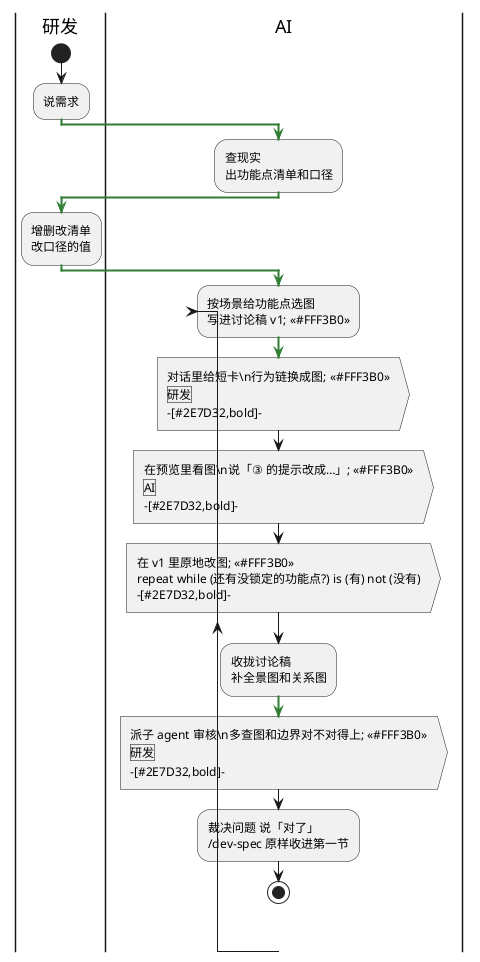
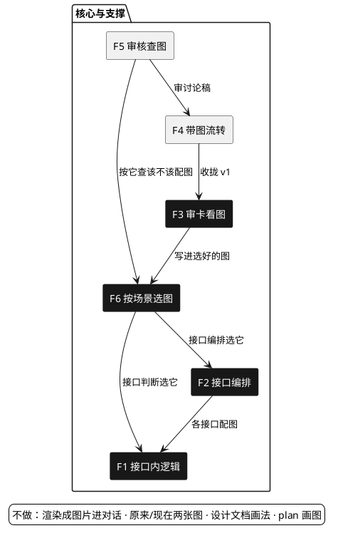
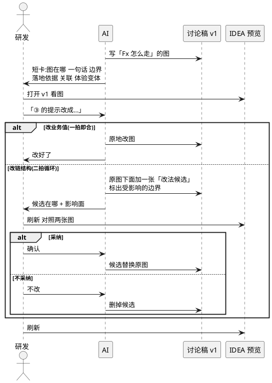
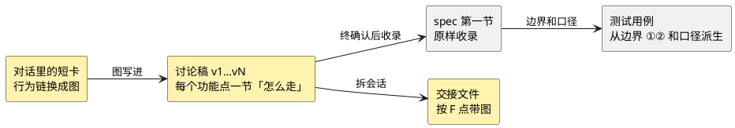
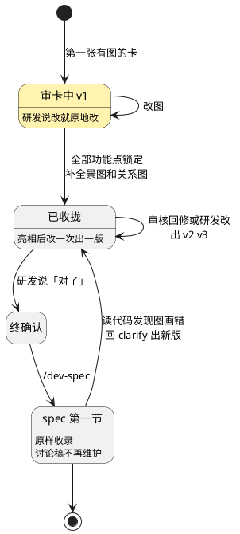
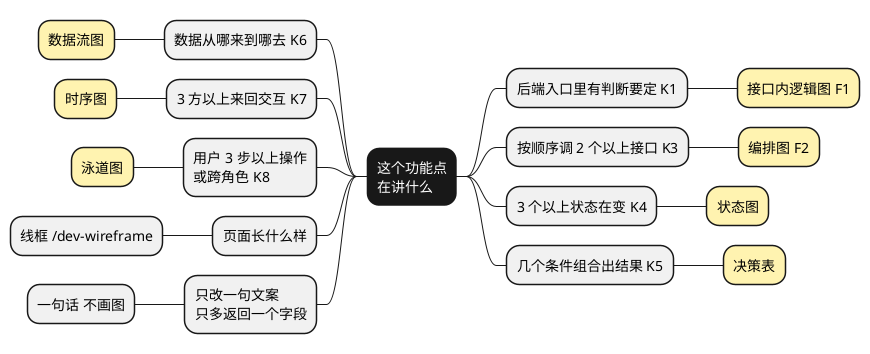

# 功能方案: 流程中澄清环节的功能点展示模式探索(讨论稿 v2)

> 讨论稿,不是契约:人终确认的那一版由 `/dev-spec` 原样收录为 spec 第一节,之后以 spec 为准,本文件不再维护。
> 图用支持 PlantUML 的 Markdown 预览打开(IDEA:设置 → 语言和框架 → Markdown → 启用 PlantUML)。

**一句话**:原来澄清时功能点都是文字卡,接口里的判断、几个接口的调用顺序读起来费劲;这次每个功能点按讲的东西配一种图(接口逻辑、接口编排、状态、决策表、数据流、时序、泳道),审卡时就在讨论稿里看图、改图,图随讨论稿进 spec。

**业务口径**

| 编号 | 口径 | 怎么判定 | 算 / 不算(例子) | 依据 |
|---|---|---|---|---|
| K1 | 接口类功能点 | 功能点里有后端入口(页面调的接口、给别的系统调的接口、定时任务、消息消费),而且这次要定入口里的判断:新入口本身有判断,或者给既有入口加判断、改判断 | 算:新增「校验联系人号码」;既有校验接口加一个「在黑名单?」;收到「支付成功」消息时,订单已取消就原路退款;每天 2 点对账,金额对不上的标异常并通知财务。不算:接口只多返回一个字段(卡片写一句「客户详情多返回地区名」);只改提示原文、判断不变;只改页面布局;只改任务几点跑、隔多久跑(时间线,按 F6② 用表) | 新定;参照设计文档「没有新判断的小改动写一句话,不画图」 |
| K2 | 接口内的逻辑 | 从入口被触发到处理完,只要会让调用方看到不同结果,或者造成不同结果(改成不同状态、发不同通知)的判断都画;既有接口照代码顺序,新接口由 AI 先排顺序(几个条件同时不满足时,用户看到的是先判断的那句提示) | 画:参数为空、开关、请求头缺字段、身份和权限、业务规则(营业员号码、黑名单)、调下游后看结果的判断(先查如意,查不到再查现网)、既有的判断(不标黄);任何一步抛异常合成一条 note。不画:日志、埋点、缓存、事务、重试、对象转换;几个字段校验返回同一句提示的合成一个判断 | 新定;参照设计文档「开关、参数校验、异常处理不能漏」 |
| K3 | 接口编排 | 一个功能点里按顺序调 2 个及以上接口,而且这次改了调用顺序,或者改了其中某个接口的判断;页面依次调、一个接口里调别的接口都算 | 算:提交订单时先校验联系人、再锁号码、再下单。不算:一个接口里先查如意、查不到再查现网,两边这次都不改(写成 F1 图里的一步);只调一个接口 | 新定 |
| K4 | 状态在变 | 一个东西(订单、工单、审批单)有 3 个及以上状态,这次新增状态,或改了状态之间怎么变 | 算:订单加「退款中」,已支付 → 退款中 → 已退款,退款失败回到已支付。不算:只有开 / 关两个状态;状态不变,只改某个状态下页面显示什么 | 新定 |
| K5 | 多条件组合 | 结果由 2 个及以上条件一起决定,组合出 4 种及以上结果,条件之间没有先后 | 算:会员等级(普通 / 黄金)× 渠道(App / 门店)→ 4 种积分倍率;角色 × 操作的权限表。不算:条件一个接一个判断、先判断的先返回(那是 K2,画接口内逻辑图) | 新定 |
| K6 | 数据去向 | 数据从哪来(表、文件、别的系统),经过哪几步加工,落到哪;这次改了来源、加工或去向 | 算:订单表 → 导出任务 → xlsx;CRM → 同步任务 → 客户表,这次多同步两个字段。不算:页面查一张表直接显示 | 新定 |
| K7 | 来回交互 | 3 方及以上(人或系统)之间有往返:回调、异步通知、审批来回,这次要定先后 | 算:提交支付 → 支付平台 → 回调订单服务 → 通知页面;提交审批 → 主管驳回 → 修改后重提。不算:一次请求里按顺序调完(那是 K3,画编排图) | 新定 |
| K8 | 用户一步步操作 | 用户在页面上做 3 步及以上操作,或跨 2 个及以上角色,系统每步有响应;里面有接口判断要定的,算 K1 | 算:运营点「导出」→ 立刻提示 → 收通知 → 下载。不算:点「刷新」→ 列表更新,写一句话 | 新定;现行是「核心点判断 3 个以上或跨角色才画行为链图」,这次放宽 |

**用户会这样用**(标黄的是这次新增或改的)



**功能点关系图**(图回答:谁支撑谁、哪些独立、哪些不做)



**功能点**

| 编号 | 类别 | 一句话 | 边界 |
|---|---|---|---|
| F1 | 核心 | 接口类功能点(K1)配一张接口内逻辑图:触发方(页面、别的系统、定时任务、消息)和服务两条泳道,判断按 K2 排,失败分支带提示原文和边界编号,改动标黄、正常路径标绿;有人等结果的汇回触发方,没人等结果的在服务泳道写造成的结果 | ① 超过 25 个框:新接口按段拆,改既有接口只画改动那段 ② 新接口没定名,写中文名加「(新)」 ③ 读不到代码的服务写成一步,文档也没有的标【待确认】 |
| F2 | 核心 | 有接口编排(K3)的功能点画编排图:一个接口一个框,画清失败后还调不调、要不要撤回(撤回有两种体验时先在卡片里选);和接口判断合起来不超过 25 个框就画成一张 | ① 同时调的画成并行分叉 ② 中间有异步,箭头标「异步」 ③ 编排图自己超过 25 个框,按页面或阶段拆 |
| F3 | 核心 | 画了图的功能点,审卡时就把图写进讨论稿 v1 原地改;对话里的短卡只把文字行为链换成图,边界、落地依据、关联、体验变体照旧;改链结构时新图先放在原图下面当候选,对照后再替换 | ① 改结构后边界编号跟着分支走,新分支接着编 ② 第一次给图附查看提示 ③ 没有需求目录,先按 dev-spec 定名 |
| F4 | 支撑 | 讨论稿里每个画了图的功能点一节「Fx 怎么走」,对话版只写一句话加「见讨论稿」;spec 第一节照收,拆会话时跟着 F 点走 | ① 单功能点和 bug 也留讨论稿,不画全景图和关系图;bug 只画「改后」 ② 引用的接口图归别的会话,两边都带 ③ 写 spec 发现图画错,回 clarify 出新版 |
| F5 | 支撑 | 对抗审核按决策表多查:图和卡片边界对不对得上,该配图的有没有配 | ① 画法问题不报 ② 【待确认】不报 ③ 图种选得不合适不报 |
| F6 | 核心 | 每个功能点按讲的东西(K1、K3–K8)选一种图;页面长什么样走 /dev-wireframe,只改一句文案的写一句话 | ① 最多占两种场景:先画主要的,另一种也有东西要定再加;编排配的接口图、超框拆出的图不算数 ② 时间线用表或编号步骤 ③ 超过 25 个框照 F1① 拆 |

**F1 接口内逻辑图怎么走**

审到接口类功能点(K1)时,按 K2 画。有人等结果的入口(页面、别的系统调用)照下面这张画:失败后处理一样的汇到 (A)、通过汇到 (B),处理不一样的(比如身份失效跳登录页)各用一个连接点、各写各的结果。用「校验联系人号码」举例:假设这次新加的是黑名单判断,所以标黄;图里的 ①–⑤ 是这个示例功能点卡片上的边界编号。

```plantuml
@startuml
skinparam backgroundColor #FFFFFF
skinparam Activity {
  BackgroundColor #F1F1F1
  BorderColor #181818
  FontColor #000000
}
skinparam Swimlane {
  BorderColor #181818
  TitleBackgroundColor #FFFFFF
  TitleFontColor #000000
}
skinparam ArrowColor #181818

|填单页面|
start
:输入联系人号码\n点「下一步」;
|so-service|
-[#2E7D32,bold]->
:校验联系人号码\nqrystaffCodeAndCustIdByPhone;
note right
  任何一步抛异常
  → ⑤ 校验失败,返回异常信息
end note
-[#2E7D32,bold]->
if (custId 或手机号为空?) then (是)
  :① 校验失败\n「…不可为空」;
  (A)
  detach
else (否)
  -[#2E7D32,bold]->
  if (本人手机号?\n先查如意 查不到再查现网) then (是)
    -[#2E7D32,bold]->
    :校验通过;
    (B)
    detach
  else (否)
    -[#2E7D32,bold]->
    if (开关 BLACK_PHONE_NEW_SWITCH = Y?) then (是)
      -[#2E7D32,bold]->
      if (请求头有 regionId?) then (是)
        -[#2E7D32,bold]->
        if (营业员手机号?) then (是)
          :③ 校验失败\n「…号码为营业员号码」;
          (A)
          detach
        else (否)
          -[#2E7D32,bold]->
        endif
      else (否)
        :② 校验失败\n「请求头regionId为空」;
        (A)
        detach
      endif
    else (否)
      -[#2E7D32,bold]->
    endif
    -[#2E7D32,bold]->
    if (在黑名单?) then (是) <<#FFF3B0>>
      :④ 校验失败\n「…不允许作为联系人」; <<#FFF3B0>>
      (A)
      detach
    else (否)
      -[#2E7D32,bold]->
      :校验通过;
      (B)
      detach
    endif
  endif
endif

|填单页面|
(B)
-[#2E7D32,bold]->
:进入下一步;
stop
(A)
:停在填单页\n提示失败原因;
stop
@enduml
```

没人等结果的入口(定时任务、消息),每个分支在服务泳道写它造成的结果,各自结束;处理失败写重试和最后怎么兜底。用「收到支付成功消息」举例:假设这次新加的是已取消订单原路退款,所以标黄。

```plantuml
@startuml
skinparam backgroundColor #FFFFFF
skinparam Activity {
  BackgroundColor #F1F1F1
  BorderColor #181818
  FontColor #000000
}
skinparam Swimlane {
  BorderColor #181818
  TitleBackgroundColor #FFFFFF
  TitleFontColor #000000
}
skinparam ArrowColor #181818

|支付平台|
start
:支付成功\n发「支付成功」消息;
|order-service|
-[#2E7D32,bold]->
:处理支付成功消息\nonPaySuccess;
note right
  处理抛异常
  → ③ 重试 3 次,仍失败进死信并告警
end note
-[#2E7D32,bold]->
if (订单待支付?) then (是)
  -[#2E7D32,bold]->
  :改成已支付\n记一条支付流水;
  stop
elseif (订单已支付?) then (是)
  :① 重复消息 直接确认\n不重复记流水;
  stop
else (已取消)
  :② 原路退款\n通知用户「订单已取消,款项原路退回」; <<#FFF3B0>>
  stop
endif
@enduml
```

**F2 接口编排图怎么走**

有接口编排(K3)的功能点,编排和各接口判断合起来超过 25 个框时,先画这张编排图,有判断的接口再各配一张 F1 的图。下面用「提交订单」举例:流程和接口名是编的,这次新加的是锁号码和下单失败后释放号码,所以标黄。

```plantuml
@startuml
skinparam backgroundColor #FFFFFF
skinparam Activity {
  BackgroundColor #F1F1F1
  BorderColor #181818
  FontColor #000000
}
skinparam Swimlane {
  BorderColor #181818
  TitleBackgroundColor #FFFFFF
  TitleFontColor #000000
}
skinparam ArrowColor #181818

|提交页面|
start
:核对号码和联系人\n点「提交订单」;
|so-service|
-[#2E7D32,bold]->
:提交订单 submitOrder;
-[#2E7D32,bold]->
:校验联系人号码\nqrystaffCodeAndCustIdByPhone\n判断见图 1;
-[#2E7D32,bold]->
if (校验通过?) then (否)
  :① 返回校验失败原因;
  (A)
  detach
else (是)
  -[#2E7D32,bold]->
  |res-service|
  :锁定号码 lockNumber; <<#FFF3B0>>
  |so-service|
  -[#2E7D32,bold]->
  if (锁定成功?) then (否) <<#FFF3B0>>
    :② 返回「号码已被占用」; <<#FFF3B0>>
    (A)
    detach
  else (是)
    -[#2E7D32,bold]->
    :创建订单 createOrder\n判断见图 2;
    -[#2E7D32,bold]->
    if (下单成功?) then (否)
      :③ 下单失败;
      |res-service|
      :释放号码 releaseNumber; <<#FFF3B0>>
      (A)
      detach
    else (是)
      |so-service|
      -[#2E7D32,bold]->
      :返回订单号;
    endif
  endif
endif
|提交页面|
-[#2E7D32,bold]->
:跳到支付页;
stop
(A)
:停在提交页\n提示失败原因;
stop
@enduml
```

**F3 审卡时就看图怎么走**

审卡时研发和 AI 怎么来回改图:



**F4 讨论稿、spec、交接都带图怎么走**

图最后流到哪些文件:



讨论稿从审卡到进 spec,状态怎么变:



**F5 审核查图怎么走**

审核子 agent 看到什么、算什么问题:

| 看到什么 | 算 | 回到 |
|---|---|---|
| 图上的分支、结果、编号和卡片边界对不上 | 矛盾 | 改卡 |
| 编排图写「判断见图 2」,却没有图 2 | 矛盾 | 改卡 |
| 既有接口画的判断和代码对不上 | 矛盾 | 改图 |
| 该配图的功能点没配图 | 遗漏 | 补图 |
| 判断只画了一条分支,或者失败没写调用方看到什么 | 遗漏 | 补分支 |
| 超框、颜色、泳道顺序 | 不报 | — |
| 标了【待确认】的判断 | 不报 | — |

**F6 按场景选图怎么走**



**不做**

- 渲染成图片放进对话:换台机器或换个 agent 就用不了;图仍是 Markdown 里的 PlantUML 源码,在预览里看
- 改既有接口时画「原来 / 现在」两张图:一张图上标黄就能看出改在哪
- doc-delivery 设计文档的环节图:画法不改,它照上线后的代码画
- plan 照旧不画图;历史讨论稿和 spec 不重画;cgraphx 程序与 web 不动

**体验决策**

- F1:图里照原样写接口名、开关名、请求头字段;新接口先写中文名加「(新)」,名字由 spec 定
- F2:编排用泳道活动图,不用时序图
- F3:对话里的卡片只把文字行为链换成图(图在哪、一句话),边界、落地依据、关联、体验变体照旧;审卡时图写进讨论稿 v1 原地改,改链结构时新图先当候选放在原图下面
- F6:每个功能点都按场景选图,支撑点也画

---

以下供 spec 使用,可不细读

**功能点明细**

| 编号 | 功能点 | 类别 | 行为链(已锁定) | 边界 | 落地依据 | 关联 |
|---|---|---|---|---|---|---|
| F1 | 接口内逻辑图 | 核心 | 审到接口类功能点(K1)时配一张图,画接口里的逻辑(K2):两条泳道,触发方和接口所在的服务;触发方泳道写谁触发:页面写用户操作,别的系统写「X 系统调用」,定时任务写「每天 2 点触发」,消息写谁发了什么消息(支付平台发「支付成功」消息);服务泳道先一个框写接口,下面一个判断一个菱形,按 K2 的顺序往下排;失败分支写提示原文并带边界编号,抛异常写成一条 note 也编号;有人等结果的(页面、别的系统):失败后处理一样的连到 (A)、通过连到 (B),处理不一样的(身份失效跳登录页)各用一个连接点,触发方泳道各写各的结果;没人等结果的(定时任务、消息):每个分支在服务泳道写它造成的结果(改成已支付、原路退款),各自结束,处理失败写重试和最后怎么兜底;既有判断不标黄,新增或改的标黄,正常路径标绿(含分支入口)。见「F1 接口内逻辑图怎么走」 | ① 一张图超过 25 个框(活动、判断、起止都算,连接点不算;全景图仍是 15):新接口按段拆成两张,改既有接口只画改动那段、前后各留一个判断,其余合成一个框「其余 N 个判断不变」 ② 新接口还没定名:框里写中文名加「(新)」,名字由 spec 的接口契约定 ③ 调的服务读不到代码(别的团队、外部系统):写成一步「调 X 校验」,分支照它的接口文档画,文档也没有的标【待确认】 | 设计文档「改动的环节:<步骤名>(<接口>)」已有一个接口一节、两条泳道、判断按代码顺序画全的画法;标黄、标绿、样式头沿用 `泳道图画法.md`;本机 PlantUML 1.2026.9 渲染过 (A)(B) 连接点、note、判断标黄,以及消息入口各分支各自结束的画法 | F2(编排图引用)、F6(选中) |
| F2 | 接口编排图 | 核心 | 审到有接口编排(K3)的功能点时:编排和各接口判断合起来不超过 25 个框,画成一张,接口按调用顺序往下排;超过 25 个框,先画编排图,有判断的接口再各配一张 F1 的图(图 1、图 2…)。编排图:调用方一条泳道,每个服务一条,按第一次被调的先后从左往右;一个接口一个框,有自己逻辑图的写「判断见图 N」;画清前一个失败还调不调后一个、失败后要不要撤回前面做的(撤回有两种体验时,比如整批回滚 / 部分成功,先在卡片的体验变体里让研发选,图照选的画);调用方泳道写最后看到的结果。一个功能点的边界编号在它的几张图里接着编,不重号。见「F2 接口编排图怎么走」 | ① 两个接口同时调:画成并行分叉,不画成先后 ② 中间有异步(发消息、后台任务):箭头标「异步」,调用方泳道写马上看到什么、之后从哪知道结果 ③ 编排图自己超过 25 个框:按页面或阶段拆,一段一张 | 设计文档「流程全景」已有按服务分泳道、一步一个框、改动标黄的画法;本机试过泳道里画并行分叉 | F1(各接口配图)、F6(选中) |
| F3 | 审卡时就看图 | 核心 | 画了图的功能点,审卡时就把图写进讨论稿 v1;对话里的短卡只把文字行为链换成图(图在哪、一句话),边界、落地依据、关联、体验变体照旧;研发改业务值,AI 在 v1 里原地改图;改链结构时,新图先写在原图下面,标「改法候选」和受影响的边界,研发对照后采纳就替换原图,不采纳就删掉候选;收拢讨论稿以后再改,才出 v2。见「F3 审卡时就看图怎么走」 | ① 改结构后,边界编号跟着分支走,不重排;新加的分支接着往后编 ② 第一次给图时附查看提示(IDEA:设置 → 语言和框架 → Markdown → 启用 PlantUML) ③ 还没有需求目录:第一次写图前按 dev-spec 定名,业务 ID、标题语言让研发确认 | 讨论稿的路径、版本、查看提示已有(dev-clarify ⑤ 和澄清结果);二拍循环已有(dev-clarify ④) | F6(写进选好的图)、F4(收拢 v1) |
| F4 | 讨论稿、spec、交接都带图 | 支撑 | 收拢讨论稿时,每个画了图的功能点一节「Fx 怎么走」;对话版功能点表的行为链列写一句话加「见讨论稿」;spec 第一节照收;拆会话时每一节跟着它的 F 点走。见「F4 讨论稿、spec、交接都带图怎么走」 | ① 只有一个功能点但画了图的需求、bug 也留讨论稿,不画全景图和关系图;bug 只画「改后」一张,修的地方标黄,「现在」写一行文字 ② 编排图引用的接口图归另一个会话:两个会话都带上,图注写明归谁 ③ 写 spec 时读代码发现图画错:回 clarify 出新版,不在 spec 里改 | dev-spec 收录范围「一句话」到「非目标」;讨论稿范例「F1 订单导出怎么走」一节的位置;dev-handoff 按 F 点裁剪关系图的写法;dev-spec 反向闸门 | F3(收拢 v1)、F5(审讨论稿) |
| F5 | 审核查图 | 支撑 | 对抗审核时,子 agent 按「F5 审核查图怎么走」的决策表多查两件事:所有图和卡片边界对不对得上,该配图的有没有配 | ① 画法问题不报(超框、颜色、泳道顺序) ② 标了【待确认】的判断不报 ③ 图种选得不合适(状态变化画成了泳道)不报,不会造成返工 | 审核 prompt 已有「关系图和功能点明细对不上算矛盾」;子 agent 能只读查代码 | F4(审讨论稿)、F6(该不该配图) |
| F6 | 按场景选图 | 核心 | 审到每个功能点,AI 按它讲的东西(K1、K3–K8)选一种图画出来;页面长什么样走 /dev-wireframe;只改一句文案、只多返回一个字段的写一句话。见「F6 按场景选图怎么走」 | ① 一个功能点最多占两种场景(退款接口加了判断,订单又多了「退款中」):先画讲得最多的那种,另一种这次也有东西要定再加;编排图配的各接口图、超过 25 个框拆出来的图不算数 ② 时间线(每天几点跑、隔多久重试):用表或编号步骤,不硬画 ③ 一张图超过 25 个框:照 F1① 拆 | 本机 PlantUML 1.2026.9 渲染过泳道、脑图、状态、时序、数据流、关系六种图;页面走 /dev-wireframe 现行已有;时间线用表已写在 dev-spec | F1、F2(选中)、F3(写进)、F5(该不该配图) |
| — | 渲染成图片放进对话 | 建议新增 ✂️ | 不做:换台机器或换个 agent 就用不了,和「源码内嵌、预览端渲染、仓库不放生成物」不一致 | — | — | — |
| — | 改既有接口画「原来 / 现在」两张图 | 建议新增 ✂️ | 不做:一张图上标黄就能看出改在哪 | — | — | — |
| — | 设计文档的环节图 | 边界外 | 不改:它照上线后的代码画 | — | — | — |
| — | plan、历史讨论稿和 spec、cgraphx 程序与 web | 边界外 | plan 照旧不画图,历史的不重画,程序不动 | — | — | — |
