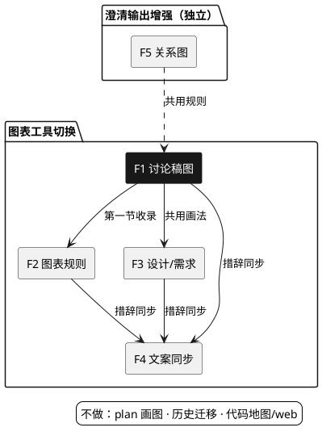
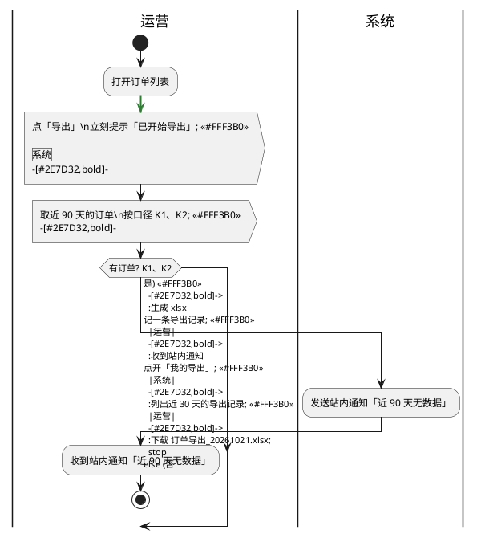

# 规格说明: 流程中的图表升级

> 产物: spec
> feature-id: 2026-10-31-流程中的图表升级
> 负责人: liulongfei
> 日期: 2026-10-31

## 功能方案

> 原样收录 clarify 终确认的功能方案(讨论稿 v2);业务要变,回 clarify 改,再同步这一节。

**一句话**:把澄清讨论稿、spec、设计文档、需求文档里的图从 mermaid 换成 PlantUML——图仍在 Markdown 里,你在支持 PlantUML 的预览里看真泳道,仓库不新增生成物。

**业务口径**:无取数口径。

**用户会这样用**:流程不变,看图方式变——讨论稿、spec、设计文档、需求文档的图都在支持 PlantUML 的预览里打开;plan、代码地图、web 系统地图、历史文档照旧。

**功能点关系图**(图回答:谁支撑谁、哪些独立、哪些不做)



**功能点**

| 编号 | 类别 | 一句话 | 边界 |
|---|---|---|---|
| F1 | 核心 | 讨论稿的图换 PlantUML,预览看真泳道 | 小需求不出图;未启用扩展只见源码;时间线类兜底 |
| F2 | 支撑 | spec 第一节随讨论稿,模板图换 PlantUML | 历史 spec 不重写;第一节不改写 |
| F3 | 支撑 | 设计文档 + 需求文档的图换 PlantUML(设计文档用泳道画法) | 历史文档不重写 |
| F4 | 支撑 | 指引文案的 mermaid 改 PlantUML | 只改措辞,不动结构 |
| F5 | 支撑 | 多功能点讨论稿加功能点关系图 | ≥3 点且关系非平凡;≤8 节点;不替代表 |

**体验决策**:源码内嵌、预览端渲染;仓库零生成物;一次性在 IDEA 的 Markdown 设置里启用 PlantUML 扩展。

**非目标**

- **plan 阶段**:维持「不画架构图/时序图/类图」;历史 plan 是快照,不重写。
- **存量需求产物**:已有 spec/讨论稿/设计文档/需求文档里的 mermaid 图不迁移。
- **代码地图 / design-map / cgraphx web 系统地图**:仍用 mermaid;web 只渲染 mermaid。
- **生成物**:不提交 SVG/PNG,不搭 PlantUML 服务端。
- **visual-explain**:单文件 HTML,与本次无关。

## 怎么实现

### 细节方案:F1 澄清讨论稿的泳道图改 PlantUML

| # | 决策 | 选择 | 没选的(为什么) | 理由(依据) | 影响面 |
|---|---|---|---|---|---|
| D1 | 图表语法 | PlantUML activity-beta;泳道用 `\|泳道\|` | 旧版 activity(无原生泳道);mermaid `subgraph` 模拟(现状) | PlantUML 文档:activity-beta 的 `\|lane\|`;旧画法是 mermaid 仿 PlantUML,现直接用 PlantUML | 讨论稿、设计文档的全部泳道图 |
| D2 | 样式头 | `skinparam backgroundColor #FFFFFF`、`skinparam Activity { BackgroundColor #F1F1F1; BorderColor #181818; FontColor #000000 }`、`skinparam Swimlane { BorderColor #181818; TitleBackgroundColor #FFFFFF; TitleFontColor #000000 }`、`skinparam ArrowColor #181818` | PlantUML 默认主题(和现有图不一致,深色主题下黑箭头看不见);CSS style(对旧版渲染器兼容性未知) | 现有 mermaid 主题变量 `primaryColor #F1F1F1`、`primaryBorderColor #181818`、`clusterBkg #FFFFFF`;skinparam 在 IDEA 扩展和 CLI 上都有 | 所有图 |
| D3 | 本次改动标黄 | 活动末尾加 `<<#FFF3B0>>`;改动的判断在 `if` 行末加 `<<#FFF3B0>>` | 只标活动(改动的判断看不见);`:step; #FFF3B0`(文档推荐构造型);黄色边框(不够醒目) | 对应现有 `:::changed`;PlantUML 1.2026.9 支持给判断菱形上色 | 所有「本次新增/改动」的活动和判断 |
| D4 | 主路径标绿 | 正常路径活动之间和 `if/else` 分支入口都写 `-[#2E7D32,bold]->`;分支入口把箭头单独写一行放在 `then`/`else` 后面 | 分支入口保持默认色(旧 linkStyle 覆盖了分支入口,正常路径会断在判断处);写内联 `then -[...]-> :...;`(语法错误) | 现有 `linkStyle ... stroke:#2E7D32,stroke-width:2px`;PlantUML 文档的 `-[#color,type]->` | 讨论稿、设计文档的泳道图 |
| D5 | 起止与结果 | `start` 起;每个分支用 `:结果文字;` 收尾再 `stop` | 共用末尾一个 `stop`(结果落在哪个泳道不清楚);`end`(终止叉号,不是结果) | PlantUML activity 语法;现有图有起点和每个分支的结果 | 所有泳道图 |
| D6 | 泳道顺序 | 先用户/调用方,再系统;按声明顺序排 | 沿用 mermaid 的从右往左(PlantUML 按声明顺序排,不需要) | PlantUML 文档的 `\|泳道\|`;现有视觉用户泳道在左 | 讨论稿、设计文档 |
| D7 | 判断与口径 | `if (条件?) then (是) ... else (否或业务标签) ... endif`;澄清讨论稿写口径编号,设计文档写业务条件;两个分支第一步同泳道,必须分属两侧时 `then` 在左、`else` 在右;分属两侧又无法满足左右顺序时回同一泳道,不反转条件 | 条件只写「有订单?」(读图的人要回表找口径);给设计文档造 K 编号;分支跨泳道且不按左 then 右 else 排(PlantUML 会把任意分支标签按左右贴反) | 现画法「讨论稿的判断和取数步骤写口径编号」;PlantUML swimlane 的标签按左右位置贴 | 讨论稿、设计文档 |
| D8 | 文字规则 | 换行 `\n`;活动文字不用半角分号和半角引号,中文直角引号 `「」` 可以用于界面原文;括号只用于 `if (...)`;只写业务语言;一张图 ≤15 个框/节点(活动、判断、开始/结束都算) | 照抄 mermaid 的 `<br/>`、「不用半角括号」(与 PlantUML 语法冲突);按「15 个活动」只数步骤(判断和起止不算,图会超密) | 现画法规则 + PlantUML 语法 | 所有图 |
| D9 | 查看提示 | 讨论稿顶部写「用支持 PlantUML 的 Markdown 预览打开(IDEA:设置 → 语言和框架 → Markdown → 启用 PlantUML)」 | 不提示(没启用扩展的人只看到源码) | 体验决策「源码内嵌,预览端渲染」 | 讨论稿 |

#### PlantUML 画法契约

所有泳道图都带同一段样式头(逐字一致),再写图:

```text
@startuml
skinparam backgroundColor #FFFFFF
skinparam Activity {
  BackgroundColor #F1F1F1
  BorderColor #181818
  FontColor #000000
}
skinparam Swimlane {
  BorderColor #181818
  TitleBackgroundColor #FFFFFF
  TitleFontColor #000000
}
skinparam ArrowColor #181818
```

规则:

1. **泳道**:`|泳道名|`;先用户/调用方,再系统;样式头设白底,不写泳道颜色。
2. **起止**:`start` 起;结果写 `:结果文字;` 再 `stop`;每个分支各接一个结果,不共用末尾 `stop`。
3. **改动标黄**:本次新增/改动的活动末尾加 `<<#FFF3B0>>`;改动的判断在 `if` 行末加 `<<#FFF3B0>>`。
4. **主路径标绿**:正常路径上活动之间写 `-[#2E7D32,bold]->`;`if/else` 的分支入口也标绿,把箭头单独写一行放在 `then`/`else` 后面,再写分支的第一步。
5. **判断**:`if (条件?) then (是) ... else (否或业务标签) ... endif`。澄清讨论稿写口径编号,设计文档写业务条件,不造 K 编号。同一个 `if` 的两个分支第一步放同一泳道;必须分属两侧时,`then` 在左、`else` 在右,两个分支的标签都按物理左右检查(PlantUML 把任意标签按左右贴);分属两侧又无法满足左右顺序时,把分支第一步改回同一泳道,不调换泳道或反转条件。
6. **文字**:换行用 `\n`;活动文字不用半角分号和半角引号,中文直角引号 `「」` 可以用于界面原文;括号只用于 `if (...)`;只写业务语言。
7. **数量**:一张图不超过 15 个框/节点(活动、判断、开始/结束都算),超了拆图。
8. **不用 mermaid 语法**:不出现 `subgraph`、`classDef`、`linkStyle`、`<br/>`。
9. **样式头**:每个 PlantUML 代码块自带一份逐字相同的样式头(代码块必须自包含);改样式时同步全部样例。

完整样例(讨论稿的订单导出,本次新增步骤标黄):



落地文件:

- `assets/claude-template/skills/dev-clarify/references/泳道图画法.md`:整篇按上面的契约重写,保留原有「一张图不超过 15 个框、只写业务语言、判断写口径编号」的意图。
- `assets/claude-template/skills/dev-clarify/references/功能方案-讨论稿范例.md`:**「用户会这样用」的泳道图**按本契约重画;关系图见 F5。
- `assets/claude-template/skills/dev-clarify/SKILL.md`:两处措辞(description、讨论稿查看提示)按 F4 改;⑤ 的关系图规则见 F5。

### 细节方案:F2 spec 的图表规则同步

除 D10 外,沿用 F1 的 D1-D9,无新决策。

| # | 决策 | 选择 | 没选的(为什么) | 理由(依据) | 影响面 |
|---|---|---|---|---|---|
| D10 | 时间线等不擅长的图 | 先用表或编号步骤,不保留 mermaid | 强行用 PlantUML 画成流程(语义变味);保留 mermaid(与零 mermaid 验收冲突) | PlantUML 无原生时间线;零 mermaid 约束 | 未来 spec 的少量图 |

落地:

- `assets/claude-template/skills/dev-spec/SKILL.md` 的样例图换成 F1 的完整 PlantUML 示例;加图表规则:spec 自己新写的活动/时序/状态/类图默认 PlantUML,时间线等用表/编号步骤;第一节收录窗口改为「一句话→非目标」(含体验决策后的非目标),其余按编号引用不变。
- spec 第一节收录讨论稿 v2 时,图随文原样进第一节;本 spec 第一节已经是示例。

### 细节方案:F3 doc-delivery 设计文档 + 需求文档换 PlantUML

| # | 决策 | 选择 | 没选的(为什么) | 理由(依据) | 影响面 |
|---|---|---|---|---|---|
| D11 | 设计文档样例 | 3 张 mermaid 样例按 F1 契约换 PlantUML;「原来/现在」的对比规则和三条额外规则(两条泳道、判断画全、接口写标题)不变 | 保留 mermaid(同一份画法两套语法);只换流程全景、不换环节图(不一致) | `doc-delivery/references/设计文档.md` 现有 3 张样例 + `泳道图画法.md` | 设计文档 3 张样例 |
| D12 | 需求文档样例 | 2 张 `flowchart LR` 换成 PlantUML 的 `rectangle` + 箭头图,保持从左到右;判断用 `hexagon`/矩形,箭头标分支 | 保留 mermaid(用户已确认全换);用 activity(第二张有两个入口——付款/退款在流水处汇合,activity 的单起点不好表达) | `doc-delivery/references/需求文档.md` 现有 2 张样例,第二张是双入口汇合 | 需求文档 2 张样例 |
| D13 | 需求文档/设计文档的查看与分发 | 文档头写「对外分发时由发送方提供可渲染的预览或 PDF」;作者用支持 PlantUML 的预览检查;生成物不进仓库 | 要求客户自己装 PlantUML(不现实);提交 SVG/PDF(生成物);把 IDEA 提示塞进客户要看的模板头 | 需求文档给领导/客户看;设计文档给领导和研发看;体验决策「源码内嵌」 | 需求/设计文档的规则与样例 |

落地:

- `assets/claude-template/skills/doc-delivery/references/设计文档.md`:3 张样例按 F1 契约重画;样例加白底;环节图的正常分支入口标绿、改动的判断标黄;规则文字「画图用 mermaid,样式模拟 PlantUML 活动图」改成「画图用 PlantUML 活动图」;头加查看/对外分发提示;三条额外规则保留。
- `assets/claude-template/skills/doc-delivery/references/需求文档.md`:模板里的 2 个 `flowchart LR` 示例和需求概览范例换成 PlantUML 的 `rectangle` + 箭头图,保持从左到右;rectangle 头加白底;章节写法里的「或 Mermaid」改成「或 PlantUML」;按 D13 写对外分发预览/PDF;业务流程行加泳道边界和 `泳道图画法.md` 指针。
- 需求文档的简单业务流程图不套泳道;需要角色/系统分开、起止或复杂判断时,按 F1 的泳道写法(参考文件里有这条边界和指针)。

### 细节方案:F4 指引文案同步

沿用现有文案结构,只做替换,无新决策。

| 文件 | 替换 |
|---|---|
| `assets/claude-template/CLAUDE.md` | 「带 mermaid 流程图」→「带 PlantUML 流程图」 |
| `assets/claude-template/FLOW-MAP.md` | 「另写 mermaid 讨论稿」→「另写 PlantUML 讨论稿」 |
| `assets/claude-template/skills/cgraphx-guide/SKILL.md` | 「带 mermaid 流程图」→「带 PlantUML 流程图」 |
| `assets/claude-template/skills/cgraphx-guide/how-to-use.md` | 同上 |
| `assets/claude-template/skills/cgraphx-guide/how-to-use.html` | 同上,只改文本节点,不动 HTML 结构 |
| `assets/claude-template/skills/cgraphx-guide/skills.html` | 同上,只改文本节点,不动 HTML 结构 |
| `assets/claude-template/skills/dev-clarify/SKILL.md` description | 「带 mermaid 流程图」→「带 PlantUML 流程图」 |
| `assets/claude-template/skills/dev-clarify/SKILL.md` 讨论稿查看提示 | 「用能渲染 mermaid 的 Markdown 预览打开」→「用支持 PlantUML 的 Markdown 预览打开」 |
| `assets/claude-template/skills/dev-spec/SKILL.md` | 样例图按 F2 换;加图表规则(默认 PlantUML;时间线用表/编号步骤) |
| `assets/claude-template/skills/doc-delivery/references/设计文档.md` | 规则文字按 F3 换 |
| `assets/claude-template/skills/doc-delivery/references/需求文档.md` | 「或 Mermaid」按 F3 换 |

- 历史需求文档/spec/代码地图里的 mermaid 字样不动。
- 完成后 `grep -ri mermaid assets/claude-template` 应为空;HTML 文件只做文本替换。

### 细节方案:F5 澄清讨论稿的功能点关系图

| # | 决策 | 选择 | 没选的(为什么) | 理由(依据) | 影响面 |
|---|---|---|---|---|---|
| D14 | 什么时候画 | 多功能点需求且 ≥3 个点、关系非平凡才画;1–2 个点或纯线性不画 | 每个讨论稿都画(成本、重复);完全不画(用户要) | 功能点明细的「类别/关联」;讨论稿的成本原则 | 讨论稿 |
| D15 | 图种 | 有向关系图:`package`/`rectangle` + 带标签 `-->`;冲突用 `..>` 虚线 | 泳道图(回答用户旅程,已有);时序图(没有时间交互);类图(没有类);状态图(没有生命周期);思维导图(只表达层级) | 图只回答「谁支撑谁、哪些独立、哪些不做」;design-map 的图种判据 | 讨论稿 |
| D16 | 内容与样式 | 节点 = F 编号 + 3–5 字;≤8 个;核心 `#181818` + 白字,支撑 `#F1F1F1`,独立项单独 package;不做项用 `legend right` 一行;箭头带标签;不用黄色;超过 8 个点回表 | 把边界/依据塞进节点(图变密);超过 8 个点硬画(不可读);用黄色(和泳道「本次改动」语义冲突) | 功能点明细的类别/关联;讨论稿的标黄语义 | 讨论稿的关系图 |
| D17 | 放置与和表的关系 | 放在「用户会这样用」之后、功能点短表之前;短表随后;长行为链/依据放下半部分;图不替代表,冲突时以表为准 | 图替代表(丢边界/依据);图放在表后(人先读长表再看图) | 讨论稿模板;用户要「以图为主,短表兜底」 | 讨论稿 |
| D18 | 示例与模板 | 本 spec 第一节的 F1–F5 图作为第一个完整示例;`功能方案-讨论稿范例.md` 加一小段关系图规则/示例(触发条件不满足时省略) | 只在 skill 正文写规则、不给示例(AI 模仿不到) | 用户要求;本需求讨论稿 v2 | `dev-clarify/SKILL.md` ⑤、`功能方案-讨论稿范例.md` |

#### 功能点关系图契约

样式头:

```text
@startuml
skinparam backgroundColor #FFFFFF
skinparam rectangle {
  BackgroundColor #F1F1F1
  BorderColor #181818
  FontColor #000000
}
skinparam package {
  BackgroundColor #FFFFFF
  BorderColor #181818
  FontColor #000000
}
skinparam ArrowColor #181818
```

规则:

1. **触发**:多功能点需求,≥3 个点且关系非平凡(有分叉、汇合、跨点依赖,或有「不做」项要和做的项摆在一起看);1–2 个点或纯线性不画。
2. **图种**:有向关系图(`package`/`rectangle` + `-->`);冲突用 `..>` 虚线并标「冲突」;不画泳道、时序、类图、状态图、思维导图。
3. **节点**:F 编号 + 3–5 字;≤8 个;核心 `#181818` + 白字,支撑 `#F1F1F1`,独立项单独 `package`;不做项用 `legend right` 一行,不占节点;不用黄色。
4. **箭头**:带具体动词标签(如「第一节收录」「共用画法」「措辞同步」);箭头不是时间顺序,不编号。
5. **放置**:讨论稿「用户会这样用」之后、功能点短表之前;关系图后跟一行一个点的短表;长行为链/依据放下半部分供 spec。
6. **不替代表**:图从功能点明细的「类别/关联」列派生;表改了图要跟着改;冲突时以表为准;超过 8 个点不画图,回到表,不截断。
7. **范围**:随讨论稿进 spec 第一节;不用于 spec/plan 的实现章节/每个功能点,也不替代泳道图/单点行为链图。

示例见本 spec 第一节的功能点关系图(F1–F5);`功能方案-讨论稿范例.md` 里加一小段同样的规则和一个简化示例。

## 全局约束

- **只改资产源** `assets/claude-template/`;`.claude/` 是部署产物,不直接改、不提交。
- **不改程序**:`src/web`、`docs/code-map/`、`design-map`、cgraphx web 的系统地图仍用 mermaid。
- **历史产物不重写**:已有 spec/plan/设计文档/需求文档/讨论稿 v1 里的 mermaid 图保持原样;本次只改模板与规则。
- **不提交生成物**:不提交 SVG/PNG/PDF,不搭 PlantUML 服务端;仓库零生成物。
- **12 个 mermaid 资产文件 + 3 个下游 skill 文件**(`dev-handoff`、`function-plan-reviewer`、`doc-delivery/SKILL.md`);18 处 mermaid(大小写不敏感);完成后这些 assets 文件里不再出现 mermaid,也不再有 `subgraph`/`classDef`/`linkStyle`/`<br/>` 残留。
- **样式头单一版本源**:`泳道图画法.md` 定义泳道图的样式头和规则;每个 PlantUML 代码块自带一份逐字相同的样式头(代码块必须自包含);改样式时同步全部样例,验收时检查各份逐字一致。关系图的样式头在 F5 契约里,同理。
- **关系图随讨论稿进 spec 第一节**:不用于 spec/plan 的实现章节/每个功能点。
- **对外需求/设计文档**:换成 PlantUML 后,对外分发时由发送方提供可渲染的预览或 PDF;生成物不进仓库;作者用支持 PlantUML 的预览检查。
- **部署验证**:`npm run build` 后 `cgraphx install` 到临时项目,部署出的 skill 文件与资产源一致;`.claude/` 不提交。

## 设计验收

| # | 对应 | 验收点 | 怎么验 |
|---|---|---|---|
| 1 | D1-D8 | F1 的泳道图样例在 PlantUML 里渲染:真泳道、灰底黑框、白底、黄色改动活动/判断、绿色主路径(含分支入口)、start/stop、判断写口径编号;深色主题下也可读;`if` 的任意分支标签和实际分支内容一致 | 用 IDEA Markdown 预览(启用 PlantUML)或本地 PlantUML CLI(含 `--dark-mode`)渲染 `功能方案-讨论稿范例.md`;看语法无报错、视觉符合 |
| 2 | D9 | 讨论稿顶部有「用支持 PlantUML 的 Markdown 预览打开」提示 | 读 `dev-clarify/SKILL.md` 和讨论稿范例 |
| 3 | D14-D18 | 关系图渲染:核心/支撑分组、箭头标签、不做项一行、≤8 节点;节点 3–5 字、边从功能点明细的「关联」派生;触发条件不满足时不出图 | 渲染本 spec 第一节的图;审阅 `dev-clarify/SKILL.md` ⑤ 和范例 |
| 4 | D10 | 时间线用表/编号步骤的规则写进 `dev-spec/SKILL.md` | 读 `dev-spec/SKILL.md` |
| 5 | D11-D13 | 设计文档 3 张 + 需求文档 2 张样例都能渲染;设计文档环节图含绿色分支入口和黄色改动判断;需求文档有对外分发预览/PDF 规则和泳道边界 | 渲染 5 张样例;grep 规则文字 |
| 6 | F4 | 12 个 mermaid 资产 + 3 个下游 skill 文件里不再出现 mermaid(大小写不敏感);没有 `subgraph`/`classDef`/`linkStyle`/`<br/>` 残留 | `grep -ri mermaid assets/claude-template`;人工检查新图 |
| 7 | 第一节 | spec 第一节的「一句话→非目标」与讨论稿 v2 逐字一致(只补格式不改内容) | diff |
| 8 | 全局 | `npm run build` 后 `cgraphx install` 到临时项目,部署出的 skill 文件与源一致;`.claude/` 未提交 | 构建 + install + git status |
| 9 | 全局 | 历史 spec/plan/设计文档/需求文档/代码地图/web 未改 | `git diff` 范围检查 |
| 10 | D2/D11 | 5 份泳道样式头逐字一致(白底、活动、泳道、箭头);设计文档 3 份 + dev-spec + 范例;改样式时同步 | 提取各代码块样式头做 diff |
| 11 | F5 | `dev-handoff`、`dev-spec` 分会话复制、⑥ 审核 prompt 都处理关系图:按本会话负责的 F 点裁剪,被裁掉的点在图注里列出;审核检查图/表一致 | 读三个文件;按分会话样例走一遍 |

## 待确认项

- 无。
