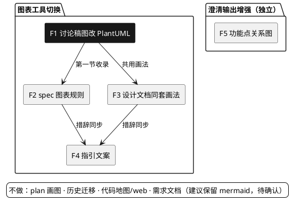

# 功能方案: 流程中的图表升级(讨论稿 v1)

> 讨论稿,不是契约:人终确认的那一版由 `/dev-spec` 原样收录为 spec 第一节,之后以 spec 为准,本文件不再维护。
> 图在文首,用支持 PlantUML 的 Markdown 预览打开(IDEA:设置 → 语言和框架 → Markdown → 启用 PlantUML)。

**一句话**:把澄清讨论稿、spec、设计文档里的图从 mermaid 换成 PlantUML——图仍在 Markdown 里,你在支持 PlantUML 的预览里看真泳道,仓库不新增生成物。

**业务口径**:无取数口径。

**用户会这样用**:流程不变,看图方式变——讨论稿和 spec 的图在支持 PlantUML 的预览里打开;发布后的设计文档同理;plan、代码地图、web 系统地图、历史文档照旧。

**功能点关系图**(图回答:谁支撑谁、哪些独立、哪些不做)

**功能点**

| 编号 | 类别 | 一句话 | 边界 |
|---|---|---|---|
| F1 | 核心 | 讨论稿的图换 PlantUML,预览看真泳道 | 小需求不出图;未启用扩展只见源码;时间线类兜底 |
| F2 | 支撑 | spec 第一节随讨论稿,模板图换 PlantUML | 历史 spec 不重写;第一节不改写 |
| F3 | 支撑 | 设计文档的图换 PlantUML,同套画法 | 历史设计文档不重写;需求文档建议保留 mermaid(待确认) |
| F4 | 支撑 | 指引文案的 mermaid 改 PlantUML | 只改措辞,不动结构 |
| F5 | 支撑 | 多功能点讨论稿加功能点关系图 | ≥3 点且关系非平凡;≤8 节点;不替代表 |

**体验决策**:源码内嵌、预览端渲染;仓库零生成物;一次性在 IDEA 的 Markdown 设置里启用 PlantUML 扩展。

**非目标**

- **plan 阶段**:维持「不画架构图/时序图/类图」;历史 plan 是快照,不重写。
- **存量需求产物**:已有 spec/讨论稿/设计文档里的 mermaid 图不迁移。
- **代码地图 / design-map / cgraphx web 系统地图**:仍用 mermaid;web 只渲染 mermaid。
- **需求文档(给领导/客户看)**:建议保留 mermaid,不要求读者装 PlantUML;待你确认。
- **生成物**:不提交 SVG/PNG,不搭 PlantUML 服务端。
- **visual-explain**:单文件 HTML,与本次无关。

---

## 以下供 spec 使用,可不细读

### 确认的功能点清单

| 编号 | 功能点 | 类别 | 行为链(已锁定) | 边界 | 落地依据 | 关联 |
|---|---|---|---|---|---|---|
| F1 | 澄清讨论稿的泳道图改 PlantUML | 核心 | 多功能点需求 → clarify 写讨论稿 → 「用户会这样用」一节出 PlantUML 活动图 → 人在支持 PlantUML 的预览里看到真泳道、本次新增步骤标黄、正常路径标绿 | ① 单功能点小需求仍不出图 ② 预览未启用 PlantUML 扩展时只显示源码,讨论稿注明查看方式 ③ 时间线等 PlantUML 不擅长的图改用表或保留 mermaid | `dev-clarify/references/泳道图画法.md`(现为 mermaid 仿 PlantUML 画法)、`功能方案-讨论稿范例.md`(现图)、`dev-clarify/SKILL.md` 两处措辞 | F2(第一节收录)、F3(共用画法)、F4(措辞) |
| F2 | spec 的图表规则同步 | 支撑 | 讨论稿终确认 → spec 第一节原样收录(图随文) → spec 模板图换 PlantUML;spec 自己新写的活动/时序/状态/类图默认 PlantUML | ① 历史 spec 不重写 ② 第一节不改写、不扩写 ③ 同一张图不混两种语法 | `dev-spec/SKILL.md` 第一节收录规则 + 现有 mermaid 范例 | F1 |
| F3 | doc-delivery 设计文档同套画法切换 | 支撑 | 发布后按需写设计文档 → 流程全景图/环节图用 PlantUML 活动图,画法引用同一份《泳道图画法》→ 3 张范例同步替换;规则文字改为「画图用 PlantUML 活动图」 | ① 历史设计文档不重写 ② 发布后按需,不在主链 ③ 需求文档建议保留 mermaid,待确认 | `doc-delivery/references/设计文档.md`(3 张 mermaid 范例 + 画法段) | F1、F4 |
| F4 | 指引文案同步 | 支撑 | 模板 CLAUDE.md、FLOW-MAP.md、cgraphx-guide 4 个文件里,「带 mermaid 流程图的讨论稿」→「带 PlantUML 流程图的讨论稿」;查看提示改「支持 PlantUML 的预览」 | 只改措辞,不改流程结构;历史需求文档/spec/代码地图里的 mermaid 字样不动 | 模板 CLAUDE.md、FLOW-MAP.md、cgraphx-guide 的 `SKILL.md` / `how-to-use.md` / `how-to-use.html` / `skills.html` | F1–F3 |
| F5 | 澄清讨论稿的功能点关系图 | 支撑 | 多功能点需求且关系非平凡 → 讨论稿先出一张有向关系图(核心/支撑/不做分组) → 再放一行一个点的短表;长行为链和落地依据放在下半部分供 spec | ① ≥3 个点且关系非平凡才画;1–2 点或纯线性不画 ② ≤8 个节点,不做项用一行文字 ③ 箭头带标签,一图只回答「谁支撑谁、哪些独立、哪些不做」 ④ 不替代功能点表 | 现有功能点表的「类别/关联」列,无新数据源;`dev-clarify/SKILL.md` ⑤ 与 `references/功能方案-讨论稿范例.md` | F1(同一套图语法/工具)、F2–F4(第一个示例) |

### 体验变体的选择记录

- 已选:**源码内嵌、预览端渲染**。讨论稿仍是自包含的 Markdown;仓库零生成物。代价是 GitHub/网页不渲染 PlantUML,看图依赖 IDEA 的 PlantUML 扩展。
- 未选:源码 + 生成 SVG 提交(多一份生成物、改图要重生成);保持 mermaid(不引入工具链)。

### 已锁定技术约束

- PlantUML 代码块语言标记用 `plantuml`。
- 图仍在 Markdown 文件内,不提交 SVG/PNG,不搭 PlantUML 服务端。
- 不改程序;cgraphx web 的系统地图仍只渲染 mermaid,不在本次范围。
- 历史产物不重写。
- 关系图只用于多功能点讨论稿,不用于 spec/plan 的每个功能点。

### 影响半径与风险

- **LOW–MEDIUM**:12 个资产文件、18 处 mermaid(大小写不敏感),全部在 `assets/claude-template/` 下;无程序改动、无测试依赖这些文本。
- 风险:PlantUML 语法/布局在打开预览前不可见 → 用完整范例兜住,可选在本地装 plantuml 命令行让 AI 自检(不提交产物)。
- 使用前提:IDEA 的 Markdown 设置里启用 PlantUML 扩展(一次性)。

### 留给 spec 的细节决策

- PlantUML 样式头:灰底/黑框/泳道白底/本次改动标黄/正常路径标绿,分别用什么 skinparam 和元素写法。
- 用哪套 activity 语法(新版 activity + `|泳道|`),以及开始/结束/判断/结果的写法。
- 文字规则迁移:换行用 `\n`;现有「不用半角括号、分号和引号」的禁令要按 PlantUML 语法调整(判断条件本身要用括号)。
- 时间线等 PlantUML 不擅长的图怎么兜底(表或 mermaid)。
- 关系图的箭头语义、节点上限、分组样式,以及与泳道图颜色语义的区分(黄色只留给「本次改动」)。
- 本地 plantuml 命令行自检是否写进 skill(装了的机器才做,不强制)。
- 构建后怎么验证资产部署(`npm run build` 后装到临时项目;不提交 `.claude/`)。

### 现实约束清单

- **澄清**:只有多功能点需求写讨论稿,一张 mermaid 泳道图;单功能点需求无图。
- **spec**:第一节原样收录讨论稿;spec 自身偶有状态图/时间线(mermaid)。
- **plan**:当前规范明确不画架构图、时序图、类图;10-25 之后的 plan 无图;10-25 之前 15 个 plan 文件有 mermaid。
- **doc-delivery 设计文档**:3 张 mermaid 泳道图 + 画法规则;需求文档 2 张简单流程图 + 1 处「Mermaid」措辞。
- **代码地图** `docs/code-map/` 用 mermaid;`design-map` 是用户级 skill,原则是「日常一律 Mermaid,泳道活动图等撑不住才升 PlantUML」。
- **cgraphx web**:系统地图页从 CDN 加载 mermaid;功能文档页不渲染 mermaid/PlantUML。
- **本机**:IntelliJ IDEA 的 Markdown 预览支持 PlantUML(需启用 Markdown 的 PlantUML 扩展);无独立 plantuml 命令行;brew 已装 openjdk 26.0.1;无 VS Code/Cursor/Typora/Obsidian。
- **资产源**在 `assets/claude-template/`; `.claude/` 是部署产物,不改。
- 12 个资产文件、18 处 mermaid;无测试依赖这些文本。

### 必须在 spec 前解决的问题

- **需求文档(给领导/客户看)是否保留 mermaid**:待你确认;默认保留,不挡 spec。

### 后续阶段的决策

- 无。

### 下游就绪判断

- **Spec 可写**:是。
- **Plan 可写**:不需要(单模块、12 个资产文件,小需求)。
- **是否需先探索**:不需要,现实约束已核。

### 用户控制的下一步

`/dev-spec`(推荐,把 PlantUML 样式头和文字规则钉死)· `/dev-impl`(跳过 spec 直接改)· `/dev-handoff`(换会话继续)· `/doc-delivery`(发布后按需)。
