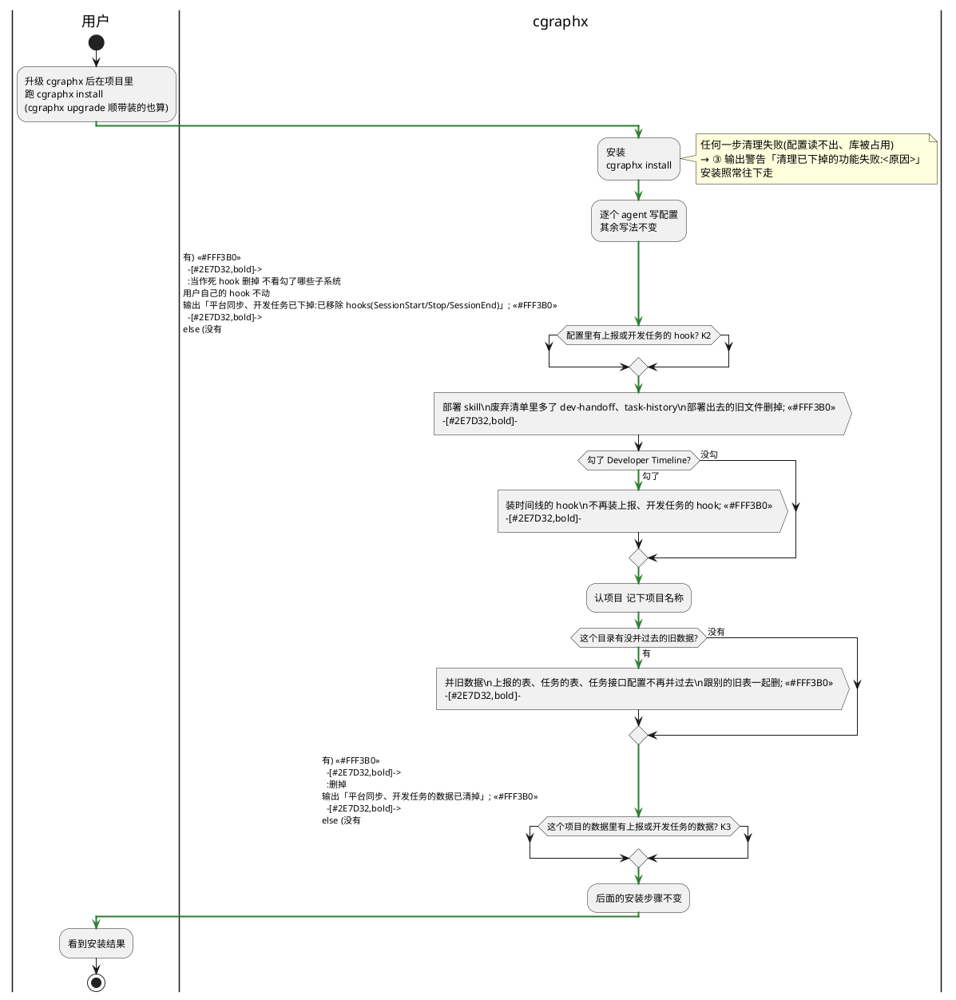
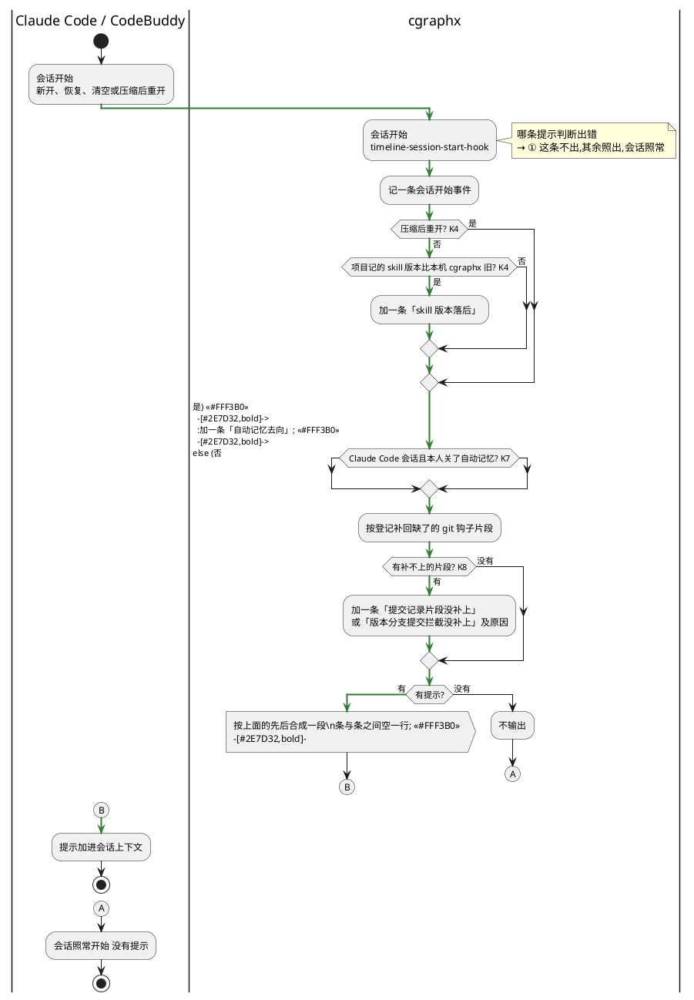

# 规格说明: 下掉web与平台同步

> 产物: spec
> feature-id: 2026-11-05-下掉web与平台同步
> 负责人: liulongfei
> 日期: 2026-11-06

## 功能方案

> 原样收录 clarify 终确认的功能方案(讨论稿 v4);业务要变,回 clarify 改,再同步这一节。

**一句话**:原来 cgraphx 除了时间线、知识库、需求目录这些本机能力,还带一个本地网页浏览服务、和研发管理平台的对接(上报研发数据、拉任务),以及把会话自动归到需求的开发任务;这次把它们连同只为它们存在的会话交接、按任务算历时一起撤掉,数据只留在本机,用命令和文件看。开需求副本或 git worktree 算一个任务、按任务算历时,后期再补。

**功能清单**

| 编号 | 功能点 | 类别 | 从哪进 → 到哪去 | 一句话 |
|---|---|---|---|---|
| F1 | 下掉本地 web | 核心 | `cgraphx web` → 报未知命令 → 改用命令和文件 | 浏览器里看知识库、时间线、任务、表结构、代码地图的页面都去掉;除任务外的数据照旧能用命令和文件看 |
| F2 | 下掉平台上报 | 核心 | `cgraphx sync`、会话开始与结束、查知识库、产物检查、`features show` 与实现收尾的环节提醒 → 不再上报、不再提平台 | 不再往平台报数据;只为上报存在的参考记录、平台下发的产物类型一起去掉;「平台环节」改成本地的「需求环节」 |
| F3 | 升级时清理 | 支撑 | 升级后 `cgraphx install` → 各 agent 的配置、部署出去的 skill、这个项目的数据 | 删掉已装项目里上报和开发任务的 hook、数据,以及部署出去的 dev-handoff、task-history |
| F4 | 下掉开发任务 | 核心 | `cgraphx task`、会话开始与轮次结束、spec 头部 `> 任务:`、`/dev-start` → 不再归集 | `cgraphx task` 全部命令、目录任务、会话自动归到需求都去掉;会话开始的提示照旧出 |
| F5 | 下掉会话交接 | 核心 | `/dev-handoff`、澄清中途换会话、`/dev-start` → 讨论稿里的「澄清进度」→ 新会话接着写 | 不再写交接文件:澄清中途换会话,先把进度写进讨论稿;一个需求只开一个副本 |
| F6 | 下掉按任务算历时 | 核心 | `/dev-end`、`/doc-report` 的阶段总结 → 不再按任务算 | task-history 子 agent 去掉;收口档案的「历时」只留起止日期和日历跨度;阶段总结不再按某个需求出 |
| — | 平台上已有的数据 | 边界外排除 | — | 不删,平台服务端不动 |
| — | 按需求副本、git worktree 记任务 | 边界外排除(后期) | — | 后期计划:开需求副本或 git worktree 就算一个任务,直接写进任务表;按任务算历时到时一起补 |

### F1 下掉本地 web(核心)

用户感知:`cgraphx web` 没了,浏览器里看不了;任务页随开发任务一起去掉(F4)。其余数据都在,改用命令和文件看。不变:其余命令和它们的输出;知识库、时间线、表结构知识库、代码地图这些数据和文件都不动。

行为链:跑 `cgraphx web` → 报 `error: unknown command 'web'`,退出码 1 → 照下表改用命令或直接看文件。

边界:① 升级前已经开着的 web 服务照常跑到关掉为止,关掉后再起不来。

| 原来在 web 上看 | 现在看哪 |
|---|---|
| 知识库总览、文档详情 | `cgraphx docs concepts` 列概念,`cgraphx docs show <文档> --body` 看正文;或直接打开 `docs/knowledge/` 下的文件 |
| 时间线 | `cgraphx timeline query`、`cgraphx timeline recent`、`cgraphx timeline stats` |
| 任务 | 随开发任务一起去掉,见 F4 |
| 表结构 | 直接看 `docs/schema-knowledge/<工程>/` 下的 INDEX.md 和 ddl/*.sql,或用 `/db-query` |
| 代码地图 | 直接看 `docs/code-map/` 下的文件 |

🎭 体验决策:跑已经下掉的命令只报 `error: unknown command 'web'`,不另给提示,和 2.0 去掉 1.x 命令时一样;F2 的 `cgraphx sync`、F4 的 `cgraphx task` 同样处理。

### F2 下掉平台上报(核心)

用户感知:不再往平台报数据;`cgraphx sync` 的 connect、now、status、disconnect 都没了;会话开始不再出现「平台上报已暂停」「平台上报已连续失败超过 1 小时」的提示,会话开始、结束都不再拉起后台上报。只为上报存在的两样一起去掉:查知识库时记的参考(原来只报给平台)、平台下发的项目产物类型。「平台环节」改成本地的「需求环节」:照旧按产物算各环节齐没齐、照旧提醒还缺什么,只是不再提平台。平台上已经有的数据不动。从平台拉任务随开发任务一起去掉,见 F4;清掉已装项目里留下的 hook 和数据见 F3。

行为链:跑 `cgraphx sync connect / now / status / disconnect` → 报 `error: unknown command 'sync'`,和 F1 一样不另给提示;会话开始、轮次结束、会话结束 → 不再有上报提示,也不再拉起后台上报;`cgraphx docs find / show` 带着 `--session` 跑 → 照常输出,`--session` 照收,只是不再记参考;`cgraphx features check` 和提交前的产物检查 → 产物类型只认内置的 K1;`cgraphx features show <需求>` → 「需求环节(按默认类型表)」下逐个列出设计、规划、测试、发布、交付文档齐没齐 K6,末尾一行「实现、知识经验:由提交和会话承载,不按产物算」,不再有「以平台为准」和项目自定义类型那一行;`/dev-impl`、`/dev-impl-subagent` 做完 → 汇报末尾照旧提醒,原文改成「这个需求还缺:测试。可以跑 `/api-case` 或 `/unit-spec` 补。」;FLOW-MAP 主线收尾那一格改叫「需求环节缺口提醒」;`/dev-end` 的发布记录照写,去掉「写了它,平台上的任务才会显示已发布」那条理由。

边界:① 在平台上给项目配过自定义产物类型的,这些产物从认得变成警告「未知类型 X:不是内置类型」,改法「改用内置类型标识」,不拦提交;本项目平台下发的 19 种都是内置类型,不受影响。

| 编号 | 哪一步 | 怎么判定 | 算 / 不算(例子) | 依据 |
|---|---|---|---|---|
| K1 | 产物检查 · 认哪些产物类型 | 只认内置的 20 种,不再读平台下发的类型表 | 算:spec、plan、knowledge、handoff 等内置类型;不算:平台上给项目加的自定义类型(警告,不拦提交) | 内置产物类型表;平台下发的类型存在 `sync_state`(key 为 platform_spec),本项目 19 种都在内置表里;新定 |
| K6 | 需求环节 · 齐没齐 | 按默认类型表把需求目录里的产物归到环节:有这个环节的产物就算齐;设计、测试两个必需的没有,标「缺(必需)」;规划、发布、交付文档没有,标「—」 | 有 spec → 设计 ✓;没有任何测试规格、测试报告 → 测试 ✗ 缺(必需);没有 plan → 规划 —;有收口档案 → 交付文档 ✓;知识库条目不进环节 | 产物注册表各类型的默认环节、`features show` 的环节表;沿用现在「平台环节」的算法,只改名、去掉平台的说法 |

### F3 升级时清理(支撑)

F2、F4、F5、F6 撤掉以后,已经装过的项目里还留着上报和开发任务的 hook、数据,以及部署出去的 dev-handoff、task-history,装新版时清掉;安装时不再装上报、开发任务的 hook(原来输出「平台同步 hook 已装」「开发任务绑定已装」)。旧的上报、开发任务 hook 当作已下掉命令留下的死 hook,在写 agent 配置那一步清掉,不看这次勾了哪些子系统。并旧数据(「数据按项目放用户目录」那个需求的「旧数据并过去」)不再并上报的表、任务的表和任务接口配置,它们跟别的旧表一起删掉,并之前的备份里还留着。

行为链:还没重装的项目,会话开始、轮次结束、会话结束时 agent 照常调旧的上报和开发任务 hook → 命令已经没有,这些 hook 都带着 `2>/dev/null || true`,不报错,会话照常 ①;`cgraphx uninstall` 卸载时写 agent 配置那一步照样把它们当死 hook 删掉 ②。

| 编号 | 哪一步 | 怎么判定 | 算 / 不算(例子) | 依据 |
|---|---|---|---|---|
| K2 | 有上报或开发任务的 hook? | cgraphx 为上报、开发任务写进 agent 配置的 hook:上报的会话开始、轮次结束、会话结束各一条;开发任务的会话开始、轮次结束各一条;还有旧配置里开发任务挂在工具调用后的那条 | 算:`cgraphx sync-stop-hook --agent codebuddy 2>/dev/null \|\| true`、`cgraphx task-session-start-hook 2>/dev/null \|\| true`、`cgraphx task-post-tool-use-hook`;不算:`cgraphx timeline-stop-hook` 这类时间线的 hook、`node …/precommit-check.cjs`、用户自己写的 hook | 各 agent 的 `settings.json`(`.claude/`、`.codebuddy/`);沿用写 agent 配置时清死 hook 的做法(`codegraph mark-dirty` 等 1.x 命令就是这样清的) |
| K3 | 有上报或开发任务的数据? | 只为上报、开发任务存的:上报进度、平台连接、参考记录、平台下发的产物类型、上报用的锁和触发文件;任务、绑定、会话的自动归属;任务接口配置 | 算:本库 60 个任务(平台 21、手动 5、目录 34)、8 条手动绑定、110 个会话的自动归属、任务接口配置、平台上报进度;不算:时间线、知识库索引、会话登记、并旧数据的备份 | 项目数据里(用户目录下这个项目的目录;没并过旧数据的目录在本地 `.cgraphx/`):`sync_*` 五张表、`task_*` 八张表,`sync.lock`、`sync-trigger`、`sync-worker.pid` 三个文件,`task-source.json`;新定 |

### F4 下掉开发任务(核心)

用户感知:`cgraphx task` 的 list、use、current、clear、show 都没了;会话不再自动归到需求目录,目录任务、手动任务都没了;spec 头部的 `> 任务:` 不再起作用,`/dev-spec` 也不再写这一行;`/dev-start` 开完副本不再说「副本里的会话、提交归到这个需求」。会话开始的提示改由时间线的会话开始 hook 出(下图):去掉「当前会话 id」那条(只给 task 命令用);去掉「配置里接了任务 hook,落后提示就交给任务 hook 出」那个判断;「自动记忆去向」从任务 hook 挪过来。本地已有的任务数据由 F3 删掉,不导出;后期按副本、worktree 记任务时重新攒(见功能清单「边界外排除」)。

行为链:跑 `cgraphx task …` → 报 `error: unknown command 'task'`,和 F1 一样不另给提示;轮次结束 → 不再刷新会话归属;写过 `> 任务:` 的 spec → 这一行留着不起作用,`cgraphx features check` 和提交前的产物检查不再查它,`cgraphx features show` 不再显示「任务」那一行;`/dev-spec` → 不再问、不再写 `> 任务:`;`/dev-start` 开完副本 → 回话里只说副本路径、分支和下一步,定位里讲「任务归属」的那句去掉。

边界:② 升级了还没重装的项目,配置里还挂着旧的任务 hook:会话开始的提示照样由时间线的 hook 出,不会因为配置里有旧任务 hook 就不出,落后提示里就有叫你重装的那句 ③ 本地已有的 60 个任务、8 条手动绑定、110 个会话的自动归属由 F3 删掉,不导出。

| 编号 | 哪一步 | 怎么判定 | 算 / 不算(例子) | 依据 |
|---|---|---|---|---|
| K4 | 压缩后重开?/ skill 版本比本机旧? | 压缩后重开的不出落后提示;其余情况,项目记录的 skill 版本比本机 cgraphx 旧就出;不再看配置里有没有接任务 hook | 算:项目记的 skill 是 2.0.12、本机 2.0.14,新开或恢复会话 → 出;配置里还挂着旧任务 hook → 照样出;不算:压缩后重开 → 不出;版本一样 → 不出 | 各 agent 配置目录下的 `cgraphx-version.json`;沿用(原来配置里接了任务 hook 时由任务 hook 出,没接时由时间线 hook 出) |
| K7 | Claude Code 会话且本人关了自动记忆? | Claude Code 的会话,且本人的本地设置里关了自动记忆;压缩后重开也出 | 算:`.claude/settings.local.json` 里 `autoMemoryEnabled` 为 false;不算:CodeBuddy 会话;没有这个设置文件;设置文件不是合法 JSON | `.claude/settings.local.json` 的 `autoMemoryEnabled`;沿用(原来在任务的会话开始 hook 里) |
| K8 | 有补不上的片段? | 按登记该有的提交记录片段、版本分支提交拦截片段,钩子文件里没有了就补回;补不上的(钩子文件被 git 跟踪、不是 shell 脚本、成了链接、钩子目录挪到仓库外)说一次原因,然后删掉这条登记 | 算:钩子文件被提交进仓库 → 提示一次「提交记录片段没补上:…」;不算:husky 重装依赖冲掉了片段 → 补回,不提示;从没装过片段的仓库 → 什么都不做 | `<git 公共目录>/cgraphx/hook-snippets.json` 的登记;沿用 |

### F5 下掉会话交接(核心)

用户感知:`/dev-handoff` 没了,不再写交接文件。澄清还没收拢就要换会话或开副本时,当前会话先把讨论稿写到最新:讨论稿留着「写稿中」那一行,在它下面加一节「澄清进度」,写清写到哪个 F、还等你拍板的事、已经拍板但还没写进图和口径表的口径(照抄);还没有讨论稿的,先照 `/dev-clarify` 的放法建 v1 再写这一节。新会话里 `/dev-clarify` 读到带「写稿中」的讨论稿,就从「澄清进度」接着写;收拢时这一节和「写稿中」那一行一起删掉。澄清收拢以后换会话,直接开新会话,说清讨论稿或 spec 的路径。一个需求只开一个副本;要几个会话并行,先把需求按功能点拆成几个需求目录,各自写讨论稿,再各开各的副本。以前写好的交接文件留着,产物检查照旧认。

行为链:输入 `/dev-handoff` → agent 里已经没有这个命令;`/dev-clarify` 结束时给的下一步里不再有 `/dev-handoff`;澄清中途要换会话 → 当前会话按 K9 判断没收拢,先写「澄清进度」,再开新会话;`/dev-start` 碰到本会话澄清没收拢 K9 → 不再转 `/dev-handoff`,先在本会话把澄清进度写进讨论稿,再开副本,讨论稿随需求目录移进副本,到副本里开新会话接着 `/dev-clarify`;`/dev-start` 讲「同一个需求换会话」的地方改成「在副本里直接开新会话,不开新副本」。

边界:① 已经部署出去的 dev-handoff 由 F3 装新版时删掉 ② 以前写好的交接文件不删,产物检查照旧认「交接文件」这种产物 ③ 同一个需求已经有副本,再对它 `/dev-start`:提示「这个需求已经有副本 <副本目录名>;一个需求只开一个副本,要并行先把需求拆成几个需求目录」,不开第二个。

| 编号 | 哪一步 | 怎么判定 | 算 / 不算(例子) | 依据 |
|---|---|---|---|---|
| K9 | 澄清收拢没有 | 讨论稿已经去掉「写稿中」那一行就算收拢;还没写出讨论稿、或讨论稿还带着「写稿中」,都算没收拢 | 算收拢:v4 头注里没有「写稿中」;不算:只在对话里聊过,还没有讨论稿;讨论稿 v1 还带着「写稿中」 | 讨论稿的头注;沿用 `/dev-start` 现在的判断 |

### F6 下掉按任务算历时(核心)

用户感知:task-history 子 agent 没了;`/dev-end` 写收口档案时,「历时」一节只写立项日期、完成日期和日历跨度,不再估「实际投入」;`/doc-report` 的阶段总结不再按某个需求出,只按时间窗或会话出。按任务算历时,后期按副本、worktree 记任务时再补(见功能清单「边界外排除」)。

行为链:`/dev-end <需求>` → 历时节写「立项:<日期> · 完成:<日期> · 日历跨度:<N 天>」K5,不派子 agent,不估实际投入;要 `/doc-report` 出某个需求的阶段总结 → 说明暂不支持按需求出,建议按这个需求的起止日期出时间窗报告。

边界:① 已经部署出去的 task-history 由 F3 删掉 ② 以前写好的收口档案里「实际投入」那行留着不改。

| 编号 | 哪一步 | 怎么判定 | 算 / 不算(例子) | 依据 |
|---|---|---|---|---|
| K5 | 收口档案 · 立项、完成、日历跨度 | 立项取需求第一个提交的日期,完成取最后一个提交的日期;日历跨度是两者之间跨了几天,首尾两天都算 | 首次提交 11-01、最后一次 11-05 → 5 天;同一天提交完 → 1 天 | 用户给的 SHA 范围里各提交的提交日期;沿用 `/dev-end` 现在的「首末 commit 天数」,含不含首尾原来没说,这里定成都算;新定 |

## 怎么实现

### 细节方案:F1 下掉本地 web

| # | 决策 | 选择 | 没选的(为什么) | 理由(依据) | 影响面 |
|---|---|---|---|---|---|
| D1 🔒 | 删除范围 | 删掉整个 `src/web/`(含 `public/` 静态文件)和 `__tests__/web/`;`src/cli/index.ts` 去掉 `registerWebCommand` 的导入、注册和「组合根例外」那段注释;`package.json` 去掉 `markdown-it` 和 `@types/markdown-it`;`scripts/copy-assets.cjs` 去掉拷 web 静态文件那段 | 留一个提示命令——F1 体验决策已定只报未知命令;只删命令、留代码——成了死代码,还拖着 `markdown-it` | `src/cli/index.ts:41-43,204`;`scripts/copy-assets.cjs:87-90`;`markdown-it` 只有 web 用(现实约束清单) | 分层约定从「cli 和 web 只依赖 core」变成只有 cli;「未初始化退出码 2」的约定随 `src/web/errors.ts` 一起没了;CLAUDE.md 跟着改 |

### 细节方案:F2 下掉平台上报

| # | 决策 | 选择 | 没选的(为什么) | 理由(依据) | 影响面 |
|---|---|---|---|---|---|
| D2 🔒 | 删除范围与依赖处 | 删掉整个 `src/core/sync/`(含 `schema.sql`)和 `__tests__/core/sync/`;依赖它的三处:`src/core/markdown/cli.ts` 不再调 `recordReferenceHit`;`src/core/project/merge.ts` 不再调 `ensureSyncSchema`、`mergeSyncTables`(见 D7);`src/cli/index.ts` 去掉 `registerSyncCommands`、`readCachedProjectArtifactTypes`;`scripts/copy-assets.cjs` 去掉 sync 的 schema;隐藏命令 `sync-worker` 随子系统删掉 | 只删命令、留子系统——并旧数据还在调它,删不干净 | `src/` 里引用 sync 的只有这三处;`sync-worker` 只由上报 hook 拉起 | 子系统少一个;CLAUDE.md 的子系统列表和架构一节跟着改 |
| D3 | 产物类型只认内置(K1) | `features check` 去掉 `projectTypes` 参数,CLI 去掉注入口 `readProjectArtifactTypes`;`unknown_type` 警告原文不变,改法改成「改用内置类型标识」 | 留着注入口、一直传 null——留一个永远不起作用的接口 | `src/core/features/check.ts:35,283,476-485`;`src/core/features/cli.ts:31,337` | `features check` 的入参变少,只有 CLI 一处调用 |
| D4 | 需求环节(K6) | 沿用 `features/show.ts` 的环节表和产物归环节的算法,只改文本输出:标题改成「需求环节(按默认类型表)」,末行改成「实现、知识经验:由提交和会话承载,不按产物算」,项目自定义类型那一行和它的计算(`customTypes`)删掉;`--json` 的字段名不变 | `--json` 字段跟着改名——没有收益,还会弄坏读它的脚本 | `src/core/features/cli.ts:157-171`;`src/core/features/show.ts:36-47,175-191` | 讲「平台环节」的 skill 文字跟着改,见「skill 与文档改动」 |

F2 已定的行为照做,不另起决策:`docs find / show` 保留 `--session` 选项,帮助文字改成「已不起作用,只为兼容旧用法保留」,不再记参考。

### 细节方案:F3 升级时清理

| # | 决策 | 选择 | 没选的(为什么) | 理由(依据) | 影响面 |
|---|---|---|---|---|---|
| D5 | 旧 hook 怎么清(K2) | 并进写 agent 配置时的死 hook 清理:`isDeadHookCommand` 按完整子命令名认五条——`sync-session-start-hook`、`sync-stop-hook`、`task-session-start-hook`、`task-stop-hook`、`task-post-tool-use-hook`,前面是 `cgraphx `,后面带不带 `--agent <id>`、容错后缀都算;install、uninstall 写 agent 配置时都扫,不看勾了哪些子系统;删掉的里面有这五条,就按 F3 的原文输出一行,括号里是删掉它们的事件名,用 `/` 连 | 在 `agent-steps.ts` 里单独清——那一步只在勾了 Developer Timeline 时跑(第 2 轮审核问题 1);按 `cgraphx task-`、`cgraphx sync-` 前缀认——以后同前缀的新命令会被误删 | `src/cli/installer/targets/agent-target.ts:123,159,251-285,422-429`;`src/cli/installer/index.ts:214-216` | `agent-steps.ts` 里装、卸上报 hook 和任务 hook 的两段删掉;卸载原来输出的「平台同步:已移除 hooks」改由这里输出 |
| D6 🔒 | 清掉上报、开发任务的数据(K3) | project 子系统新加「清理已下掉功能的数据」:在数据位置的库里 `DROP TABLE IF EXISTS` 五张 `sync_*`、八张 `task_*`(子表先删,顺序同 `project/merge.ts` 删旧表);删掉数据位置下和本地 `.cgraphx/` 下的 `sync.lock`、`sync-trigger`、`sync-worker.pid`、`task-source.json`;install 在 ⑦ 认项目、并旧数据之后调;什么都没有时不输出,删了东西输出 F3 的原文;出错只警告(F3③),安装往下走;不另做备份 | 放在 timeline 或安装器里——项目数据的生命周期(并旧数据、删项目数据)都归 project 子系统;删之前备份——用户定的删掉不导出,并旧数据时已经备份过旧库 | `src/core/project/merge.ts:141`(删旧表的子表顺序);`src/core/data-location.ts` 的数据位置;sync、task 的 `schema.sql` | 删表不可逆;升级前拉起的上报进程如果正在跑,可能把 `sync_*` 表建回来,下次 install 再清 |
| D7 | 并旧数据 | `project/merge.ts` 去掉 task 表的并入和 `mergeSyncTables`(连同平台连接、`task-source.json` 的并入);旧库里的 `sync_*`、`task_*` 表照旧在删旧表那一步删掉,删之前的备份照旧;「这个目录还有没并过去的旧数据」照旧看 `timeline_*`、`task_*`、`sync_*` 任一张表;`project remove` 去掉删任务数据那部分 | 判断改成只看 `timeline_*`——只剩任务、上报表的旧库就一直留在本地,D6 也清不到 | `src/core/project/merge.ts:34,50-53,141,192,332`;`merge-files.ts` 开头注释「task-source.json 归 sync 并」;`src/core/project/remove.ts` | 并旧数据少两段;剩下的 `task-source.json` 由 D6 删 |
| D8 | 已下掉的 hook 子命令 | D5 那五个子命令留成隐藏的空命令:读完 stdin,不输出,退出码 0;在 CLI 层单放一个文件注册,不进任何子系统 | 直接删掉、只靠容错后缀——更早版本写进配置的旧条目不带后缀(旧的 PostToolUse 条目、旧的 SessionStart 条目),没重装的项目每次触发都报 unknown command | `src/core/task/installer.ts` 开头注释;`src/core/timeline/constants.ts` 的 `LEGACY_BINARY_TOLERANT_SUFFIX` 说明 | CLI 多五个隐藏命令,只兜没重装的项目;D5 清掉配置以后不再被调 |

迁移与兼容:

| 场景 | 结果 |
|---|---|
| 换了新版 cgraphx,还没重装 | 旧 hook 调到 D8 的空命令,不报错;会话开始的提示由时间线 hook 出(D10);上报、任务的数据还在,下次 install 清 |
| `cgraphx upgrade`(装完新版自动跑 `install -y`) | D5 清 hook,D7 并旧数据,D6 清数据 |
| 勾掉 Developer Timeline 重装 | D5 照样清 hook |
| `cgraphx uninstall` | D5 清 hook;卸载删本地 `.cgraphx/` 之前照旧先并一次旧数据,D7 照样删掉上报、任务表 |

输出原文:

| 场景 | 原文 |
|---|---|
| 清掉旧 hook | `平台同步、开发任务已下掉:已移除 hooks(SessionStart/Stop/SessionEnd)`(括号里按实际删掉的事件) |
| 清掉数据 | `平台同步、开发任务的数据已清掉` |
| 清理出错 | `清理已下掉的功能失败:<原因>`(警告) |

### 细节方案:F4 下掉开发任务

| # | 决策 | 选择 | 没选的(为什么) | 理由(依据) | 影响面 |
|---|---|---|---|---|---|
| D9 🔒 | 删除范围与依赖处 | 删掉整个 `src/core/task/`(含 `schema.sql`)和它的测试;依赖它的地方:`src/cli/index.ts` 去掉 `registerTaskCommands`;`src/cli/installer/agent-steps.ts` 去掉装卸任务 hook(清理由 D5 接手);`src/core/project/` 的 `merge.ts`、`merge-files.ts`、`remove.ts`(D7);`scripts/copy-assets.cjs` 去掉 task 的 schema;会话登记的读取方只剩 timeline | 留 task 子系统、只删命令和 hook——派生逻辑没人调,成了死代码 | `src/` 里引用 task 门面的只有 project 和 CLI 入口(web、sync 一起删) | CLAUDE.md 里 task 子系统、`task → timeline / features` 的依赖方向、会话登记的读取方跟着改;replica 的依赖方少一个 |
| D10 | 会话开始的提示(K4、K7、K8) | 全由 `timeline/hooks.ts` 的 `sessionStartHook` 出,顺序照 F4 的图:去掉 `hasTaskSessionStartHook` 判断(`skill-version` 里这个函数一起删);自动记忆去向的判断 `isAutoMemoryOff` 和原文 `autoMemoryOffContext` 从 `task/hooks.ts` 挪到时间线的会话开始 hook,只对 claude-code 生效、不看压缩;几条用空行连成一段 additionalContext;会话 id 那条不再有 | 记忆提示放进 `skill-version`——那个模块只管版本;放进 agents 门面——门面只描述 agent 差异,不带 cgraphx 的业务文案 | `src/core/timeline/hooks.ts:245-300`;`src/core/task/hooks.ts`(`isAutoMemoryOff`、`autoMemoryOffContext`);`src/core/skill-version/index.ts:90-110` | 时间线的会话开始 hook 多读一次 `.claude/settings.local.json`,在 hook 耗时预算内 |
| D11 | `> 任务:` 头部 | features 不再读它(`readFeatureTask`、`scanFeatureTasks` 删掉)、不再显示(`features show` 的「任务」行,`--json` 去掉 `task` 字段,其余字段不变)、不再查(`invalid_task`);旧 spec 里留着的这一行不能因此出现新的警告或失败 | 让产物检查提示「这一行可以删了」——旧 spec 一查就出提示,F4 已定留着不起作用 | `src/core/features/scanner.ts:17,75,108,368`;`src/core/features/check.ts:405-416`;`src/core/artifact-registry/header.ts:81` | `features show --json` 少一个字段,原来只有 task 子系统读它 |

### 细节方案:F5 下掉会话交接

| # | 决策 | 选择 | 没选的(为什么) | 理由(依据) | 影响面 |
|---|---|---|---|---|---|
| D12 | 澄清进度放哪、怎么写(K9) | 写在讨论稿里:「写稿中」那一行后面加一节 `**澄清进度**`,三项——写到哪个 F;还等拍板的事,一条一行;已经拍板、还没写进图和口径表的口径,照抄;`/dev-clarify` ⑤「放哪」里「换会话的照交接文件『澄清进度』接着写」改成从这一节接着写,收拢时这一节和「写稿中」一起删;还没有讨论稿的,照「放哪」先建 v1;收拢没有照 K9,沿用 `/dev-start` 现在的判断 | 另起一个 `<前缀>-澄清进度.md`——收拢时还得记得删,等于把交接文件换了个名字 | `skills/dev-handoff/SKILL.md:18`(原来的「澄清进度」节);`skills/dev-clarify/SKILL.md` ⑤「放哪」 | 只改 skill 文字,见「skill 与文档改动」 |
| D13 | 一个需求只开一个副本(F5③) | `cgraphx replica create` 开之前查登记:同一个 feature-id 已有状态为 present 的副本 → 报新错误码 `feature_has_replica`,message 用 F5③ 原文,什么都不建;状态是 missing、removed 的不拦;`/dev-start` 照常把 message 转告 | 只在 `/dev-start` 的文字里先查 `replica list`——直接跑 `cgraphx replica create` 换个 `--prefix` 就绕过去了 | `src/core/replica/create.ts:194-197`(现在只在目标目录已存在时报 `target_exists`);副本状态 present / missing / removed(`src/core/replica/types.ts:56`) | `replica create --json` 多一个错误码 |

### 细节方案:F6 下掉按任务算历时

| # | 决策 | 选择 | 没选的(为什么) | 理由(依据) | 影响面 |
|---|---|---|---|---|---|
| D14 | 收口档案的历时(K5) | `commands/dev-end.md` 的档案模板里历时节只留「立项 · 完成 · 日历跨度」一行;填法改成按 K5 从用户给的 SHA 范围取首末提交日期算;删掉「实际投入」那行、派 `task-history` 的那段和按会话活跃时段估的办法;自检的「六节齐全」不变 | 整节删掉——产物注册表要求收口档案首屏标题是「历时」,删了得连注册表一起改 | `commands/dev-end.md:36-38,54-59`;`src/core/artifact-registry/registry.ts:163` | 删掉 `agents/task-history.md`,`deprecated-assets.json` 加这一条 |

### 文档与知识库

| # | 决策 | 选择 | 没选的(为什么) | 理由(依据) | 影响面 |
|---|---|---|---|---|---|
| D15 | 知识库条目 | 整篇讲下掉功能的六篇(`cgraphx-web`、`平台上报`、`开发任务`、`开发任务绑定`、`开发任务浏览`、`开发任务投入时长口径`)改成 `status: deprecated`,Summary 开头加一句「2.0.14 起已下掉,见 `docs/features/2026-11-05-下掉web与平台同步/`」;部分相关的五篇(`会话id来源约束`、`开发时间线工具事件契约`、`需求副本`、`并旧数据`、`Bash事件cwd是执行后的目录`)只改讲到上报、任务的段落;改完过 `cgraphx docs validate`,再重建索引 | 直接删文件——以后按副本记任务、补历时,还要参考原来的口径和踩过的坑 | 知识库 status 取值有 draft / active / superseded / deprecated(`src/core/markdown/cli.ts:149`) | knowledge-recall 召回时能看到 deprecated 标记 |

skill 与文档改动(只改文字,没有另外的选型):

| 文件 | 改什么 | 对应 |
|---|---|---|
| `skills/dev-clarify/SKILL.md` | ⑤「放哪」照 D12;推荐下一步去掉 `/dev-handoff` | F5 |
| `skills/dev-spec/SKILL.md` | 去掉「照交接文件写的范围收」整段、两处 `> 任务:`、「`/dev-handoff` 建立的目录」;负责人那条「写成显示名平台就建不出任务」改成「写成显示名,`features list --mine` 就找不到」 | F4、F5 |
| `skills/dev-start/SKILL.md` | 定位(第 12 行)和开完副本的回话(第 99 行)去掉任务归属;第 13、20、135 行换会话改成「在副本里直接开新会话,不开新副本」;第 136 行澄清没收拢改成先写澄清进度再开副本(D12);「停下问用户」加 `feature_has_replica`(D13) | F4、F5 |
| `skills/dev-handoff/` | 整个删掉;`deprecated-assets.json` 加 `skills/dev-handoff` | F5 |
| `commands/dev-end.md`、`agents/task-history.md` | 照 D14;发布记录去掉「平台上的任务才会显示已发布」那条理由 | F2、F6 |
| `skills/doc-report/SKILL.md` | 报告类型表里阶段总结的范围改成「时间窗口 / 会话范围」;第 114 行按需求取 `task show` 那句改成 F6 的说明 | F6 |
| `skills/dev-impl/SKILL.md`、`skills/dev-impl-subagent/SKILL.md` | 「平台环节」改「需求环节」,提醒原文照 F2 | F2 |
| `FLOW-MAP.md` | 去掉 `/dev-handoff` 两处;收尾那一格改叫「需求环节缺口提醒」 | F2、F5 |
| `skills/cgraphx-guide/`(`SKILL.md`、`skills.html`、`how-to-use.md`、`how-to-use.html`) | 去掉 web、上报、开发任务、`/dev-handoff`、task-history 的介绍 | F1–F6 |
| 本仓库 `CLAUDE.md`、`CHANGELOG.md` | 子系统列表、架构、分层约定里的 web、sync、task 去掉;CHANGELOG 记 2.0.14 去掉的命令和 skill | 全部 |

### 全局约束

- 不变:时间线的采集(agent 的 7 个时间线 hook 照旧,等「会话文件解析替代hooks」再动)、git 提交记录、知识库命令(除 F2 的不记参考)、`features list / sync`、`features check` 除 D3、D11 以外的检查、replica、release、report、db-query 的行为。
- `precommit-check` 不动,改成 git 原生钩子是下一个需求的事。
- `src/core/` 里不再有任何对 sync、task、web 的引用;core 不依赖 cli 的分层约束照旧。
- `sync_*`、`task_*` 是包内表,不走 `docs/guides/data-standards.md`「Schema 变更约定」的全量 / 增量(那一节的适用说明写明它约束目标项目的业务库)。
- 改动进 2.0.14,CHANGELOG 写明去掉的命令(`cgraphx web`、`cgraphx sync`、`cgraphx task`)和 skill(`/dev-handoff`、task-history)。

## 设计验收

| # | 对应 | 验收点 | 怎么验 |
|---|---|---|---|
| 1 | D8 | 换了新版、没重装的项目,配置里带后缀和不带后缀的旧上报、任务 hook 条目触发时,agent 不显示 hook 报错 | 单元测试 + 本机实测 |
| 2 | D5 | 勾掉 Developer Timeline 重装,旧的上报、任务 hook 也被清掉;用户自己的 hook 原样保留 | 单元测试 |
| 3 | D5、D6 | 连跑两次 install,第二次不再输出清理的两行 | 单元测试 |
| 4 | D6、D7 | 旧库模式的目录(本地库有 timeline、task、sync 表)install 以后:时间线数据完整并进项目库;项目库和本地库都没有 `task_*`、`sync_*` 表;并旧数据的备份里还有 | 单元测试 |
| 5 | D10 | 配置里还挂着旧任务 hook 的项目,会话开始照样出 skill 版本落后提示;关了自动记忆的 Claude Code 会话出记忆去向,CodeBuddy 会话不出 | 单元测试 |
| 6 | D11 | 写着 `> 任务: T-xx` 的旧 spec,`features check` 不出新的警告和失败 | 单元测试 |
| 7 | D4 | `features show --json` 除去 `task`、`customTypes` 字段,其余字段名和改之前一样 | 单元测试 |
| 8 | D1、D2、D9 | 构建产物里没有 `web/`、`core/sync/`、`core/task/`;依赖里没有 `markdown-it`;`node dist/cli/index.js web`(`sync`、`task` 同)输出 `error: unknown command`,退出码 1 | 构建后实测 |
| 9 | 全局约束 | `src/core/` 里搜不到对 sync、task、web 的引用;全量测试通过 | grep + `npm test` |
| 10 | D13 | 同一个需求已有副本,`cgraphx replica create` 换个 `--prefix` 也开不出第二个,返回 `feature_has_replica` | 单元测试 |

## 待确认项

- 无
