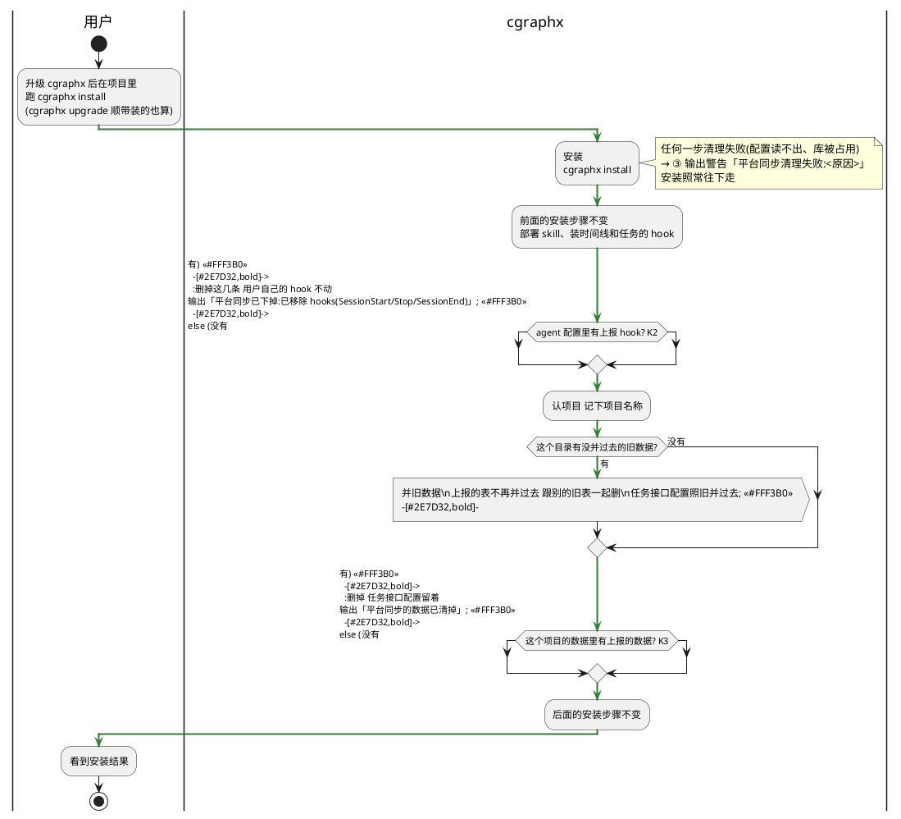

# 功能方案: 下掉web与平台同步(讨论稿 v1)

> 讨论稿,不是契约:人终确认的那一版由 `/dev-spec` 原样收录为 spec 第一节,之后以 spec 为准,本文件不再维护。
> 图用支持 PlantUML 的 Markdown 预览打开(IDEA:设置 → 语言和框架 → Markdown → 启用 PlantUML)。

**一句话**:原来 cgraphx 除了命令行,还带一个本地网页浏览服务,并在会话开始、结束时自动把研发数据报到研发管理平台;这次把本地 web 和平台上报都下掉,数据只留在本机,用命令和文件看;从平台拉任务照旧。

**功能清单**

| 编号 | 功能点 | 类别 | 从哪进 → 到哪去 | 一句话 |
|---|---|---|---|---|
| F1 | 下掉本地 web | 核心 | `cgraphx web` → 报未知命令 → 改用命令和文件 | 浏览器里看知识库、时间线、任务、表结构、代码地图的页面都去掉,数据照旧能用命令和文件看 |
| F2 | 下掉平台上报 | 核心 | `cgraphx sync`、会话开始与结束、查知识库、产物检查 → 不再上报 | 不再往平台报数据;只为上报存在的参考记录、平台下发的产物类型一起去掉 |
| F3 | 升级时清理 | 支撑 | 升级后 `cgraphx install` → 各 agent 的配置、这个项目的数据 | 删掉已装项目里旧的上报 hook 和上报的数据,任务接口配置留着 |
| — | 从平台拉任务 | 边界外排除 | — | 保留:`task list` 照旧从任务接口拉平台任务,spec 头部 `> 任务: T-xx` 照旧 |
| — | 平台上已有的数据 | 边界外排除 | — | 不删,平台服务端不动 |
| — | 任务接口配置命令 | 建议新增 ✂️ | — | 不做:去掉 `sync connect` 以后,新项目要从平台拉任务就手写任务接口配置 |

### F1 下掉本地 web(核心)

用户感知:`cgraphx web` 没了,浏览器里看不了;数据都在,改用命令和文件看。不变:其余命令和它们的输出;知识库、时间线、任务、表结构知识库、代码地图这些数据和文件都不动。

行为链:跑 `cgraphx web` → 报 `error: unknown command 'web'`,退出码 1 → 照下表改用命令或直接看文件。

边界:① 升级前已经开着的 web 服务照常跑到关掉为止,关掉后再起不来。

| 原来在 web 上看 | 现在看哪 |
|---|---|
| 知识库总览、文档详情 | `cgraphx docs concepts` 列概念,`cgraphx docs show <文档> --body` 看正文;或直接打开 `docs/knowledge/` 下的文件 |
| 时间线 | `cgraphx timeline query`、`cgraphx timeline recent`、`cgraphx timeline stats` |
| 任务 | `cgraphx task list`、`cgraphx task show <任务>` |
| 表结构 | 直接看 `docs/schema-knowledge/<工程>/` 下的 INDEX.md 和 ddl/*.sql,或用 `/db-query` |
| 代码地图 | 直接看 `docs/code-map/` 下的文件 |

🎭 体验决策:跑已经下掉的命令只报 `error: unknown command 'web'`,不另给提示,和 2.0 去掉 1.x 命令时一样;F2 的 `cgraphx sync` 同样处理。

### F2 下掉平台上报(核心)

用户感知:不再往平台报数据;`cgraphx sync` 的 connect、now、status、disconnect 都没了;会话开始不再出现「平台上报已暂停」「平台上报已连续失败超过 1 小时」的提示,会话开始、结束都不再拉起后台上报。只为上报存在的两样一起去掉:查知识库时记的参考(原来只报给平台)、平台下发的项目产物类型。平台上已经有的数据不动;从平台拉任务照旧(见功能清单「边界外排除」)。清掉已装项目里留下的 hook 和数据见 F3。

行为链:跑 `cgraphx sync connect / now / status / disconnect` → 报 `error: unknown command 'sync'`,和 F1 一样不另给提示;会话开始、轮次结束、会话结束 → 不再有上报提示,也不再拉起后台上报;`cgraphx docs find / show` 带着 `--session` 跑 → 照常输出,`--session` 照收,只是不再记参考;`cgraphx features check` 和提交前的产物检查 → 产物类型只认内置的 K1。

边界:① 已经接过平台的项目,任务接口配置留着,升级并旧数据时照旧并进用户目录,`task list` 照旧从平台拉任务;要换地址、换凭据只能手改这个配置(原来用 `cgraphx sync connect --force`),它放在哪用 `cgraphx project show` 看数据位置 ② 新项目要从平台拉任务,得手写任务接口配置 ③ 在平台上给项目配过自定义产物类型的,这些产物从认得变成警告「未知类型 X:不是内置类型」,改法「改用内置类型标识」,不拦提交;本项目平台下发的 19 种都是内置类型,不受影响 ④ spec 头部 `> 任务: T-xx` 照旧,只查格式。

| 编号 | 哪一步 | 怎么判定 | 算 / 不算(例子) | 依据 |
|---|---|---|---|---|
| K1 | 产物检查 · 认哪些产物类型 | 只认内置的 20 种,不再读平台下发的类型表 | 算:spec、plan、knowledge、handoff 等内置类型;不算:平台上给项目加的自定义类型(警告,不拦提交) | 内置产物类型表;平台下发的类型存在 `sync_state`(key 为 platform_spec),本项目 19 种都在内置表里;新定 |

### F3 升级时清理(支撑)

F2 下掉以后,已经装过的项目里还留着上报的 hook 和数据,装新版时清掉;安装时去掉「装平台同步 hook」那一步(原来输出「平台同步 hook 已装」)。并旧数据(「数据按项目放用户目录」F4)不再并上报的表,它们跟别的旧表一起删掉,并之前的备份里还留着;任务接口配置照旧并过去。

行为链:还没重装的项目,会话开始、轮次结束、会话结束时 agent 照常调旧的上报 hook → 命令已经没有,hook 带着 `2>/dev/null || true`,不报错,会话照常 ①;`cgraphx uninstall` 卸载时照样删掉旧的上报 hook ②。

| 编号 | 哪一步 | 怎么判定 | 算 / 不算(例子) | 依据 |
|---|---|---|---|---|
| K2 | 有上报 hook? | cgraphx 为平台上报写进 agent 配置的 hook:会话开始一条、轮次结束一条、会话结束一条 | 算:`cgraphx sync-session-start-hook 2>/dev/null \|\| true`、`cgraphx sync-stop-hook --agent codebuddy 2>/dev/null \|\| true`;不算:`cgraphx timeline-stop-hook`、`cgraphx task-stop-hook`、用户自己写的 hook | 各 agent 的 `settings.json`(`.claude/`、`.codebuddy/`);沿用卸载时删上报 hook 的认法 |
| K3 | 有上报的数据? | 只为上报存的:上报进度、平台连接、参考记录、平台下发的产物类型、上报用的锁和触发文件;任务接口配置不算,拉任务还要用 | 算:上报进度、平台地址、「这个会话查过哪些知识库」的参考记录;不算:时间线、任务绑定、知识库索引、任务接口配置 | 项目数据里(用户目录下这个项目的目录;没并过旧数据的目录在本地 `.cgraphx/`)`sync_state`、`sync_sessions`、`sync_reference_records`、`sync_unreported_artifacts`、`sync_schema_versions` 五张表,`sync.lock`、`sync-trigger`、`sync-worker.pid` 三个文件;`task-source.json` 留着;新定 |

---

以下供 spec 使用,可不细读

**必须在 spec 前解决的问题**:无

**已锁定技术约束**:
- 从平台拉任务保留:`task list` 读任务接口配置拉平台任务、spec 头部 `> 任务: T-xx`、任务接口配置文件都不动(用户 11-05 定)。
- 平台服务端不改,平台上已有的数据不动;已经上报的 72 个会话不做处理(用户 11-05 定)。
- 已下掉的命令只报 unknown command,不留隐藏的提示命令(用户 11-05 定)。
- 先后:排在「数据按项目放用户目录」之后(已于 11-05 合入 dev/2.0.14,合并提交 5b0a344),排在「会话文件解析替代hooks」之前。

**留给 spec 的细节决策**:
- 并旧数据去掉上报那段以后,`task-source.json` 的并入挪到哪:现在归上报的 `mergeSyncTables` 并(`src/core/project/merge-files.ts` 注释「task-source.json 归 sync 并」)。
- 旧库里的 `sync_*` 表:并旧数据的「这个目录还有没并过去的旧数据」判断现在也看 `sync_*` 表,去掉上报后这类表只删不并,判断要不要还看它。
- 上报 hook 的认法(K2)给 install 和 uninstall 共用,落在哪个模块;`agent-steps.ts` 里装上报 hook 那一段删掉。
- 产物检查的警告原文:改法里「请项目管理员在平台配置」那半句去掉;`readProjectArtifactTypes` 这个注入口留不留。
- `cgraphx docs find / show` 的 `--session` 保留为不起作用的参数(F2 已定照收),帮助文字怎么改。
- 构建与依赖:`scripts/copy-assets.cjs` 去掉 web 静态文件那段,`markdown-it` 依赖去掉,`__tests__/web/`、`__tests__/core/sync/` 和别处引用上报的测试一起清。
- 文档:本仓库 CLAUDE.md 架构一节(web、上报)、CHANGELOG、cgraphx-guide;知识库条目改写或废弃(见现实约束清单最后一行)。

**影响半径与风险**:MEDIUM。删掉 web、上报两个子系统约 10,400 行源码,牵动 CLI 入口、安装器、并旧数据、知识库命令、产物检查;最容易漏的是并旧数据里 `task-source.json` 的并入,漏了的话,已经接过平台的项目升级后 `task list` 拉不到平台任务。

**现实约束清单**

| 表 / 现有实现 | 事实 |
|---|---|
| 本地 web(`cgraphx web`) | `src/web/` 全部,经 web 门面在 `src/cli/index.ts` 注册;页面 `/`(知识库总览)、`/doc`(文档)、`/timeline`、`/tasks`、`/schema`(读 `docs/schema-knowledge/`)、`/map`(读 `docs/code-map/`)、`/assets`(静态文件);依赖 `markdown-it` 只有 web 用;`scripts/copy-assets.cjs` 把 `src/web/public` 拷到 `dist/web/public` |
| 平台上报(`cgraphx sync`) | `src/core/sync/` 全部;子命令 connect、disconnect、now、status,隐藏命令 sync-worker、sync-session-start-hook、sync-stop-hook |
| 上报 hook | SessionStart、Stop、SessionEnd 各一条,命令带 `2>/dev/null \|\| true`;CodeBuddy 的另带 `--agent codebuddy`;装卸在 `src/cli/installer/agent-steps.ts`(`installSyncHooks` / `uninstallSyncHooks`),install 里先装 agent hook(`installAgentHooks`)、后认项目和并旧数据(`settleProjectData`) |
| 上报的表与文件 | `sync_schema_versions`、`sync_state`(含平台连接、`platform_spec` 产物类型缓存)、`sync_sessions`、`sync_reference_records`、`sync_unreported_artifacts`;`sync.lock`、`sync-trigger`、`sync-worker.pid` 经 `getDataDir` 落在数据位置 |
| 别处对上报的依赖 | `src/core/markdown/cli.ts`:docs find / show 调 `recordReferenceHit` 记参考;`src/core/project/merge.ts`:并旧数据调 `ensureSyncSchema`、`mergeSyncTables`,并上报的表、平台连接和 `task-source.json`;`src/cli/index.ts`:`readCachedProjectArtifactTypes` 给 features check 读平台产物类型 |
| 任务接口配置 | `task-source.json` 由 `sync connect` 写、`sync disconnect` 删,经 `getDataDir` 落在数据位置;`task list` 经 task 门面读,不依赖上报 |
| 产物检查 | 未知类型是 warn 不是 fail,提交门禁只拦 fail;`> 任务:` 只按格式校验(`TASK_VALUE_PATTERN`) |
| 去掉的命令 | commander 对未知命令输出 `error: unknown command '<名字>'`、退出码 1(实测 `cgraphx explore`) |
| 本项目的平台数据 | 平台地址 `localhost:8080`;72 个会话 10-16 至 10-22 上报过,之后连不上;`platform_spec` 的 19 种类型都在内置 20 种里(内置多一个 handoff) |
| 讲到 web 或上报的知识库条目 | `cgraphx-web.md`、`平台上报.md`、`开发任务浏览.md`、`开发任务.md`、`开发任务绑定.md`、`开发时间线工具事件契约.md`、`需求副本.md`、`并旧数据.md`、`Bash事件cwd是执行后的目录.md` |
