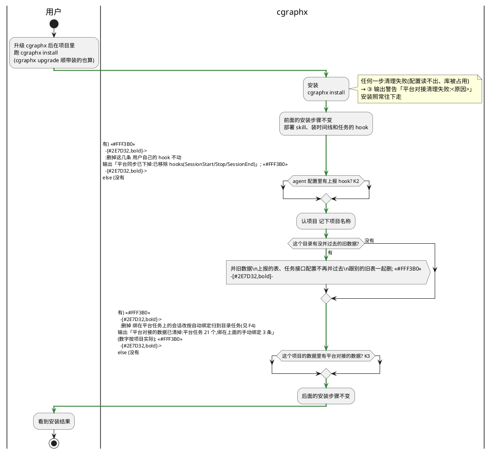

# 功能方案: 下掉web与平台同步(讨论稿 v2)

> 讨论稿,不是契约:人终确认的那一版由 `/dev-spec` 原样收录为 spec 第一节,之后以 spec 为准,本文件不再维护。
> 图用支持 PlantUML 的 Markdown 预览打开(IDEA:设置 → 语言和框架 → Markdown → 启用 PlantUML)。

**一句话**:原来 cgraphx 除了命令行,还带一个本地网页浏览服务,并和研发管理平台对接:会话开始、结束时自动上报研发数据,开发任务从平台拉;这次把本地 web 和平台对接都撤掉,数据只留在本机,用命令和文件看,开发任务只剩需求目录派生的目录任务和手动建的任务。

**功能清单**

| 编号 | 功能点 | 类别 | 从哪进 → 到哪去 | 一句话 |
|---|---|---|---|---|
| F1 | 下掉本地 web | 核心 | `cgraphx web` → 报未知命令 → 改用命令和文件 | 浏览器里看知识库、时间线、任务、表结构、代码地图的页面都去掉;任务页上的投入时长、产出、参考、会话数、最近活动跟着一起删,其余数据照旧能用命令和文件看 |
| F2 | 下掉平台上报 | 核心 | `cgraphx sync`、会话开始与结束、查知识库、产物检查 → 不再上报 | 不再往平台报数据;只为上报存在的参考记录、平台下发的产物类型一起去掉 |
| F3 | 升级时清理 | 支撑 | 升级后 `cgraphx install` → 各 agent 的配置、这个项目的数据 | 删掉已装项目里旧的上报 hook、上报的数据、任务接口配置和本地的平台任务 |
| F4 | 开发任务不再对接平台 | 核心 | `cgraphx task list / use / show`、spec 头部 `> 任务:` → 只剩目录任务和手动任务 | 不再从平台拉任务;需求目录一律对应自己的目录任务,`> 任务: T-xx` 不再起作用 |
| — | 平台上已有的数据 | 边界外排除 | — | 不删,平台服务端不动 |

### F1 下掉本地 web(核心)

用户感知:`cgraphx web` 没了,浏览器里看不了。任务页上的几样跟着一起删,不挪进命令:每个任务的投入时长(活跃时长、工作时长)、产出、参考,任务列表上的会话数、最近活动;要看某个需求实际投入多久,用 `task-history` 子 agent 从时间线算(`/dev-end` 写收口档案就是这样取的)。其余数据都在,改用命令和文件看。不变:其余命令和它们的输出;知识库、时间线、任务、表结构知识库、代码地图这些数据和文件都不动。

行为链:跑 `cgraphx web` → 报 `error: unknown command 'web'`,退出码 1 → 照下表改用命令或直接看文件。

边界:① 升级前已经开着的 web 服务照常跑到关掉为止,关掉后再起不来。

| 原来在 web 上看 | 现在看哪 |
|---|---|
| 知识库总览、文档详情 | `cgraphx docs concepts` 列概念,`cgraphx docs show <文档> --body` 看正文;或直接打开 `docs/knowledge/` 下的文件 |
| 时间线 | `cgraphx timeline query`、`cgraphx timeline recent`、`cgraphx timeline stats` |
| 任务 | `cgraphx task list`、`cgraphx task show <任务>`;投入时长、产出、参考、会话数、最近活动不再有(见上) |
| 表结构 | 直接看 `docs/schema-knowledge/<工程>/` 下的 INDEX.md 和 ddl/*.sql,或用 `/db-query` |
| 代码地图 | 直接看 `docs/code-map/` 下的文件 |

🎭 体验决策:跑已经下掉的命令只报 `error: unknown command 'web'`,不另给提示,和 2.0 去掉 1.x 命令时一样;F2 的 `cgraphx sync` 同样处理。

### F2 下掉平台上报(核心)

用户感知:不再往平台报数据;`cgraphx sync` 的 connect、now、status、disconnect 都没了;会话开始不再出现「平台上报已暂停」「平台上报已连续失败超过 1 小时」的提示,会话开始、结束都不再拉起后台上报。只为上报存在的两样一起去掉:查知识库时记的参考(原来只报给平台)、平台下发的项目产物类型。平台上已经有的数据不动。从平台拉任务也一起撤掉,见 F4;清掉已装项目里留下的 hook 和数据见 F3。

行为链:跑 `cgraphx sync connect / now / status / disconnect` → 报 `error: unknown command 'sync'`,和 F1 一样不另给提示;会话开始、轮次结束、会话结束 → 不再有上报提示,也不再拉起后台上报;`cgraphx docs find / show` 带着 `--session` 跑 → 照常输出,`--session` 照收,只是不再记参考;`cgraphx features check` 和提交前的产物检查 → 产物类型只认内置的 K1。

边界:① 在平台上给项目配过自定义产物类型的,这些产物从认得变成警告「未知类型 X:不是内置类型」,改法「改用内置类型标识」,不拦提交;本项目平台下发的 19 种都是内置类型,不受影响。

| 编号 | 哪一步 | 怎么判定 | 算 / 不算(例子) | 依据 |
|---|---|---|---|---|
| K1 | 产物检查 · 认哪些产物类型 | 只认内置的 20 种,不再读平台下发的类型表 | 算:spec、plan、knowledge、handoff 等内置类型;不算:平台上给项目加的自定义类型(警告,不拦提交) | 内置产物类型表;平台下发的类型存在 `sync_state`(key 为 platform_spec),本项目 19 种都在内置表里;新定 |

### F3 升级时清理(支撑)

F2、F4 撤掉以后,已经装过的项目里还留着上报的 hook、上报的数据、任务接口配置和平台任务,装新版时清掉;安装时去掉「装平台同步 hook」那一步(原来输出「平台同步 hook 已装」)。并旧数据(「数据按项目放用户目录」那个需求的「旧数据并过去」)不再并上报的表和任务接口配置,它们跟别的旧表一起删掉,并之前的备份里还留着。删掉的平台任务上绑的会话,按 F4 的口径改归目录任务。

行为链:还没重装的项目,会话开始、轮次结束、会话结束时 agent 照常调旧的上报 hook → 命令已经没有,hook 带着 `2>/dev/null || true`,不报错,会话照常 ①;`cgraphx uninstall` 卸载时照样删掉旧的上报 hook ②。

| 编号 | 哪一步 | 怎么判定 | 算 / 不算(例子) | 依据 |
|---|---|---|---|---|
| K2 | 有上报 hook? | cgraphx 为平台上报写进 agent 配置的 hook:会话开始一条、轮次结束一条、会话结束一条 | 算:`cgraphx sync-session-start-hook 2>/dev/null \|\| true`、`cgraphx sync-stop-hook --agent codebuddy 2>/dev/null \|\| true`;不算:`cgraphx timeline-stop-hook`、`cgraphx task-stop-hook`、用户自己写的 hook | 各 agent 的 `settings.json`(`.claude/`、`.codebuddy/`);沿用卸载时删上报 hook 的认法 |
| K3 | 有平台对接的数据? | 只为平台对接存的:上报进度、平台连接、参考记录、平台下发的产物类型、上报用的锁和触发文件;任务接口配置;从平台拉来的任务和绑在它们上的手动绑定;目录任务上记的平台编号 | 算:本库 21 个平台任务、绑在上面的 3 条手动绑定、18 个目录任务上的平台编号、任务接口配置;不算:时间线、5 个手动任务和绑在上面的 5 条手动绑定、34 个目录任务本身、自动绑定、知识库索引 | 项目数据里(用户目录下这个项目的目录;没并过旧数据的目录在本地 `.cgraphx/`):`sync_state`、`sync_sessions`、`sync_reference_records`、`sync_unreported_artifacts`、`sync_schema_versions` 五张表,`sync.lock`、`sync-trigger`、`sync-worker.pid` 三个文件;`task-source.json`;`task_items` 里 source 为 api 的行和指向它们的 `task_sessions`;`task_feature_tasks.platform_task_id`;新定 |

### F4 开发任务不再对接平台(核心)

用户感知:不再从平台拉任务;开发任务只剩两种:需求目录派生的目录任务、`task use` 手动建的任务,就是现在「没配任务接口」时的样子。spec 头部的 `> 任务: T-xx` 不再起作用,`/dev-spec` 也不再写这一行。和 F2 撤的是同一个平台;本地已有的平台任务、任务接口配置、目录任务上的平台编号由 F3 清掉。

行为链:`cgraphx task list` → 列本地任务 K4,不再请求任务接口,不再显示平台编号;带 `--local` 照收,不起作用。`cgraphx task use <值>` → 按 K5 找,找不到就按名称新建手动任务;带 `--manual` 照收,不起作用。`cgraphx task show <值>` → 照旧输出任务、关联需求目录、会话、commit、事件统计,不再按平台编号找。写过 `> 任务:` 的需求目录 → 对应哪个任务按 K6;`cgraphx features check` 和提交前的产物检查不再查这一行,`cgraphx features show` 不再显示「任务」那一行。

边界:① `task use T-12` 这类平台编号:按名称新建一个叫 T-12 的手动任务,平台编号不再认 ② 写过 `> 任务: T-xx` 的旧 spec 不用改,这一行留着不起作用 ③ 原来绑在平台任务上的会话,F3 删掉那 3 条手动绑定后,按自动绑定归到它读写过的需求目录的目录任务;没读写过需求目录的不归任何任务。

| 编号 | 哪一步 | 怎么判定 | 算 / 不算(例子) | 依据 |
|---|---|---|---|---|
| K4 | task list · 列哪些任务 | 本地的目录任务和手动任务,不请求任务接口 | 算:本库 34 个目录任务、5 个手动任务;不算:21 个平台任务(F3 删掉) | `task_feature_tasks`、`task_items`(source 为 manual);沿用现在没配任务接口时的列法 |
| K5 | task use · 怎么找任务 | 按本地 id、手动任务名称找,找不到按名称新建手动任务;目录任务照旧不能手动绑 | 算:`task use 修登录超时` 新建手动任务;`task use T-12` 新建名叫 T-12 的手动任务;不算:`task use 2026-11-05-下掉web与平台同步`(目录任务,照旧报不能手动绑) | 沿用现在没配任务接口时的找法 |
| K6 | 需求目录对应哪个任务 | 一律对应自己的目录任务,不看 spec 头部 `> 任务:` | 算:本库 4 个写了 `> 任务: T-xx` 的需求目录(如 2026-10-16-cgraphx接入研发管理平台)也对应各自的目录任务 | 主 spec 头部 `> 任务:`;现在值是 T-<n> 的对应平台任务,本地没有就建接口任务占位;新定 |

---

以下供 spec 使用,可不细读

**必须在 spec 前解决的问题**:无

**已锁定技术约束**:
- 平台对接整体撤掉:上报和从平台拉任务都去掉;平台服务端不改,平台上已有的数据不动,已经上报的 72 个会话不做处理(用户 11-05 定)。
- web 任务页上的投入时长、产出、参考、会话数、最近活动跟着 web 删,不挪进命令(用户 11-05 定)。
- 已下掉的命令只报 unknown command,不留隐藏的提示命令(用户 11-05 定)。
- 先后:排在「数据按项目放用户目录」之后(已于 11-05 合入 dev/2.0.14,合并提交 5b0a344),排在「会话文件解析替代hooks」之前。

**留给 spec 的细节决策**:
- 并旧数据去掉 `mergeSyncTables` 以后,上报的表和 `task-source.json` 都不再并;「这个目录还有没并过去的旧数据」的判断还看不看 `sync_*` 表。
- task 里平台那部分怎么拆:接口任务来源(`source.ts`、刷新、`TaskSourceUnavailableError`)、`resolve.ts` 里按接口编号和 `platform_task_id` 找的分支;`task use --manual`、`task list --local` 留作不起作用的参数;`task_items.source` 的 CHECK 里 `api` 留不留(旧库兼容)、`task_feature_tasks.platform_task_id` 列留不留;删平台任务后自动绑定怎么重算。
- 删 `listTaskSummaries` / `getTaskReport` 时,`feature-link.ts` 还在用的 `listEffectiveBindingsIn`(`report.ts`)和 `queryBindingEvents`(`attribution.ts`)要留下;`task/artifacts.ts` 只给任务页和上报用,跟着删。
- 上报 hook 的认法(K2)给 install 和 uninstall 共用;`agent-steps.ts` 里装上报 hook 那一段删掉。
- 产物检查:`invalid_task` 那条检查删掉,`readProjectArtifactTypes` 注入口删掉,未知类型警告的改法去掉「请项目管理员在平台配置」;scanner 读 `> 任务:`、`features show` 的「任务」行去掉。
- `cgraphx docs find / show` 的 `--session` 保留为不起作用的参数,帮助文字怎么改。
- 构建与依赖:`scripts/copy-assets.cjs` 去掉 web 静态文件那段,`markdown-it` 依赖去掉;`__tests__/web/`、`__tests__/core/sync/` 和 task、features、project 里涉及平台的测试一起清。
- skill 和文档:`dev-spec` 去掉写 `> 任务:` 的两处,负责人那条里「平台就建不出任务」的说法改掉;本仓库 CLAUDE.md 架构一节、CHANGELOG、cgraphx-guide;知识库条目改写或废弃(见现实约束清单最后一行)。FLOW-MAP、init-guides 里的「接口任务」指 plan 里写接口的任务,不是平台任务,不动。

**影响半径与风险**:HIGH。删掉 web、上报两个子系统约 10,400 行源码,外加 task 里对接平台的那部分,牵动 CLI 入口、安装器、并旧数据、知识库命令、产物检查、需求目录与任务的对应、`/dev-spec`。风险最大的是 task:拆平台分支时不能伤到目录任务的派生、自动绑定和 `task show`;其次是升级清理删平台任务时,绑在上面的会话要能重新归到目录任务。

**现实约束清单**

| 表 / 现有实现 | 事实 |
|---|---|
| 本地 web(`cgraphx web`) | `src/web/` 全部,经 web 门面在 `src/cli/index.ts` 注册;页面 `/`(知识库总览)、`/doc`(文档)、`/timeline`、`/tasks`、`/schema`(读 `docs/schema-knowledge/`)、`/map`(读 `docs/code-map/`)、`/assets`(静态文件);依赖 `markdown-it` 只有 web 用;`scripts/copy-assets.cjs` 把 `src/web/public` 拷到 `dist/web/public` |
| 平台上报(`cgraphx sync`) | `src/core/sync/` 全部;子命令 connect、disconnect、now、status,隐藏命令 sync-worker、sync-session-start-hook、sync-stop-hook |
| 上报 hook | SessionStart、Stop、SessionEnd 各一条,命令带 `2>/dev/null \|\| true`;CodeBuddy 的另带 `--agent codebuddy`;装卸在 `src/cli/installer/agent-steps.ts`(`installSyncHooks` / `uninstallSyncHooks`),install 里先装 agent hook(`installAgentHooks`)、后认项目和并旧数据(`settleProjectData`) |
| 上报的表与文件 | `sync_schema_versions`、`sync_state`(含平台连接、`platform_spec` 产物类型缓存)、`sync_sessions`、`sync_reference_records`、`sync_unreported_artifacts`;`sync.lock`、`sync-trigger`、`sync-worker.pid` 经 `getDataDir` 落在数据位置 |
| 别处对上报的依赖 | `src/core/markdown/cli.ts`:docs find / show 调 `recordReferenceHit` 记参考;`src/core/project/merge.ts`:并旧数据调 `ensureSyncSchema`、`mergeSyncTables`,并上报的表、平台连接和 `task-source.json`;`src/cli/index.ts`:`readCachedProjectArtifactTypes` 给 features check 读平台产物类型 |
| 任务接口配置 | `task-source.json` 由 `sync connect` 写、`sync disconnect` 删,经 `getDataDir` 落在数据位置;配了它,`task list` 先从接口刷新,`task use` 按接口编号找、找不到要带 `--manual` 才建手动任务 |
| 平台凭据 | 平台只在接入时用账号密码换发客户端凭据,网页上没有发凭据的地方;停用账号会吊销这个人的全部凭据(cgraphx-server `apps/server/src/domain/ingest.ts`、`domain/users.ts`) |
| task 里的平台部分 | `task_items.source` 取值 api / manual,api 行带 `external_id`(平台编号);`task_feature_tasks.platform_task_id` 是平台给目录任务的编号;主 spec 头部 `> 任务:` 的值是 T-<n> 时目录对应平台任务,本地没有就建接口任务占位;`src/core/task/resolve.ts` 有按接口编号、`platform_task_id` 找的分支 |
| 任务页那几样 | `listTaskSummaries` / `getTaskReport`(`src/core/task/report.ts`)只有 `src/web/pages-tasks.ts` 调,用到 `task/artifacts.ts`(产出、参考)和 `task/attribution.ts`;`task/feature-link.ts` 也用 attribution 和 report 里的 `listEffectiveBindingsIn`;`task list` 只出 ID、来源、编号、名称、状态、当前,`task show` 出任务、关联需求目录、会话、commit、事件统计 |
| 产物检查 | 未知类型是 warn 不是 fail,提交门禁只拦 fail;`> 任务:` 的值不是 T-<n> 时 fail(`invalid_task`,`TASK_VALUE_PATTERN`) |
| 去掉的命令 | commander 对未知命令输出 `error: unknown command '<名字>'`、退出码 1(实测 `cgraphx explore`) |
| 本项目的数据 | 平台地址 `localhost:8080`;72 个会话 10-16 至 10-22 上报过,之后连不上;`platform_spec` 的 19 种类型都在内置 20 种里(内置多一个 handoff);本地库(主目录还没装新版,在旧库模式 `.cgraphx/cgraphx.db`)平台任务 21 个、手动任务 5 个、手动绑定 8 条(3 条绑在平台任务上)、目录任务 34 个(18 个带平台编号)、有自动绑定的会话 110 个;4 个需求目录的主 spec 写了 `> 任务:` |
| 讲到 web、上报或平台任务的知识库条目 | `cgraphx-web.md`、`平台上报.md`、`开发任务浏览.md`、`开发任务投入时长口径.md`、`开发任务.md`、`开发任务绑定.md`、`开发时间线工具事件契约.md`、`需求副本.md`、`并旧数据.md`、`Bash事件cwd是执行后的目录.md` |
