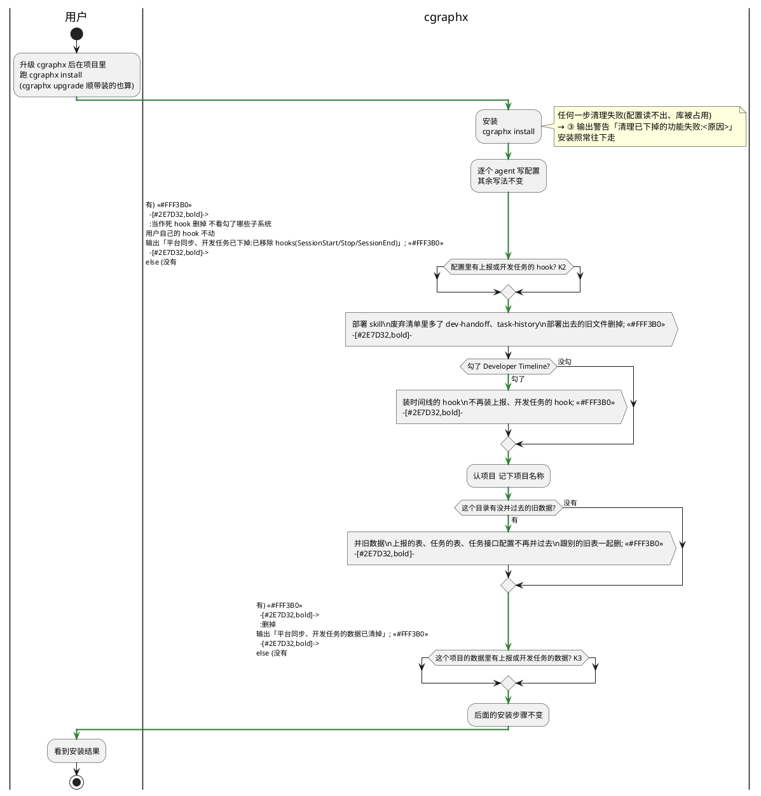
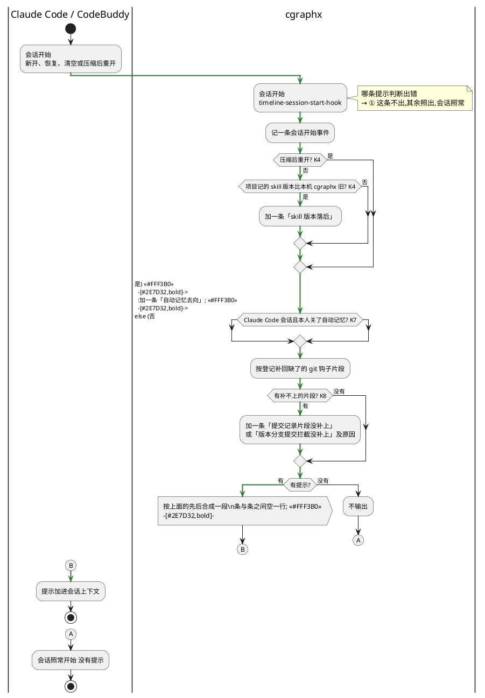

# 功能方案: 下掉web与平台同步(讨论稿 v4)

> 讨论稿,不是契约:人终确认的那一版由 `/dev-spec` 原样收录为 spec 第一节,之后以 spec 为准,本文件不再维护。
> 图用支持 PlantUML 的 Markdown 预览打开(IDEA:设置 → 语言和框架 → Markdown → 启用 PlantUML)。

**一句话**:原来 cgraphx 除了时间线、知识库、需求目录这些本机能力,还带一个本地网页浏览服务、和研发管理平台的对接(上报研发数据、拉任务),以及把会话自动归到需求的开发任务;这次把它们连同只为它们存在的会话交接、按任务算历时一起撤掉,数据只留在本机,用命令和文件看。开需求副本或 git worktree 算一个任务、按任务算历时,后期再补。

**功能清单**

| 编号 | 功能点 | 类别 | 从哪进 → 到哪去 | 一句话 |
|---|---|---|---|---|
| F1 | 下掉本地 web | 核心 | `cgraphx web` → 报未知命令 → 改用命令和文件 | 浏览器里看知识库、时间线、任务、表结构、代码地图的页面都去掉;除任务外的数据照旧能用命令和文件看 |
| F2 | 下掉平台上报 | 核心 | `cgraphx sync`、会话开始与结束、查知识库、产物检查、`features show` 与实现收尾的环节提醒 → 不再上报、不再提平台 | 不再往平台报数据;只为上报存在的参考记录、平台下发的产物类型一起去掉;「平台环节」改成本地的「需求环节」 |
| F3 | 升级时清理 | 支撑 | 升级后 `cgraphx install` → 各 agent 的配置、部署出去的 skill、这个项目的数据 | 删掉已装项目里上报和开发任务的 hook、数据,以及部署出去的 dev-handoff、task-history |
| F4 | 下掉开发任务 | 核心 | `cgraphx task`、会话开始与轮次结束、spec 头部 `> 任务:`、`/dev-start` → 不再归集 | `cgraphx task` 全部命令、目录任务、会话自动归到需求都去掉;会话开始的提示照旧出 |
| F5 | 下掉会话交接 | 核心 | `/dev-handoff`、澄清中途换会话、`/dev-start` → 讨论稿里的「澄清进度」→ 新会话接着写 | 不再写交接文件:澄清中途换会话,先把进度写进讨论稿;一个需求只开一个副本 |
| F6 | 下掉按任务算历时 | 核心 | `/dev-end`、`/doc-report` 的阶段总结 → 不再按任务算 | task-history 子 agent 去掉;收口档案的「历时」只留起止日期和日历跨度;阶段总结不再按某个需求出 |
| — | 平台上已有的数据 | 边界外排除 | — | 不删,平台服务端不动 |
| — | 按需求副本、git worktree 记任务 | 边界外排除(后期) | — | 后期计划:开需求副本或 git worktree 就算一个任务,直接写进任务表;按任务算历时到时一起补 |

### F1 下掉本地 web(核心)

用户感知:`cgraphx web` 没了,浏览器里看不了;任务页随开发任务一起去掉(F4)。其余数据都在,改用命令和文件看。不变:其余命令和它们的输出;知识库、时间线、表结构知识库、代码地图这些数据和文件都不动。

行为链:跑 `cgraphx web` → 报 `error: unknown command 'web'`,退出码 1 → 照下表改用命令或直接看文件。

边界:① 升级前已经开着的 web 服务照常跑到关掉为止,关掉后再起不来。

| 原来在 web 上看 | 现在看哪 |
|---|---|
| 知识库总览、文档详情 | `cgraphx docs concepts` 列概念,`cgraphx docs show <文档> --body` 看正文;或直接打开 `docs/knowledge/` 下的文件 |
| 时间线 | `cgraphx timeline query`、`cgraphx timeline recent`、`cgraphx timeline stats` |
| 任务 | 随开发任务一起去掉,见 F4 |
| 表结构 | 直接看 `docs/schema-knowledge/<工程>/` 下的 INDEX.md 和 ddl/*.sql,或用 `/db-query` |
| 代码地图 | 直接看 `docs/code-map/` 下的文件 |

🎭 体验决策:跑已经下掉的命令只报 `error: unknown command 'web'`,不另给提示,和 2.0 去掉 1.x 命令时一样;F2 的 `cgraphx sync`、F4 的 `cgraphx task` 同样处理。

### F2 下掉平台上报(核心)

用户感知:不再往平台报数据;`cgraphx sync` 的 connect、now、status、disconnect 都没了;会话开始不再出现「平台上报已暂停」「平台上报已连续失败超过 1 小时」的提示,会话开始、结束都不再拉起后台上报。只为上报存在的两样一起去掉:查知识库时记的参考(原来只报给平台)、平台下发的项目产物类型。「平台环节」改成本地的「需求环节」:照旧按产物算各环节齐没齐、照旧提醒还缺什么,只是不再提平台。平台上已经有的数据不动。从平台拉任务随开发任务一起去掉,见 F4;清掉已装项目里留下的 hook 和数据见 F3。

行为链:跑 `cgraphx sync connect / now / status / disconnect` → 报 `error: unknown command 'sync'`,和 F1 一样不另给提示;会话开始、轮次结束、会话结束 → 不再有上报提示,也不再拉起后台上报;`cgraphx docs find / show` 带着 `--session` 跑 → 照常输出,`--session` 照收,只是不再记参考;`cgraphx features check` 和提交前的产物检查 → 产物类型只认内置的 K1;`cgraphx features show <需求>` → 「需求环节(按默认类型表)」下逐个列出设计、规划、测试、发布、交付文档齐没齐 K6,末尾一行「实现、知识经验:由提交和会话承载,不按产物算」,不再有「以平台为准」和项目自定义类型那一行;`/dev-impl`、`/dev-impl-subagent` 做完 → 汇报末尾照旧提醒,原文改成「这个需求还缺:测试。可以跑 `/api-case` 或 `/unit-spec` 补。」;FLOW-MAP 主线收尾那一格改叫「需求环节缺口提醒」;`/dev-end` 的发布记录照写,去掉「写了它,平台上的任务才会显示已发布」那条理由。

边界:① 在平台上给项目配过自定义产物类型的,这些产物从认得变成警告「未知类型 X:不是内置类型」,改法「改用内置类型标识」,不拦提交;本项目平台下发的 19 种都是内置类型,不受影响。

| 编号 | 哪一步 | 怎么判定 | 算 / 不算(例子) | 依据 |
|---|---|---|---|---|
| K1 | 产物检查 · 认哪些产物类型 | 只认内置的 20 种,不再读平台下发的类型表 | 算:spec、plan、knowledge、handoff 等内置类型;不算:平台上给项目加的自定义类型(警告,不拦提交) | 内置产物类型表;平台下发的类型存在 `sync_state`(key 为 platform_spec),本项目 19 种都在内置表里;新定 |
| K6 | 需求环节 · 齐没齐 | 按默认类型表把需求目录里的产物归到环节:有这个环节的产物就算齐;设计、测试两个必需的没有,标「缺(必需)」;规划、发布、交付文档没有,标「—」 | 有 spec → 设计 ✓;没有任何测试规格、测试报告 → 测试 ✗ 缺(必需);没有 plan → 规划 —;有收口档案 → 交付文档 ✓;知识库条目不进环节 | 产物注册表各类型的默认环节、`features show` 的环节表;沿用现在「平台环节」的算法,只改名、去掉平台的说法 |

### F3 升级时清理(支撑)

F2、F4、F5、F6 撤掉以后,已经装过的项目里还留着上报和开发任务的 hook、数据,以及部署出去的 dev-handoff、task-history,装新版时清掉;安装时不再装上报、开发任务的 hook(原来输出「平台同步 hook 已装」「开发任务绑定已装」)。旧的上报、开发任务 hook 当作已下掉命令留下的死 hook,在写 agent 配置那一步清掉,不看这次勾了哪些子系统。并旧数据(「数据按项目放用户目录」那个需求的「旧数据并过去」)不再并上报的表、任务的表和任务接口配置,它们跟别的旧表一起删掉,并之前的备份里还留着。

行为链:还没重装的项目,会话开始、轮次结束、会话结束时 agent 照常调旧的上报和开发任务 hook → 命令已经没有,这些 hook 都带着 `2>/dev/null || true`,不报错,会话照常 ①;`cgraphx uninstall` 卸载时写 agent 配置那一步照样把它们当死 hook 删掉 ②。

| 编号 | 哪一步 | 怎么判定 | 算 / 不算(例子) | 依据 |
|---|---|---|---|---|
| K2 | 有上报或开发任务的 hook? | cgraphx 为上报、开发任务写进 agent 配置的 hook:上报的会话开始、轮次结束、会话结束各一条;开发任务的会话开始、轮次结束各一条;还有旧配置里开发任务挂在工具调用后的那条 | 算:`cgraphx sync-stop-hook --agent codebuddy 2>/dev/null \|\| true`、`cgraphx task-session-start-hook 2>/dev/null \|\| true`、`cgraphx task-post-tool-use-hook`;不算:`cgraphx timeline-stop-hook` 这类时间线的 hook、`node …/precommit-check.cjs`、用户自己写的 hook | 各 agent 的 `settings.json`(`.claude/`、`.codebuddy/`);沿用写 agent 配置时清死 hook 的做法(`codegraph mark-dirty` 等 1.x 命令就是这样清的) |
| K3 | 有上报或开发任务的数据? | 只为上报、开发任务存的:上报进度、平台连接、参考记录、平台下发的产物类型、上报用的锁和触发文件;任务、绑定、会话的自动归属;任务接口配置 | 算:本库 60 个任务(平台 21、手动 5、目录 34)、8 条手动绑定、110 个会话的自动归属、任务接口配置、平台上报进度;不算:时间线、知识库索引、会话登记、并旧数据的备份 | 项目数据里(用户目录下这个项目的目录;没并过旧数据的目录在本地 `.cgraphx/`):`sync_*` 五张表、`task_*` 八张表,`sync.lock`、`sync-trigger`、`sync-worker.pid` 三个文件,`task-source.json`;新定 |

### F4 下掉开发任务(核心)

用户感知:`cgraphx task` 的 list、use、current、clear、show 都没了;会话不再自动归到需求目录,目录任务、手动任务都没了;spec 头部的 `> 任务:` 不再起作用,`/dev-spec` 也不再写这一行;`/dev-start` 开完副本不再说「副本里的会话、提交归到这个需求」。会话开始的提示改由时间线的会话开始 hook 出(下图):去掉「当前会话 id」那条(只给 task 命令用);去掉「配置里接了任务 hook,落后提示就交给任务 hook 出」那个判断;「自动记忆去向」从任务 hook 挪过来。本地已有的任务数据由 F3 删掉,不导出;后期按副本、worktree 记任务时重新攒(见功能清单「边界外排除」)。

行为链:跑 `cgraphx task …` → 报 `error: unknown command 'task'`,和 F1 一样不另给提示;轮次结束 → 不再刷新会话归属;写过 `> 任务:` 的 spec → 这一行留着不起作用,`cgraphx features check` 和提交前的产物检查不再查它,`cgraphx features show` 不再显示「任务」那一行;`/dev-spec` → 不再问、不再写 `> 任务:`;`/dev-start` 开完副本 → 回话里只说副本路径、分支和下一步,定位里讲「任务归属」的那句去掉。

边界:② 升级了还没重装的项目,配置里还挂着旧的任务 hook:会话开始的提示照样由时间线的 hook 出,不会因为配置里有旧任务 hook 就不出,落后提示里就有叫你重装的那句 ③ 本地已有的 60 个任务、8 条手动绑定、110 个会话的自动归属由 F3 删掉,不导出。

| 编号 | 哪一步 | 怎么判定 | 算 / 不算(例子) | 依据 |
|---|---|---|---|---|
| K4 | 压缩后重开?/ skill 版本比本机旧? | 压缩后重开的不出落后提示;其余情况,项目记录的 skill 版本比本机 cgraphx 旧就出;不再看配置里有没有接任务 hook | 算:项目记的 skill 是 2.0.12、本机 2.0.14,新开或恢复会话 → 出;配置里还挂着旧任务 hook → 照样出;不算:压缩后重开 → 不出;版本一样 → 不出 | 各 agent 配置目录下的 `cgraphx-version.json`;沿用(原来配置里接了任务 hook 时由任务 hook 出,没接时由时间线 hook 出) |
| K7 | Claude Code 会话且本人关了自动记忆? | Claude Code 的会话,且本人的本地设置里关了自动记忆;压缩后重开也出 | 算:`.claude/settings.local.json` 里 `autoMemoryEnabled` 为 false;不算:CodeBuddy 会话;没有这个设置文件;设置文件不是合法 JSON | `.claude/settings.local.json` 的 `autoMemoryEnabled`;沿用(原来在任务的会话开始 hook 里) |
| K8 | 有补不上的片段? | 按登记该有的提交记录片段、版本分支提交拦截片段,钩子文件里没有了就补回;补不上的(钩子文件被 git 跟踪、不是 shell 脚本、成了链接、钩子目录挪到仓库外)说一次原因,然后删掉这条登记 | 算:钩子文件被提交进仓库 → 提示一次「提交记录片段没补上:…」;不算:husky 重装依赖冲掉了片段 → 补回,不提示;从没装过片段的仓库 → 什么都不做 | `<git 公共目录>/cgraphx/hook-snippets.json` 的登记;沿用 |

### F5 下掉会话交接(核心)

用户感知:`/dev-handoff` 没了,不再写交接文件。澄清还没收拢就要换会话或开副本时,当前会话先把讨论稿写到最新:讨论稿留着「写稿中」那一行,在它下面加一节「澄清进度」,写清写到哪个 F、还等你拍板的事、已经拍板但还没写进图和口径表的口径(照抄);还没有讨论稿的,先照 `/dev-clarify` 的放法建 v1 再写这一节。新会话里 `/dev-clarify` 读到带「写稿中」的讨论稿,就从「澄清进度」接着写;收拢时这一节和「写稿中」那一行一起删掉。澄清收拢以后换会话,直接开新会话,说清讨论稿或 spec 的路径。一个需求只开一个副本;要几个会话并行,先把需求按功能点拆成几个需求目录,各自写讨论稿,再各开各的副本。以前写好的交接文件留着,产物检查照旧认。

行为链:输入 `/dev-handoff` → agent 里已经没有这个命令;`/dev-clarify` 结束时给的下一步里不再有 `/dev-handoff`;澄清中途要换会话 → 当前会话按 K9 判断没收拢,先写「澄清进度」,再开新会话;`/dev-start` 碰到本会话澄清没收拢 K9 → 不再转 `/dev-handoff`,先在本会话把澄清进度写进讨论稿,再开副本,讨论稿随需求目录移进副本,到副本里开新会话接着 `/dev-clarify`;`/dev-start` 讲「同一个需求换会话」的地方改成「在副本里直接开新会话,不开新副本」。

边界:① 已经部署出去的 dev-handoff 由 F3 装新版时删掉 ② 以前写好的交接文件不删,产物检查照旧认「交接文件」这种产物 ③ 同一个需求已经有副本,再对它 `/dev-start`:提示「这个需求已经有副本 <副本目录名>;一个需求只开一个副本,要并行先把需求拆成几个需求目录」,不开第二个。

| 编号 | 哪一步 | 怎么判定 | 算 / 不算(例子) | 依据 |
|---|---|---|---|---|
| K9 | 澄清收拢没有 | 讨论稿已经去掉「写稿中」那一行就算收拢;还没写出讨论稿、或讨论稿还带着「写稿中」,都算没收拢 | 算收拢:v4 头注里没有「写稿中」;不算:只在对话里聊过,还没有讨论稿;讨论稿 v1 还带着「写稿中」 | 讨论稿的头注;沿用 `/dev-start` 现在的判断 |

### F6 下掉按任务算历时(核心)

用户感知:task-history 子 agent 没了;`/dev-end` 写收口档案时,「历时」一节只写立项日期、完成日期和日历跨度,不再估「实际投入」;`/doc-report` 的阶段总结不再按某个需求出,只按时间窗或会话出。按任务算历时,后期按副本、worktree 记任务时再补(见功能清单「边界外排除」)。

行为链:`/dev-end <需求>` → 历时节写「立项:<日期> · 完成:<日期> · 日历跨度:<N 天>」K5,不派子 agent,不估实际投入;要 `/doc-report` 出某个需求的阶段总结 → 说明暂不支持按需求出,建议按这个需求的起止日期出时间窗报告。

边界:① 已经部署出去的 task-history 由 F3 删掉 ② 以前写好的收口档案里「实际投入」那行留着不改。

| 编号 | 哪一步 | 怎么判定 | 算 / 不算(例子) | 依据 |
|---|---|---|---|---|
| K5 | 收口档案 · 立项、完成、日历跨度 | 立项取需求第一个提交的日期,完成取最后一个提交的日期;日历跨度是两者之间跨了几天,首尾两天都算 | 首次提交 11-01、最后一次 11-05 → 5 天;同一天提交完 → 1 天 | 用户给的 SHA 范围里各提交的提交日期;沿用 `/dev-end` 现在的「首末 commit 天数」,含不含首尾原来没说,这里定成都算;新定 |

---

以下供 spec 使用,可不细读

**必须在 spec 前解决的问题**:无

**已锁定技术约束**:
- 平台对接整体撤掉:上报和从平台拉任务都去掉;平台服务端不改,平台上已有的数据不动,已经上报的 72 个会话不做处理(用户 11-05 定)。
- 开发任务整体下掉:`cgraphx task` 全部命令、目录任务派生、会话自动归属、`> 任务:` 头部;本地任务数据删掉不导出(用户 11-05 定)。
- `/dev-handoff` 下掉;按任务算历时下掉:task-history 子 agent、`/dev-end` 的「实际投入」、`/doc-report` 按需求出阶段总结(用户 11-05 定)。
- 会话交接的替代:澄清中途换会话,进度写进讨论稿的「澄清进度」;一个需求只开一个副本(用户 11-06 定)。
- 「平台环节」改成本地的「需求环节」,照旧提醒缺口;`/dev-end` 发布记录保留(用户 11-06 定)。
- 后期计划,本需求不做:开需求副本或 git worktree 就算一个任务,直接写进任务表;按任务算历时到时一起补(用户 11-05 说)。
- 已下掉的命令只报 unknown command,不留隐藏的提示命令(用户 11-05 定)。
- 先后:排在「数据按项目放用户目录」之后(已于 11-05 合入 dev/2.0.14,合并提交 5b0a344),排在「会话文件解析替代hooks」之前。

**留给 spec 的细节决策**:
- 死 hook 清理:`agent-target.ts` 的 `isDeadHookCommand` 加上报、开发任务的命令(K2),install、uninstall 写 agent 配置时都会扫;`agent-steps.ts` 里装上报 hook、任务 hook 的两段删掉。
- 并旧数据去掉 `mergeSyncTables`、task 表的并入以后,上报的表、任务的表和 `task-source.json` 都不再并;「这个目录还有没并过去的旧数据」的判断还看不看 `sync_*`、`task_*` 表;`project remove` 里删任务数据的那部分跟着去掉。
- 会话开始的提示:时间线的会话开始 hook 去掉 `hasTaskSessionStartHook` 判断,自动记忆去向挪过来(`isAutoMemoryOff` 跟着搬),几条提示的先后照 F4 的图。
- 产物检查和 features:`invalid_task` 那条检查删掉,`readProjectArtifactTypes` 注入口和项目自定义类型那一行删掉,未知类型警告的改法去掉「请项目管理员在平台配置」;scanner 读 `> 任务:`、`features show` 的「任务」行去掉;「平台环节」改名「需求环节」(`features show` 的标题和末行、JSON 字段名改不改);产物注册表的 handoff 类型留着(旧交接文件还要认)。
- 会话登记(「数据按项目放用户目录」的 D6)原来的读取方里,`task use / current / clear` 和 `docs find / show` 记参考两处去掉,只剩时间线自己用。
- `cgraphx docs find / show` 的 `--session` 保留为不起作用的参数,帮助文字怎么改。
- `/dev-clarify`:「澄清进度」一节的写法(什么时候写、写在哪、收拢时删),原来「换会话的照交接文件『澄清进度』从 ④ 接着写」改成读讨论稿里的这一节;`/dev-spec` 里「照交接文件写的范围收」那段去掉。
- `/dev-start`:「停下问用户」里澄清没收拢那行、三处讲换会话用 `/dev-handoff` 的、定位和回话里讲任务归属的句子;同一个需求已有副本时的提示(`replica create` 现在报 `target_exists`,让换文件前缀)。
- 构建与依赖:`scripts/copy-assets.cjs` 去掉 web 静态文件那段,`markdown-it` 依赖去掉;`__tests__/web/`、`__tests__/core/sync/` 和 project、features、timeline、installer 里涉及上报、任务的测试一起清。
- 废弃资产清单 `deprecated-assets.json` 加 `skills/dev-handoff`、`agents/task-history.md`。
- skill 和文档:`dev-clarify`、`dev-spec`、`dev-start`、`dev-end`、`doc-report`、`dev-impl`、`dev-impl-subagent`、FLOW-MAP、cgraphx-guide(SKILL.md、skills.html);本仓库 CLAUDE.md(task、sync、web 的描述和分层)、CHANGELOG;知识库条目改写或废弃(见现实约束清单最后一行)。FLOW-MAP、init-guides 里的「接口任务」指 plan 里写接口的任务,不是开发任务,不动。

**影响半径与风险**:HIGH。删掉 web、上报、开发任务三个子系统约 14,900 行源码,外加两个 skill、一个子 agent,牵动 CLI 入口、安装器、并旧数据、会话开始的提示、知识库命令、产物检查和 9 处 skill、说明的文字。风险最大的三处:会话开始的提示从任务 hook 挪到时间线 hook 时不能丢,特别是升级后还没重装的项目要照样提示重装;旧 hook 要在不看子系统勾选的那一步清掉;并旧数据去掉上报、任务两段以后,时间线和别的数据照旧完整并过去。

**现实约束清单**

| 表 / 现有实现 | 事实 |
|---|---|
| 本地 web(`cgraphx web`) | `src/web/` 全部,经 web 门面在 `src/cli/index.ts` 注册;页面 `/`(知识库总览)、`/doc`(文档)、`/timeline`、`/tasks`、`/schema`(读 `docs/schema-knowledge/`)、`/map`(读 `docs/code-map/`)、`/assets`(静态文件);依赖 `markdown-it` 只有 web 用;`scripts/copy-assets.cjs` 把 `src/web/public` 拷到 `dist/web/public` |
| 平台上报(`cgraphx sync`) | `src/core/sync/` 全部;子命令 connect、disconnect、now、status,隐藏命令 sync-worker、sync-session-start-hook、sync-stop-hook |
| 开发任务(`cgraphx task`) | `src/core/task/` 共 4,523 行;子命令 list、use、current、clear、show,隐藏命令 task-session-start-hook、task-stop-hook、task-post-tool-use-hook;表 `task_schema_versions`、`task_items`、`task_sessions`、`task_reminders`、`task_feature_tasks`、`task_auto_sessions`、`task_superseded_bindings`、`task_auto_meta`;任务接口配置 `task-source.json` 由 `sync connect` 写 |
| 安装器的步骤 | `src/cli/installer/index.ts`:① 逐个 agent 写配置(`targets/agent-target.ts`:写 context-monitor 与 statusLine、写 precommit-check、`cleanupDeadHooks` 清死 hook、写指引块、部署模板资产;卸载时同样清死 hook)… ⑥ 勾了 timeline 才 `installAgentHooks`(装时间线、任务、上报的 hook)⑦ `settleProjectData` 认项目、并旧数据 ⑧ db-query 模板;死 hook 按 `isDeadHookCommand` 认,现在认 `codegraph mark-dirty`、`codegraph sync-if-dirty` 等 1.x 命令 |
| 上报和开发任务的 hook | 上报:SessionStart、Stop、SessionEnd 各一条;开发任务:SessionStart、Stop 各一条,旧配置还可能有 PostToolUse 的 `task-post-tool-use-hook`;都带 `2>/dev/null \|\| true`(旧的 PostToolUse 那条除外),CodeBuddy 的另带 `--agent codebuddy`;装卸在 `src/cli/installer/agent-steps.ts`(`installSyncHooks` / `uninstallSyncHooks`、`installTaskHooks` / `uninstallTaskHooks`) |
| 会话开始的提示 | 任务的会话开始 hook 出会话 id、skill 版本落后、自动记忆去向(用 `\n` 连成一段);时间线的会话开始 hook(`src/core/timeline/hooks.ts` 的 `sessionStartHook`)先记事件,再在配置里没接任务 hook 时出 skill 版本落后(`hasTaskSessionStartHook`),再按登记补 git 钩子片段、补不上的出原因,几条用空行连成一段 additionalContext;压缩后重开不出落后提示(`SILENT_SOURCES`),自动记忆去向不受压缩影响(`isAutoMemoryOff`,只看 Claude Code) |
| 上报的表与文件 | `sync_schema_versions`、`sync_state`(含平台连接、`platform_spec` 产物类型缓存)、`sync_sessions`、`sync_reference_records`、`sync_unreported_artifacts`;`sync.lock`、`sync-trigger`、`sync-worker.pid` 经 `getDataDir` 落在数据位置 |
| 别处对上报、开发任务的依赖 | `src/core/markdown/cli.ts`:docs find / show 调 `recordReferenceHit` 记参考;`src/core/project/merge.ts`、`merge-files.ts`、`remove.ts`:并旧数据并上报、任务的表和 `task-source.json`,删项目数据时删任务数据;`src/cli/index.ts`:注册 task、sync、web 命令,`readCachedProjectArtifactTypes` 给 features check 读平台产物类型;features 的 scanner 读 `> 任务:`、show 显示任务、check 查 `invalid_task` |
| 平台环节 | `src/core/features/show.ts` 的环节表:设计(必需)、规划、测试(必需)、发布、交付文档;产物按注册表的默认环节归:spec、wireframe、prd、design_doc → 设计,plan → 规划,六种测试规格和报告 → 测试,release_record → 发布,delivery_brief、closure_record、api_doc → 交付文档,knowledge 等四种不进环节,handoff 没有环节;`src/core/features/cli.ts:157-171` 输出标题「平台环节(按默认类型表;任务类型按「需求开发」估)」、末行「实现、知识经验:由 commit 和会话承载,以平台为准」、项目自定义类型那行;`dev-impl` 第 8 步和「平台环节缺口」一节、`dev-impl-subagent` 收尾范例、FLOW-MAP 主线收尾那一格都提醒它;`commands/dev-end.md:80` 发布记录的理由是平台显示「已发布」 |
| 用到开发任务的 skill | `dev-handoff` 跑 `cgraphx task current` 看当前会话归属;`doc-report` 按需求出报告时取 `cgraphx task show <需求> --json`;`dev-start` 定位(第 12 行)和开完副本的回话(第 99 行)讲任务归属 |
| 提到 dev-handoff 的模板资产 | `FLOW-MAP.md`、`skills/cgraphx-guide/SKILL.md`、`skills/cgraphx-guide/skills.html`、`skills/dev-clarify/SKILL.md`、`skills/dev-spec/SKILL.md`、`skills/dev-start/SKILL.md`(第 13、20、135、136 行,136 行是澄清没收拢时转 `/dev-handoff`) |
| 交接文件带走的东西 | `dev-handoff` 第 18 行:写稿、改稿到一半时另写「澄清进度」节(讨论稿路径、写到哪个 F、等拍板的事、拍板了还没写进去的口径);`src/core/replica/create.ts`:开副本时只把 `docs/features/<featureId>/` 下没被跟踪的文件移进副本;同一个目标目录已存在时报 `target_exists`(是别的需求的副本时让换文件前缀) |
| task-history | `agents/task-history.md`,只有 `commands/dev-end.md` 用(历时节的「实际投入」,子 agent 报覆盖不足时退回按会话活跃时段估);收口档案的首屏标题按产物注册表要求是「历时」(`src/core/artifact-registry/registry.ts`) |
| 废弃资产清单 | `assets/claude-template/deprecated-assets.json` 的 `paths` 相对 agent 配置目录,install / uninstall 碰到就删,不存在就跳过 |
| 产物检查 | 未知类型是 warn 不是 fail,提交门禁只拦 fail;`> 任务:` 的值不是 T-<n> 时 fail(`invalid_task`) |
| 去掉的命令 | commander 对未知命令输出 `error: unknown command '<名字>'`、退出码 1(实测 `cgraphx explore`) |
| 平台凭据 | 平台只在接入时用账号密码换发客户端凭据,网页上没有发凭据的地方;停用账号会吊销这个人的全部凭据(cgraphx-server `apps/server/src/domain/ingest.ts`、`domain/users.ts`) |
| 本项目的数据 | 平台地址 `localhost:8080`;72 个会话 10-16 至 10-22 上报过,之后连不上;`platform_spec` 的 19 种类型都在内置 20 种里(内置多一个 handoff);本地库(主目录还没装新版,在旧库模式 `.cgraphx/cgraphx.db`)任务 60 个(平台 21、手动 5、目录 34,18 个目录任务带平台编号)、手动绑定 8 条、有自动归属的会话 110 个;4 个需求目录的主 spec 写了 `> 任务:` |
| 讲到 web、上报或开发任务的知识库条目 | `cgraphx-web.md`、`平台上报.md`、`开发任务.md`、`开发任务绑定.md`、`开发任务浏览.md`、`开发任务投入时长口径.md`、`会话id来源约束.md`、`开发时间线工具事件契约.md`、`需求副本.md`、`并旧数据.md`、`Bash事件cwd是执行后的目录.md` |
