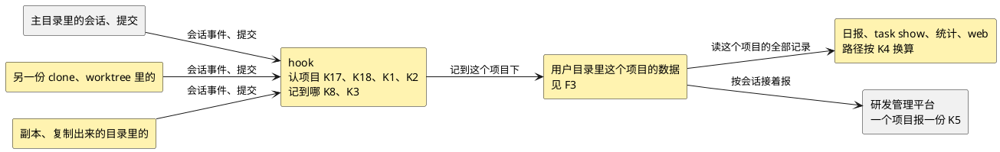
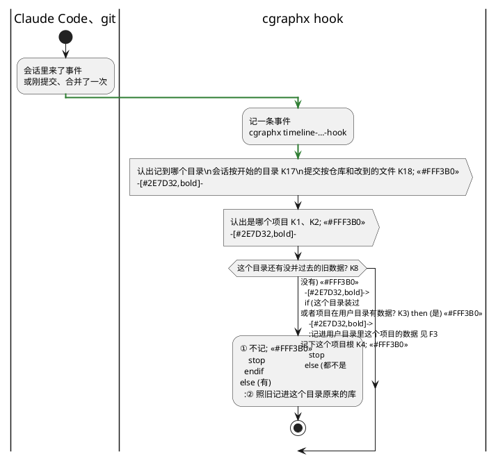
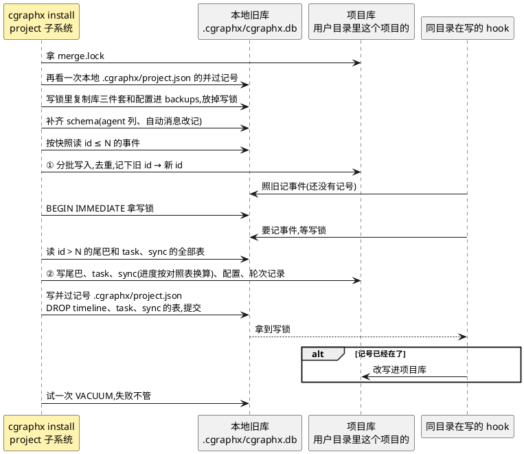

# 规格说明: 数据按项目放用户目录

> 产物: spec
> feature-id: 2026-11-05-数据按项目放用户目录
> 负责人: liulongfei
> 日期: 2026-11-05

## 功能方案

> 原样收录 clarify 终确认的功能方案(讨论稿 v2);业务要变,回 clarify 改,再同步这一节。

**一句话**:原来同一个项目在本机的每个目录各记一份数据，只有 `/dev-start` 开的副本靠链接记回主目录，换个目录干活，日报、task、统计里就少一块;这次把 timeline、task、sync 的数据按项目放到用户目录，在项目的哪个目录干活都记进同一份里。

**功能清单**

| 编号 | 功能点 | 类别 | 从哪进 → 到哪去 | 一句话 |
|---|---|---|---|---|
| F1 | 同一项目的各个目录记到一起 | 核心 | 在项目的任一目录里开会话、提交 → 记进这个项目的数据(F3)→ 日报、task show、统计、web、平台上报 | 不管在 clone、worktree、副本还是手动复制的目录里干活，会话和提交都记到这个项目下，一个会话从哪个目录开的就整个记到那个项目;读的时候看到的是同一份，挪过目录的旧记录也照样换算 |
| F2 | 认项目、改项目 | 支撑 | 项目的任一目录里查、改 → F1 按改过的项目记 | 能查当前目录属于哪个项目、数据在哪、本机出现过哪些目录;认错了可以手动指定项目名称，指定成已有的名字就并进那个项目 |
| F3 | 数据放到用户目录 | 核心 | F1 记的、F4 并的 → `~/.cgraphx/projects/<项目>/` | timeline、task、sync 的数据和项目级的连接配置搬到用户目录，一个项目一个目录;知识库索引、「我的需求」留在各目录 |
| F4 | 旧数据并过去 | 支撑 | 升级后在目录里 `cgraphx install` → 并进 F3 → 之后照 F1 记 | 在一个目录装的时候，按名字认的项目记下项目名称，把这个目录原来库里的数据并进用户目录;复制出来的目录带着的同一批会话只留一份，平台不重复报，已经绑定的任务不重算 |
| F5 | 卸载和清理 | 支撑 | 目录里 `cgraphx uninstall`、清理命令 → 卸这个目录、删某个项目的数据 | 在一个目录卸载只卸这个目录，项目的数据留着，同一个仓库别的目录的提交照样记;另给列出、删除项目数据的命令 |
| — | 跨机器合并数据 | 建议新增 ✂️ | — | 不做：数据只在本机 |
| — | 平台按规整后的地址认项目 | 边界外 | — | 不做：平台现在按 origin 原样认项目;本机一个项目只按一个地址报(K5),别的机器用另一种写法接的平台，平台上还是两个;要改归平台 |
| — | 拆掉版本流程 | 边界外 | — | 另立需求，排在这个之后;这个需求只做到副本的数据不再靠链接 |
| — | Claude Code 自己按路径存的会话和记忆 | 边界外 | — | 不归 cgraphx 管:`/resume` 列表、自动记忆照旧按目录分 |

### F1 同一项目的各个目录记到一起(核心)

现在：一个目录一份数据，只有 `/dev-start` 开的副本经链接记回主目录;同一个项目的另一份 clone、worktree、手动复制的目录各记各的，目录里没有 `.cgraphx/` 的一条不记;每条事件按它当时所在的目录找项目，会话在附加的工作目录里干活，就被拆进两个项目。这次会话按开始的目录、提交按仓库认出项目(K17、K18),哪个目录记的都进这个项目的数据，放在哪见 F3;一个目录的旧数据并过去之前(F4),它照旧记在原来的库里(K8)。项目怎么认(K1、K2)和 F2 共用，认错了到 F2 改。

**图 1 数据从哪来、记到哪**



**图 2 hook 每记一条怎么判断**



| 编号 | 哪一步 | 怎么判定 | 算 / 不算(例子) | 依据 |
|---|---|---|---|---|
| K17 | 认目录 · 会话记到哪 | 会话从哪个目录开的，整个会话都记到那个目录的项目;中途 cd 到别的目录、在附加的工作目录里改文件跑命令，都不换 | 算：在 cgraphx 开的会话附加了 GitNexus 目录，在 GitNexus 里改的文件、跑的命令都记到 cgraphx。不算：按每条事件当时所在的目录分——现在就是这样，本机有 2 个会话的事件分在 cgraphx、GitNexus 两个库里 | `timeline_events.session_id`、`timeline_events.cwd`;现在每条事件按自己的 cwd 找项目;你定的(11-05) |
| K18 | 认目录 · 提交记到哪 | 在哪个仓库提交，就记到那个仓库的项目，不看是哪个会话里提交的;一个仓库装了几个项目的，改了哪个项目目录下的文件就记到哪个项目，几个都改了各记一条，都没改到的不记 | 算：在 cgraphx 开的会话里到 GitNexus 提交，这次提交记到 GitNexus;仓库 platform 的一次提交改了 server/ 和 web/,server、web 各记一条。不算：只改了 platform 根目录 README 的提交——哪个项目都不记 | git 钩子按仓库根记;你定的(11-05):提交照旧按仓库认;一个仓库几个项目时按改到的文件分，新定 |
| K1 | 认项目 · 是哪个项目 | 有 origin 的按 origin 地址认，规整后比:ssh 和 https 两种写法、末尾的 `.git`、末尾的 `/` 都不看;没有 origin 的按项目名称(K2);一个仓库里装了几个项目的，按仓库地址加项目名称分 | 算同一个:`git@github.com:smdnkB/cgraphx.git` 和 `https://github.com/smdnkB/cgraphx` 两份 clone;主目录 cgraphx 和副本 cgraphx@dev-del丢弃副本(origin 一样);从 cgraphx 用 `git worktree add` 开出来的目录。不算同一个:cgraph 和 cgraphx(cgraph 没有 origin,按项目名称 cgraph 认);一个仓库里装在 server/、web/ 两个子目录的两个项目 | git 的 origin 地址;平台现在按 origin 原样认项目;新定 |
| K2 | 认项目 · 项目名称 | 按名字认的项目(没有 origin、一个仓库装了几个项目)装 cgraphx 时记下名字，默认是装的那个目录的名字(一个仓库里装了几个项目的，是项目所在的子目录名),装的时候可以改;之后从它复制出来的目录、它的 worktree 带着这个名字，不看自己的目录名;名字一样就是同一个项目，本机已经有这个名字的数据时提示一句，照样记进去 | 算:workflow(没有 origin)装的时候记下「workflow」,之后 `cp -R` 出来的 workflow-2 也算 workflow;另一个没有 origin、也叫 workflow 的目录也算 workflow,装的时候提示「workflow 已经有数据(在 /Users/smdnk/objects/ai/workflow 记的),这个目录也记进去」;仓库 platform 里 server/ 装的项目叫 server,web/ 的叫 web。不算：升级之前就复制出来的 workflow-old——装的时候默认叫 workflow-old,要算进 workflow,装的时候改成 workflow,或者到 F2 改 | 新数据(存哪由 spec 定);你定的(11-05):没有 origin、一个仓库装了几个项目，都按项目名称;名字一样就是同一个项目 |
| K8 | 记到哪 · 这个目录的旧数据并过没有 | 这个目录原来的库里还有没并过去的数据(新版还没在这里 install 过),照旧记进原来的库;并过的、没有旧库的，往下按 K3 记进用户目录 | 算：只用 `npm i -g cgraphx` 换了新版、还没 install 的主目录 cgraphx,照旧记在 `cgraphx/.cgraphx/cgraphx.db`。不算：已经 install 并过的主目录;副本 cgraphx@dev-del丢弃副本——它的库里只有知识库索引，没有要并的，直接记进用户目录 | 你定的(11-05):安装时并;什么时候并见 F4 |
| K3 | 记不记 · 没装过 cgraphx 的目录 | 这个目录装过(里面有 `.cgraphx/`),或者这个项目在用户目录里有数据，就记;都不是的不记。只管记事件：知识库索引要在这个目录装过才有 | 算:cgraphx 在主目录装过,`git worktree add` 开的 cgraphx-hotfix 没装，在里面提交照样记到 cgraphx(git 钩子和主目录共用);F5 删掉 workflow 的数据以后,workflow 目录里还有 `.cgraphx/`,再开会话照样记，重新攒起来。不算：从没装过的项目 C;hook 根本不触发的，如 cgraphx-hotfix 里开的会话——cgraphx 只装在项目里,`.claude/` 被 git 忽略的项目(cgraphx 自己就是),新开的 worktree、新 clone 里没有 hook 配置 | hook 配置在项目的 `.claude/settings.json`;git 钩子 worktree 和主目录共用;现在目录里没有 `.cgraphx/cgraphx.db` 就整条丢掉;你定的(11-05) |
| K4 | 换算路径 · 记下的路径算项目里哪个文件 | 这个项目在本机出现过的项目根都算：一般是仓库根，一个仓库装了几个项目的是各项目的目录;主目录、各个 clone、worktree、副本，挪走之前的旧位置、删掉的副本也算;会话 cd 进去的子目录不算;并过来的旧记录，按并的那个目录和它登记过的副本算;记下的路径落在哪个根下，就按它换算成项目里的路径 | 算:`/Users/smdnk/objects/ai/cgraphx@dev-del丢弃副本/src/core/directory.ts` 和 `/Users/smdnk/objects/ai/cgraphx/src/core/directory.ts` 都算 `src/core/directory.ts`,统计的文件排行里排一行;主目录挪到新位置后，挪之前记的路径照样换算,`task show` 的产出不会少。不算：项目外的路径，如 `~/.zshrc`;会话 cd 到 `cgraphx/src/core` 时的这个目录——它要是也算根,`directory.ts` 就换算不成 `src/core/directory.ts` | `timeline_events.cwd`、`timeline_events.tool_args` 里记的是绝对路径，主目录库里 72 个不同的 cwd 有 62 个是子目录;现在只按主目录和登记过的副本换算，换算不了的 task 丢掉、sync 不报;新定 |
| K5 | 上报 · 一个项目报几份、按哪个地址报 | 一个项目只报一份：哪个目录记的会话都在这个项目的数据里，按会话接着报;都按这个项目 `cgraphx sync connect` 接平台时的那个 origin 报，不看是哪个目录触发的上报 | 算：主目录、worktree 各开一个会话，平台上是这个项目的两个会话;主目录用 `git@github.com:smdnkB/cgraphx.git` 接的平台,https 那份 clone 里开的会话也按它报。不算：同一个会话从两个目录各报一遍;按触发上报的那个目录自己的 origin 报——ssh、https 两份 clone 在平台上成了两个项目 | `sync_sessions.last_event_id` 按会话记上报进度;现在每次上报取触发那个目录的 origin;沿用现在的上报;按一个地址报，新定 |

### F2 认项目、改项目(支撑)

和 F1 共用项目标识(K1、K2):查的是 F1 认出来的项目，改了以后 F1 按改过的记;名字一样就是同一个项目，改成本机已有的名字，等于并进那个项目。

行为链：你在项目的任一个目录里查「这是哪个项目」→ 显示项目、数据放在哪(F3)、本机出现过的项目根(K4),每个写最近一次活动(K16)

```plantuml
@startuml
skinparam backgroundColor #FFFFFF
skinparam Activity {
  BackgroundColor #F1F1F1
  BorderColor #181818
  FontColor #000000
}
skinparam Swimlane {
  BorderColor #181818
  TitleBackgroundColor #FFFFFF
  TitleFontColor #000000
}
skinparam ArrowColor #181818

|你|
start
:在项目的一个目录里\n指定项目名称;
|cgraphx|
-[#2E7D32,bold]->
:指定项目名称(新); <<#FFF3B0>>
-[#2E7D32,bold]->
:记下名字 K6\n这个目录、它的 worktree、之后从它复制出来的\n都按这个名字认，已经记下的留在原处; <<#FFF3B0>>
-[#2E7D32,bold]->
if (这个名字本机已经有数据? K2) then (没有) <<#FFF3B0>>
  -[#2E7D32,bold]->
  if (这个目录原来按 origin 认? K1) then (不是) <<#FFF3B0>>
    -[#2E7D32,bold]->
    :分出一个新项目; <<#FFF3B0>>
    -[#2E7D32,bold]->
    (B)
    detach
  else (是)
    :② 分出一个新项目\n和同一个 origin 的别的 clone 分开; <<#FFF3B0>>
    (D)
    detach
  endif
else (有)
  :① 名字一样就是同一个项目\n这个目录之后也记进去; <<#FFF3B0>>
  (C)
  detach
endif
|你|
(B)
-[#2E7D32,bold]->
:看到「之后记到 workflow-2\n之前记的 85 条还在 workflow 下」; <<#FFF3B0>>
stop
(C)
:看到「workflow 已经有数据(在 /Users/smdnk/objects/ai/workflow 记的)\n这个目录之后也记到 workflow」; <<#FFF3B0>>
stop
(D)
:看到「之后记到 B2\n之前记的 320 条还在 github.com/org/template 下\ntemplate 的别的 clone 照旧记在那里」; <<#FFF3B0>>
stop
@enduml
```

| 编号 | 哪一步 | 怎么判定 | 算 / 不算(例子) | 依据 |
|---|---|---|---|---|
| K4 | 显示 · 本机出现过的项目根 | 见 F1 | — | — |
| K16 | 显示 · 每个项目根的最近一次活动 | 从这个项目根记的最后一条事件的时间：会话按它开始的那个根算，提交按提交的那个根算;挪走之前的旧位置、删掉的副本照样列，标「目录已不在」 | 算:cgraphx@dev-del丢弃副本 删掉以后照样列，写「11-05 10:05 最后活动，目录已不在」。不算：会话 cd 进去的子目录(`cgraphx/src/core`)、项目外的目录(`~/Downloads`),都不单列 | `timeline_events.ts`、`timeline_events.cwd`;新定 |
| K6 | 记下名字 · 指定的名字管哪些目录 | 在哪个目录指定，就管这个目录、它的 worktree 和之后从它复制出来的目录;别的 clone、之前复制出来的照旧;已经记下的不挪 | 算:B2 从模板 clone 来，在 B2 里指定「B2」后,B2 和它的 worktree 都记到 B2;workflow-2 指定「workflow-2」后，之后记到 workflow-2。不算：模板本身和模板的其他 clone;指定之前记在模板下的 320 条(留在原处) | 新数据(存哪由 spec 定);新定 |
| K2 | 名字本机已经有数据 | 见 F1 | — | — |
| K1 | 原来按名字认还是按 origin 认 | 见 F1 | — | — |

### F3 数据放到用户目录(核心)

共用数据和各目录自己的数据，分法沿用知识库「数据目录」:原来共用的(副本里落在主目录的那些)搬到用户目录，各目录自己的留下。F1 记的、F4 并过来的都放这里。

| 数据 | 原来在 | 改到 | 这次 |
|---|---|---|---|
| timeline 的会话、提问、工具调用、提交 | 目录里的 `.cgraphx/cgraphx.db`(副本里是主目录那份) | `~/.cgraphx/projects/<项目>/` | 改 |
| 任务绑定、平台上报进度 | 同上 | 同上 | 改 |
| 会话的轮次记录 | `.cgraphx/turns/` | 同上 | 改 |
| 平台连接、任务接口配置 | `.cgraphx/` | 同上 | 改 |
| db-query 的项目级连接配置、查询日志 | `.cgraphx/db-profiles.json`、`db-query.log` | 同上;用户级的 `~/.cgraphx/db-profiles.json` 不变 | 改 |
| 上报的锁和触发文件 | `.cgraphx/` | 同上 | 改 |
| 知识库索引 | `.cgraphx/cgraphx.db` | 不动，各目录各建 | |
| 「我的需求」 | `.cgraphx/my-features.md` | 不动 | |

| 编号 | 哪一步 | 怎么判定 | 算 / 不算(例子) | 依据 |
|---|---|---|---|---|
| K7 | 放哪 · 用户目录里怎么分 | 一个项目一个目录 `~/.cgraphx/projects/<项目>/`,目录名按项目标识取(K1、K2、K6),看得出是哪个项目：按 origin 认的取地址里的主机、组织和仓库名，一个仓库装了几个项目的再接上项目名称;按名字认的取项目名称 | 算:`~/.cgraphx/projects/github.com-smdnkB-cgraphx/`;`workflow/`;仓库 platform 里的两个项目 `github.com-org-platform-server/`、`github.com-org-platform-web/`;从模板 clone 来、指定了「B2」的，记到 `B2/`。不算：一串看不出是谁的 hash;一个仓库里的两个项目、改过名的 clone 挤进同一个目录 | db-query 的用户级配置已经放在 `~/.cgraphx/`;新定 |

### F4 旧数据并过去(支撑)

你定的：安装时并(11-05)。现在升级后数据照旧在各目录的 `.cgraphx/` 里;这次在一个目录跑 `cgraphx install` 时，按名字认的项目先记下项目名称，再把这个目录原来库里的数据并进用户目录(F3),之后这个目录照 F1 记。`cgraphx upgrade` 装完新版会自动跑 `install -y`,不问，都用默认。

```plantuml
@startuml
skinparam backgroundColor #FFFFFF
skinparam Activity {
  BackgroundColor #F1F1F1
  BorderColor #181818
  FontColor #000000
}
skinparam Swimlane {
  BorderColor #181818
  TitleBackgroundColor #FFFFFF
  TitleFontColor #000000
}
skinparam ArrowColor #181818

|你|
start
:升级后在项目的一个目录里安装 K8\ncgraphx upgrade 装完新版会自动跑 -y;
|cgraphx|
-[#2E7D32,bold]->
:安装\ncgraphx install;
-[#2E7D32,bold]->
:装 hook 配置、建这个目录的知识库索引\n照旧;
-[#2E7D32,bold]->
:认出是哪个项目 见 F1; <<#FFF3B0>>
-[#2E7D32,bold]->
if (要用项目名称? K1) then (不用) <<#FFF3B0>>
  -[#2E7D32,bold]->
else (没有 origin 或一个仓库几个项目)
  :记下项目名称 K2\n默认目录名，问你改不改,-y 不问用默认\n这个名字已经有数据的，提示「workflow 已经有数据\n(在 /Users/smdnk/objects/ai/workflow 记的),这个目录也记进去」; <<#FFF3B0>>
endif
-[#2E7D32,bold]->
if (这个目录有没并过的旧数据? K9、K10) then (有) <<#FFF3B0>>
  -[#2E7D32,bold]->
  :旧库连同 -wal、-shm 备份一份\n放进用户目录这个项目下 K11; <<#FFF3B0>>
  -[#2E7D32,bold]->
  if (并得进去?) then (能) <<#FFF3B0>>
    -[#2E7D32,bold]->
    :并进用户目录这个项目的数据\n会话、事件、任务绑定、上报进度 K9、K12\n同一个会话的同一条事件只留一份 K10; <<#FFF3B0>>
    -[#2E7D32,bold]->
    if (项目级配置和已有的不一样? K10) then (一样或没有) <<#FFF3B0>>
      -[#2E7D32,bold]->
    else (不一样)
      :③ 留先并的那份\n提示「workflow-2 的 db-query 连接配置\n和项目里已有的不一样，没并，在备份里」; <<#FFF3B0>>
    endif
    -[#2E7D32,bold]->
    :旧库里只留知识库索引\n记下这个目录并过了 K10; <<#FFF3B0>>
    -[#2E7D32,bold]->
    (B)
    detach
  else (不能)
    :② 不并 这个目录照旧记在原来的库里\n「并到用户目录没成功:<原因>」; <<#FFF3B0>>
    (A)
    detach
  endif
else (没有)
  :① 不用并\n副本、新开的目录、已经并过的; <<#FFF3B0>>
  (C)
  detach
endif
|你|
(B)
-[#2E7D32,bold]->
:看到「已把 58272 条事件、105 个会话\n并进项目 github.com/smdnkB/cgraphx」; <<#FFF3B0>>
stop
(C)
:看到装好了;
stop
(A)
:照旧能用\n按提示处理后再安装; <<#FFF3B0>>
stop
@enduml
```

| 编号 | 哪一步 | 怎么判定 | 算 / 不算(例子) | 依据 |
|---|---|---|---|---|
| K8 | 安装 · 什么时候并 | 在这个目录跑 `cgraphx install` 时并;`cgraphx upgrade` 装完新版会自动跑 `install -y`,也算。没并之前怎么记见 F1 | 算：升级后第一次在主目录安装，主目录的数据当场并过去。不算：只用 `npm i -g cgraphx` 换了版本、没跑 install 的目录——照旧记在原来的库里，下次 install 再并 | 你定的(11-05):安装时并 |
| K1、K2 | 认出是哪个项目、记下项目名称 | 见 F1 | — | — |
| K9 | 有没有旧数据 · 并哪些 | 这个目录旧库里的会话、事件、任务绑定、上报进度，连同项目级的连接配置(F3 表里标「改」的那些) | 算：主目录 cgraphx 旧库里的 58272 条事件、105 个会话。不算：知识库索引(留在原地);副本的旧库——副本的事件本来就记在主目录那份里，副本里没有要并的 | `timeline_events`、`task_*`、`sync_*` 各表;共用数据的分法沿用知识库「数据目录」 |
| K10 | 有没有旧数据 · 只并一次 | 一个目录并过就记下，再装不再并 | 算：主目录装第二次，提示「已经并过」;两份 clone 各有旧库，各装一次各并一次。不算：并过的主目录再装又并一遍 | 新定 |
| K11 | 备份 · 旧库怎么办 | 并之前把旧库连同 -wal、-shm 文件复制一份，放进用户目录这个项目下;并完旧库里只留知识库索引;备份一直留着，用 F5 的清理命令删 | 算：主目录 110M 的旧库，备份一份到 `~/.cgraphx/projects/github.com-smdnkB-cgraphx/` 下。不算：只复制 `cgraphx.db` 一个文件——会丢最近写进去的数据 | 知识库「库副本验证」:库是 WAL 模式，复制要带 -wal、-shm;新定 |
| K12 | 并 · 平台和任务接着用 | 并过来的会话照原来的进度接着上报，平台不重复收;已经算好的任务绑定照旧，不重算 | 算：并之前报到第 58000 条的会话，并完从下一条接着报。不算：从头再报一遍 | `sync_sessions.last_event_id`、`task_auto_sessions.derived_max_event_id` 按事件记进度;知识库「平台上报」:重复不计数;新定 |
| K10 | 并 · 重复的会话、不一样的配置 | 两个目录的旧库里有同一个会话的(手动复制的目录带着复制之前的记录),同一个会话的同一条事件只留一份;项目级的配置两份不一样时，留先并的那份，后并的那份列出来给你看，原样留在它的备份里 | 算:`cp -R` 出来的 workflow-2 旧库里带着复制之前的 30 个会话，先并了 workflow,再并 workflow-2 时这 30 个会话只留一份;workflow-2 的 db-query 连接配置和 workflow 的不一样，提示「workflow-2 的 db-query 连接配置和项目里已有的不一样，没并，在备份里」。不算：同一条事件记两遍，日报、统计里翻倍;后并的配置盖掉先并的 | `timeline_events.session_id`;新定 |

### F5 卸载和清理(支撑)

在一个目录卸载只卸这个目录(图 1),项目的数据留在用户目录;要删数据用清理命令(图 2):先列出，再指定一个项目删，你确认了才删。删掉的项目，还装着 cgraphx 的目录之后再干活会重新记(K3,见 F1)。

**图 1 卸载**

```plantuml
@startuml
skinparam backgroundColor #FFFFFF
skinparam Activity {
  BackgroundColor #F1F1F1
  BorderColor #181818
  FontColor #000000
}
skinparam Swimlane {
  BorderColor #181818
  TitleBackgroundColor #FFFFFF
  TitleFontColor #000000
}
skinparam ArrowColor #181818

|你|
start
:在一个目录里卸载;
|cgraphx|
-[#2E7D32,bold]->
:卸载\ncgraphx uninstall;
-[#2E7D32,bold]->
:删掉这个目录的 hook 配置\n和本地 .cgraphx/ K13; <<#FFF3B0>>
-[#2E7D32,bold]->
if (共用 git 钩子的目录还有装着的? K13) then (没有) <<#FFF3B0>>
  -[#2E7D32,bold]->
  :删掉 git 钩子里 cgraphx 的片段;
  -[#2E7D32,bold]->
  (B)
  detach
else (有)
  :② git 钩子留着; <<#FFF3B0>>
  (C)
  detach
endif
|你|
(B)
-[#2E7D32,bold]->
:看到「项目 github.com/smdnkB/cgraphx 的数据留在\n\~/.cgraphx/projects/github.com-smdnkB-cgraphx/\n要删数据，用清理命令」; <<#FFF3B0>>
stop
(C)
:看到「主目录 cgraphx 还装着，提交照样记\n项目的数据留在 \~/.cgraphx/projects/github.com-smdnkB-cgraphx/」; <<#FFF3B0>>
stop
@enduml
```

**图 2 清理**

```plantuml
@startuml
skinparam backgroundColor #FFFFFF
skinparam Activity {
  BackgroundColor #F1F1F1
  BorderColor #181818
  FontColor #000000
}
skinparam Swimlane {
  BorderColor #181818
  TitleBackgroundColor #FFFFFF
  TitleFontColor #000000
}
skinparam ArrowColor #181818

|你|
start
:列出项目数据;
|cgraphx|
-[#2E7D32,bold]->
:列出项目数据(新)\n每个项目一行 K14\n项目、数据在哪、占多大、最近一次活动\n本机出现过的项目根、有没有旧库备份; <<#FFF3B0>>
|你|
-[#2E7D32,bold]->
:指定一个项目\n删整个项目或只删备份 K15;
|cgraphx|
-[#2E7D32,bold]->
:删除项目数据(新)\n先列出会删的\n多少条事件、几个会话、配置、备份; <<#FFF3B0>>
-[#2E7D32,bold]->
if (你确认删?) then (确认) <<#FFF3B0>>
  -[#2E7D32,bold]->
  if (这个项目还有目录装着 cgraphx? K15) then (没有) <<#FFF3B0>>
    -[#2E7D32,bold]->
    :删掉 K15; <<#FFF3B0>>
    -[#2E7D32,bold]->
    (B)
    detach
  else (有)
    :① 照样删掉\n列出这些目录 K15; <<#FFF3B0>>
    (C)
    detach
  endif
else (不确认)
  :③ 不删; <<#FFF3B0>>
  (D)
  detach
endif
|你|
(B)
-[#2E7D32,bold]->
:看到「已删除 workflow 的数据\n12034 条事件、37 个会话、配置和备份」; <<#FFF3B0>>
stop
(C)
:看到「已删除 workflow 的数据\n这 2 个目录还装着 cgraphx,之后再干活会重新记\n/Users/smdnk/objects/ai/workflow\n/Users/smdnk/objects/ai/workflow-2」; <<#FFF3B0>>
stop
(D)
:看到「没有删除」; <<#FFF3B0>>
stop
@enduml
```

| 编号 | 哪一步 | 怎么判定 | 算 / 不算(例子) | 依据 |
|---|---|---|---|---|
| K13 | 卸载 · 删什么、git 钩子留不留 | 只删这个目录的 hook 配置和本地 `.cgraphx/`;项目的数据不删，哪怕这是这个项目在本机的最后一个目录;和它共用 git 钩子的目录(同一个仓库的主目录、各个 worktree)还有装着 cgraphx 的,git 钩子留着，最后一个卸载的才删 | 算：在装过的 worktree B-hotfix 里卸载，只卸 B-hotfix,主目录 B 的提交照样记;B 的主目录和 worktree 都卸了,git 钩子才删。不算：项目 B 在用户目录里的数据、备份;另一份 clone 的 git 钩子(各有各的) | 现在 uninstall 默认连 `.cgraphx/` 一起删(`--keep-data` 保留),git 钩子跟着这个目录一起删;worktree 和主目录共用一个钩子目录;新定 |
| K14 | 列出 · 列哪些项目 | 用户目录里的每个项目都列，不管它的目录还在不在 | 算：主目录已经删掉的项目，照样列出来、能删 | 新定 |
| K15 | 删 · 删项目数据 | 删整个项目：事件、会话、任务绑定、上报进度、项目级配置、备份;也可以只删备份。先列出会删的，你确认了才删;删完提示还装着 cgraphx 的目录：本机出现过、目录还在、里面有 `.cgraphx/` 的 | 算：删掉 workflow 的全部数据。不算：别的项目的数据;各目录里的知识库索引(要删就在那个目录 uninstall) | 新定 |
| K3 | ① 之后会重新记 | 见 F1 | — | — |

## 怎么实现

### 总体做法

- 认项目放在基础层:会话按开始的目录、提交按工作区根,认出项目根和项目标识(D2–D5);标识决定数据落在 `~/.cgraphx/projects/` 下哪个目录(D21)。timeline、task、sync 的库和文件,db-query 的项目级配置,都经同一个数据位置入口落到那里(D8);知识库索引、「我的需求」照旧落在本地 `.cgraphx/`。
- 会话开始时认一次,写进会话登记;同一会话之后的 hook 只读登记,不跑 git(D5、D6)。
- 没并过的目录走旧库模式,照旧记在本地库;`cgraphx install` 把旧库并进项目库、写上并过记号以后,改走项目库(D7、F4)。
- 项目在本机出现过的根,记在项目库的 `timeline_roots` 里,读取方按它换算路径(D10、D11)。

模块分工(D1):

| 模块 | 管什么 | 依赖 |
|---|---|---|
| 基础层(`directory.ts` 旁新增项目定位) | 项目根、项目标识、用户目录布局、会话登记、数据位置;不建表 | fs、只读 git |
| timeline | 事件、`timeline_roots` | 基础层 |
| replica | 副本的开、列、删、登记;「是不是副本、主目录在哪」只给版本流程用 | 基础层、agents(不变) |
| task、sync | 各自的表;项目根汇总(timeline 记下的根 + replica 的登记) | 基础层、timeline、replica,sync 另依赖 task(不变) |
| project(新子系统,无表) | F2 查和改名、F4 并旧数据、F5 列出和删除;命令由 `registerProjectCommands` 注册 | 基础层,timeline、task、sync、replica 的门面 |
| 安装器(cli) | install 时调 project 门面并旧数据;uninstall 按 D31 | core 各门面 |

### 细节方案:F1 同一项目的各个目录记到一起

| # | 决策 | 选择 | 没选的(为什么) | 理由(依据) | 影响面 |
|---|---|---|---|---|---|
| D1 🔒 | 模块边界 | 照上表:认项目、布局、会话登记、数据位置放基础层,不建表;`timeline_roots` 归 timeline;新增 `project` 子系统(门面 + cli + errors + types + constants)放 F2、F4、F5;replica 的依赖不变,项目根汇总由 task、sync 在调用处组合 | 标识和布局放进新子系统——timeline 记事件要先找到项目,新子系统又要读 timeline 的事件数,两边成环;根汇总交给 replica——replica 得依赖 timeline,改了它「只依赖基础层与 agents」的边界,版本流程拆掉时还要改回来;并旧数据写在安装器里——业务逻辑进了 cli | CLAUDE.md 分层约束;`replica/index.ts` 门面注释;各子系统自管前缀表 | 新增一个子系统、一个基础层文件;CLAUDE.md 架构一节要改写 |
| D2 | 项目根(K3、K4 说的根) | 从起点往上,第一个装过的目录(`.cgraphx/cgraphx.db` 在,就近优先,沿用 `resolveProjectRoot`)就是根;一直没有,再往上找第一个有 `.git`(目录或文件都算)的目录,即工作区根;也没有,就没有根,不记。起点:会话是开始的目录(D6),提交是工作区根(D9),CLI 是当前目录 | 每次跑 `git rev-parse --show-toplevel`——一次约 7.5ms;直接拿 cwd 当根——会话 cd 进去的子目录成了根(K4 不算) | `directory.ts:312` resolveProjectRoot | 没装过的 worktree 也有根(K3) |
| D3 🔒 | 项目标识与名字存哪(K1、K2、K6) | 标识 = origin、名字两项,按根取(见下表)。名字存放:根在 git 仓库里,存仓库的本地 git 配置——根是工作区根的存 `cgraphx.projectName`,子目录项目存 `[cgraphx "<子目录相对工作区根的路径>"] projectName`;不在 git 仓库里,存 `.cgraphx/project.json` 的 `name`(D22)。根不是工作区根就算「一个仓库装了几个项目」,只在一个子目录装了也一样 | 名字写进提交的文件——新 clone 也带上,K6「别的 clone 照旧」做不到,还改了团队文件;全放 `.cgraphx/`——worktree 里没有 `.cgraphx/`(K3),认不出名字,git 钩子也拿不到仓库里装了哪些子目录项目(D9);按用户目录里的路径记——复制出来的目录带不过去(K2);等装了第二个子目录项目再改成按 origin 加名字——第一个项目的标识跟着变,数据分家 | 本地 git 配置 worktree 共用、`cp -R` 和副本带着、新 clone 没有,正好是 K2、K6 要的范围;release 子系统已用本地 git 配置 `cgraphx.releaseFlow`;只影响本机 | install、`project name` 写本地 git 配置;uninstall 不删它(同仓库别的 worktree 还在用) |
| D4 | origin 规整(K1) | 比的是规整后的 `主机/路径`:先套 `url.<base>.insteadOf`(和 `git remote get-url origin` 的结果一致);scp 写法(`git@host:path`)和 URL 写法(ssh、https、git)一样拆开;去掉用户名、密码、端口;主机转小写;路径去掉开头的 `/`、`~` 和末尾的 `/`、`.git`。`git@github.com:smdnkB/cgraphx.git`、`https://github.com/smdnkB/cgraphx/`、`ssh://git@github.com:22/smdnkB/cgraphx.git` 都是 `github.com/smdnkB/cgraphx`。origin 是本地路径的,只去末尾的 `/`、`.git` 后原样比 | 留着端口——自建 GitLab 的 ssh 端口和 https 端口不同,两种写法永远对不上;路径转小写——GitLab 的路径分大小写,可能把两个仓库并成一个 | K1;平台照旧按原样地址认项目(`sync/git.ts:18`),规整只用来在本机认项目 | 无 |
| D5 | 什么时候跑 git | 认标识只跑一次 `git config -z --get-regexp`,一次取齐 `remote.origin.url`、各级配置里的 `url.*.insteadof` 和 `cgraphx.*`;只在三处跑:会话开始的 hook(或 D6 补登记的那一次)、git 钩子、CLI 第一次用到某个根。同一进程按根记住标识,改名以后长驻进程(web、sync worker)重启才换项目;数据位置每次现定(D7 读一次并过记号),并旧数据以后长驻进程不用重启。git 跑不起来或报错(没有匹配项不算)时不猜标识:这一条不记、不写会话登记,下一条再试——猜成按目录名认,数据会落进另一个项目 | 每条事件现跑——一次约 7.5ms,比整个 hook 还慢;`git remote get-url` 和 `git config` 分开跑——会话开始多一次 7.5ms;自己解析 `.git/config`——include、worktree 的公共目录都要自己处理 | 讨论稿实测 7.5ms;会话开始 hook 现在已跑一次 git(`git-hooks.ts:146` 补装片段) | 会话开始 hook 多一次 git 调用 |
| D6 | 会话登记(K17) | timeline 的会话开始 hook 按开始的目录(payload.cwd)认根和标识(D2–D5),写 `~/.cgraphx/sessions/<安全会话名>.json`(格式见下),登记已在就沿用(resume、compact 是同一个会话 id,不重写,会话不会因为换了目录 resume 而拆开);同一会话之后的 hook 按 payload 的 session_id 读它,不看 payload.cwd。读不到(升级前已开着的会话、文件坏了):起点取 agent 给 hook 的项目目录环境变量(agents 描述的 `projectDirEnv`:`CLAUDE_PROJECT_DIR`、`CODEBUDDY_PROJECT_DIR`),没有再用 payload.cwd,现认一次补写。会话结束不删(同时触发的 task、sync hook 还要读),会话开始 hook 顺手删掉 7 天没改过的登记 | 存进轮次记录——轮次记录在项目目录里(F3),先得知道项目才找得到它;每条按 payload.cwd 现找——就是现在把会话拆进两个库的做法;只靠环境变量——没有文档保证每个 agent 都给(知识库「会话 id 来源约束」要求有降级) | `timeline/hooks.ts` 各 hook 按 payload.cwd 找根;hook 命令已经依赖 `projectDirEnv`(`installer/targets/agent-target.ts:66`);`turn-state.ts` safeSessionName | 新增 `~/.cgraphx/sessions/` |
| D7 | 每条事件记到哪(K8、K3) | hook 一开始就照下图定位置(要建就先建),再写轮次记录、写库。根装过:本地 `.cgraphx/project.json` 有并过记号,走项目库;没记号,开本地库看有没有 `timeline_*`、`task_*`、`sync_*` 任一张表——有就走旧库(记进这个目录的本地库,读写方式和现在一样;timeline 写事件时在写事务里再看一次记号,恰好并完了就改写项目库),没有就写上记号走项目库。项目库模式下根装过而项目目录不在,当场建(先写 identity.json 再建库);根没装过,项目库在才记(K3)。task、sync 写进旧库的派生和进度如果被并旧数据丢掉,下一轮在项目库重算、重报 | 每条都开本地库看表——项目库模式下多开一个库,hook 变慢;只看记号——旧版开的副本、新装的目录没有记号也没有旧数据,会一直走旧库(K8 的副本例子) | K8、K3 的例子;现在库不在就抛错、事件丢掉(`timeline/schema-bootstrap.ts:229`) | 旧库模式下数据落在这个目录的本地库,不再顺着 shared 链接 |
| D8 | 数据位置的统一入口 | `getDataDir(root)`、`getDatabasePath(root)` 改成按 D7 给出本地 `.cgraphx/`(旧库)或项目目录;`getLocalDatabasePath(root)` 不变。走本地的:知识库(markdown)、1.x 遗留表清理(`db/migrate.ts` 改走本地库)、`my-features.md`、副本登记、并过记号;走数据位置的:timeline、task、sync 的库和文件,db-query 的项目级配置和日志;install 只给本地库建 markdown 的表,timeline、task、sync 的表建在项目库(本地库里出现这几张表就会被 D7 当成旧库)。hook 进程先把会话登记里的根和标识填进 D5 的进程内记忆,深处只传根的调用(`openTimelineDb(root)` 等)不改签名、不跑 git。`resolveDataDir` 顺着 shared 链接找主目录的那段删掉;「是不是副本、主目录在哪」挪进 replica 子系统,只给版本流程(开、列、删、合入,`features list` 列出副本里的需求)用 | 每个函数加一个项目参数——几十处改签名;留着 shared 链接解析——副本的数据接着落进主目录的旧库,主目录并完还得再并一次 | `getDataDir`、`getDatabasePath` 的调用方在 task/source.ts、sync/lock.ts、timeline/turn-state.ts、dbquery/config.ts 等 20 多处 | 数据侧的「副本关联的主项目不在了」提示和跳过写(`cli/index.ts:124` warnIfMainRootMissing、turn-state、dbquery)删掉,版本流程自己的提示保留 |
| D9 | 提交记到哪(K18) | git 钩子取工作区根 T,跑一次 D5 的配置读取,列出这个仓库的项目:从 T 起按 D2 认的根(有标识的话),加上配置里记了名字的子目录项目。没有子目录项目,整个提交照现在记给 T 的项目;有的话,每个改动文件归包含它的最深那个项目根,一个项目一条 git_commit,文件列表和增删行只算归它的文件(合并提交按相对第一父提交的改动分,统计写进各自的 `metadata.merge`),一个文件都没归到的项目不记。cwd 照旧记 T;每个项目里按 commit_hash 去重(沿用 `insertCommitOnce`);记不记、记旧库还是项目库按 D7,子目录项目没并过时照现在不记 | 按提交所在会话的项目记——K18 你定的按仓库认;子目录项目各记整个提交——别的项目的改动算进统计 | `timeline/hooks.ts:347` gitCommitHook、`readGitCommitInfo`;现在从 T 往上找根,子目录项目的提交整条丢 | 子目录项目第一次记到提交 |
| D10 🔒 | 项目根登记表(K4、K16) | timeline 新表 `timeline_roots`(DDL 见下):每记一条事件,在同一事务里 upsert 这条事件的根——会话事件记会话的根,提交记提交的根,`last_ts` 取较大的;只加表、不升 timeline 版本号 | 每条事件加一列 root——要回填 5.8 万条旧事件,列出根还得扫全表;根列表存成 JSON 文件——几个 hook 进程同时写会丢;从事件 cwd 现推——cwd 有子目录、有漂到项目外的,推不出根(K4) | data-standards 要求表变更加版本号;timeline 已有不占版本号的先例(`timeline/schema.sql` 的 timeline_meta):旧库模式下新版也会给旧库建这张表,退回旧版时旧库仍要能打开 | schema 变更(只加表);每条事件多一条 upsert |
| D11 | 根汇总与路径换算(K4) | 项目根 = `timeline_roots` 的全部根 + 当前根 + 这些根上的副本登记(根自己的 `.cgraphx/replicas/`,以及根的 shared 链接指向的主目录的 `replicas/`;在用、已删都算);换算沿用 `matchProjectRoot`(取最长的根,字符串前缀 + 目录 realpath 缓存)。需求目录按「登记了这个需求的在用副本 → 当前根 → 其余还在的根(最近活动的在前)」找,需求目录扫描、任务声明也按这个顺序合并。现在拿「主目录」兜底读文件、查 git 的地方改成当前根;查一个提交先在当前根的仓库查,查不到再到提交记的工作区根(还在的话)查。当前根:CLI 是当前目录的根,hook 是会话的根,sync worker 是拉起它的那个根 | 副本登记搬进用户目录——登记只给版本流程用,版本流程要另立需求拆掉,搬过去要多一轮迁移;需求目录只在当前根找——在 A 刷新认不出 B 里写的需求目录,派生结果随在哪刷新而变,而派生结果是落库的 | `replica/roots.ts` listProjectRoots、matchProjectRoot、locateFeatureRoot;知识库「需求副本」:Stop hook 换算预算 50ms | task(auto-binding、artifacts、report、feature-task、resolve)、sync(payload、paths、artifacts)换掉根的来源 |
| D12 | 统计的文件排行(K4) | `timeline stats`(web 概览同)的读、写文件排行,按 `timeline_roots` 换算后计数:工具参数里的绝对路径换成项目内路径,提交里的仓库内路径去掉提交的根(等于提交 cwd、或在它下面的那个根)在仓库里的相对位置;项目外的路径照原样计 | 照原样路径计——同一个文件在主目录、副本里各占一行(K4 不算) | `timeline/store.ts:488-535` 按原样路径计数 | `timeline stats` 的输出变了 |
| D13 🔒 | 上报地址与 worker(K5) | `sync connect` 把那次用的 origin 原样存进 `sync_state.connection.remoteUrl`;状态探测、类型表、上报、终端会话 id、副本会话 id 都用它,不再现取触发目录的 origin;连接里没有 remoteUrl(旧库、并过来的旧连接)时,取当前根的 origin 补存。锁、存活标记、触发文件都在项目目录,一个项目一个 worker,哪个根触发都一样。已接入后在另一个 origin 的目录 connect,提示已接入、按存的地址报;`--force` 才换成这个目录的 origin(照现在清空进度、全部重报)。`sync status` 显示上报地址 | 每轮取触发目录的 origin——ssh、https 两份 clone 在平台上成了两个项目(K5 不算);存规整后的地址——平台按原样认项目,规整后的可能对不上平台登记的仓库(边界外) | `sync/payload.ts:98`、`:425`、`:454`;`sync/runner.ts` 探测、类型表各取一次 origin;`SyncConnection` 现在不存地址 | `sync_state.connection` 加一个字段(旧值没有也能读) |
| D14 | 按会话办的命令(K17) | `task use / current / clear`,以及 `docs find / show` 记参考,先按会话 id(`--session` 或环境变量)读会话登记,用登记里的项目;没有登记再按当前目录。其余命令(查询、统计、web、db、sync)按当前目录认项目 | 一律按当前目录——会话 cd 到别的项目后 `task use`,绑定写进别的项目,和这个会话的事件不在一个库 | `task/binding.ts:17` resolveSessionId;`sync/connection.ts` recordReferenceHit | 无新接口 |
| D15 | Stop hook 只刷本会话 | 只刷新指定会话时,会话水位只查这几个会话(`WHERE session_id IN (…)`),不按会话分组扫全表;根汇总一轮取一次 | 照现在每轮扫全表——项目库合进几个目录以后事件更多,Stop hook 跟着变慢 | `task/auto-binding.ts:346-358` 先取全部会话的水位再过滤;`timeline/store.ts:303` | timeline 门面加一个按会话取水位的查询 |
| D16 | web 读哪个库 | 知识库读本地库(必须在);时间线、任务经门面读项目库,启动预检只在项目库在的时候打开它查 timeline schema,不建目录;项目库不在,时间线、任务页按没有数据显示,不报启动错误;旧库模式和现在一样只有一个库 | 项目库不在就拒绝启动——F5 删掉项目数据以后,装着的目录连知识库都看不了 | `web/bootstrap.ts` 已有「共用库先查在不在再开」的两库分支 | web 启动预检改成两个库 |

**项目标识**(D3):

| 根 | 标识 | 例子 |
|---|---|---|
| 工作区根,有 origin,没记名字 | origin(D4 规整后) | 主目录 cgraphx、它的 worktree、副本、ssh 和 https 两份 clone |
| 工作区根,记了名字 | 名字 | 没有 origin 的 workflow;指定了「B2」的 B2 |
| 工作区里的子目录 | origin + 名字;没有 origin 只用名字 | 仓库 platform 的 server/、web/ |
| 不在 git 仓库里 | 名字 | 没有 git 的笔记目录 |
| 装过、该有名字却没记 | 按默认名字(目录名;子目录项目取子目录名)认,不写回 | 手动删了 git 配置里名字的目录 |
| 没有 origin、没记名字、也没装过 | 没有标识,不记 | 从没装过的项目 C |

hook 每记一条事件怎么定位置(D6、D7):

```plantuml
@startuml
skinparam backgroundColor #FFFFFF
skinparam Activity {
  BackgroundColor #F1F1F1
  BorderColor #181818
  FontColor #000000
}
skinparam Swimlane {
  BorderColor #181818
  TitleBackgroundColor #FFFFFF
  TitleFontColor #000000
}
skinparam ArrowColor #181818

|cgraphx hook|
start
:按 session_id 读会话登记; <<#FFF3B0>>
if (会话登记读得到?) then (读不到) <<#FFF3B0>>
  :起点取 CLAUDE_PROJECT_DIR\n没有再取 payload.cwd\n认根和标识 D2–D5,补写登记; <<#FFF3B0>>
else (读得到)
  -[#2E7D32,bold]->
endif
-[#2E7D32,bold]->
if (根装过?\n.cgraphx/cgraphx.db 在) then (是)
  -[#2E7D32,bold]->
  if (.cgraphx/project.json 有并过记号?) then (没有) <<#FFF3B0>>
    if (本地库有 timeline、task、sync 的表?) then (有) <<#FFF3B0>>
      :① 旧库模式 记进本地库\n写事务里再看一次记号\n有了就改写项目库; <<#FFF3B0>>
      stop
    else (没有)
      :写上并过记号; <<#FFF3B0>>
    endif
  else (有)
    -[#2E7D32,bold]->
  endif
  -[#2E7D32,bold]->
  :项目目录不在就建\n先写 identity.json 再建库; <<#FFF3B0>>
else (否)
  if (有标识而且项目库在?) then (否) <<#FFF3B0>>
    :② 不记; <<#FFF3B0>>
    stop
  else (是)
  endif
endif
-[#2E7D32,bold]->
:写轮次记录、记事件\n同一事务 upsert timeline_roots; <<#FFF3B0>>
stop
@enduml
```

数据格式:

会话登记(D6):`~/.cgraphx/sessions/<安全会话名>.json`,写临时文件再改名(同副本登记的写法)。没有标识时 `origin`、`name`、`project` 都是 null,这个会话的事件都不记。

```json
{
  "sessionId": "d2762cdf-973e-42c3-9e75-ece171d2cfe9",
  "root": "/Users/smdnk/objects/ai/cgraphx",
  "origin": "github.com/smdnkB/cgraphx",
  "name": null,
  "project": "github.com-smdnkB-cgraphx",
  "writtenAt": "2026-11-05T06:42:00.000Z"
}
```

`timeline_roots`(D10),追加进 `src/core/timeline/schema.sql`:

```sql
-- 项目在本机出现过的根(K4)和各自最近一次活动(K16):hook 每记一条事件 upsert 一次。
-- 只加表、不升版本号:旧库模式下新版也会给旧库建这张表,退回旧版时旧库仍要能打开。
CREATE TABLE IF NOT EXISTS timeline_roots (
  root TEXT PRIMARY KEY,   -- 装过的目录或工作区根的绝对路径,不放会话 cd 进去的子目录
  first_ts TEXT NOT NULL,
  last_ts TEXT NOT NULL
);
```

`sync_state.connection`(D13):`{ serverUrl, username, projectName, connectedAt, remoteUrl }`,`remoteUrl` 是接入时 `git remote get-url origin` 的原样结果。

迁移与兼容:

- 升级前已开着的会话没有会话登记,第一条 hook 按 D6 补上,之后不再跑 git。
- 旧版开的副本:本地库里只有知识库,第一条 hook 写上并过记号,直接记项目库。主目录还没并时,主目录的新事件仍在主目录的旧库里,项目库里暂时看不到;主目录 install 并完就齐了(K8 的过渡期)。
- 旧库模式下,新版打开旧库会建出 `timeline_roots`,其余表和版本号不动。
- 没有 origin 的项目,升级前开的副本、复制出来的目录没记名字,按自己的目录名认成另一个项目(同 K2 的 workflow-old);要并回去,在那个目录 `cgraphx project name <原来的名字>`(F2 图 C)。

### 细节方案:F2 认项目、改项目

| # | 决策 | 选择 | 没选的(为什么) | 理由(依据) | 影响面 |
|---|---|---|---|---|---|
| D17 🔒 | 命令 | 新增命令组 `cgraphx project`(契约见下):`show` 查、`name` 改名(F2),`list` 列出、`remove` 删除(F5);`show`、`list` 带 `--json` 给 skill 用 | 挂在 `timeline` 下——数据不只有 timeline,还有 task、sync、db-query 配置;叫 `cgraphx data`——和功能方案里「项目」的叫法对不上 | 子系统命令各在自己的 `cli.ts` 注册(CLAUDE.md) | 新增对外命令;cgraphx-guide 等 skill 要写上 |
| D18 | 显示名 | 按 origin 认:规整后的地址 `github.com/smdnkB/cgraphx`;按 origin 加名字:`github.com/org/platform#server`;按名字:名字本身。提示、`show`、`list` 都用它 | 显示目录名——`github.com-org-platform-server` 分不出是仓库名还是子目录 | F4、F5 图里的提示 | 无 |
| D19 | 改名(K6) | `cgraphx project name <名称>`:名称去掉首尾空白,不能为空、不能有换行和控制字符、不超过 100 个字;按 D3 写进本地 git 配置或 `.cgraphx/project.json`,这个目录没装、也不在 git 仓库里就报错记不下;这个目录还有没并过去的旧数据(旧库模式,K8)时不改,报错「这个目录还有没并过去的旧数据,先运行 cgraphx install 并过去再改名(install 时也能直接改名字)」(你定的,11-05);已经记下的数据不挪。本机正在跑、开在受影响的根(这个目录和它的各个 worktree)上的会话,改写它们的会话登记,之后的事件记到新项目。提示照 F2 图(B)(C)(D),「之前记的 N 条」= 受影响的根记过的事件数(会话按第一条事件的 cwd 落在哪个根算,提交按 cwd 算);改完标识没变,提示「没有变化」 | 把记过的数据挪到新项目——K6「已经记下的不挪」;只改配置、不管正在跑的会话——这些会话直到下次开始都记在旧项目,和「之后记到 X」对不上 | K6;F2 图 | 改本地 git 配置 |

接口契约:

| 命令 | 参数 | 输出 | 错误 |
|---|---|---|---|
| `cgraphx project show [--json]` | — | 显示名;怎么认的(按 origin / 按名字 / 按 origin 加名字);数据目录;这个目录在旧库还是项目库(旧库加一句「这个目录还有没并过去的旧数据,运行 cgraphx install 并过去」);本机出现过的根和各自最近一次活动(K16,目录不在的标「目录已不在」) | 认不出项目(没有根或没有标识)→ 退出码 2 |
| `cgraphx project name <名称>` | 名称 | F2 图(B)(C)(D) | 名称不合法 → 1;记不下、这个目录还有没并过去的旧数据 → 2 |
| `cgraphx project list [--json]` | — | 见 D32 | — |
| `cgraphx project remove <目录名> [--backups] [--yes]` | `list` 给出的目录名 | 见 D33 | 没有这个目录 → 1;非交互终端又没给 `--yes` → 不删,退出码 1 |

`show --json`:`{ "project": { "dir", "display", "kind": "origin" | "name" | "origin+name", "origin", "name" }, "dataDir", "mode": "legacy" | "project" | "none", "roots": [{ "path", "lastActiveAt", "exists" }] }`;`list --json` 是数组,每项是同样的 `project` 对象,加上 `size`、`lastActiveAt`、`roots`、`backups: { "count", "size" }`、`identityMissing`。

### 细节方案:F3 数据放到用户目录

| # | 决策 | 选择 | 没选的(为什么) | 理由(依据) | 影响面 |
|---|---|---|---|---|---|
| D20 🔒 | 用户目录布局 | 照下面的目录树:项目数据在 `~/.cgraphx/projects/<目录名>/`,会话登记在 `~/.cgraphx/sessions/`,用户级 `db-profiles.json` 原地不动;`~/.cgraphx/` 根下不放 `cgraphx.db` | 一个大库加项目列——版本流程 spec D18 否过:每条查询都得带分区条件,漏一处就串;项目目录直接平铺在 `~/.cgraphx/` 下——和用户级配置、1.x 留下的 `daemons/`、`telemetry.json` 混在一起 | 用户级配置已在 `~/.cgraphx/`(`dbquery/config.ts:76`);`~/.cgraphx/` 根下有 `cgraphx.db` 的话,家目录下所有目录往上找根都会停在家目录(`directory.ts:312`) | 新目录 |
| D21 🔒 | 项目目录名(K7) | 按标识取:按 origin 认,主机和路径各段用 `-` 连(`github.com-smdnkB-cgraphx`);按 origin 加名字,再接 `-名字`(`github.com-org-platform-server`);按名字认,就是名字。不能做文件名的字符(`/ \ : * ? " < > \|`、控制字符)换成 `-`,去掉首尾的 `.` 和空格,超过 120 个字截断。这个目录名已被别的标识占了(identity.json 对不上,或目录在而 identity.json 读不出)→ 依次试 `-2`、`-3`…。建目录时先在 `projects/` 下的临时目录(`.` 开头,`list` 不列,下次建时清掉过期的)写好 identity.json,再整个改名到位,目标已在就重新核对,不会留下没有标识的半个目录。建好以后目录名固定,标识不变就不改 | 一串 hash——K7 不算;目录名本身当标识——仓库 `github.com/org/platform-server` 和 platform 里的 server 会挤进同一个目录(K7 不算) | K7 | 无 |
| D22 🔒 | 本地 `.cgraphx/` | 留下:知识库库文件(并完只剩 `markdown_*`)、`my-features.md`、`.gitignore`、主目录的副本登记 `replicas/`、副本的 shared 链接(只给版本流程用)。新增 `.cgraphx/project.json`(格式见下):`mergedAt` 是并过记号,`name` 只给不在 git 仓库里的目录存项目名称。别的文件(比如以前放进来的草稿)不动 | 并过记号记在用户目录、按路径记——`cp -R` 出来的目录拿不到记号,复制之前就并过、旧库里已经没有旧表的目录会被当成没并 | K10;D3 | 新增一个本地文件 |
| D23 🔒 | 权限与敏感信息 | `~/.cgraphx/projects/` 和每个项目目录建成 0700(Windows 照默认权限);`task-source.json`、`db-profiles.json`、`db-query.log` 照现在 0600(并过来的显式 chmod);标识、目录名、会话登记里不放 origin 带的用户名和密码;上报地址(D13)原样存在项目库里,和现在每次取出来发给平台的值相同 | 照本地 `.cgraphx/` 的默认权限——一个项目的提问原文和凭据集中在家目录下一处,同机的其他用户能读 | `task/source.ts`、`dbquery/init.ts` 写 0600 | 无 |
| D24 | `CGRAPHX_DIR` | 只管本地目录名(知识库索引、「我的需求」、并过记号、副本登记所在的那个目录);用户目录里的项目数据不受它影响 | 也用它给用户目录分家——它原本是让 Windows 和 WSL 共用一个工作区时各用各的数据目录,两边的家目录本来就不同 | `directory.ts:22-35` | 无 |

目录树(D20):

```text
~/.cgraphx/
├── db-profiles.json              用户级连接配置(不变)
├── sessions/<安全会话名>.json      会话登记(D6)
└── projects/<目录名>/             一个项目一个(D21)
    ├── identity.json             项目标识
    ├── cgraphx.db、-wal、-shm     timeline、task、sync 的表(含 timeline_roots)
    ├── turns/                    轮次记录
    ├── task-source.json          平台连接、任务接口配置
    ├── db-profiles.json          db-query 项目级连接配置
    ├── db-query.log              db-query 查询日志
    ├── sync.lock、sync-trigger、sync-worker.pid
    └── backups/<时间>-<目录名>/    F4 的旧库备份
```

数据格式:

`identity.json`(D21):按 origin 认的 `name` 为 null,按名字认的 `origin` 为 null;两项都相同才算同一个标识。

```json
{ "version": 1, "origin": "github.com/org/platform", "name": "server", "createdAt": "2026-11-05T06:42:00.000Z" }
```

`.cgraphx/project.json`(D22):`mergedInto` 只作记录,改名以后不跟着改。

```json
{ "mergedAt": "2026-11-05T06:42:00.000Z", "mergedInto": "github.com-smdnkB-cgraphx", "name": null }
```

本地 git 配置里的名字(D3):

```ini
[cgraphx]
	releaseFlow = true
	projectName = workflow
[cgraphx "server"]
	projectName = server
```

迁移与兼容:db-query 读不到连接配置时的报错、`cgraphx db profiles` 显示的来源,改写项目级配置的新位置;并过以后本地又出现的 `.cgraphx/db-profiles.json` 不再读。

### 细节方案:F4 旧数据并过去

认项目、记名字照 K1、K2 和 D3:要用名字的(没有 origin、子目录项目),默认取已经记下的名字(复制来的、worktree 带着的),没有再取装的目录名(子目录项目取子目录名);交互问改不改,`-y` 用默认;这个名字在用户目录已有数据时,提示「workflow 已经有数据(在 <最近活动的根> 记的),这个目录也记进去」。

| # | 决策 | 选择 | 没选的(为什么) | 理由(依据) | 影响面 |
|---|---|---|---|---|---|
| D25 | 什么时候并 | `cgraphx install`(含 upgrade 自动跑的 `install -y`)装完 hook、建完知识库索引以后,经 project 门面并这个目录;`cgraphx uninstall` 删本地 `.cgraphx/` 之前,这个目录有没并过的旧数据也先并(名字用默认),并不进去就不删本地 `.cgraphx/`,提示原因 | 卸载时照删——没并过的数据还只在本地库,删了就丢,和 F5「项目的数据留着」对不上;第一条 hook 时自动并——hook 预算 50ms,并 5.8 万条要秒级 | K8;F5 | uninstall 可能多一段输出 |
| D26 | 有没有旧数据、只并一次、备份(K9、K10、K11) | 有没并过的旧数据 = 本地库里有 `timeline_*`、`task_*`、`sync_*` 任一张表,而且 `.cgraphx/project.json` 没有并过记号。没有,就写上记号、不用并(已有记号的提示「已经并过(<时间>)」)。有,先拿项目目录里的 `merge.lock`(往同一个项目并的同一时间只有一个,两份 clone 同时 install 也不会因为互相看不到对方没提交的写入而去重失败;拿到锁后再看一次记号,同一目录的第二个 install 就此停下;进程不在了的陈旧锁照 `sync.lock` 的规则接管),再在旧库写锁里把旧库连同 -wal、-shm,以及 task-source.json、db-profiles.json、db-query.log、turns/ 复制进 `backups/<时间>-<目录名>/`(能写时复制就写时复制),复制完就放掉旧库写锁;备份失败就不并 | `VACUUM INTO` 导出一份——要重写整个库,110MB 要秒级,导出期间的写入不在里面;只复制 cgraphx.db——丢掉 -wal 里最近的写入(K11 不算) | 知识库「库副本验证」;K11 | 备份占一份旧库的空间,留到 F5 删 |
| D27 | 会话在写时不丢、不重 | 分两段(见下图):① 不加锁,按快照把 id ≤ N(开始时的最大 id)的事件分批并进项目库;② 拿旧库写锁(BEGIN IMMEDIATE),并 id > N 的尾巴、task 和 sync 的全部表、项目级配置、轮次记录,写上并过记号,在同一个事务里删掉 `timeline_*`、`task_*`、`sync_*`,提交;之后试一次 VACUUM 收回旧库的空间,失败不管。往旧库记事件的 hook 拿到写锁后再看一次记号(D7),看到了就改写项目库 | 整个并都持旧库写锁——事件多时持锁超过 busy_timeout 的 5 秒,同时在写的 hook 失败、事件丢掉;先写记号再并——新事件的 id 比之后并进来的旧事件小,换算后的上报进度会越过它们,平台漏收 | busy_timeout 5000(`db/index.ts:40`);`recorder.ts` 写提交事件的 BEGIN IMMEDIATE 写法 | 并的那一刻,同目录其它会话的 hook 最多等一段尾巴的时间 |
| D28 | 同一条事件只留一份、id 换算(K10、K12) | 并之前先在旧库上跑一遍新版 timeline 的 schema 补齐(补 agent 列、自动消息改记),让两边同一条事件的各列一致;同一条事件 = 除 id 外各列都相同,git_commit 按 commit_hash(沿用 `insertCommitOnce` 的去重)。旧事件按 id 升序插入,同一会话里先后不变;重复的取项目库里已有那条的 id,记下旧 id → 新 id。`sync_sessions.last_event_id`、`task_auto_sessions.derived_max_event_id` 按这张对照表换算(旧值不在表里,取这个会话里不大于它的最大旧 id 对应的新 id)。两边都有的会话:上报进度在项目库这边已报完(等于并之前这个会话在项目库里的最大 id)才取两边的较大值,否则保持项目库的——旧版按 cwd 分库,一个会话可能在同一项目的两个目录各记了一段,并过来的那段 id 排在后面,取较大值会越过项目库里还没报的事件;task 派生照 D29 不动,会话多了事件,下一轮自然重算。派生读一个会话的事件改按 ts(同 ts 按 id)排序,并过来的事件 id 靠后也不影响先后。`timeline_roots` 并入并的那个目录、它登记过的副本(在用、已删)和旧库里已有的根;各根的最早、最近活动按旧事件落在哪个根算(会话按第一条事件的 cwd,提交按 cwd),和项目库里已有的比,取较早、较晚的 | 按会话 id 加时间认同一条——同一毫秒的并行工具调用会被并掉;不换算、从头重报——平台重复不计数,但 5.8 万条要全部重传 | ensureAgentColumn、ensureAutoMessageMigration 会改写旧行(`timeline/schema-bootstrap.ts`);`sync_sessions`、`task_auto_sessions` 按事件 id 记进度 | — |
| D29 | 各表、各文件怎么并 | 照下表;搬过去的文件从本地 `.cgraphx/` 删掉(备份里有),旧库只留 `markdown_*` | 整库复制再改 id——项目库里已有别的目录的数据,不能覆盖 | `task/schema.sql`、`sync/schema.sql` 的唯一索引 | — |
| D30 | 结果与失败 | 成功提示「已把 N 条事件、M 个会话并进项目 <显示名>」,有重复的接一句「其中 K 条之前已经并过,只留一份」,没并的配置逐条提示(F4 图 ③)。任何一步失败:项目库里这次已写进去的保留(再装时按 D28 去重,不会翻倍),旧库不动、不写记号,提示「并到用户目录没成功:<原因>」,这个目录照旧记在原来的库里(F4 图 ②),install 其余步骤照常 | 失败时删掉项目库里这次写进去的——项目库同时有别的目录在写,删不干净还可能误删 | F4 图 | — |

各表、各文件怎么并(D29):

| 表 / 文件 | 怎么并 |
|---|---|
| `timeline_events`、`timeline_roots` | 见 D28;`timeline_meta` 不并(水位按项目库自己的 id) |
| `task_items` | 接口任务按 `external_id`、本地任务按 `name` 对上就用已有的,对不上就新建;记下旧 id → 新 id |
| `task_feature_tasks` | 按 `feature_id` 对上就用已有的(已有 `platform_task_id` 的不改,没有的补上旧库的),对不上按目录任务的 id 规则新建 |
| `task_sessions` | `task_id` 换算后,同一会话、同一任务、同一 `bound_at` 的算重复;这个会话在项目库已有生效绑定时,旧库的生效绑定不并(先并的为准) |
| `task_superseded_bindings`、`task_reminders` | id 换算后并入;重复的、指向没并的绑定的跳过 |
| `task_auto_sessions` | 项目库没有这个会话:进度换算后并入;有:不动(K12 不重算) |
| `task_auto_meta` | 项目库没有 `history_pass_done` 才取旧库的 |
| 平台连接(`task-source.json` + `sync_state` 各键) | 项目里没有:整份搬过去,`connection` 补上 remoteUrl(D13);一样(`task-source.json` 内容相同,`connection` 的平台地址、上报地址相同):不管;不一样:留项目里的,提示「<目录名> 的平台连接和项目里已有的不一样,没并,在备份里」 |
| `sync_sessions` | 进度换算(D28);旧库接的平台和项目库的不是同一个(平台地址或上报地址不同)时不并它的进度,这些会话按项目库的连接重报(平台重复不计数) |
| `sync_reference_records`、`sync_unreported_artifacts` | 按唯一键并,重复的跳过 |
| `db-profiles.json` | 项目里没有:搬过去;一样:不管;不一样:留项目里的,提示「<目录名> 的 db-query 连接配置和项目里已有的不一样,没并,在备份里」 |
| `db-query.log` | 追加到项目里的日志后面 |
| `turns/` | 项目里没有这个会话的才搬 |

并的先后(D26–D28):



### 细节方案:F5 卸载和清理

| # | 决策 | 选择 | 没选的(为什么) | 理由(依据) | 影响面 |
|---|---|---|---|---|---|
| D31 🔒 | 卸载(K13) | `cgraphx uninstall` 只删这个目录的 hook 配置和本地 `.cgraphx/`,`--keep-data` 改为保留本地 `.cgraphx/`;用户目录里的项目数据、备份都不删;删之前没并过的先并(D25)。git 钩子片段(post-commit、post-merge、版本分支提交拦截)和 `cgraphx.releaseFlow`:同一个钩子目录下还有别的装着的目录,就留着,没有了才删;「还有别的装着的」= `git worktree list --porcelain` 列出的各个工作区里,工作区根或配置里记了名字的子目录有 `.cgraphx/cgraphx.db`(不算正在卸的这个)。确认提示改成「删除 <.cgraphx 路径>?(这个目录的知识库索引和「我的需求」;项目的数据留在 ~/.cgraphx/projects/<目录名>/)」,收尾提示照 F5 图 1(B)(C)。`cgraphx timeline uninstall` 走同一条 git 钩子规则;`--purge` 不再删数据,只提示「项目的数据在 ~/.cgraphx/projects/<目录名>/,要删用 cgraphx project remove」(参数保留,旧脚本不报错) | 照现在删 git 钩子——同仓库的主目录还装着,提交就不记了(K13 不算);`--purge` 删项目库里的 timeline 表——一下删掉这个项目所有目录的记录,而删项目数据要走 F5 先列出、再确认 | `cli/installer/index.ts:399-419`;`timeline/installer.ts` uninstallTimelineHooks;`release/guard.ts:86` removeReleaseGuard;钩子目录跟随 core.hooksPath(`git-hooks.ts:112`) | uninstall、`timeline uninstall` 的含义变了;`--keep-data`、`--purge` 的说明要改 |
| D32 | 列出(K14) | `cgraphx project list`:`~/.cgraphx/projects/` 下每个目录一行——显示名、目录、占多大(整个目录)、最近一次活动(`timeline_roots` 里最晚的)、本机出现过的根(目录已不在的标出来)、有没有备份(几份、多大);读不出 identity.json 的照样列,标「标识缺失」;只读,不建库 | 只列还有目录装着的项目——K14 主目录删了的也要列、能删 | K14 | — |
| D33 | 删除(K15) | `cgraphx project remove <目录名> [--backups] [--yes]`:先列出会删的(多少条事件、几个会话、哪些配置、几份备份),交互确认(`--yes` 跳过;非交互终端没给 `--yes` 就不删);确认后删整个项目目录,`--backups` 只删 `backups/`;目标解析 realpath 后必须是 `~/.cgraphx/projects/` 下的一级目录,不跟随链接。删完列出还装着的根(本机出现过、目录还在、有 `.cgraphx/cgraphx.db`),提示之后再干活会重新记(K3);删的时候有会话在写照样删,装着的目录下一条事件按 D7 重建 | 按显示名删——同一个显示名可能对应带 `-2` 的两个目录,会删错;删之前先停 worker——worker 下一轮读不到连接就自己退出 | K15 | — |

### 全局约束

- 没并过的目录走旧库模式:数据落在这个目录的本地库(会话按开始的目录归,K17),记事件、`task show`、`sync`、db-query 的读写方式和现在主目录里一样(K8)。
- hook 预算:除了会话开始的 hook、git 钩子和 D6 补登记的那一次,hook 不跑 git;hook 都不发网络请求;每条 hook 新增的只有读会话登记、读本地 `project.json` 和一条 upsert;会话开始的 hook 多一次 git 调用。
- 项目目录只经一个入口建(先写 identity.json 再建库),只有根装过的写数据时才调它;读的一方、根没装过的、写轮次记录 / 锁 / 触发文件 / 日志的,目录不在就不写、不建——不然删掉的项目会被半个目录复活,还占住目录名(D21)。
- `~/.cgraphx/` 根下不能出现 `cgraphx.db`。
- 平台上报的白名单、协议,「hook 里不发网络请求」,都不变。
- 版本流程(开副本、列、删、合入、发版审核)的行为不变,副本登记的位置不变;数据不看 shared 链接和登记。
- web 只读:不建项目目录、不建库、不写。
- 测试不碰真实家目录:用临时 HOME(沿用 `__tests__/core/dbquery/config.test.ts` 的做法)。
- 讲数据放在哪的文字随实现一起改:模板 skill(db-query、doc-report、dev-start、dev-merge、cgraphx-guide、FLOW-MAP)、CLAUDE.md 的架构一节。

## 设计验收

| # | 对应 | 验收点 | 怎么验 |
|---|---|---|---|
| 1 | D7、D27 | 并旧数据的同时,另一个进程不停往这个目录记事件:完事后项目库里的事件 = 旧库原有的 + 期间新记的,没有重复;旧库里不剩 timeline、task、sync 的表 | 单元测试(两个子进程) |
| 2 | D28、D30 | 并到一半杀掉进程,再装一次:事件不翻倍,上报进度、任务派生和一次并完的结果相同 | 单元测试 |
| 3 | D28 | 并之前报到某条事件的会话,并完后第一轮上报只带之后的事件 | 单元测试(打桩平台) |
| 4 | D5、D6、D15 | 项目库有 10 万条事件时,post_tool_use、Stop 各 hook 的进程内耗时和现在同一量级、在 50ms 预算内;会话开始的 hook 只多一次 git 调用 | 单元测试计时 + 本机实测 |
| 5 | 全局约束 1 | 没并过的目录里记事件、`task show`、`sync now`,读写的文件和输出与现在一致 | 单元测试 |
| 6 | D21 | 仓库 `github.com/org/platform-server` 和 platform 里的 server 目录名撞上:后建的落到 `-2`,数据互不串 | 单元测试 |
| 7 | D3 | 名字存在本地 git 配置:worktree 读得到,`cp -R` 出来的目录带着,新 clone 没有 | 单元测试(临时仓库) |
| 8 | D9 | 子目录项目的一次提交同时改了 server/、web/:两个项目各记一条,文件和增删行只算各自的;只改根目录 README 的提交不记 | 单元测试(临时仓库) |
| 9 | D31 | 主目录装着时在 worktree 里卸载,git 钩子片段还在;主目录、worktree 都卸了才删 | 单元测试(临时仓库) |
| 10 | D33、全局约束 3 | `project remove` 拒绝 `~/.cgraphx/projects/` 以外的目标、不跟随链接;删完以后正在写的 hook 只经建目录的入口重建(identity.json 在) | 单元测试 |
| 11 | D23 | 新建的项目目录是 0700,并过来的配置是 0600 | 单元测试 |
| 12 | D16 | web 把各页面访问一遍,项目目录里不新增文件,库文件 mtime 不变 | 单元测试 |

## 待确认项

- 改名以后改回按 origin 认,功能方案没写:本期不给命令,要改回就删掉本地 git 配置里的 `cgraphx.projectName`(子目录项目是 `[cgraphx "<子目录>"]` 那一节的 `projectName`);不影响 plan。【待确认】
