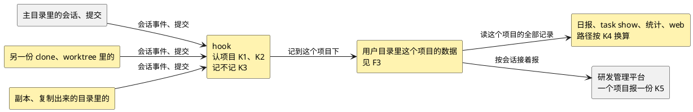

# 功能方案: 数据按项目放用户目录(讨论稿 v1)

> 讨论稿，不是契约：人终确认的那一版由 `/dev-spec` 原样收录为 spec 第一节，之后以 spec 为准，本文件不再维护。
> 图用支持 PlantUML 的 Markdown 预览打开(IDEA:设置 → 语言和框架 → Markdown → 启用 PlantUML)。

**一句话**:原来同一个项目在本机的每个目录各记一份数据，只有 `/dev-start` 开的副本靠链接记回主目录，换个目录干活，日报、task、统计里就少一块;这次把 timeline、task、sync 的数据按项目放到用户目录，在项目的哪个目录干活都记进同一份里。

**功能清单**

| 编号 | 功能点 | 类别 | 从哪进 → 到哪去 | 一句话 |
|---|---|---|---|---|
| F1 | 同一项目的各个目录记到一起 | 核心 | 在项目的任一目录里开会话、提交 → 记进这个项目的数据(F3)→ 日报、task show、统计、web、平台上报 | 不管在 clone、worktree、副本还是手动复制的目录里干活，会话和提交都记到这个项目下;读的时候看到的是同一份，挪过目录的旧记录也照样换算 |
| F2 | 认项目、改项目 | 支撑 | 项目的任一目录里查、改 → F1 按改过的项目记 | 能查当前目录属于哪个项目、数据在哪、本机出现过哪些目录;认错了可以手动指定项目名称 |
| F3 | 数据放到用户目录 | 支撑 | F1 记的、F4 并的 → `~/.cgraphx/projects/<项目>/` | timeline、task、sync 的数据和项目级的连接配置搬到用户目录，一个项目一个目录;知识库索引、「我的需求」留在各目录 |
| F4 | 旧数据并过去 | 支撑 | 升级后在目录里 `cgraphx install` → 并进 F3 → 之后照 F1 记 | 在一个目录装的时候，把它原来库里的数据并进用户目录;平台不重复报，已经绑定的任务不重算 |
| F5 | 卸载和清理 | 支撑 | 目录里 `cgraphx uninstall`、清理命令 → 卸这个目录、删某个项目的数据 | 在一个目录卸载只卸这个目录，项目的数据留着;另给列出、删除项目数据的命令 |
| — | 跨机器合并数据 | 建议新增 ✂️ | — | 不做：数据只在本机 |
| — | 平台按规整后的地址认项目 | 边界外 | — | 不做：平台现在按 origin 原样认项目，同一个项目用 ssh、https 两种地址会被当成两个;要改归平台 |
| — | 拆掉版本流程 | 边界外 | — | 另立需求，排在这个之后;这个需求只做到副本的数据不再靠链接 |
| — | Claude Code 自己按路径存的会话和记忆 | 边界外 | — | 不归 cgraphx 管:`/resume` 列表、自动记忆照旧按目录分 |

### F1 同一项目的各个目录记到一起(核心)

现在：一个目录一份数据，只有 `/dev-start` 开的副本经链接记回主目录;同一个项目的另一份 clone、worktree、手动复制的目录各记各的，目录里没有 `.cgraphx/` 的一条不记。这次哪个目录记的都进这个项目的数据，放在哪见 F3;一个目录的旧数据并过去之前(F4),它照旧记在原来的库里。项目怎么认(K1、K2)和 F2 共用，认错了到 F2 改。

**图 1 数据从哪来、记到哪**



**图 2 hook 每记一条怎么判断**

```plantuml
@startuml
skinparam backgroundColor #FFFFFF
skinparam Activity {
  BackgroundColor #F1F1F1
  BorderColor #181818
  FontColor #000000
}
skinparam Swimlane {
  BorderColor #181818
  TitleBackgroundColor #FFFFFF
  TitleFontColor #000000
}
skinparam ArrowColor #181818

|Claude Code、git|
start
:会话里来了事件\n或刚提交、合并了一次;
|cgraphx hook|
-[#2E7D32,bold]->
:记一条事件\ncgraphx timeline-…-hook;
-[#2E7D32,bold]->
:认出是哪个项目 K1、K2; <<#FFF3B0>>
-[#2E7D32,bold]->
if (这个项目在本机装过? K3) then (装过) <<#FFF3B0>>
  -[#2E7D32,bold]->
  :记进用户目录里这个项目的数据 见 F3\n记下这个目录是项目出现过的目录 K4; <<#FFF3B0>>
  stop
else (没装过)
  :① 不记; <<#FFF3B0>>
  stop
endif
@enduml
```

| 编号 | 哪一步 | 怎么判定 | 算 / 不算(例子) | 依据 |
|---|---|---|---|---|
| K1 | 认项目 · 是哪个项目 | 有 origin 的按 origin 地址认，规整后比:ssh 和 https 两种写法、末尾的 `.git`、末尾的 `/` 都不看;没有 origin 的按项目名称(K2);一个仓库里装了几个项目的，按仓库地址加项目名称分 | 算同一个:`git@github.com:smdnkB/cgraphx.git` 和 `https://github.com/smdnkB/cgraphx` 两份 clone;主目录 cgraphx 和副本 cgraphx@dev-del丢弃副本(origin 一样);从 cgraphx 用 `git worktree add` 开出来的目录。不算同一个:cgraph 和 cgraphx(cgraph 没有 origin,按项目名称 cgraph 认);一个仓库里装在 server/、web/ 两个子目录的两个项目 | git 的 origin 地址;平台现在按 origin 原样认项目;新定 |
| K2 | 认项目 · 项目名称 | 装 cgraphx 时记下，默认是装的那个目录的名字(一个仓库里装了几个项目的，是项目所在的子目录名),装的时候可以改;从它复制出来的目录、它的 worktree 带着这个名字，不看自己的目录名;名字已经被本机另一个项目用了，装的时候提示换一个 | 算:workflow(没有 origin)装的时候记下「workflow」,`cp -R` 出来的 workflow-2 也算 workflow;仓库 platform 里 server/ 装的项目叫 server,web/ 的叫 web。不算：另一个没有 origin、也叫 workflow 的目录——装的时候提示「workflow 已经是 /Users/smdnk/objects/ai/workflow 的项目名称，换一个」 | 新数据(存哪由 spec 定);你定的(11-05):没有 origin、一个仓库装了几个项目，都按项目名称 |
| K3 | 记不记 · 没装过 cgraphx 的目录 | 这个项目在本机任何一个目录装过(用户目录里有它的数据),它的哪个目录触发了 hook 都记;一个目录都没装过的项目不记。只管记事件：知识库索引要在这个目录装过才有 | 算：项目 B 在主目录装过，又开了 worktree B-hotfix 没装，在里面开会话照样记到 B。不算：从没装过的项目 C;hook 根本不触发的目录——cgraphx 只装在项目里,`.claude/` 被 git 忽略的项目(cgraphx 自己就是),新开的 worktree、新 clone 里没有 hook 配置 | hook 配置在项目的 `.claude/settings.json`;现在目录里没有 `.cgraphx/cgraphx.db` 就整条丢掉;你定的(11-05) |
| K4 | 换算路径 · 记下的路径算项目里哪个文件 | 这个项目在本机出现过的目录都当项目根：主目录、各个 clone、worktree、副本，挪走之前的旧位置、删掉的副本也算;记下的路径落在哪个根下，就按它换算成项目里的路径 | 算:`/Users/smdnk/objects/ai/cgraphx@dev-del丢弃副本/src/core/directory.ts` 和 `/Users/smdnk/objects/ai/cgraphx/src/core/directory.ts` 都算 `src/core/directory.ts`,统计的文件排行里排一行;主目录挪到新位置后，挪之前记的路径照样换算,`task show` 的产出不会少。不算：项目外的路径，如 `~/.zshrc` | `timeline_events.cwd`、`timeline_events.tool_args` 里记的是绝对路径;现在只按主目录和登记过的副本换算，换算不了的 task 丢掉、sync 不报;新定 |
| K5 | 上报 · 一个项目报几份 | 一个项目只报一份：哪个目录记的会话都在这个项目的数据里，按会话接着报 | 算：主目录、worktree 各开一个会话，平台上是这个项目的两个会话。不算：同一个会话从两个目录各报一遍 | `sync_sessions.last_event_id` 按会话记上报进度;沿用现在的上报 |

### F2 认项目、改项目(支撑)

和 F1 共用项目标识(K1、K2):查的是 F1 认出来的项目，改了以后 F1 按改过的记。

行为链：你在项目的任一个目录里查「这是哪个项目」→ 显示项目、数据放在哪(F3)、本机出现过的目录(K4,每个写最近一次活动)→ 认错了(从模板 clone 来没改 origin,和模板被认成一个项目),在这个目录里指定一个项目名称 → 之后这个目录记到新项目下，提示「之前记的 320 条还在 github.com/org/template 下」

边界:① 名字已经被本机另一个项目用了 → 提示换一个，不改 ② 改的是有 origin 的目录 → 改完它按名字认，和别的 clone 分开了，提示一句

| 编号 | 哪一步 | 怎么判定 | 算 / 不算(例子) | 依据 |
|---|---|---|---|---|
| K4 | 显示 · 本机出现过的目录 | 见 F1 | — | — |
| K16 | 显示 · 每个目录的最近一次活动 | 这个目录里记的最后一条事件的时间;挪走之前的旧位置、删掉的副本照样列，标「目录已不在」 | 算:cgraphx@dev-del丢弃副本 删掉以后照样列，写「11-05 10:05 最后活动，目录已不在」。不算：项目外的目录(会话里 cd 到 `~/Downloads` 记下的事件) | `timeline_events.ts`、`timeline_events.cwd`;新定 |
| K2 | 指定名字 · 名字重了 | 见 F1 | — | — |
| K6 | 改项目 · 指定的名字管哪些目录 | 在哪个目录指定，就管这个目录、它的 worktree 和从它复制出来的目录;别的 clone 照旧按 origin 认;已经记下的不挪 | 算:B2 从模板 clone 来，在 B2 里指定「B2」后,B2 和它的 worktree 都记到 B2。不算：模板本身和模板的其他 clone;指定之前记在模板下的 320 条(留在原处) | 新数据(存哪由 spec 定);新定 |

### F3 数据放到用户目录(支撑)

共用数据和各目录自己的数据，分法沿用知识库「数据目录」:原来共用的(副本里落在主目录的那些)搬到用户目录，各目录自己的留下。F1 记的、F4 并过来的都放这里。

| 数据 | 原来在 | 改到 | 这次 |
|---|---|---|---|
| timeline 的会话、提问、工具调用、提交 | 目录里的 `.cgraphx/cgraphx.db`(副本里是主目录那份) | `~/.cgraphx/projects/<项目>/` | 改 |
| 任务绑定、平台上报进度 | 同上 | 同上 | 改 |
| 会话的轮次记录 | `.cgraphx/turns/` | 同上 | 改 |
| 平台连接、任务接口配置 | `.cgraphx/` | 同上 | 改 |
| db-query 的项目级连接配置、查询日志 | `.cgraphx/db-profiles.json`、`db-query.log` | 同上;用户级的 `~/.cgraphx/db-profiles.json` 不变 | 改 |
| 上报的锁和触发文件 | `.cgraphx/` | 同上 | 改 |
| 知识库索引 | `.cgraphx/cgraphx.db` | 不动，各目录各建 | |
| 「我的需求」 | `.cgraphx/my-features.md` | 不动 | |

| 编号 | 哪一步 | 怎么判定 | 算 / 不算(例子) | 依据 |
|---|---|---|---|---|
| K7 | 放哪 · 用户目录里怎么分 | 一个项目一个目录 `~/.cgraphx/projects/<项目>/`,目录名看得出是哪个项目：有 origin 的取地址里的主机、组织和仓库名，没有的取项目名称 | 算:`~/.cgraphx/projects/github.com-smdnkB-cgraphx/`、`~/.cgraphx/projects/workflow/`。不算：一串看不出是谁的 hash | db-query 的用户级配置已经放在 `~/.cgraphx/`;新定 |

### F4 旧数据并过去(支撑)

你定的：安装时并(11-05)。现在升级后数据照旧在各目录的 `.cgraphx/` 里;这次在一个目录跑 `cgraphx install` 时，把它原来库里的数据并进用户目录(F3),之后这个目录照 F1 记。`cgraphx upgrade` 装完新版会自动跑 install。

```plantuml
@startuml
skinparam backgroundColor #FFFFFF
skinparam Activity {
  BackgroundColor #F1F1F1
  BorderColor #181818
  FontColor #000000
}
skinparam Swimlane {
  BorderColor #181818
  TitleBackgroundColor #FFFFFF
  TitleFontColor #000000
}
skinparam ArrowColor #181818

|你|
start
:升级后在项目的一个目录里\n跑 cgraphx install K8\ncgraphx upgrade 装完新版会自动跑;
|cgraphx install|
-[#2E7D32,bold]->
:装 hook 配置、建这个目录的知识库索引\n照旧;
-[#2E7D32,bold]->
:认出是哪个项目 见 F1; <<#FFF3B0>>
-[#2E7D32,bold]->
if (这个目录有没并过的旧数据? K9、K10) then (有) <<#FFF3B0>>
  -[#2E7D32,bold]->
  :旧库连同 -wal、-shm 备份一份\n放进用户目录这个项目下 K11; <<#FFF3B0>>
  -[#2E7D32,bold]->
  if (并得进去?) then (能) <<#FFF3B0>>
    -[#2E7D32,bold]->
    :并进用户目录这个项目的数据\n会话、事件、任务绑定、上报进度 K9、K12; <<#FFF3B0>>
    -[#2E7D32,bold]->
    :旧库里只留知识库索引\n记下这个目录并过了 K10; <<#FFF3B0>>
    -[#2E7D32,bold]->
    (B)
    detach
  else (不能)
    :② 不并 这个目录照旧记在原来的库里\n「并到用户目录没成功:<原因>」; <<#FFF3B0>>
    (A)
    detach
  endif
else (没有)
  :① 不用并\n副本、新开的目录、已经并过的; <<#FFF3B0>>
  (C)
  detach
endif
|你|
(B)
-[#2E7D32,bold]->
:看到「已把 58272 条事件、105 个会话\n并进项目 github.com/smdnkB/cgraphx」; <<#FFF3B0>>
stop
(C)
:看到装好了;
stop
(A)
:照旧能用\n按提示处理后再 install; <<#FFF3B0>>
stop
@enduml
```

| 编号 | 哪一步 | 怎么判定 | 算 / 不算(例子) | 依据 |
|---|---|---|---|---|
| K8 | 跑 install · 什么时候并 | 在这个目录跑 `cgraphx install` 时并;`cgraphx upgrade` 装完新版会自动跑 install,也算。没并之前，这个目录照旧记在原来的库里 | 算：升级后第一次在主目录 install,主目录的数据当场并过去。不算：只用 `npm i -g cgraphx` 换了版本、没跑 install 的目录——照旧记在原来的库里，下次 install 再并 | 你定的(11-05):安装时并 |
| K1、K2 | 认出是哪个项目 | 见 F1 | — | — |
| K9 | 有没有旧数据 · 并哪些 | 这个目录旧库里的会话、事件、任务绑定、上报进度，连同项目级的连接配置(F3 表里标「改」的那些) | 算：主目录 cgraphx 旧库里的 58272 条事件、105 个会话。不算：知识库索引(留在原地);副本的旧库——副本的事件本来就记在主目录那份里，副本里没有要并的 | `timeline_events`、`task_*`、`sync_*` 各表;共用数据的分法沿用知识库「数据目录」 |
| K10 | 有没有旧数据 · 只并一次 | 一个目录并过就记下，再装不再并;两个目录的旧库各是各的会话，各并各的;同一个会话的事件在项目里只有一份 | 算：主目录装第二次，提示「已经并过」;两份 clone 各有旧库，各装一次各并一次。不算：… | 新定 |
| K11 | 备份 · 旧库怎么办 | 并之前把旧库连同 -wal、-shm 文件复制一份，放进用户目录这个项目下;并完旧库里只留知识库索引;备份一直留着，用 F5 的清理命令删 | 算：主目录 110M 的旧库，备份一份到 `~/.cgraphx/projects/github.com-smdnkB-cgraphx/` 下。不算：只复制 `cgraphx.db` 一个文件——会丢最近写进去的数据 | 知识库「库副本验证」:库是 WAL 模式，复制要带 -wal、-shm;新定 |
| K12 | 并 · 平台和任务接着用 | 并过来的会话照原来的进度接着上报，平台不重复收;已经算好的任务绑定照旧，不重算 | 算：并之前报到第 58000 条的会话，并完从下一条接着报。不算：从头再报一遍 | `sync_sessions.last_event_id`、`task_auto_sessions.derived_max_event_id` 按事件记进度;知识库「平台上报」:重复不计数;新定 |

### F5 卸载和清理(支撑)

行为链：你在一个目录里 `cgraphx uninstall` → 卸掉这个目录的 hook 配置和本地 `.cgraphx/`(知识库索引、「我的需求」)→ 提示「项目 github.com/smdnkB/cgraphx 的数据留在 ~/.cgraphx/projects/github.com-smdnkB-cgraphx/;要删数据，用清理命令」;你用清理命令列出 → 每个项目一行：项目、数据在哪、占多大、最近一次活动、本机出现过的目录、有没有旧库备份(K14)→ 指定一个项目删 → 先列出会删的(多少条事件、几个会话、配置、备份)→ 你说「删」才删(K15)

边界:① 要删的项目还有目录装着 cgraphx → 照样删，提示「这 2 个目录之后再干活会重新记(K3)」

| 编号 | 哪一步 | 怎么判定 | 算 / 不算(例子) | 依据 |
|---|---|---|---|---|
| K13 | 卸载 · 删什么 | 只删这个目录的 hook 配置和本地 `.cgraphx/`;项目的数据不删，哪怕这是这个项目在本机的最后一个目录 | 算：在 worktree B-hotfix 里卸载，只卸 B-hotfix。不算：项目 B 在用户目录里的数据、备份 | 现在 uninstall 默认连 `.cgraphx/` 一起删(`--keep-data` 保留);新定 |
| K14 | 清理 · 列出 | 用户目录里的每个项目都列，不管它的目录还在不在 | 算：主目录已经删掉的项目，照样列出来、能删 | 新定 |
| K15 | 清理 · 删项目数据 | 删整个项目：事件、会话、任务绑定、上报进度、项目级配置、备份;也可以只删备份。删完提示还装着 cgraphx 的目录：本机出现过、目录还在、里面有 `.cgraphx/` 的 | 算：删掉 workflow 的全部数据。不算：别的项目的数据;各目录里的知识库索引(要删就在那个目录 uninstall) | 新定 |

---

以下供 spec 使用，可不细读

**必须在 spec 前解决的问题**:无

后续阶段的决策：拆掉版本流程另立需求，排在这个之后;平台按规整后的地址认项目，归平台。

**已锁定技术约束**:数据放用户目录、按项目隔离(你定的,11-05);没有 origin 的项目、一个仓库里装了几个项目，都按项目名称认;旧数据在安装时并(`cgraphx upgrade` 装完新版自动跑 install,也算);拆掉版本流程另立需求，排在这个之后;知识库索引、「我的需求」留在各目录;hook 一次 5ms 上下的耗时不能明显变慢。

**留给 spec 的细节决策**:

- origin 怎么规整(ssh、https、`.git`、末尾 `/`、端口);项目名称记在哪(git 本地配置、目录里的文件，还是提交进仓库的文件),worktree、复制出来的目录怎么读到;一个仓库里装了几个项目时，项目名称默认怎么取。
- 每个 hook 怎么拿到项目标识：会话开始时算一次，存进轮次记录(那边实测 Node 调一次 `git remote get-url` 约 7.5ms,比整个 hook 还慢);git 钩子(提交、合并)怎么取。
- 用户目录的布局和目录名(K7);一个项目一个库文件，不用一个大库加项目列(版本流程 spec D18 否掉过按工作目录分区，每条查询都得带条件，漏一处就串)。
- 「项目出现过的目录」怎么记，换算时怎么用(取代现在按「主目录 + 登记过的副本」换算);每个目录的最近一次活动(K16)怎么取。
- 旧库怎么并：事件 id 重排后，sync、task 的进度怎么换算;并的时候有会话在写，怎么不丢、不重;「并过」的记号记在哪。
- 副本：数据不再看 `.cgraphx/shared` 链接和登记;数据目录的取法怎么改;版本流程拆掉之前 `/dev-start` 开的副本照常能用。
- uninstall、`timeline uninstall --purge` 的新含义;清理命令叫什么、放在哪个子命令下。
- cgraphx web 读哪个库;`CGRAPHX_DIR` 以后还管什么(本地 `.cgraphx/` 的目录名)。

**影响半径与风险**:HIGH——timeline、task、sync 和 db-query 配置全部换存放位置;本机已有的数据(主目录 5.8 万条事件)要在安装时并过去，并错就丢记录(K11 先备份);uninstall 的含义从「连数据一起删」变成「只卸这个目录」;认错项目会把两个项目的记录混在一起(K2 装的时候查重名,F2 能改)。

**现实约束清单**

| 表 / 现有实现 | 事实 |
|---|---|
| `src/core/directory.ts:312-331` | 项目根：从 cwd 往上找第一个有 `.cgraphx/cgraphx.db` 的目录，找不到就把起点当根 |
| `src/core/directory.ts:136-175` | 共用数据目录：副本里顺着 `.cgraphx/shared` 链接到主目录(要有登记、没删);没有链接就是项目自己的 `.cgraphx/` |
| `src/core/db/index.ts:235-247` | 共用库 = 数据目录里的 cgraphx.db;本地库(知识库索引)= 项目自己的 `.cgraphx/cgraphx.db`;普通目录里两个是同一个文件，副本里分开 |
| 各子系统的表 | timeline:`timeline_events`、`timeline_meta`;task:`task_items`、`task_sessions`、`task_reminders`、`task_feature_tasks`、`task_auto_sessions`、`task_superseded_bindings`、`task_auto_meta`;sync:`sync_state`、`sync_sessions`、`sync_reference_records`、`sync_unreported_artifacts`;知识库:`markdown_*` |
| 进度 | `sync_sessions.last_event_id`、`task_auto_sessions.derived_max_event_id` 按 timeline 事件 id 记 |
| 数据目录里的文件 | `turns/`(轮次记录)、`db-profiles.json`、`db-query.log`、`task-source.json`、`sync.lock`、`sync-trigger`、`sync-worker.pid`、`replicas/`(副本登记);`my-features.md` 留在本地 |
| `src/core/timeline/recorder.ts:4`、`hooks.ts:59` 起 | hook 按 payload 的 cwd 找项目根，git 钩子按仓库根(`hooks.ts:366`);项目没初始化时写入报错，hook 捕获后以 0 退出，事件丢掉 |
| `timeline_events` | 每条记 cwd、tool_args(里面的文件路径都是绝对路径)、session_id;本机主目录 cgraphx 的库 11-05 有 58272 条事件、105 个会话、72 个不同的 cwd(副本里的事件在主目录库里) |
| `src/core/sync/git.ts:18`、`connection.ts:85` | 平台按 `git remote get-url origin` 原样认项目，没有 origin 不能接平台 |
| `src/core/dbquery/config.ts:76-81` | db-query 连接配置的顺序：环境变量指定的 → 项目级(数据目录里)→ 用户级 `~/.cgraphx/db-profiles.json` |
| `src/cli/installer/index.ts:82-83` | 2.0 只装在项目里(`.claude/settings.json`),没有全局安装 |
| `src/cli/installer/index.ts:399-419` | uninstall 默认连 `.cgraphx/` 一起删,`--keep-data` 保留;副本里不跟随链接 |
| `src/cli/upgrade/index.ts:17` | `cgraphx upgrade` 装完新版自动跑 `install -y` |
| `src/core/directory.ts:22-35` | `CGRAPHX_DIR` 原来是给 Windows 和 WSL 共用一个工作目录时各用各的数据目录 |
| 本仓库 `.gitignore:19` | `.claude/` 被忽略：新开的 worktree、新 clone 里没有 hook 配置 |
| 本机(11-05 查) | 11 个目录装过 cgraphx;origin 相同的只有 cgraphx 和它的副本;cgraph、workflow 没有 origin |
| 知识库 | 「数据目录」:共用数据经数据目录落主目录，知识库索引、「我的需求」各目录各建;「库副本验证」:库是 WAL 模式，复制要带 -wal、-shm;「平台上报」:离线积压补传，重复不计数 |
