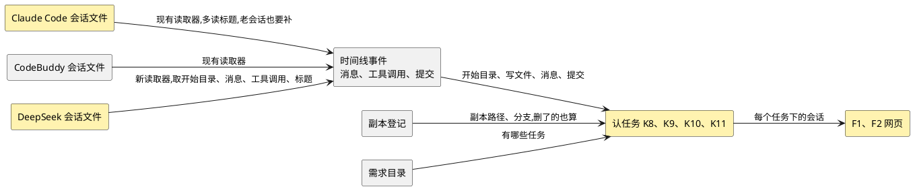

# 规格说明: agent看板

> 产物: spec
> feature-id: 2026-11-06-agent看板
> 负责人: liulongfei
> 日期: 2026-11-07

## 功能方案

> 原样收录 clarify 终确认的功能方案(讨论稿 v3);业务要变,回 clarify 改,再同步这一节。

**一句话**:原来一个任务做上一个月,会话散在 Claude Code、CodeBuddy、DeepSeek Harness 各自的项目列表里,和别的任务混在一起,找不回当时的会话;这次加一个本机网页看板,在任意目录都能打开,任务从开发流程自动来,会话自动挂到任务上,能复制会话标题和编号,到对应的软件里找回。

**功能清单**

| 编号 | 功能点 | 类别 | 从哪进 → 到哪去 | 一句话 |
|---|---|---|---|---|
| F1 | 任务列表 | 核心 | 任意目录 `cgraphx board` → 浏览器打开,在页面左栏 → 点任务,右栏显示 F2 | 按项目分组,列出最近有会话的任务,最近活动的在前 |
| F2 | 任务下的会话 | 核心 | F1 点任务 → 页面右栏 → F3 | 列出挂到这个任务的会话,分「定挂」和「可能相关」,agent 类型不限 |
| F3 | 复制会话标题和编号 | 核心 | F2 点按钮 → 复制 → 留在 F2 | 复制后到对应的软件里按标题或编号找回 |
| F4 | 自动把会话挂到任务 | 核心 | 补录后计算 → F1、F2 显示 | 按副本、写需求目录、流程命令、提交等依据认,不用人挂 |
| — | 直接打开(恢复)会话 | 边界外 | — | 这次不做,先只记录;恢复命令和副本删掉后能不能打开,以后再测 |
| — | 手动建任务、手动挂会话 | 边界外 | — | 不做:任务来自开发流程,会话自动挂 |
| — | 看板里改数据 | 边界外 | — | 不做:网页只读 |
| — | 看板里看会话内容 | 建议新增 ✂️ | — | 不做:复制后到软件里看;基于现有时间线事件可支撑 |
| — | 任务状态和看板列(待办、进行中、已完成) | 建议新增 ✂️ | — | 不做:先按最近活动排;基于现有需求阶段可支撑 |
| — | 没装 cgraphx 的目录 | 边界外 | — | 不做:任务来自项目里的需求目录,要先跑 `cgraphx install` |
| — | DeepSeek 进安装器、部署配置、过提交门禁 | 边界外 | — | 不做:DeepSeek 这次只读会话 |
| — | Claude Code、CodeBuddy、DeepSeek Harness 之外的 agent | 边界外 | — | 这次不接 |

### F1 任务列表(核心)

任务不用人建:澄清写出讨论稿,或开副本时,这个需求目录就是一个任务。和 F2 共用 F4 的认法。

行为链:在任意目录输入 `cgraphx board` → 终端显示「正在补录 2 个项目…」→ 补录完启动本机服务,打开浏览器 `http://127.0.0.1:<随机端口>`,终端同时打印这个地址 → 页面左栏按项目分组,每个任务一行,显示标题、阶段、会话数(定挂)、用过哪些 agent、最近活动,如 `订单导出  已规划  5 个会话  Claude Code、DeepSeek  11-06 16:56` → 每个项目最后一行是「未归类(3)」→ 默认选中最近活动的任务,点一行,右栏换成它的 F2。页面有「刷新」按钮,再补录一次;终端按 Ctrl+C 退出。

边界:① 没有项目:页面显示「还没有项目:在项目里跑 cgraphx install」

② 项目下没有挂上会话的任务:「还没有挂上会话的任务」;有 30 天以外的任务时再加「还有 N 个超过 30 天,点「全部」看」

③ 打不开浏览器:终端显示「浏览器没打开,手动访问 http://127.0.0.1:<端口>」,服务照常跑

④ 项目没能补录,照常显示已有数据,项目标题旁提示原因:别的进程在补录时「正在补录,可能缺最新的会话」;目录还没跑新版 install 时「这个目录还没跑新版 cgraphx install,没有补录」;设了 `CGRAPHX_NO_TIMELINE` 时「CGRAPHX_NO_TIMELINE 开着,没有补录」;出错时「补录失败,可能缺最新的会话」

⑤ 项目的目录都不在了:显示项目名和「目录已不在,列不出任务」,这个项目只有未归类

| 编号 | 哪一步 | 怎么判定 | 算 / 不算(例子) | 依据 |
|---|---|---|---|---|
| K12 | 列出项目 | 用户目录里记过数据的项目,都列;和从哪个目录启动无关;有活动的项目在前。项目的目录取记下的目录里还在的,需求目录和副本登记都按主目录算,在副本里启动和在主目录启动看到的一样 | 算:`~/.cgraphx/projects/cgraphx/`。不算:只开过会话、没装过 cgraphx 的目录 | `~/.cgraphx/projects/*`、`timeline_roots.root`;`src/core/project/list.ts`;新定 |
| K1 | 列出任务 · 哪些算任务 | 需求目录里有讨论稿或 spec,或者开副本时登记过这个需求;在用副本里的需求目录也算 | 算:`docs/features/2026-11-06-订单导出/` 有 `订单导出-功能方案-v1.md`;副本登记了这个需求但目录是空的。不算:只有空目录、没有登记 | `docs/features/`、`.cgraphx/replicas/*.json` 的 `featureId`;新定 |
| K2 | 列出任务 · 列哪些、怎么排 | 本机有挂上的会话(定挂或可能相关),而且最近活动在 30 天内;按最近活动倒序。点「全部」不限 30 天。只有可能相关会话的任务也列,会话数显示「0 个,可能相关 2 个」 | 今天 11-06:10-07 有活动的列,10-06 的点「全部」才列;同事的需求本机没有会话就不列 | K9、K10;新定 |
| K13 | 每行 · 标题和阶段 | 标题取需求目录名去掉日期;副本已删、目录不在的,取登记里的需求名。阶段用现有的已规格、已规划、已验证,没有就显示 `-` | `2026-11-06-订单导出` 显示 `订单导出`;只有讨论稿的显示 `-` | `src/core/features/scanner.ts`、副本登记;沿用「需求阶段」 |
| K14 | 每行 · 最近活动 | 这个任务下所有会话活动时间(K6)里最晚的;没有定挂会话时取可能相关的 | 三个会话活动到 11-03、11-05、11-06:显示 11-06 | K6;新定 |
| K3 | 未归类 | 这个项目 5 条人发消息以上、一个任务都没认到的会话,新的在前 | 算:12 条消息、没有任何依据。不算:只发过 3 条的;有可能相关依据的(它在那个任务下) | 见 K9、K10;新定 |

🎭 体验决策:网页,在任意目录都能打开,读全部项目;网页只读,只监听本机。打开前先补录,看到此刻的会话,代价是要等补录跑完,第一次最慢。左右分栏:左边任务、右边会话,连着翻几个任务不用来回返回。

页面布局与交互以 `agent看板-线框-v2.html` 为准。

### F2 任务下的会话(核心)

从 F1 进来;认法见 F4,同一个会话可以出现在几个任务下。

行为链:在左栏点任务 → 右栏上面是「定挂」,下面是「可能相关」,各按活动时间倒序 → 每行显示 agent、标题、会话编号、开始目录、活动时间和依据,如 `DeepSeek  实现订单导出  session-ef6ec8b0  副本 cgraphx@订单导出  11-05 ~ 11-06  开始目录在副本`,行尾有 F3 的两个按钮。点「未归类」时只有一组,没有依据这一栏。

边界:① 会话文件被 agent 清理了:行尾标「会话文件已不在」,照样能复制

| 编号 | 哪一步 | 怎么判定 | 算 / 不算(例子) | 依据 |
|---|---|---|---|---|
| K4 | 列出会话 · 一个会话算几行 | 主会话算一行;子 agent 不单列,它的动作算主会话的。续接后换了编号的,各算一行 | 算一行:DeepSeek 主会话带 11 个子会话。不单列:Claude Code 的 `subagents/` 文件。算两行:Claude Code 同一个标题的 `d235e1ba`、`e8d330c3` | `session_files.path`;DeepSeek 文件头 `parentSession`;沿用时间线 |
| K5 | 每行 · 标题 | 优先用 agent 自己的标题,没有就取第一条人发的消息前 40 个字 | Claude Code:用户起的名字,其次自动标题;DeepSeek:会话标题;CodeBuddy:第一条消息 | Claude Code `custom-title`、`ai-title`;DeepSeek `session/title`;新定 |
| K6 | 每行 · 活动时间 | 会话只挂一个任务:这个会话的第一条到最后一条事件。挂多个任务:只算第一次到最后一次命中这个任务的时间。副本依据一律算整个会话。未归类算整个会话 | 主目录会话只命中订单导出,从 10-05 做到 11-05:显示 `10-05 ~ 11-05`。一个会话 11-05 写订单导出、11-07 写积分发放:订单导出下显示 `11-05` | `timeline_events.ts`;新定 |

### F3 复制会话标题和编号(核心)

只记录,不打开:看板告诉你是哪个软件的哪个会话,复制后自己到那个软件里找回。

行为链:在 F2 的一行点「复制编号」或「复制标题」→ 按钮旁显示「已复制」,留在 F2。

边界:① 浏览器不让写剪贴板:弹出一个选中了内容的文本框,提示「没能写进剪贴板,手动复制」

| 编号 | 哪一步 | 怎么判定 | 算 / 不算(例子) | 依据 |
|---|---|---|---|---|
| K7 | 复制 · 复制什么 | 编号是这家 agent 自己的完整会话编号,标题同 K5;列表里编号只显示前面一段,复制的是完整的 | 算:`session-ef6ec8b0-bf92-43c1-b247-ea41223a8d14`、`d235e1ba-f304-4cd7-877f-e9c7bc837ba4`。不算:子 agent 的编号 | `session_files.session_id`;DeepSeek 文件头 `id`;新定 |

### F4 自动把会话挂到任务(核心)

补录后按下面的依据算,不写绑定,所以老会话装上就能认,也不靠 agent 配合。主目录做澄清、spec、合入,副本做开发,两段都认得到。只有靠提交的两条(K9 ②③)例外:DeepSeek 的提交、早就记下的提交没有会话编号,认不到;DeepSeek 的开发在副本里,靠 K9 ① 认。F1、F2 都用它的结果。

| 编号 | 哪一步 | 怎么判定 | 算 / 不算(例子) | 依据 |
|---|---|---|---|---|
| K8 | 认任务 · 哪些会话参与 | 开始目录在这个项目的目录及其子目录,或在用、已删的副本里;按路径算 | 算:`cgraphx`、`cgraphx@订单导出`、`cgraphx/.claude/worktrees/a`。不算:在上级目录 `objects/ai` 开的会话 | `session_files.start_cwd`、`timeline_roots.root`、`.cgraphx/replicas/*.json` 的 `path`;新定(不按 `session_files.project_dir`,见现实约束) |
| K9 | 认任务 · 定挂 | 命中任一条:① 开始目录在这个需求的副本里 ② 提交在这个需求的分支上 ③ 提交改了这个需求目录 ④ 写过这个需求目录里的文件 ⑤ 流程命令带了需求名 ⑥ 人发的消息里有这个需求目录的路径 | 算:在 `cgraphx@订单导出` 开的;提交到 `feat/订单导出`;写了 `订单导出-spec.md`;`/dev-merge 订单导出`;「按 docs/features/2026-10-27-订单导出/订单导出-spec.md 写计划」。一个会话命中几个需求就挂几个任务 | `session_files.start_cwd`、`timeline_events`(`tool_args`、`prompt_text`、`commit_files`、`metadata.branch`)、副本登记;新定 |
| K10 | 认任务 · 可能相关 | 没有定挂这个任务,但读过这个需求目录,或人发的消息里提到需求名(4 个字以上) | 算:读过 `订单导出-spec.md`;消息说「参考订单导出的做法」。不算:名字只有 3 个字的需求 | `timeline_events.tool_args`、`prompt_text`;新定 |
| K11 | 认任务 · 不算 | 只在命令文字里出现过需求目录路径 | 不算:`ls docs/features/2026-10-27-订单导出/`、`grep` 扫到 | `timeline_events.tool_args`;新定(旧数据里这条噪声最大) |

🎭 体验决策:任务来自开发流程,不手动建;先只记录,不打开会话;DeepSeek 只读会话,不进安装器、不部署、不过门禁。

## 怎么实现

### 细节方案:F1 任务列表

| # | 决策 | 选择 | 没选的(为什么) | 理由(依据) | 影响面 |
|---|---|---|---|---|---|
| D1 🔒 | 模块边界 | 新子系统 `src/core/board/`:`index.ts` 门面、`cli.ts`、`types.ts`、`errors.ts`、`constants.ts`、计算和服务分文件,页面 `page.html` 同目录。只经 project、timeline、features、replica、agents 门面取数,别的子系统不依赖 board | 恢复 `src/web/`——已删的 25 个文件几乎都是别的页面,还要带回 cli→web 这条分层例外;放进 timeline——任务归属不是时间线的事 | `git show 2e1215a^:src/web/`;`docs/guides/coding-standards.md`「门面是硬约定」;`src/cli/index.ts:175` 的注册方式 | `src/cli/index.ts` 加一行注册;`scripts/copy-assets.cjs` 加 `page.html` |
| D2 🔒 | 服务的安全边界 | `node:http`,只 `listen('127.0.0.1', 0)`;每次启动生成随机令牌,地址是 `http://127.0.0.1:<端口>/?t=<令牌>`,接口都校验令牌和 `Host`;`POST /api/refresh` 再校验 `Origin`;除补录外不写任何东西,不接受路径参数 | 只靠绑定本机——多用户机器上别的账号能读,`sessions.db` 特意是 0600(`session-index.ts:25`);`Host` 不校验——有 DNS 重绑定风险 | `session-index.ts:25`;旧 `src/web/server.ts` 也是回环绑定,但没有令牌 | 浏览器地址多一段令牌;打印和打开的都是带令牌的地址 |
| D3 | 页面和接口 | `page.html` 单文件,内联 CSS、JS,不用框架;启动时读好的数据放内存,`GET /api/board` 返回,`POST /api/refresh` 补录、重算后返回新数据。布局照线框 v2 | 服务端拼 HTML——旧 web 那套要带回模板层;前端框架——要构建链,cgraphx 没有 | `agent看板-线框-v2.html`;`scripts/copy-assets.cjs` | 无 |
| D4 | 启动顺序(F1 行为链、③) | 枚举项目 → 逐个项目 `ensureTimelineUpToDate(主目录)` → 认任务 → `listen` → 打印地址 → `spawn` 系统命令打开浏览器(`open`、`xdg-open`、`start`),失败走 ③。Ctrl+C 退出。不做 `--json`、不做固定端口 | 边开服务边补录——已定「先补录」(F1 体验决策);并发补录——每个项目各有 `ingest.lock`,没必要,而且读 sessions.db 会竞争 | `ingest.ts:72`;原型:1029 个主会话文件 stat 7 ms | `cli.ts` |
| D5 | 项目和任务(K12、K1、K13) | K12 用 project 门面 `listProjects()`,目录取 `roots` 里还在的,经 `replicaLinkOf` 换成主目录并去重;同名项目有几个主目录就合并它们的任务,按 feature-id 去重。K1:对主目录 `listFeatures()`,需求目录里有 `*-功能方案-v*.md` 或 spec 才算,再并上 `listReplicas({includeRemoved:true})` 的 `featureId`。K13:标题和阶段取 `FeatureEntry`;目录不在的取 `parseFeatureId` 的标题,阶段 `-` | 只取最近的主目录——同名的另一个 clone 里在做的需求就丢了 | `project/list.ts:84`、`replica/main-dir.ts:47`、`features/index.ts:101`、`features/feature-id.ts` | `listProjects` 已带目录大小统计,项目多时可能慢,实现时只读汇总就够 |
| D6 | 列表口径(K2、K14、K3) | 都在内存里算:K2 用 D14 的结果,`最近活动 >= 现在 - 30 天` 进默认列表,其余放进 `older`,页面点「全部」才显示;K14 取任务下会话活动时间最晚的,没有定挂时取可能相关的;K3 取事件里 `user_prompt` 不少于 5 条且 D14 没认到的会话 | 查询时过滤 30 天——点「全部」还要再查一次 | D14 | 无 |
| D7 | 没能补录的提示(F1 ④、⑤) | 按 `TimelineSyncOutcome.status` 映射成 F1 ④ 的文案写进项目数据:`busy`、`skipped-legacy`、`skipped-disabled`、`failed`。这里单写一份映射,不用 `describeSyncOutcome`(那份文案不同,`skipped-disabled` 还返回空) | 改 `describeSyncOutcome`——查询命令的提示不该跟着变 | `ingest.ts:51,101` | 无 |

接口契约(只给自己的页面用,令牌不对返回 403,`Host` 不对返回 403):

| 方法 | 路径 | 入参 | 出参 | 错误 |
|---|---|---|---|---|
| GET | `/?t=<令牌>` | 无 | `page.html` | 403 |
| GET | `/api/board?t=<令牌>` | 无 | `{ projects: [{ name, dirs, notice, tasks: [Task], older: [Task], unsorted: [Session] }] }` | 403 |
| POST | `/api/refresh?t=<令牌>` | 无 | 同上 | 403;另一次刷新没结束时 409,页面照旧显示 |

`Task`:`{ featureId, title, stage, fixedCount, maybeCount, agents, lastActiveAt, fixed: [Session], maybe: [Session] }`。`Session`:`{ agent, id, title, startCwd, dirLabel, from, to, reasons, fileExists }`。

### 细节方案:F2 任务下的会话

| # | 决策 | 选择 | 没选的(为什么) | 理由(依据) | 影响面 |
|---|---|---|---|---|---|
| D8 🔒 | 标题存哪(K5) | 项目库加表 `timeline_session_titles(session_id 主键, title, kind, ts)`,`kind` 取 `custom`、`ai`、`agent`;读取器产 `SessionTitleFact`,管线按「`custom` 优先,同级取新」写入。只加表、不升版本号。CodeBuddy 没有标题,不写,显示时取第一条 `user_prompt` 的前 40 个字 | 放 `session_files`——`sessions.db` 约定不放会话内容(`session-index.ts:5`);记成时间线事件——`timeline query`、`stats` 都要改,Claude Code 的标题行很多(抽样 60 个会话 2174 行) | `timeline/schema.sql` 的 `timeline_meta` 也是只加表;本机最近 80 个主会话 38 个有 `ai-title`、35 个有 `custom-title` | `schema.sql`、`claude-transcript.ts`、`ingest.ts`、`rebuild.ts` |
| D9 | 老会话补标题 | `ensureTimelineUpToDate` 里,项目库 `timeline_meta` 没有 `session_titles_at` 就把本项目已归属的文件从头读一遍,只写标题,不写事件,写完记号;一个项目一次,和全量重建同一把 `ingest.lock` | 看板打开时现读——每次都要读全部文件;清偏移重新补录——事件会重读一遍,靠去重也慢 | `ingest.ts:221`:大小和修改时间没变的文件会被跳过;`rebuild.ts` 的记号写法 | 升级后第一次打开要多读一遍文件 |
| D10 | 会话文件已不在(F2 ①)、K4、K6 | `fileExists` 按 `session_files.path` 现查;K4 靠读取器把子 agent 的事实归到主会话,看板不用另外合并;K6 在 D14 里按每个会话命中的任务数算 | 另存一份主子关系——时间线事件已经按主会话记 | `timeline/ingest/types.ts:12`;`session-index.ts` 的 `listSessionFiles` | `session-index.ts` 不改 |

### 细节方案:F3 复制会话标题和编号

| # | 决策 | 选择 | 没选的(为什么) | 理由(依据) | 影响面 |
|---|---|---|---|---|---|
| D11 | 复制(K7、F3 ①) | 页面用 `navigator.clipboard.writeText`,`127.0.0.1` 算安全上下文;失败时显示选中内容的文本框。编号用 `Session.id`,就是事件里的 `session_id` | 服务端调 `pbcopy`——浏览器自己能做,还多一个写接口 | 线框 v2;DeepSeek 文件头 `id` 带 `session-` 前缀,照原样 | 无 |

### 细节方案:F4 自动把会话挂到任务

| # | 决策 | 选择 | 没选的(为什么) | 理由(依据) | 影响面 |
|---|---|---|---|---|---|
| D12 🔒 | DeepSeek 只读怎么登记 | agents 门面新增 `listSessionSources()`:现有描述加一个只读来源 `{ id: 'deepseek', displayName: 'DeepSeek', sessionsRoot, sessionReader, listFiles }`,补录和重建改用它;`AGENT_PROFILES` 不动,`AgentId` 不动,事件的 `agent` 列放宽到 `SessionSourceId` | 给 `AgentProfile` 加只读标记——`listAgentProfiles` 有 6 处调用,漏过滤一处就会部署 `.dsh/` 或开门禁;完整登记——用户定了不进安装器、不部署、不过门禁 | `targets/registry.ts:10`、`agents/index.ts:66`、`replica/carry.ts:57`、`commit-gate/gate.ts:260` | `ingest.ts`、`rebuild.ts`、`timeline/types.ts`;`timeline query`、`stats`、`/doc-report` 开始看到 DeepSeek 的事件 |
| D13 | DeepSeek 读取器 | 新文件 `deepseek-session.ts`。列文件:`~/.dsh/sessions/<编码目录>/<编号>/session.v4.jsonl.zstd`,`DSH_HOME` 设了以它为根。按 zstd 帧头结构切帧,逐帧 `zstdDecompressSync`,偏移记到最后一个完整帧的末尾,尾部不完整的留到下次。映射:文件头 → 会话头;`user/message` 且 `data.source.kind === 'user'` → 提问;`tool/call` 配 `tool/result`(`callId`)→ 工具事实,工具名转成 `Write`、`Edit`、`Read`、`Bash`、`Grep`、`Glob`、`Skill`;`turn/end` → 轮次结束;`session/title` → 标题(`kind` 为 `agent`)。子会话按文件头 `parentSession` 一路找到主会话。Node 没有 `zstdDecompressSync` 时不读,项目提示「DeepSeek 会话要 Node 22.15 以上,没有读取」;engines 下限不抬 | 整个文件一次解压——只出第一行;抬 Node 下限——为了一家只读来源影响所有人;读 `session_projcache` 取标题——那是缓存,没有消息和工具 | 原型:204 个文件、80 MB、42455 帧、86067 行,1487 ms,无坏帧(Node 26.3);`deepseek-harness/packages/session/session-persistence-jsonl/src/zstd.ts:48` | `reader.ts`;`ingest.ts:432` 的 `subagentMainPath` 是 Claude 布局,DeepSeek 子会话的开始目录读它自己的文件头 |
| D14 | 认任务(K8–K11) | 纯函数,每次补录后现算,不写绑定。timeline 门面新增只读查询,取 `session_start`、`user_prompt`、`git_commit`,和工具名是 `Write`、`Edit`、`MultiEdit`、`NotebookEdit`、`Read`、`Skill` 的事件;`Bash` 不取,K11 自然成立。K8:`session_start.cwd` 用 `createRootMatcher` 匹配 `timeline_roots` 和副本路径。K9:① `cwd` 在副本路径下 ② `metadata.branch` 等于登记的 `branch` ③ `commit_files` ④ 写类工具的 `file_path`(③④ 都按 `docs/features/<id>/` 取 id,只认这个项目的任务)⑤ `prompt_text` 匹配 `^/[a-z][\w-]*\s+(.+)` 且参数含标题,或 `Skill` 的 `args` 含标题 ⑥ `prompt_text` 含 `docs/features/<id>/`。K10:`Read` 的 `file_path`,或 `prompt_text` 含 4 个字以上的标题 | 写绑定表——规则一改历史对不上,老会话也要回填;缓存——原型筛出 17702 条事件读 37 ms、匹配 15 ms,没必要 | 原型(`timeline_events` 48122 条);`root-match.ts`(`2c8b2a8` 已修 Windows 路径) | `timeline/index.ts` 加一个查询;标题含 `-`、`_` 等都按原文比较 |

### 迁移与兼容

- `timeline_session_titles` 是 `CREATE TABLE IF NOT EXISTS`,不升 `TIMELINE_SCHEMA_VERSION`,旧版打开库不受影响。包内数据,不走 `docs/guides/data-standards.md`「Schema 变更约定」。
- 不写绑定,所以不用迁移。还没跑新版 `cgraphx install` 的目录走 F1 ④ 的提示。
- 本机 `github.com-smdnkB-cgraphx` 的手动改名和错归事件清理都是另外的事,看板 K8 按路径算,不依赖它们。

### 文档

| 文件 | 改什么 | 对应 |
|---|---|---|
| 本仓库 `CLAUDE.md`、`CHANGELOG.md` | 新子系统 board;时间线多一个只读来源;下掉的 web 换成只读看板 | 全部 |
| `skills/cgraphx-guide/SKILL.md`、`how-to-use.*` | `cgraphx board` 怎么用 | F1、F3 |
| `skills/doc-report/SKILL.md` | 事件来源多了 DeepSeek | D12 |
| 知识库「开发时间线」相关条目 | 第三个读取器、只读来源、标题表 | D8、D12、D13 |

### 全局约束

- 现有 `timeline query`、`stats`、`show`、`recent` 的参数和输出格式不变,只是多了 DeepSeek 的事件。
- `AGENT_PROFILES` 不变:安装器、副本带配置、提交门禁、会话提示对 DeepSeek 零变化。
- 看板除补录外不写任何东西,不改用户的会话文件。
- 读取器照旧只产事实,不打开库。

## 设计验收

| # | 对应 | 验收点 | 怎么验 |
|---|---|---|---|
| 1 | D2 | 令牌错、`Host` 是别的域名、`POST` 的 `Origin` 不对,都返回 403;服务不监听 `0.0.0.0` | 单元测试 |
| 2 | D12 | 装上后 `cgraphx install -t all` 不部署 `.dsh/`,开副本不带它,带 `DSH_SESSION_ID` 提交不触发门禁 | 单元测试 |
| 3 | D13 | 尾部不完整的帧留到下次;追加新帧后增量读只出新事实;子会话的事实归主会话;Node 没有 zstd 时提示且不报错 | 单元测试(用 `zlib.zstdCompressSync` 造文件) |
| 4 | D13 | 本机全部 DeepSeek 文件解析无异常,项目 `cgraphx` 的主会话数和文件数对得上(17 个主会话) | 手工跑一次 |
| 5 | D8、D9 | 老会话补标题后,`custom` 不被 `ai` 覆盖;第二次打开不再重读;事件数不变 | 单元测试 |
| 6 | D14 | 第一节 K8–K11 的「算 / 不算」例子逐条覆盖;Windows 路径的会话不参与 | 单元测试 |
| 7 | D14 | 本机项目打开看板,从补录完到页面可用的计算耗时低于 1 秒 | 手工跑一次 |
| 8 | D1、D3 | `npm pack` 的包里有 `page.html`,全局安装后在任意目录能打开 | 手工跑一次 |
| 9 | D4 | 打不开浏览器时终端有带令牌的地址,服务照常跑 | 单元测试(注入打开函数) |
| 10 | 全局 | 全量测试通过,现有时间线测试不用改断言 | `npm test` |

## 待确认项

- 无
