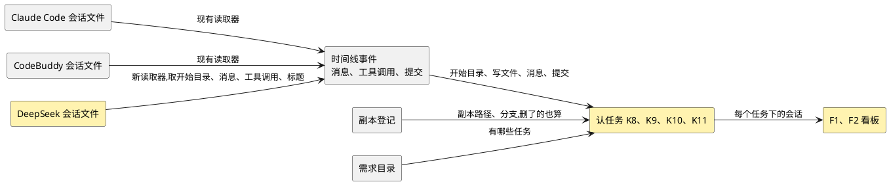

# 功能方案: agent看板(讨论稿 v1)

> 讨论稿,不是契约:人终确认的那一版由 `/dev-spec` 原样收录为 spec 第一节,之后以 spec 为准,本文件不再维护。

**一句话**:原来一个任务做上一个月,会话散在 Claude Code、CodeBuddy、DeepSeek Harness 各自的项目列表里,和别的任务混在一起,找不回当时的会话;这次在终端加一个看板,任务从开发流程自动来,会话自动挂到任务上,能复制会话标题和编号,到对应的软件里找回。

**功能清单**

| 编号 | 功能点 | 类别 | 从哪进 → 到哪去 | 一句话 |
|---|---|---|---|---|
| F1 | 任务列表 | 核心 | 终端 `cgraphx board` → F2 | 列出这个项目最近有会话的任务,最近活动的在前 |
| F2 | 任务下的会话 | 核心 | F1 选任务 → F3;返回 F1 | 列出挂到这个任务的会话,分「定挂」和「可能相关」,agent 类型不限 |
| F3 | 复制会话标题和编号 | 核心 | F2 选会话 → 复制 → 留在 F2 | 复制后到对应的软件里按标题或编号找回 |
| F4 | 自动把会话挂到任务 | 核心 | 打开看板时计算 → F1、F2 显示 | 按副本、写需求目录、流程命令、提交等依据认,不用人挂 |
| — | 直接打开(恢复)会话 | 边界外 | — | 这次不做,先只记录;恢复命令和副本删掉后能不能打开,以后再测 |
| — | 手动建任务、手动挂会话 | 边界外 | — | 不做:任务来自开发流程,会话自动挂 |
| — | 看板里看会话内容 | 建议新增 ✂️ | — | 不做:复制后到软件里看;基于现有时间线事件可支撑 |
| — | 任务状态和看板列(待办、进行中、已完成) | 建议新增 ✂️ | — | 不做:先按最近活动排;基于现有需求阶段可支撑 |
| — | 跨项目看板 | 边界外 | — | 不做:只看当前项目 |
| — | 网页或独立应用 | 边界外 | — | 不做:先做终端列表 |
| — | agent 自己开的 worktree 单独算任务 | 边界外 | — | 不做:照 F4 认,认不出的进「未归类」 |
| — | Claude Code、CodeBuddy、DeepSeek Harness 之外的 agent | 边界外 | — | 这次不接;接一家 = 一份描述 + 一个读取器 |

### F1 任务列表(核心)

任务不用人建:澄清写出讨论稿,或开副本时,这个需求目录就是一个任务。和 F2 共用 F4 的认法。

行为链:在项目里输入 `cgraphx board` → 先把各家 agent 新增的会话补录进来 → 列出任务,每行显示标题、阶段、会话数(定挂)、用过哪些 agent、最近活动,如 `订单导出  已规划  5 个会话  Claude Code、DeepSeek  11-06 16:56` → 最后一行是「未归类(3)」→ 选一行进 F2,按 `q` 退出。

边界:① 不在项目里:「这个目录不在 cgraphx 项目里,先跑 cgraphx install」

② 没有任务:「还没有任务:澄清写出讨论稿或开副本后,这里会出现」

③ 不在交互终端里(管道、脚本):「看板要在终端里打开」

④ 补录失败:照常显示已有数据,顶部提示「补录失败,可能缺最新的会话」

| 编号 | 哪一步 | 怎么判定 | 算 / 不算(例子) | 依据 |
|---|---|---|---|---|
| K1 | 列出任务 · 哪些算任务 | 需求目录里有讨论稿或 spec,或者开副本时登记过这个需求;在用副本里的需求目录也算 | 算:`docs/features/2026-11-06-订单导出/` 有 `订单导出-功能方案-v1.md`;副本登记了这个需求但目录是空的。不算:只有空目录、没有登记 | `docs/features/`、`.cgraphx/replicas/*.json` 的 `featureId`;新定 |
| K2 | 列出任务 · 列哪些、怎么排 | 本机有定挂会话,而且最近活动在 30 天内;按最近活动倒序。`--all` 不限 30 天 | 今天 11-06:10-07 有活动的列,10-06 的只在 `--all` 列;同事的需求本机没有会话就不列;只有「可能相关」会话的不列 | K9;新定 |
| K3 | 未归类 | 这个项目 5 条人发消息以上、一个任务都没认到的会话,新的在前 | 算:12 条消息、没有任何依据。不算:只发过 3 条的;有「可能相关」依据的 | 见 K9、K10;新定 |

🎭 体验决策:打开时先补录,看到此刻的会话,代价是要等补录跑完,第一次最慢。

### F2 任务下的会话(核心)

从 F1 进来;认法见 F4,同一个会话可以出现在几个任务下。

行为链:选中任务 → 上面是「定挂」,下面是「可能相关」,各按活动时间倒序 → 每行显示 agent、标题、会话编号、开始目录、在这个任务上的活动时间和依据,如 `DeepSeek  实现订单导出  session-ef6ec8b0  副本 cgraphx@订单导出  11-05 ~ 11-06  开始目录在副本` → 选中一行按 F3 复制,按 `q` 回到 F1。从「未归类」进来时只有一组,依据一栏留空。

| 编号 | 哪一步 | 怎么判定 | 算 / 不算(例子) | 依据 |
|---|---|---|---|---|
| K4 | 列出会话 · 一个会话算几行 | 主会话算一行;子 agent 不单列,它的动作算主会话的 | 算一行:DeepSeek 主会话带 11 个子会话。不单列:Claude Code 的 `subagents/` 文件 | `session_files.path`;DeepSeek 文件头 `delegationDepth`;沿用时间线 |
| K5 | 每行 · 标题 | 优先用 agent 自己的标题,没有就取第一条人发的消息前 40 个字 | Claude Code:用户起的名字,其次自动标题;DeepSeek:会话标题;CodeBuddy:第一条消息 | Claude Code `custom-title`、`ai-title`;DeepSeek `session/title`;新定 |
| K6 | 每行 · 活动时间 | 副本依据:这个会话的第一条到最后一条事件;其他依据:第一次到最后一次命中这个任务的时间 | 11-05 写讨论稿,11-06 合入:显示 `11-05 ~ 11-06`;这个会话 11-07 改别的需求,不算进来 | `timeline_events.ts`;新定 |

### F3 复制会话标题和编号(核心)

只记录,不打开:看板告诉你是哪个软件的哪个会话,复制后自己到那个软件里找回。

行为链:在 F2 选中一个会话 → 按回车复制会话编号,按 `t` 复制标题 → 底部显示「已复制:session-ef6ec8b0-bf92-43c1-b247-ea41223a8d14」,留在 F2。

边界:① 复制不了(本机没有可用的剪贴板命令,如没有图形界面的 Linux):底部显示要复制的内容和「没能写进剪贴板,手动复制」

| 编号 | 哪一步 | 怎么判定 | 算 / 不算(例子) | 依据 |
|---|---|---|---|---|
| K7 | 复制 · 复制什么 | 编号是这家 agent 自己的完整会话编号,标题同 K5;列表里编号只显示前面一段,复制的是完整的 | 算:`session-ef6ec8b0-bf92-43c1-b247-ea41223a8d14`、`d235e1ba-f304-4cd7-877f-e9c7bc837ba4`。不算:子 agent 的编号 | `session_files.session_id`;DeepSeek 文件头 `id`;新定 |

### F4 自动把会话挂到任务(核心)

每次打开看板时按下面的依据算,不写绑定,所以一个月前的会话装上就能认,也不靠 agent 配合。主目录做澄清、spec、合入,副本做开发,两段都认得到。F1、F2 都用它的结果。

| 编号 | 哪一步 | 怎么判定 | 算 / 不算(例子) | 依据 |
|---|---|---|---|---|
| K8 | 认任务 · 哪些会话参与 | 开始目录属于这个项目:主目录、在用或已删的副本 | 算:`cgraphx`、`cgraphx@订单导出`。不算:在上级目录 `objects/ai` 开的会话 | `session_files.start_cwd`、`.cgraphx/replicas/*.json` 的 `path`;沿用时间线 |
| K9 | 认任务 · 定挂 | 命中任一条:① 开始目录在这个需求的副本里 ② 提交在这个需求的分支上 ③ 提交改了这个需求目录 ④ 写过这个需求目录里的文件 ⑤ 流程命令带了需求名 ⑥ 人发的消息里有这个需求目录的路径 | 算:在 `cgraphx@订单导出` 开的;提交到 `feat/订单导出`;写了 `订单导出-spec.md`;`/dev-merge 订单导出`;「按 docs/features/2026-10-27-订单导出/订单导出-spec.md 写计划」。一个会话命中几个需求就挂几个任务 | `session_files.start_cwd`、`timeline_events`(`tool_args`、`prompt_text`、`commit_files`、`metadata.branch`)、副本登记;新定 |
| K10 | 认任务 · 可能相关 | 没有定挂这个任务,但读过这个需求目录,或人发的消息里提到需求名(4 个字以上) | 算:读过 `订单导出-spec.md`;消息说「参考订单导出的做法」。不算:名字只有 3 个字的需求 | `timeline_events.tool_args`、`prompt_text`;新定 |
| K11 | 认任务 · 不算 | 只在命令文字里出现过需求目录路径 | 不算:`ls docs/features/2026-10-27-订单导出/`、`grep` 扫到 | `timeline_events.tool_args`;新定(旧数据里这条噪声最大) |

🎭 体验决策:终端界面,放进 cgraphx 作一条命令;任务来自开发流程,不手动建;只看当前项目;先只记录,不打开会话。

---

以下供 spec 使用,可不细读。

**必须在 spec 前解决的问题**:无

后续阶段的决策:解析的实测在 spec 做,见下面「留给 spec 的细节决策」;恢复会话不在这次范围。

**已锁定技术约束**

- 任务不手动建,来自澄清后的需求目录或开副本。
- 先只记录、能复制标题和编号,不做直接打开。
- 方案按新流程(副本是 git worktree)定,不用旧写时复制副本的做法和统计定方案。
- 三家:Claude Code、CodeBuddy、DeepSeek Harness(`dsh`)。
- 只有本机数据,不上报。

**留给 spec 的细节决策**

- DeepSeek 读取器:`session.v4.jsonl.zstd` 怎么解。Node 内置的 zstd 只解出第一行,后面报 `Unknown frame descriptor`;查 `deepseek-harness` 的 `scripts/migrate-sessions-to-v4.ts` 和存储实现。Node 22.15 起才有内置 zstd,cgraphx 下限是 22.5,要定低版本时跳过还是抬下限。
- 把 `DSH_SESSION_ID` 加进 agent 描述的 `sessionIdEnv`。这样提交记录能带上 DeepSeek 的会话,但提交门禁也会开始对 DeepSeek 生效,要确认。
- 读取器的会话编号和标题怎么取:DeepSeek 主会话编号带 `session-` 前缀,子会话是 UUID。
- 剪贴板:macOS `pbcopy`,Linux `wl-copy`、`xclip`;都没有时走 F3 ①。
- 认任务每次算的耗时,要不要缓存(只影响速度,不写绑定);终端列表用 `@clack/prompts` 还是自己写。
- 模块边界:新子系统怎么经 timeline、features、replica、agents 门面取数。

**影响半径与风险**

- HIGH DeepSeek 主力开发却还没解析:读取器做不出来时,只有 K9 ① 这一条能靠文件头认到它的会话。
- LOW 同一会话挂多个任务时,只能从活动时间判断是哪一段。

**现实约束清单**(2026-11-06 查)

- 新流程实测(新版 `b61949c`,临时仓库):worktree 副本和主目录路径不同,会话文件各存一处;补录把两个目录认成同一个项目,开始目录都对。agent 在副本里提交没测到。
- 三家的会话文件:Claude Code `~/.claude/projects/<编码目录>/<编号>.jsonl`;CodeBuddy `~/.codebuddy/projects/<编码目录>/<编号>.jsonl`;DeepSeek `~/.dsh/sessions/<编码目录>/<编号>/session.v4.jsonl.zstd`,文件头有 `id`、`cwd`、`createdAt`、`delegationDepth`,目录名里的中文编码成 `~526F` 这样。
- DeepSeek 事件:`user/message`、`tool/call`、`tool/result`、`turn/start`、`turn/end`、`session/title`;工具 `write`、`edit`、`read` 带 `file_path`,`bash` 带 `command`、`workdir`,`skill` 带 `name`(看的是 `session.v4.jsonl 2` 这份未压缩样本)。缓存 `~/.dsh/storages/session_projcache/sessions/<编号>.json` 有标题;`local_tasks/sessions/` 有 `subagentIds`。
- DeepSeek 命令环境带 `DSH_SESSION_ID`(`packages/shell/shell-env/src/index.ts:162`)。
- 本机 DeepSeek 会话:`cgraphx` 24 个(主会话 15),`cgraphx@副本改用worktree` 12 个(主会话 1),`cgraphx@项目按名称认` 7 个(主会话 1)。
- 现成数据:`session_files`(路径、agent、会话编号、开始目录、所属项目)、`timeline_events`、`timeline_roots`;`features list` 已列出在用副本里的需求;读取器在 `src/core/timeline/ingest/`,agent 描述在 `src/core/agents/profiles.ts`。
- 旧流程数据只看过信号的噪声:只在命令里出现路径的,平均一个会话命中 3.1 个需求,最多 9 个。这份数据不作为新流程的覆盖率依据。
