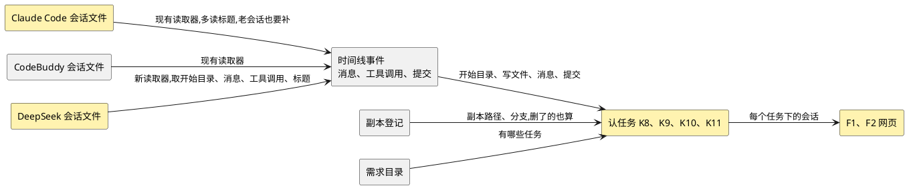

# 功能方案: agent看板(讨论稿 v3)

> 讨论稿,不是契约:人终确认的那一版由 `/dev-spec` 原样收录为 spec 第一节,之后以 spec 为准,本文件不再维护。

**一句话**:原来一个任务做上一个月,会话散在 Claude Code、CodeBuddy、DeepSeek Harness 各自的项目列表里,和别的任务混在一起,找不回当时的会话;这次加一个本机网页看板,在任意目录都能打开,任务从开发流程自动来,会话自动挂到任务上,能复制会话标题和编号,到对应的软件里找回。

**功能清单**

| 编号 | 功能点 | 类别 | 从哪进 → 到哪去 | 一句话 |
|---|---|---|---|---|
| F1 | 任务列表 | 核心 | 任意目录 `cgraphx board` → 浏览器打开,在页面左栏 → 点任务,右栏显示 F2 | 按项目分组,列出最近有会话的任务,最近活动的在前 |
| F2 | 任务下的会话 | 核心 | F1 点任务 → 页面右栏 → F3 | 列出挂到这个任务的会话,分「定挂」和「可能相关」,agent 类型不限 |
| F3 | 复制会话标题和编号 | 核心 | F2 点按钮 → 复制 → 留在 F2 | 复制后到对应的软件里按标题或编号找回 |
| F4 | 自动把会话挂到任务 | 核心 | 补录后计算 → F1、F2 显示 | 按副本、写需求目录、流程命令、提交等依据认,不用人挂 |
| — | 直接打开(恢复)会话 | 边界外 | — | 这次不做,先只记录;恢复命令和副本删掉后能不能打开,以后再测 |
| — | 手动建任务、手动挂会话 | 边界外 | — | 不做:任务来自开发流程,会话自动挂 |
| — | 看板里改数据 | 边界外 | — | 不做:网页只读 |
| — | 看板里看会话内容 | 建议新增 ✂️ | — | 不做:复制后到软件里看;基于现有时间线事件可支撑 |
| — | 任务状态和看板列(待办、进行中、已完成) | 建议新增 ✂️ | — | 不做:先按最近活动排;基于现有需求阶段可支撑 |
| — | 没装 cgraphx 的目录 | 边界外 | — | 不做:任务来自项目里的需求目录,要先跑 `cgraphx install` |
| — | DeepSeek 进安装器、部署配置、过提交门禁 | 边界外 | — | 不做:DeepSeek 这次只读会话 |
| — | Claude Code、CodeBuddy、DeepSeek Harness 之外的 agent | 边界外 | — | 这次不接 |

### F1 任务列表(核心)

任务不用人建:澄清写出讨论稿,或开副本时,这个需求目录就是一个任务。和 F2 共用 F4 的认法。

行为链:在任意目录输入 `cgraphx board` → 终端显示「正在补录 2 个项目…」→ 补录完启动本机服务,打开浏览器 `http://127.0.0.1:<随机端口>`,终端同时打印这个地址 → 页面左栏按项目分组,每个任务一行,显示标题、阶段、会话数(定挂)、用过哪些 agent、最近活动,如 `订单导出  已规划  5 个会话  Claude Code、DeepSeek  11-06 16:56` → 每个项目最后一行是「未归类(3)」→ 默认选中最近活动的任务,点一行,右栏换成它的 F2。页面有「刷新」按钮,再补录一次;终端按 Ctrl+C 退出。

边界:① 没有项目:页面显示「还没有项目:在项目里跑 cgraphx install」

② 项目下没有挂上会话的任务:「还没有挂上会话的任务」;有 30 天以外的任务时再加「还有 N 个超过 30 天,点「全部」看」

③ 打不开浏览器:终端显示「浏览器没打开,手动访问 http://127.0.0.1:<端口>」,服务照常跑

④ 项目没能补录,照常显示已有数据,项目标题旁提示原因:别的进程在补录时「正在补录,可能缺最新的会话」;目录还没跑新版 install 时「这个目录还没跑新版 cgraphx install,没有补录」;设了 `CGRAPHX_NO_TIMELINE` 时「CGRAPHX_NO_TIMELINE 开着,没有补录」;出错时「补录失败,可能缺最新的会话」

⑤ 项目的目录都不在了:显示项目名和「目录已不在,列不出任务」,这个项目只有未归类

| 编号 | 哪一步 | 怎么判定 | 算 / 不算(例子) | 依据 |
|---|---|---|---|---|
| K12 | 列出项目 | 用户目录里记过数据的项目,都列;和从哪个目录启动无关;有活动的项目在前。项目的目录取记下的目录里还在的,需求目录和副本登记都按主目录算,在副本里启动和在主目录启动看到的一样 | 算:`~/.cgraphx/projects/cgraphx/`。不算:只开过会话、没装过 cgraphx 的目录 | `~/.cgraphx/projects/*`、`timeline_roots.root`;`src/core/project/list.ts`;新定 |
| K1 | 列出任务 · 哪些算任务 | 需求目录里有讨论稿或 spec,或者开副本时登记过这个需求;在用副本里的需求目录也算 | 算:`docs/features/2026-11-06-订单导出/` 有 `订单导出-功能方案-v1.md`;副本登记了这个需求但目录是空的。不算:只有空目录、没有登记 | `docs/features/`、`.cgraphx/replicas/*.json` 的 `featureId`;新定 |
| K2 | 列出任务 · 列哪些、怎么排 | 本机有挂上的会话(定挂或可能相关),而且最近活动在 30 天内;按最近活动倒序。点「全部」不限 30 天。只有可能相关会话的任务也列,会话数显示「0 个,可能相关 2 个」 | 今天 11-06:10-07 有活动的列,10-06 的点「全部」才列;同事的需求本机没有会话就不列 | K9、K10;新定 |
| K13 | 每行 · 标题和阶段 | 标题取需求目录名去掉日期;副本已删、目录不在的,取登记里的需求名。阶段用现有的已规格、已规划、已验证,没有就显示 `-` | `2026-11-06-订单导出` 显示 `订单导出`;只有讨论稿的显示 `-` | `src/core/features/scanner.ts`、副本登记;沿用「需求阶段」 |
| K14 | 每行 · 最近活动 | 这个任务下所有会话活动时间(K6)里最晚的;没有定挂会话时取可能相关的 | 三个会话活动到 11-03、11-05、11-06:显示 11-06 | K6;新定 |
| K3 | 未归类 | 这个项目 5 条人发消息以上、一个任务都没认到的会话,新的在前 | 算:12 条消息、没有任何依据。不算:只发过 3 条的;有可能相关依据的(它在那个任务下) | 见 K9、K10;新定 |

🎭 体验决策:网页,在任意目录都能打开,读全部项目;网页只读,只监听本机。打开前先补录,看到此刻的会话,代价是要等补录跑完,第一次最慢。左右分栏:左边任务、右边会话,连着翻几个任务不用来回返回。

页面布局与交互以 `agent看板-线框-v2.html` 为准。

### F2 任务下的会话(核心)

从 F1 进来;认法见 F4,同一个会话可以出现在几个任务下。

行为链:在左栏点任务 → 右栏上面是「定挂」,下面是「可能相关」,各按活动时间倒序 → 每行显示 agent、标题、会话编号、开始目录、活动时间和依据,如 `DeepSeek  实现订单导出  session-ef6ec8b0  副本 cgraphx@订单导出  11-05 ~ 11-06  开始目录在副本`,行尾有 F3 的两个按钮。点「未归类」时只有一组,没有依据这一栏。

边界:① 会话文件被 agent 清理了:行尾标「会话文件已不在」,照样能复制

| 编号 | 哪一步 | 怎么判定 | 算 / 不算(例子) | 依据 |
|---|---|---|---|---|
| K4 | 列出会话 · 一个会话算几行 | 主会话算一行;子 agent 不单列,它的动作算主会话的。续接后换了编号的,各算一行 | 算一行:DeepSeek 主会话带 11 个子会话。不单列:Claude Code 的 `subagents/` 文件。算两行:Claude Code 同一个标题的 `d235e1ba`、`e8d330c3` | `session_files.path`;DeepSeek 文件头 `parentSession`;沿用时间线 |
| K5 | 每行 · 标题 | 优先用 agent 自己的标题,没有就取第一条人发的消息前 40 个字 | Claude Code:用户起的名字,其次自动标题;DeepSeek:会话标题;CodeBuddy:第一条消息 | Claude Code `custom-title`、`ai-title`;DeepSeek `session/title`;新定 |
| K6 | 每行 · 活动时间 | 会话只挂一个任务:这个会话的第一条到最后一条事件。挂多个任务:只算第一次到最后一次命中这个任务的时间。副本依据一律算整个会话。未归类算整个会话 | 主目录会话只命中订单导出,从 10-05 做到 11-05:显示 `10-05 ~ 11-05`。一个会话 11-05 写订单导出、11-07 写积分发放:订单导出下显示 `11-05` | `timeline_events.ts`;新定 |

### F3 复制会话标题和编号(核心)

只记录,不打开:看板告诉你是哪个软件的哪个会话,复制后自己到那个软件里找回。

行为链:在 F2 的一行点「复制编号」或「复制标题」→ 按钮旁显示「已复制」,留在 F2。

边界:① 浏览器不让写剪贴板:弹出一个选中了内容的文本框,提示「没能写进剪贴板,手动复制」

| 编号 | 哪一步 | 怎么判定 | 算 / 不算(例子) | 依据 |
|---|---|---|---|---|
| K7 | 复制 · 复制什么 | 编号是这家 agent 自己的完整会话编号,标题同 K5;列表里编号只显示前面一段,复制的是完整的 | 算:`session-ef6ec8b0-bf92-43c1-b247-ea41223a8d14`、`d235e1ba-f304-4cd7-877f-e9c7bc837ba4`。不算:子 agent 的编号 | `session_files.session_id`;DeepSeek 文件头 `id`;新定 |

### F4 自动把会话挂到任务(核心)

补录后按下面的依据算,不写绑定,所以老会话装上就能认,也不靠 agent 配合。主目录做澄清、spec、合入,副本做开发,两段都认得到。只有靠提交的两条(K9 ②③)例外:DeepSeek 的提交、早就记下的提交没有会话编号,认不到;DeepSeek 的开发在副本里,靠 K9 ① 认。F1、F2 都用它的结果。

| 编号 | 哪一步 | 怎么判定 | 算 / 不算(例子) | 依据 |
|---|---|---|---|---|
| K8 | 认任务 · 哪些会话参与 | 开始目录在这个项目的目录及其子目录,或在用、已删的副本里;按路径算 | 算:`cgraphx`、`cgraphx@订单导出`、`cgraphx/.claude/worktrees/a`。不算:在上级目录 `objects/ai` 开的会话 | `session_files.start_cwd`、`timeline_roots.root`、`.cgraphx/replicas/*.json` 的 `path`;新定(不按 `session_files.project_dir`,见现实约束) |
| K9 | 认任务 · 定挂 | 命中任一条:① 开始目录在这个需求的副本里 ② 提交在这个需求的分支上 ③ 提交改了这个需求目录 ④ 写过这个需求目录里的文件 ⑤ 流程命令带了需求名 ⑥ 人发的消息里有这个需求目录的路径 | 算:在 `cgraphx@订单导出` 开的;提交到 `feat/订单导出`;写了 `订单导出-spec.md`;`/dev-merge 订单导出`;「按 docs/features/2026-10-27-订单导出/订单导出-spec.md 写计划」。一个会话命中几个需求就挂几个任务 | `session_files.start_cwd`、`timeline_events`(`tool_args`、`prompt_text`、`commit_files`、`metadata.branch`)、副本登记;新定 |
| K10 | 认任务 · 可能相关 | 没有定挂这个任务,但读过这个需求目录,或人发的消息里提到需求名(4 个字以上) | 算:读过 `订单导出-spec.md`;消息说「参考订单导出的做法」。不算:名字只有 3 个字的需求 | `timeline_events.tool_args`、`prompt_text`;新定 |
| K11 | 认任务 · 不算 | 只在命令文字里出现过需求目录路径 | 不算:`ls docs/features/2026-10-27-订单导出/`、`grep` 扫到 | `timeline_events.tool_args`;新定(旧数据里这条噪声最大) |

🎭 体验决策:任务来自开发流程,不手动建;先只记录,不打开会话;DeepSeek 只读会话,不进安装器、不部署、不过门禁。

---

以下供 spec 使用,可不细读。

**必须在 spec 前解决的问题**:无

后续阶段的决策:解析和服务的实测在 spec 做,见下面「留给 spec 的细节决策」;恢复会话不在这次范围。

**已锁定技术约束**

- 任务不手动建,来自澄清后的需求目录或开副本。
- 先只记录、能复制标题和编号,不做直接打开。
- 方案按新流程(副本是 git worktree)定,不用旧写时复制副本的做法和统计定方案。
- 三家:Claude Code、CodeBuddy、DeepSeek Harness(`dsh`);DeepSeek 只读。
- 网页只读、只监听本机;只有本机数据,不上报。

**留给 spec 的细节决策**

- DeepSeek 只读怎么放:现有 agent 描述一登记就会进安装器、部署 `.dsh/`、开副本带配置、会话提示也认它(`targets/registry.ts:10`、`agents/index.ts:66`、`carry.ts:57`),要有不走这些的登记方式;不加 `DSH_SESSION_ID`。
- DeepSeek 读取器:文件是多个独立 zstd 帧拼接,按帧切开后 Node 内置 zstd 能解(审核抽查 799 帧、1512 行,Node 26.3);Node 22.15 起才有内置 zstd,cgraphx 下限是 22.5,要定低版本时跳过还是抬下限。「人发的」按 `source.kind=user` 过滤,子会话按 `parentSession` 归主会话。
- Claude Code 标题:读取器现在只处理 user、assistant、attachment 行,没读标题;老文件大小和修改时间没变会被跳过,要定老会话怎么补。`session_files` 或时间线要多存标题。
- 网页:服务怎么写、页面怎么随包(`scripts/copy-assets.cjs`),只绑 `127.0.0.1`,校验 Host 防 DNS 重绑定;剪贴板用 `navigator.clipboard`。2.0.14 刚下掉本地 web,看 CHANGELOG 和 `2026-11-05-下掉web与平台同步` 哪些能捞回来。
- 多项目补录:现在的补录入口按项目根跑,要逐个项目跑;耗时、并发和失败隔离。
- 认任务每次算的耗时,要不要缓存(只影响速度,不写绑定)。
- 模块边界:新子系统怎么经 project、timeline、features、replica 门面取数。

**影响半径与风险**

- MEDIUM 第一次打开要把所有项目补录一遍,DeepSeek 老会话还要全量解析,可能要等很久;终端要有进度。
- MEDIUM 把本地 web 又加回来了,要维护服务和页面;这次限定只读、不做上报。
- LOW 同一会话挂多个任务时,只能从活动时间判断是哪一段。
- LOW 其他项目要先 `cgraphx install` 才出现;本机现在只有 cgraphx 一个项目。

**现实约束清单**(2026-11-06 查)

- 新流程实测(新版 `b61949c`,临时仓库):worktree 副本和主目录路径不同,会话文件各存一处;补录把两个目录认成同一个项目,开始目录都对。agent 在副本里提交没测到。
- `session_files.project_dir` 不可靠:本机 121 个开始目录是 `D:\objects\java\hy\flowable-zqassis-service` 的主会话被记到了 cgraphx,所以 K8 按路径算。这个错归另有任务卡。
- 三家的会话文件:Claude Code `~/.claude/projects/<编码目录>/<编号>.jsonl`;CodeBuddy `~/.codebuddy/projects/<编码目录>/<编号>.jsonl`;DeepSeek `~/.dsh/sessions/<编码目录>/<编号>/session.v4.jsonl.zstd`,文件头有 `id`、`cwd`、`createdAt`、`delegationDepth`,子会话有 `parentSession`,目录名里的中文编码成 `~526F` 这样。
- DeepSeek 事件:`user/message`、`tool/call`、`tool/result`、`turn/start`、`turn/end`、`session/title`;工具 `write`、`edit`、`read` 带 `file_path`,`bash` 带 `command`、`workdir`,`skill` 带 `name`。流程命令留在 `source.kind=user` 的消息里。
- 本机 DeepSeek 会话:`cgraphx` 24 个(主会话 15),`cgraphx@副本改用worktree` 12 个(主会话 1),`cgraphx@项目按名称认` 7 个(主会话 1)。
- 补录入口除了成功,还会返回 busy、skipped-legacy、skipped-disabled(`src/core/timeline/ingest/ingest.ts:51`);本仓库现在就是旧库形态,要跑新版 install 才补录。
- 现有阶段只有已规格、已规划、已验证(`src/core/features/types.ts:9`);`scanFeature` 对不存在的目录返回 null。
- 现成数据:`session_files`(路径、agent、会话编号、开始目录)、`timeline_events`、`timeline_roots`;`project list`、`features list`;读取器在 `src/core/timeline/ingest/`。
- 本机 `~/.cgraphx/projects/` 下只有一个项目;别的目录有 905 个主会话,大多没装 cgraphx。
- 旧流程数据只看过信号的噪声:只在命令里出现路径的,平均一个会话命中 3.1 个需求,最多 9 个。这份数据不作为新流程的覆盖率依据。
