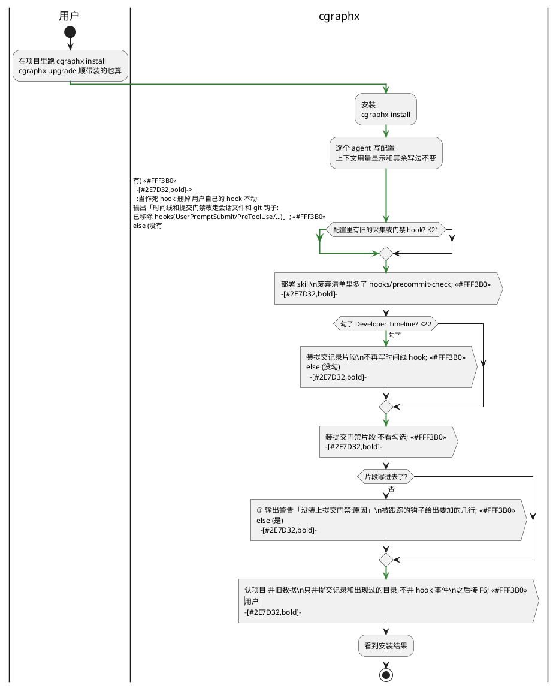

# 规格说明: 会话文件解析替代hooks

> 产物: spec
> feature-id: 2026-11-06-会话文件解析替代hooks
> 负责人: liulongfei
> 日期: 2026-11-06

## 功能方案

> 原样收录 clarify 终确认的功能方案(讨论稿 v2);业务要变,回 clarify 改,再同步这一节。

**一句话**:原来 cgraphx 靠接进 agent 配置的 hook 实时记时间线、拦提交,不支持这套 hook 的 agent 用不了,每次工具调用前后还要各等一个进程;这次改成查时间线之前先解析 agent 自己留下的会话文件,提交门禁改用 git 自带的钩子,agent 配置里不再需要 cgraphx 的采集和门禁 hook。

**功能清单**

| 编号 | 功能点 | 类别 | 从哪进 → 到哪去 | 一句话 |
|---|---|---|---|---|
| F1 | 会话文件补录时间线 | 核心 | `cgraphx timeline` 的查询命令、`/doc-report`、`/release-review`、git 提交 → 时间线 | 查之前先把 Claude Code、CodeBuddy 会话文件里新增的部分解析进来;项目怎么认,沿用「数据按项目放用户目录」 |
| F2 | agent 提交走 git 钩子门禁 | 核心 | agent 跑 `git commit` → 版本分支、产物检查、提交说明自查 → 放行或打回 → F3 | 产物检查和自查搬进 git 钩子,只对 agent 的提交生效;`git merge` 直接生成的合并提交不查 |
| F3 | 跳过门禁的提交可查 | 支撑 | F2 没跑的 agent 提交 → 提交记录标「跳过门禁」→ `/release-review` 报告 | 拦不住的提交,发版审核时列出来 |
| F4 | 会话开始的提示改由命令输出 | 支撑 | 会话里第一条 cgraphx 命令 → 命令输出末尾 | skill 版本落后、自动记忆去向、钩子片段补不上,每个会话提示一次 |
| F5 | 撤掉 agent hooks | 核心 | `cgraphx install`、`cgraphx uninstall` → 各 agent 的配置、git 钩子 | 清掉 7 条时间线 hook 和 precommit-check,装上 git 钩子门禁 |
| F6 | 清掉旧采集数据、按解析重建 | 支撑 | 升级后 `cgraphx install` 或第一次查时间线 → F1 全量解析 → 时间线 | hook 记的事件全部清掉,提交记录保留;只重建一次 |
| — | 读 Codex 的会话文件 | 建议新增 ✂️ | — | 不做:本机 `~/.codex/sessions` 的 5 个样本支撑得了,这次先不加 |
| — | 读仓库根 `session.v4.jsonl` 那种格式 | 建议新增 ✂️ | — | 不做:不确定是哪家 agent 写的 |
| — | 上下文用量显示 | 边界外排除 | — | Claude Code 专用的显示 hook,不采集也不拦截,不动 |
| — | 人手动提交也过检查 | 边界外排除 | — | 不做:产物检查和提交说明自查只查 agent 的提交;版本分支拦截照旧对所有提交生效 |

### F1 会话文件补录时间线(核心)

现在:每个事件靠 hook 当场写库,新开的 worktree、新 clone 里没有 hook 配置就记不到。这次改成查时间线之前补录,记不记、记到哪沿用「数据按项目放用户目录」的项目规则,这些目录里的会话也能记到;记下的事件和以前存在同一处,`/doc-report`、`/release-review` 的用法不变,事件种类有变化的见 K10。和 F6 共用同一套解析;F6 是第一次全量,这里之后只读新增的部分。

行为链:提交之后,git 钩子在后台顺带跑一遍同样的补录(输出没人看),避免一直不查时间线、会话文件先被 agent 清理掉。

```plantuml
@startuml
skinparam backgroundColor #FFFFFF
skinparam Activity {
  BackgroundColor #F1F1F1
  BorderColor #181818
  FontColor #000000
}
skinparam Swimlane {
  BorderColor #181818
  TitleBackgroundColor #FFFFFF
  TitleFontColor #000000
}
skinparam ArrowColor #181818

|用户或 agent|
start
:跑 cgraphx timeline query\nshow、stats、recent 同样;
|cgraphx|
-[#2E7D32,bold]->
:查时间线\ncgraphx timeline query;
note right
  另一条命令正在补录
  → ⑥ 最多等 3 秒,等不到照查现有数据,
  提示「时间线正在补录,结果可能缺最近的」
  补录中途出错
  → ⑦ 提示「时间线补录失败:原因,结果可能缺最近的」,
  照查现有数据
end note
-[#2E7D32,bold]->
if (关了时间线?\nCGRAPHX_NO_TIMELINE) then (没关) <<#FFF3B0>>
  -[#2E7D32,bold]->
  if (这个目录的旧数据并过了? K25) then (并过了) <<#FFF3B0>>
    -[#2E7D32,bold]->
    :找出这个项目的会话文件 K1、K2、K3; <<#FFF3B0>>
    -[#2E7D32,bold]->
    :只读上次读到之后新增的整行\n① 写到一半的行留到下次; <<#FFF3B0>>
    -[#2E7D32,bold]->
    :解析成事件 写进时间线 K4–K10; <<#FFF3B0>>
    -[#2E7D32,bold]->
    if (有整个文件都解析不出? K11) then (有) <<#FFF3B0>>
      :② 提示「Claude Code 2.2.0 的会话文件有 3 个解析不出,\n时间线可能不全;升级 cgraphx 或反馈」; <<#FFF3B0>>
    else (没有)
      -[#2E7D32,bold]->
    endif
  else (没并过)
    :③ 不补录\n提示「这个目录还没装新版,时间线停在升级前;\n运行 cgraphx install 补齐」; <<#FFF3B0>>
  endif
  -[#2E7D32,bold]->
else (关了)
  :④ 不补录; <<#FFF3B0>>
endif
-[#2E7D32,bold]->
:按查询条件查时间线;
|用户或 agent|
-[#2E7D32,bold]->
:看到结果和提示;
stop
@enduml
```

边界:⑤ 会话文件被 agent 清理掉了:已经记进时间线的留着,不受影响。

| 编号 | 哪一步 | 怎么判定 | 算 / 不算(例子) | 依据 |
|---|---|---|---|---|
| K25 | 这个目录的旧数据并过了? | 装过、没有并过记号、本地库里还有旧表的目录,才算没并过 | 算没并过:只换了新版、还没 install 的主目录;算并过(直接补录):新开的 worktree、新 clone、副本,本地库只有知识库索引 | `.cgraphx/project.json` 的 `mergedAt`,本地库的 `timeline_*`、`task_*`、`sync_*` 表;沿用「数据按项目放用户目录」K8 |
| K1 | 找会话文件 · 哪些会话算这个项目 | 会话从哪个目录开的,整个会话就算那个目录的项目,中途 cd 也不换;同一个项目的主目录、clone、worktree、副本里开的都算;开始的目录已经不在的,按项目记下的出现过的目录和副本登记认,都对不上的不记 | 算:新开的 worktree 里开的会话(现在没有 hook 配置,记不到);已经删掉的副本 cgraphx@dev-migrate系统迁移 里开的,算 cgraphx(本机 115 个会话里 11 个开始目录已不在,全是登记过的副本);不算:在 GitNexus 里开、cd 到 cgraphx 干活的会话,算 GitNexus;删掉的、从没记下过的 worktree;别的机器同步来的 `D:\` 路径 | 会话文件里本会话第一条消息的工作目录,本库 59 个会话都和文件所在目录对得上;`timeline_roots.root`、副本登记;沿用「数据按项目放用户目录」K1、K2、K17,目录不在的认法是新定 |
| K2 | 找会话文件 · 读哪几家 | Claude Code、CodeBuddy 两家 | 算:`~/.claude/projects/` 下的主会话和 `subagents/` 下的子 agent 文件,`~/.codebuddy/projects/` 下的会话文件;不算:Codex、Cursor | 沿用现在登记的两家 agent;新定读取位置 |
| K3 | 找会话文件 · 记不记、从什么时候记 | 这个目录装过 cgraphx,或者这个项目在用户目录里有数据,才记;会话文件里还在的都补进来,包括装 cgraphx 之前的;用 `cgraphx project remove` 删过数据的项目,只收删除之后的事件 | 算:今天新装的项目,第一次查就有上个月的会话;不算:从没装过的项目;删数据之前的旧会话不再补回来 | 沿用「数据按项目放用户目录」K3;补历史和删除后的处理是新定;删除记录是新数据,存哪由 spec 定,要放在项目目录之外,不跟着项目数据一起删 |
| K4 | 解析 · 一条消息归哪个会话 | 按消息里自带的会话编号,同一条消息只记一次 | 会话 c512fa32 是从 bfa22fb0 分叉出来的,文件开头 1,880 行是 bfa22fb0 的历史,只算 bfa22fb0;分叉之后的 20 行算 c512fa32 | 会话文件每行的 `sessionId`、`uuid`;沿用 hook 收到的会话编号 |
| K5 | 解析 · 什么算提问 | 人发的算「用户提问」,排队后才发出的也算,斜杠命令记成敲的原文;后台任务通知、子 agent 交回算「自动消息」;压缩摘要、打断标记、本地命令的输出都不算 | 算用户提问:`/dev-merge 下掉web与平台同步`;算自动消息:`<task-notification>`、子 agent 交回;不算:`[Request interrupted by user]`、`This session is being continued…` | 用户消息行的 `isMeta`、`isCompactSummary`,`queued_command` 附件,`<command-name>` 标记;分类沿用 `timeline_events.event_type` 的 user_prompt、auto_message |
| K6 | 解析 · 一轮从哪到哪 | 从一条提问或自动消息,到下一条之前;轮次结束记这一轮 agent 最后一条回复的时间 | 10:00 提问、10:03 最后回复、10:05 再提问 → 第一轮结束记 10:03 | `end_turn` 回复 945 条,hook 记的轮次结束 962 条;沿用 `timeline_events.event_type` 的 stop,时间改取回复时间 |
| K7 | 解析 · 工具调用记什么 | 每次调用记一条:参数、结果摘要、成没成功;子 agent 里的调用算进发起它的会话,并标上是哪个子 agent | 工具结果带错误标记 → 失败;子 agent 跑的 Bash 记在主会话下 | 本库 25,180 条逐条对比,工具名全部一致,失败 261 条全部一致;沿用工具事件摘要契约 |
| K8 | 解析 · 工具耗时 | 结果回来的时间减发出调用的时间,所有工具都算,含等人批准、等人回答 | 等你点批准 3 分钟、跑 2 秒 → 3 分 2 秒;比 Claude Code 自己测的中位数多 0.6 秒,23,927 条里有 664 条多出 10 秒以上 | 工具调用行和结果行的时间戳;新定(原来 Claude Code 自己测的耗时不含等人) |
| K9 | 解析 · 会话开始 | 一个会话只记一条,时间和工作目录取本会话第一条消息;恢复、压缩后重开不再另记 | 会话恢复两次 → 1 条(hook 时代本库 136 条会话开始) | 新定 |
| K10 | 解析 · 不再记的事件 | 不再记工具调用前那条和会话结束 | 不记 `pre_tool_use`:本库 26,196 条,占 41%,结果事件带参数和耗时,只有估耗时和显示用到它;不记 `session_end`:只靠会话文件判断不出会话什么时候结束,只有显示用到它;`timeline query --type pre_tool_use` 查不到新数据 | `timeline_events.event_type`;`/doc-report` 讲事件种类那段跟着改;新定 |
| K11 | 有整个文件都解析不出? | 文件有内容,却一条提问、一次工具调用都解析不出;不认识的行类型单独跳过,不提示 | 算:agent 升级改了格式,整份文件一条事件都没有;不算:只有 `queue-operation` 这种没有提问的短文件;新增了一种没见过的行类型 | 会话文件有 19 种行类型,还在增加;新定 |

🎭 体验决策:查之前自动补录,不用手动跑命令;每次多查一遍本机会话文件有没有变(实测 3,221 个文件 27–67 毫秒),有新内容再读。

### F2 agent 提交走 git 钩子门禁(核心)

现在:门禁挂在 agent 的 hook 上,按命令文字判断,临时仓库里的提交、`git commit-tree` 也会被当成这个项目的提交拦下;不支持这套 hook 的 agent 没有这道门禁。这次检查跟着真实提交走:规则不变,只有 `--no-verify` 从拦得住变成跳得过,跳过的由 F3 事后列出;钩子片段装不上的项目没有门禁(F5)。通过时给 F3 留记号。

```plantuml
@startuml
skinparam backgroundColor #FFFFFF
skinparam Activity {
  BackgroundColor #F1F1F1
  BorderColor #181818
  FontColor #000000
}
skinparam Swimlane {
  BorderColor #181818
  TitleBackgroundColor #FFFFFF
  TitleFontColor #000000
}
skinparam ArrowColor #181818

|agent 或人|
start
:git commit;
|git 钩子|
-[#2E7D32,bold]->
:提交说明写好之后\ncommit-msg;
note right
  检查跑不起来(旧版 cgraphx、超过 15 秒)
  → ④ 这一道当没查,往下走,这笔仍算走过门禁
end note
-[#2E7D32,bold]->
if (版本分支上的违规提交? K26) then (是)
  :① 打回\n「dev/2.0.14 是版本分支:需求改动到副本里做,\n整个版本的改动以 chore(release): 开头提交」;
  (A)
  detach
else (否)
  -[#2E7D32,bold]->
  if (agent 的提交? K12) then (是) <<#FFF3B0>>
    -[#2E7D32,bold]->
    if (git merge 直接生成的合并提交? K13) then (否) <<#FFF3B0>>
      -[#2E7D32,bold]->
      if (有暂存内容? K27) then (有) <<#FFF3B0>>
      -[#2E7D32,bold]->
      if (暂存的产物合格? K14) then (否) <<#FFF3B0>>
        :② 打回\n「【产物检查】本次暂存的产物有 1 处不合格,改对后才能提交…」; <<#FFF3B0>>
        (A)
        detach
      else (是)
        -[#2E7D32,bold]->
        if (带了 CGRAPHX_PRECOMMIT_REVIEWED=1? K15) then (否) <<#FFF3B0>>
          :③ 打回\n「【提交门禁】先读 git-standards.md,按检查点自查、按规范写说明,\n处理完带 CGRAPHX_PRECOMMIT_REVIEWED=1 重试」; <<#FFF3B0>>
          (A)
          detach
        else (是)
          -[#2E7D32,bold]->
          :记下这笔过了门禁 见 F3; <<#FFF3B0>>
          -[#2E7D32,bold]->
        endif
        -[#2E7D32,bold]->
      endif
      -[#2E7D32,bold]->
      else (没有)
        -[#2E7D32,bold]->
      endif
      -[#2E7D32,bold]->
    else (是)
      -[#2E7D32,bold]->
    endif
    -[#2E7D32,bold]->
  else (否)
    -[#2E7D32,bold]->
  endif
  -[#2E7D32,bold]->
endif
|agent 或人|
-[#2E7D32,bold]->
:提交成功;
stop
(A)
:提交没成,看到打回原文;
stop
@enduml
```

| 编号 | 哪一步 | 怎么判定 | 算 / 不算(例子) | 依据 |
|---|---|---|---|---|
| K26 | 版本分支上的违规提交? | 开过版本的项目里,人和 agent 的提交都查:当前在 `dev/x.y.z` 分支上,不是合并收尾,说明第一行也不以 `chore(release):` 开头 | 算:dev/2.0.14 上直接提交「fix: 改个字」;不算:`chore(release): 版本号 2.0.13→2.0.14`、合并提交、`feat/` 分支上的提交 | 版本分支提交拦截片段,由 `/release-start` 装;规则不变,沿用 |
| K12 | agent 的提交? | 提交时环境里有已登记 agent 的会话变量 | 算:Claude Code 或 CodeBuddy 里让 agent 跑 `git commit`;不算:终端里自己提交、IDE 里点提交、没登记的 agent 提交(按人手动提交算) | `CLAUDE_CODE_SESSION_ID`、`CODEBUDDY_SESSION_ID`;沿用提交记录归到会话的做法 |
| K13 | git merge 直接生成的合并提交? | `git merge` 自己生成的不查;解决冲突后用 `git commit` 收尾的照查 | 不查:`/dev-merge` 的 `git merge --no-ff`;照查:冲突解决后 agent 跑 `git commit --no-edit` | 沿用现在只拦 `git commit` 的范围;git 怎么区分两者,写 spec 时实测 |
| K27 | 有暂存内容? | 暂存了文件才往下查,什么都没暂存的放行 | 放行:`git commit --amend --no-edit`、`--allow-empty`;往下查:暂存了文件的提交,包括带暂存文件的 `--amend` | `git diff --cached`;沿用现在的门禁 |
| K14 | 暂存的产物合格? | 只拦检查结果里的不合格,警告不拦;带 `CGRAPHX_PRECOMMIT_REVIEWED=1` 也跳不过 | 拦:暂存的 spec 头部不合规;不拦:未知产物类型的警告 | 沿用 `cgraphx features check --staged` |
| K15 | 带了 CGRAPHX_PRECOMMIT_REVIEWED=1? | 第一次提交打回,agent 自查后带这个变量重提才放行;项目没有 `docs/guides/git-standards.md` 时,打回提示改成先跑 `/init-guides` | 算:`CGRAPHX_PRECOMMIT_REVIEWED=1 git commit -m "…"` | 沿用现在的提交门禁 |

### F3 跳过门禁的提交可查(支撑)

F2 走过门禁时留记号,提交之后看这笔有没有记号;记号的存放由 spec 定。F2 只拦得住没带 `--no-verify` 的,这里是拦不住时的兜底。提交后的后台任务还顺带做 F1 的补录和 F4 的补片段。

行为链:`cgraphx timeline query --type git_commit` 能看到「跳过门禁」的标记 → `/release-review` 报告多一节「跳过门禁的提交」,列提交号、说明和会话,没有写「无」;有就进「风险」,结论写「有风险」。

```plantuml
@startuml
skinparam backgroundColor #FFFFFF
skinparam Activity {
  BackgroundColor #F1F1F1
  BorderColor #181818
  FontColor #000000
}
skinparam Swimlane {
  BorderColor #181818
  TitleBackgroundColor #FFFFFF
  TitleFontColor #000000
}
skinparam ArrowColor #181818

|git|
start
:提交完成\npost-commit 片段在后台调起 cgraphx;
|cgraphx|
-[#2E7D32,bold]->
:记提交记录\ntimeline-git-commit-hook;
note right
  任何一步出错 → ④ 只写错误输出,不影响这笔提交
end note
-[#2E7D32,bold]->
:记一条提交记录\n哈希、分支、文件、增删行、会话;
-[#2E7D32,bold]->
if (跳过门禁了? K16) then (是) <<#FFF3B0>>
  -[#2E7D32,bold]->
  :提交记录标上「跳过门禁」; <<#FFF3B0>>
  -[#2E7D32,bold]->
else (否)
  -[#2E7D32,bold]->
endif
-[#2E7D32,bold]->
:按登记补回缺了的钩子片段 K20\n补录时间线 见 F1; <<#FFF3B0>>
stop
@enduml
```

边界:① 钩子片段装不上的项目没有提交记录,也就查不到 ② 人在版本分支上带 `--no-verify` 直接提交,照旧由 `/release-review` 的「疑似夹带」列出,不进这一节 ③ 没勾 Developer Timeline 的项目没有提交记录,跳过门禁也查不到;这个项目选了不要时间线,接受。

| 编号 | 哪一步 | 怎么判定 | 算 / 不算(例子) | 依据 |
|---|---|---|---|---|
| K16 | 跳过门禁了? | agent 的提交(K12),门禁片段在,这笔是 `git commit` 做的,却没走过门禁;检查超时、跑不起来(F2 ④)算走过 | 算:agent 带 `--no-verify` 提交;不算:人手动提交;`/dev-merge` 的合并提交;升级了没重装、片段没装上,这时没有门禁可走;`cherry-pick`、`revert`、`rebase` 做出的提交,门禁本来不管 | `timeline_events.metadata` 里新增的标记(新数据,存哪由 spec 定);`git help githooks`:commit-msg 只由 git-commit、git-merge 调起;这几种提交会不会触发 post-commit、怎么排除,写 spec 时实测;新定 |

### F4 会话开始的提示改由命令输出(支撑)

现在:三条提示由会话开始的 hook 注入。撤掉 hook(F5)后,改成这个会话第一条 cgraphx 命令输出时带上;补回钩子片段也从会话开始挪到这里。这个会话一条 cgraphx 命令都没跑,就看不到这些提示;提交之后的后台任务也补一次片段(F3)。

```plantuml
@startuml
skinparam backgroundColor #FFFFFF
skinparam Activity {
  BackgroundColor #F1F1F1
  BorderColor #181818
  FontColor #000000
}
skinparam Swimlane {
  BorderColor #181818
  TitleBackgroundColor #FFFFFF
  TitleFontColor #000000
}
skinparam ArrowColor #181818

|agent 或人|
start
:跑一条 cgraphx 命令;
|cgraphx|
-[#2E7D32,bold]->
:命令照常执行 输出结果;
note right
  哪条提示判断出错
  → ① 这条不出,其余照出,命令结果不受影响
end note
-[#2E7D32,bold]->
if (这个会话提示过了? K17) then (没有) <<#FFF3B0>>
  -[#2E7D32,bold]->
  if (项目的 skill 比本机 cgraphx 旧? K18) then (是) <<#FFF3B0>>
    :加一条\n「这个项目的 cgraphx skill 还是 2.0.12,本机 cgraphx 已经是 2.0.14。\n运行 cgraphx install -y 更新…」; <<#FFF3B0>>
  else (否)
    -[#2E7D32,bold]->
  endif
  -[#2E7D32,bold]->
  if (Claude Code 会话且本人关了自动记忆? K19) then (是) <<#FFF3B0>>
    :加一条\n「本项目已关 Claude Code 自动记忆:用户要你以后都照某个做法来时,先问记到哪…」; <<#FFF3B0>>
  else (否)
    -[#2E7D32,bold]->
  endif
  -[#2E7D32,bold]->
  :按登记补回缺了的 git 钩子片段; <<#FFF3B0>>
  -[#2E7D32,bold]->
  if (有补不上的片段? K20) then (有) <<#FFF3B0>>
    :加一条\n「提交门禁片段没补上:原因」\n提交记录片段、版本分支拦截同样; <<#FFF3B0>>
  else (没有)
    -[#2E7D32,bold]->
  endif
  -[#2E7D32,bold]->
  :有提示就接在输出末尾\n写到错误输出,不混进 --json 的结果; <<#FFF3B0>>
  -[#2E7D32,bold]->
else (提示过)
  -[#2E7D32,bold]->
endif
|agent 或人|
-[#2E7D32,bold]->
:看到结果和提示;
stop
@enduml
```

边界:② 提交记录片段和门禁片段一起被冲掉(比如 husky 重装依赖),这个会话又没跑 cgraphx:门禁和提交记录都悄悄失效,直到下一条 cgraphx 命令或 install 补回;只有门禁片段被冲掉时,提交后的后台任务会补回,下一笔提交起恢复。接受这个限制。

| 编号 | 哪一步 | 怎么判定 | 算 / 不算(例子) | 依据 |
|---|---|---|---|---|
| K17 | 这个会话提示过了? | 有会话变量的,同一个会话只提示一次;没有会话变量的(终端里自己跑),每个项目每天第一条提示一次;隐藏命令、git 钩子调起的命令、`--help`、`--version` 不算一条 | 算:agent 第一条 `cgraphx docs concepts` 带提示,第二条不带;终端今天第一条带;不算:恢复同一个会话不再提示 | `CLAUDE_CODE_SESSION_ID`、`CODEBUDDY_SESSION_ID`;提示过的记录是新数据,存哪由 spec 定;新定 |
| K18 | 项目的 skill 比本机 cgraphx 旧? | 项目记录的 skill 版本比本机 cgraphx 旧 | 算:项目记的 2.0.12、本机 2.0.14;不算:版本一样 | 各 agent 配置目录下的 `cgraphx-version.json`;沿用 |
| K19 | Claude Code 会话且本人关了自动记忆? | Claude Code 的会话,且本人的本地设置里关了自动记忆 | 算:`.claude/settings.local.json` 里 `autoMemoryEnabled` 为 false;不算:CodeBuddy 会话;终端里自己跑 | `.claude/settings.local.json` 的 `autoMemoryEnabled`;沿用 |
| K20 | 有补不上的片段? | 按登记该有的片段不见了就补回;钩子文件被 git 跟踪、不是 shell 脚本、成了链接、钩子目录挪到仓库外的补不上,说一次原因并删掉这条登记 | 算:钩子被提交进仓库 → 提示一次;不算:husky 重装依赖冲掉片段 → 补回,不提示 | `<git 公共目录>/cgraphx/hook-snippets.json`;沿用 |

### F5 撤掉 agent hooks(核心)

F1、F2、F4 接手以后,agent 配置里 cgraphx 写的采集和门禁 hook 就不要了;以后接一家新 agent,不用它支持 hook,只要能读懂它的会话文件。git 钩子片段由这里装,F2 用门禁片段,F1、F3 用提交记录片段。

行为链:换了新版、还没重装的项目,agent 照常调旧 hook → 这些命令留成隐藏的空命令,不报错,什么都不做 ①;`cgraphx uninstall` 同样清掉旧 hook,并删掉门禁片段,同一仓库还有装着的目录时片段留着 ②;`cgraphx timeline install` 只装提交记录片段。



| 编号 | 哪一步 | 怎么判定 | 算 / 不算(例子) | 依据 |
|---|---|---|---|---|
| K21 | 配置里有旧的采集或门禁 hook? | cgraphx 写进 agent 配置的 7 条时间线 hook 和 precommit-check | 算:`cgraphx timeline-post-tool-use-hook --agent codebuddy`、`node $CLAUDE_PROJECT_DIR/.claude/hooks/precommit-check/precommit-check.cjs`;不算:context-monitor、用户自己写的 hook、git 钩子片段 | 各 agent 的 `settings.json`;沿用写配置时清死 hook 的做法 |
| K22 | 勾了 Developer Timeline? | 只管要不要装提交记录片段;门禁片段照旧不看勾选;没勾的项目查时间线照样补录,只是没有提交记录 | 算:勾了 → 提交写进时间线,提交后后台补录;没勾 → 跑 `timeline query` 仍能查到会话事件,跳过门禁查不到(F3 ③) | 沿用 precommit-check「一律写入」;补录不看勾选是新定 |

### F6 清掉旧采集数据、按解析重建(支撑)

现在:时间线里是 hook 记的事件。这次全部清掉、以解析为准,解析规则见 F1;提交记录是 git 钩子记的,不动。全清之后,会话文件已经不在的会话找不回:本库 2 个会话 8 条;Claude Code 默认只留 30 天会话文件,默认设置的机器上更早的时间线都没了(按本库算是 48 个会话 9,262 条)。在同一个项目的哪个目录先触发,都只重建一次。开始目录已经不在、也认不出项目的会话(K1)同样不会重建回来。并旧数据从此不并 hook 事件,项目重建之后,另一个目录再 install 也不会把旧事件带回来。

```plantuml
@startuml
skinparam backgroundColor #FFFFFF
skinparam Activity {
  BackgroundColor #F1F1F1
  BorderColor #181818
  FontColor #000000
}
skinparam Swimlane {
  BorderColor #181818
  TitleBackgroundColor #FFFFFF
  TitleFontColor #000000
}
skinparam ArrowColor #181818

|用户或 agent|
start
:cgraphx install 走到并旧数据之后\n或这个项目第一次查时间线 见 F1;
|cgraphx|
-[#2E7D32,bold]->
:补录之前先看;
note right
  重建中途中断或出错
  → ① 清和写一起撤销,时间线还是旧的,下次重来
  install 里输出警告「时间线重建失败:原因」,安装照常往下走
end note
-[#2E7D32,bold]->
if (关了时间线?\nCGRAPHX_NO_TIMELINE) then (没关) <<#FFF3B0>>
-[#2E7D32,bold]->
if (这个项目重建过了? K23) then (没有) <<#FFF3B0>>
  -[#2E7D32,bold]->
  :提示「正在从会话文件重建时间线…」; <<#FFF3B0>>
  -[#2E7D32,bold]->
  :清掉 hook 记的事件 K24\n删掉轮次记录和会话登记; <<#FFF3B0>>
  -[#2E7D32,bold]->
  :全量解析这个项目的会话文件\n规则见 F1 K1–K10; <<#FFF3B0>>
  -[#2E7D32,bold]->
  :记下重建过了\n输出「时间线已重建:43 个会话,31,020 条事件」\n(数字按项目实际); <<#FFF3B0>>
else (重建过)
  -[#2E7D32,bold]->
endif
-[#2E7D32,bold]->
else (关了)
  :② 不清、不重建 时间线保持原样; <<#FFF3B0>>
endif
|用户或 agent|
-[#2E7D32,bold]->
:接着安装或查询;
stop
@enduml
```

| 编号 | 哪一步 | 怎么判定 | 算 / 不算(例子) | 依据 |
|---|---|---|---|---|
| K23 | 这个项目重建过了? | 一个项目只重建一次,记号跟着项目数据;还在旧库模式的目录先并旧数据再重建;`cgraphx project remove` 连记号一起删了,这时看 K3 的删除记录,有就算重建过,只收删除之后的 | 主目录 install 重建过,worktree 再 install 不重建;副本查时间线也不再重建;删过数据的项目再查,不全量解析,旧会话不补回 | 新数据,存哪由 spec 定;新定 |
| K24 | 清掉 hook 记的事件 | 除提交记录外的事件全部删掉,不备份;会话文件不在的也删 | 删:本库 62,719 条(提问、工具调用、轮次结束、会话开始和结束);留:399 条提交记录、项目出现过的目录 | `timeline_events.event_type` 不是 git_commit 的行;`timeline_roots` 留着;用户 11-06 定全清、提交记录保留 |

🎭 体验决策:install 时当场重建,等待时显示进度;光解析本项目 994MB 会话文件实测 2–3 秒,加上写库估计 10 秒量级(写库部分还没实测)。

## 怎么实现

### 细节方案:F1 会话文件补录时间线

| # | 决策 | 选择 | 没选的(为什么) | 理由(依据) | 影响面 |
|---|---|---|---|---|---|
| D1 🔒 | 解析放哪、怎么接新 agent | 放进 timeline 子系统的 `timeline/ingest/`,门面导出补录入口;每家 agent 一个读取器,只把这家的会话文件转成统一的「会话事实」(提问、工具调用和结果、回复、开始目录),不碰库;agents 描述新增会话文件的根目录和读取器标识,接新 agent = 加一份描述 + 一个读取器 | 独立成新子系统——timeline 是这些事件唯一的写入方,拆开只多一层门面;读取器放进 agents——agents 只描述差异,不带业务解析 | `src/core/agents/types.ts`、`profiles.ts`;`timeline/recorder.ts` | timeline 多一个目录;agents 描述多两个字段 |
| D2 🔒 | 进度和会话文件索引存哪 | 用户目录新建 `~/.cgraphx/sessions.db`(0600),表见下;只放路径、会话编号、进度,不放会话内容 | 进度放项目库——`project remove` 连进度一起删,K3 就兑现不了;改名后新项目会从头重读,违反「已经记下的不挪」。JSON 文件——3,000 多条每次整写,并发要自己加锁。库名用 `cgraphx.db`——`~/.cgraphx/` 根下有它,家目录下往上找根都会停在这里 | `src/core/user-data-dir.ts`;`src/core/project/remove.ts:145`;`project/name.ts:173`;知识库「项目」 | 新增一个用户级库;`~/.cgraphx/sessions/` 废弃(D19) |
| D3 | 找这个项目的会话文件(K1、K2、K3、K25) | 列 agent 根目录下的 `*.jsonl` 和 `subagents/*.jsonl`;新文件读到本会话第一条带 `cwd` 的行,写进索引;没认过的开始目录跑一次 `findProjectRoot` + `identityOfRoot`,结果写进 `start_dirs`;目录不在了,按各项目 `timeline_roots.root` 和副本登记匹配,对不上就留空;只处理归到当前项目、大小或修改时间变了的文件;K3、K25 直接用 `locateDataAtRoot`、`hasUnmergedLegacyData` | 只扫路径编码后的目录——目录名有损,新 worktree、clone 也找不到;每次跑 git——60 个目录约 450ms | `~/.claude/projects` 目录名把非字母数字都换成 `-`;`data-location.ts:98`;`project/merge.ts:317`;`timeline/roots.ts:36` | `CLAUDE_CONFIG_DIR` 设了就用它作 Claude Code 的根目录 |
| D4 | 增量读 | 按字节偏移读到最后一个换行(F1 ①);文件比偏移短就从头重读,靠 D5 去重;每个文件一批写进项目库,项目库提交之后再更新索引里的偏移 | 按行号——每次都要从头数;两边放一个事务——跨库做不到,先写事件再写进度,中断了重读也不重复 | 会话文件是追加写;`src/core/db/index.ts:40` 的 `busy_timeout` 5 秒 | 无 |
| D5 🔒 | 事件去重(K4) | `timeline_events` 加列 `source_key` 和部分唯一索引(`WHERE source_key IS NOT NULL`),写入用 `INSERT OR IGNORE`;键:提问 `<agent>:prompt:<uuid>`,工具 `<agent>:tool:<tool_use_id>`,轮次结束 `<agent>:stop:<回复 message.id>`,会话开始 `<agent>:start:<会话编号>`;分叉拷过来的行照行内 `sessionId` 归属,键相同只记一次;提交记录不带键 | 比较除 id 外的全部列——轮次编号、摘要一变就对不上;只按文件偏移防重——文件重写、分叉拷贝防不住 | `timeline/merge.ts` 的去重;c512fa32 的 1,880 行;`schema-bootstrap.ts` 的 `ensureAgentColumn` 写法 | 只加列、不升 `TIMELINE_SCHEMA_VERSION`,旧版 cgraphx 打开库不报错 |
| D6 | 提问怎么认(K5、K6) | Claude Code:`type=user`、非侧链、非 `isCompactSummary`、没有工具结果;文本开头是 `<agent-message`、`<task-notification>` → 自动消息(沿用 `classifyAutoMessage`,含 `isMeta` 行);其余 `isMeta`、`[Request interrupted`、`<local-command` 不算;`<command-name>` 还原成 `/命令 参数`;`queued_command` 附件文本没有对应用户行的才算一条;轮次编号取提问消息的 `uuid`,重新解析不变 | 沿用 hook 现造的随机编号——重新解析就变,事件对不上轮次 | 原型对比 59 个会话:人发的提问 682 条对上 680 条,解析多找到 64 条 hook 没记的;自动消息 hook 404、原型 503,差异见待确认项 | `turn-state.ts`、`turns/` 不再需要 |
| D7 | 工具事件(K7、K8) | 每对调用行和结果行记一条 `post_tool_use`:`sanitizeToolArgs` 处理参数,`summarizeToolResponse` 处理 `toolUseResult`,`is_error` 走失败分支;`ts` 取结果行时间,`cwd` 取调用行,`duration_ms` 取两行时间差,`metadata` 带 `tool_use_id`、`subagent`、`duration_source: transcript`;还没有结果的调用留到下次,一直没有结果的不记 | 自己再写一套摘要——工具事件契约会有两份;`cwd` 取结果行——命令里 `cd` 过就是执行后的目录,相对路径会解析错 | `timeline/post-tool-summary.ts:140`;`tool-args.ts:33`;知识库「Bash 事件 cwd 是执行后的目录」 | 这篇知识库要改写 |
| D8 | 其余事件(K6、K9、K10) | `session_start` 每个会话一条,取本会话第一条消息;`stop` 取这一轮最后一条 `stop_reason=end_turn` 的回复时间;不再写 `pre_tool_use`、`session_end`;`--type` 选项和显示照旧认这两种类型,旧记录没了只是查不到;`store.getMostRecentPre` 删掉 | 从查询选项里去掉这两种类型——`--type pre_tool_use` 变成报错,K10 写的是查不到新数据 | `timeline/store.ts:303`;`timeline/describe.ts` | `/doc-report` 讲事件种类那段跟着改 |
| D9 | 触发、并发和出错(F1 ②、⑥、⑦) | `timeline query / show / stats / recent` 查询之前调补录,post-commit 的后台进程也调;项目目录下 `ingest.lock`(写法沿用 `merge.lock`,pid 不活或超过 2 小时算陈旧),等 3 秒拿不到就照查并提示;整份文件读出内容却没有一条事实才算 K11,提示里带行内 `version`;提示都写 stderr | 后台常驻进程——要管生命周期,这次本来就是要去掉常驻接入;拿不到锁就报错——查询不该因为补录失败 | `project/merge-files.ts:156`;F1 体验决策;实测 3,221 个文件 27–67 毫秒 | 读路径从只读变成可能写库 |

`sessions.db` 数据格式:

| 表 | 列 | 说明 |
|---|---|---|
| `session_files` | `path` 主键、`agent`、`session_id`、`start_cwd`、`project_dir`、`byte_offset`、`size`、`mtime_ms`、`updated_at` | 一个文件一行,进度全局一份;子 agent 文件的 `start_cwd` 跟主会话 |
| `start_dirs` | `cwd` 主键、`root`、`origin`、`name`、`project_dir`、`classified_at` | 开始目录认到哪个项目;`project name` 清掉受影响目录的行,下次重认 |
| `removed_projects` | `identity_key` 主键、`removed_at` | K3 的删除记录,`project remove` 写 |
| `notices_shown` | `scope` 主键、`shown_at` | D16;启动时删 30 天前的行 |

改名、删数据的行为:改名只清 `start_dirs`,偏移不动,所以新增的内容归新项目,已经记下的不挪,取代 `rewriteSessionRegistrations`;`project remove` 后偏移还在,旧内容不重读,没读过的文件按 `removed_at` 过滤事件。

### 细节方案:F2 agent 提交走 git 钩子门禁

| # | 决策 | 选择 | 没选的(为什么) | 理由(依据) | 影响面 |
|---|---|---|---|---|---|
| D10 🔒 | 门禁放哪 | 新增轻形态子系统 `src/core/commit-gate/`(门面 + cli + constants),隐藏命令 `commit-gate-hook <说明文件>`;依赖 features、release、agents、git-hooks 的门面;只用 commit-msg 一个钩子 | 另加 pre-commit——那里拿不到说明,版本分支规则还得在 commit-msg 判一次,而且 `GitHookName` 要加一种;塞进 release——它只管版本分支 | `src/core/git-hooks.ts:52`;`release/constants.ts:20`;实测 `git commit` 走 pre-commit、commit-msg,`--no-verify` 两个都跳 | 分层多一个子系统;CLAUDE.md 跟着改 |
| D11 | 片段写法(K12、④) | sh 片段先看环境变量,没有已登记的会话变量就不起 node;有才调隐藏命令,退出码 3 才打回,其余(`command not found`、旧版报未知命令、异常)都放行;变量名单从 agents 描述的 `sessionIdEnv` 生成;片段按 `installHookSnippet` 规则写,兼容 `sh -e` | 钩子里直接跑 node 判断——人每次提交多等 90ms;非零都打回——cgraphx 卸了或版本旧时所有 agent 提交都过不去 | `agents/profiles.ts`;`git-hooks.ts:423`;空转实测 90ms;知识库「会话 id 来源约束」 | 新登记 agent 要重装才进名单 |
| D12 | 判断顺序(K26、K13、K27、K14、K15) | 隐藏命令按 F2 的图走。K26:`cgraphx.releaseFlow` 为 true、当前分支匹配 `VERSION_BRANCH_PATTERN`、没有 `MERGE_HEAD`、说明第一行(跳过注释和空行)不以 `chore(release):` 开头,打回原文同拦截片段,所以和拦截片段谁先谁后结果一样。K13:说明文件名是 `MERGE_MSG` 放行。K27:`git diff --cached --name-status` 为空放行。K14:子进程跑 `features check --staged --json`,超时 15 秒,只拦 `failures > 0`,跑不起来算走过。K15:看环境变量 `CGRAPHX_PRECOMMIT_REVIEWED=1`;提示原文搬自 `precommit-check.cjs`,guide 路径相对工作区根 | 依赖片段先后——重装时片段都插到 shebang 后面,先后不固定;进程内调 `checkFeatures`——卡住时超时不了 | 实测:干净合并拿到 `.git/MERGE_MSG`,`git merge --continue` 拿到 `.git/COMMIT_EDITMSG`、同时有 `MERGE_HEAD`;钩子里 `GIT_INDEX_FILE` 指向实际索引,`git commit -a` 也看得到;`precommit-check.cjs:123,148-159` | K26 的判断有 sh 和 TS 两份,规则常量共用门面导出的那份 |
| D13 | 过门禁的记号 | 隐藏命令只要没打回(含 K13、K27 放行和跑不起来),就把 `git write-tree` 的结果写进 `<git 目录>/cgraphx/commit-gate-pass`;post-commit 片段在前台读出并删掉,经环境变量 `CGRAPHX_GATE_TREE` 交给后台进程 | 后台进程自己读——连续提交时记号已被下一笔覆盖,和知识库记的「钩子当下固定 hash」同一个坑;存时间戳——对不到具体提交 | 知识库「git 提交记录须在钩子当下固定 hash」;`timeline/installer.ts` 的 post-commit 片段 | `git write-tree` 只多写对象,不动索引 |

### 细节方案:F3 跳过门禁的提交可查

| # | 决策 | 选择 | 没选的(为什么) | 理由(依据) | 影响面 |
|---|---|---|---|---|---|
| D14 | 怎么判跳过(K16) | post-commit 片段在前台另取:`CHERRY_PICK_HEAD` 在不在、`rebase-merge` / `rebase-apply` 在不在;后台进程判:有 agent 会话变量、commit-msg 钩子文件里有门禁片段、提交的 tree 和 `CGRAPHX_GATE_TREE` 不一致、不是 cherry-pick 或 rebase、说明不是 `Revert "…"` 带 `This reverts commit`;符合就写 `metadata.gate = "skipped"`;post-merge 调起的一律不判 | 只看记号有没有——没重装、`cherry-pick` 都会误报;加新列——metadata 已经是给这类附加信息的 | 实测:cherry-pick、revert、rebase 都不走 commit-msg、都触发 post-commit;cherry-pick 和 rebase 有状态文件,revert 没有,只能看说明;`merge --no-verify` 只触发 post-merge | agent 带 `--no-verify` 写 Revert 格式的说明会漏掉,接受 |
| D15 | 后台任务和报告 | post-commit 后台进程记完提交,再补钩子片段(K20)、调补录(F1);`describeEvent` 给带标记的提交加「跳过门禁」;`/release-review` 用现有的 `timeline query --type git_commit` 按 `metadata.gate` 列一节,进「风险」规则 | 报告自己比对钩子日志——没有这种日志 | `timeline/git-commit.ts`;`skills/release-review/SKILL.md:56,94` | 提交后的后台进程变长,不阻塞提交 |

### 细节方案:F4 会话开始的提示改由命令输出

| # | 决策 | 选择 | 没选的(为什么) | 理由(依据) | 影响面 |
|---|---|---|---|---|---|
| D16 | 接到哪、谁算一个会话(K17–K20) | commander 根命令的 `postAction` 统一调;隐藏命令、`version` 不提示,`--help`、`--version` 本来就不触发;scope 取 `session:<会话编号>`,没有会话变量取 `day:<项目根>:<本地日期>`,记在 `notices_shown`;K18 有会话变量看那家 agent,没有就看已装的各家,任一家落后就提示;K19 只看 Claude Code 的会话变量;判断函数和原文从 `timeline/hooks.ts` 挪到新文件 `src/core/session-notices.ts`,写 stderr,整体 try/catch | 每个子系统的 cli 各调一次——漏一个就不提示;写 stdout——`--json` 的结果会坏 | `timeline/hooks.ts:253-345`;`agents/index.ts` 的 `resolveSessionIdFromEnv`、`selectInstalledAgents`;`git-hooks.ts:470` | 每条命令多开一次 `sessions.db`;调 `process.exit` 的命令路径拿不到 `postAction`,不提示,下一条补上 |

### 细节方案:F5 撤掉 agent hooks

| # | 决策 | 选择 | 没选的(为什么) | 理由(依据) | 影响面 |
|---|---|---|---|---|---|
| D17 | 清旧 hook(K21)和兼容 | `isDeadHookCommand` 按完整子命令名加 7 条时间线 hook,并认 `/hooks/precommit-check/precommit-check.cjs`;`writePrecommitHookEntry` 删掉;F5 ① 的 7 个子命令加进 `legacy-hook-commands.ts` 当空命令;`timeline-git-commit-hook` 保留;`hooks/precommit-check` 进废弃清单;没重装时旧 precommit-check 还会跑,和门禁片段规则相同,`CGRAPHX_PRECOMMIT_REVIEWED=1` 两边都认 | 另写一段清理——只在勾 timeline 时跑会漏,上个需求踩过 | `targets/agent-target.ts:55,134,455`;`src/cli/legacy-hook-commands.ts`;`deprecated-assets.json` | `postToolUseFailure` 能力、`writeTools` 没人用了,从 agents 描述删掉 |
| D18 | 片段怎么装(K22) | `agent-steps.ts` 的 `installAgentHooks` 拆开:提交记录片段照旧看勾选,不再写 agent 配置;门禁片段由 commit-gate 门面装,install 选了 agent 就装,不看勾选;卸载走现有 `gitHookKeptFor` 判断;`timeline install / uninstall` 只管提交记录片段;F5 ③ 用现有 `hookNotice` 的原因原文 | 门禁片段挂在 Developer Timeline 下——不勾就没门禁,和 precommit-check 一律写入不一致 | `src/cli/installer/index.ts:215,397`;`git-hooks.ts:423` | `isAgentInstalled` 靠 settings 里的 hook 标记判断的那部分变少,靠指引块兜底,设计验收查 |

### 细节方案:F6 清掉旧采集数据、按解析重建

| # | 决策 | 选择 | 没选的(为什么) | 理由(依据) | 影响面 |
|---|---|---|---|---|---|
| D19 | 重建怎么做到要么全成要么全不成(F6 ①、K23) | 拿 `ingest.lock`;全量解析写进项目目录下的临时库 `rebuild.tmp.db`,写完在一个短事务里 `ATTACH`、删非提交事件、`INSERT SELECT`、写 `timeline_meta` 的 `rebuilt_at`,提交后更新 `sessions.db` 的偏移,删 `turns/`、`~/.cgraphx/sessions/`、临时库,再 `VACUUM`;`CGRAPHX_NO_TIMELINE` 打开时入口直接返回;`removed_projects` 有这个项目且没有 `rebuilt_at` 时只写 `rebuilt_at` | 整个解析放一个事务——持写锁十几秒,超过 `busy_timeout` 的 5 秒,这期间的提交记录会写失败,提交记录又补不回来 | `db/index.ts:40`;`timeline/recorder.ts`;`session-registry.ts` | `session-registry.ts`、`turn-state.ts`、`hook-runner.ts`、`payload.ts` 和 `hooks.ts` 里 agent hook 部分都没人用,删掉;`project/name.ts` 改成清 `start_dirs` |
| D20 | 并旧数据(K24) | `createTimelineMerger` 只并 `git_commit` 和 `timeline_roots`;备份照旧是整个旧库;输出的事件数和会话数改成并了多少提交 | 并进来再清——项目重建过之后不会再清,就是审核第 1 条的问题 | `project/merge.ts:229`;`timeline/merge.ts:105,288` | id 对照和进度换算没人用了,一起删 |

### 文档与知识库

沿用现有写法,没有另外的选型:

| 文件 | 改什么 | 对应 |
|---|---|---|
| `skills/doc-report/SKILL.md` | 事件种类那段去掉 `pre_tool_use`,`stop` 改说轮次结束;`cgraphx timeline install` 那段改成提交记录 | F1 |
| `skills/release-review/SKILL.md` | 多一节「跳过门禁的提交」,风险规则加这一项 | F3 |
| `skills/dev-clarify`、`dev-merge`、`dev-start`、`dev-impl`、FLOW-MAP、`init-guides` 里讲提交门禁、带 `CGRAPHX_PRECOMMIT_REVIEWED=1` 重试的地方 | 机制说法改成 git 钩子,用法不变 | F2 |
| `skills/cgraphx-guide/`、`assets/claude-template/CLAUDE.md` | 接入方式、hook 说明 | F5 |
| 本仓库 `CLAUDE.md`、`CHANGELOG.md` | 产品全貌、架构的 timeline 一节、问题 5、7;CHANGELOG 记全清的影响和 `--no-verify` 的变化 | 全部 |
| 知识库 | 改写 `开发时间线工具事件契约`、`会话id来源约束`、`Bash事件cwd是执行后的目录`、`agent适配`、`项目`、`并旧数据`、`git提交记录须在钩子当下固定hash`;过 `cgraphx docs validate` | 全部 |

### 全局约束

- 不变:提交记录的内容和去重、`timeline query / show / stats / recent` 的选项和输出格式、知识库、`features`、`replica`、`release guard`、`db-query`、上下文用量显示和 statusLine。
- `CGRAPHX_NO_TIMELINE` 继续管时间线的采集和重建,不管门禁。
- 所有 git 钩子片段都不能让提交失败,打回只来自门禁的退出码 3 和版本分支拦截片段;只写不被 git 跟踪的钩子文件,沿用 `git-hooks.ts`。
- `sessions.db` 属于基础设施,不是目标项目业务库,不走 `docs/guides/data-standards.md`「Schema 变更约定」的全量 / 增量;`timeline_events` 加列沿用包内表的做法。
- core 不依赖 cli;`ingest` 只经 agents 门面取差异。

## 设计验收

| # | 对应 | 验收点 | 怎么验 |
|---|---|---|---|
| 1 | D6、D7 | 用本库 10-18 以来 59 个会话的会话文件回放:工具事件和 hook 记录按 `tool_use_id` 全部对上,名字和失败标记一致;人发的提问对上率不低于 99%;自动消息差异逐类解释清 | 脚本对比 + 本机实测 |
| 2 | D3、D4 | 3,221 个文件、没有新内容时,补录加查询的额外耗时不超过 150 毫秒 | 本机实测 |
| 3 | D4、D5 | 文件写到半行、重复补录、文件被截断重写、分叉拷贝,事件都不多不少 | 单元测试 |
| 4 | D9 | 两个进程同时查时间线,不重复、不死锁,等不到锁的 3 秒内返回 | 单元测试 |
| 5 | D2 | 改名后新增内容进新项目、旧内容不挪;`project remove` 后不补回旧会话,之后新增的照收 | 单元测试 |
| 6 | D11 | 人手动提交不起 node;cgraphx 不在 PATH、旧版 cgraphx 时 agent 提交照常成功 | 本机实测 |
| 7 | D12 | `git merge --no-ff` 不被自查拦;`--amend --no-edit` 放行;`git commit -a` 的产物检查看得到要提交的文件 | 临时仓库集成测试 |
| 8 | D13、D14 | 连续两笔快速提交,记号不串;`--no-verify` 标记,`cherry-pick`、`revert`、`rebase`、人手动提交、没重装的项目不标 | 临时仓库集成测试 |
| 9 | D16 | `--json` 的 stdout 能解析;同一会话第二条命令不提示 | 单元测试 |
| 10 | D17、D18 | 旧配置没重装时 agent 不显示 hook 报错;不勾 Developer Timeline 重装也能清掉旧 hook、装上门禁;清完 hook 的项目 `isAgentInstalled` 仍为真 | 单元测试 + 本机实测 |
| 11 | D19 | 重建中途杀进程,时间线还是旧的,下次能重来;重建期间提交记录能写进去;提交记录一条不少 | 单元测试 |
| 12 | D20 | 项目重建过之后,另一个旧库模式的目录 install,不带回 hook 事件 | 单元测试 |
| 13 | 全局 | 全量测试通过;构建产物不含 `hooks/precommit-check`;`src/` 里搜不到 `session-registry`、`turn-state` 的引用 | `npm test` + grep |

## 待确认项

- 【待确认】CodeBuddy 的解析细节,默认先按下面写,实现第一步用已安装的 2.167.0 实测后回填:子 agent 文件在 `<会话>/subagents/agent-<id>.jsonl`(目录已看到),归属规则同 Claude Code;工具结果 `status` 是 `completed` 算成功,`incomplete` 算失败(本机 48 条里 11 条,含义未核实);斜杠命令和自动消息的原文形式没有样本。
- 【待确认】Claude Code 自动消息 hook 404 条、原型 503 条,多的 99 条是 hook 漏记还是 `queued_command` 重复计数没查清;实现时按设计验收 1 校准 D6,不影响方案结构。
