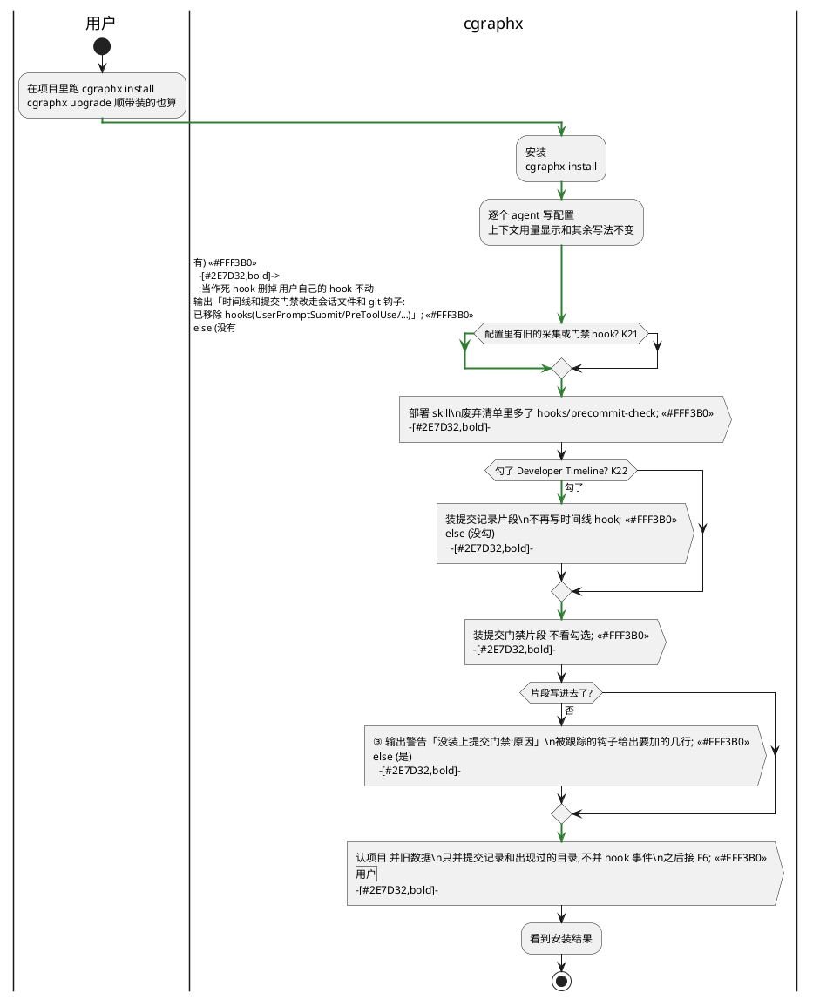

# 功能方案: 会话文件解析替代hooks(讨论稿 v2)

> 讨论稿,不是契约:人终确认的那一版由 `/dev-spec` 原样收录为 spec 第一节,之后以 spec 为准,本文件不再维护。
> 图用支持 PlantUML 的 Markdown 预览打开(IDEA:设置 → 语言和框架 → Markdown → 启用 PlantUML)。

**一句话**:原来 cgraphx 靠接进 agent 配置的 hook 实时记时间线、拦提交,不支持这套 hook 的 agent 用不了,每次工具调用前后还要各等一个进程;这次改成查时间线之前先解析 agent 自己留下的会话文件,提交门禁改用 git 自带的钩子,agent 配置里不再需要 cgraphx 的采集和门禁 hook。

**功能清单**

| 编号 | 功能点 | 类别 | 从哪进 → 到哪去 | 一句话 |
|---|---|---|---|---|
| F1 | 会话文件补录时间线 | 核心 | `cgraphx timeline` 的查询命令、`/doc-report`、`/release-review`、git 提交 → 时间线 | 查之前先把 Claude Code、CodeBuddy 会话文件里新增的部分解析进来;项目怎么认,沿用「数据按项目放用户目录」 |
| F2 | agent 提交走 git 钩子门禁 | 核心 | agent 跑 `git commit` → 版本分支、产物检查、提交说明自查 → 放行或打回 → F3 | 产物检查和自查搬进 git 钩子,只对 agent 的提交生效;`git merge` 直接生成的合并提交不查 |
| F3 | 跳过门禁的提交可查 | 支撑 | F2 没跑的 agent 提交 → 提交记录标「跳过门禁」→ `/release-review` 报告 | 拦不住的提交,发版审核时列出来 |
| F4 | 会话开始的提示改由命令输出 | 支撑 | 会话里第一条 cgraphx 命令 → 命令输出末尾 | skill 版本落后、自动记忆去向、钩子片段补不上,每个会话提示一次 |
| F5 | 撤掉 agent hooks | 核心 | `cgraphx install`、`cgraphx uninstall` → 各 agent 的配置、git 钩子 | 清掉 7 条时间线 hook 和 precommit-check,装上 git 钩子门禁 |
| F6 | 清掉旧采集数据、按解析重建 | 支撑 | 升级后 `cgraphx install` 或第一次查时间线 → F1 全量解析 → 时间线 | hook 记的事件全部清掉,提交记录保留;只重建一次 |
| — | 读 Codex 的会话文件 | 建议新增 ✂️ | — | 不做:本机 `~/.codex/sessions` 的 5 个样本支撑得了,这次先不加 |
| — | 读仓库根 `session.v4.jsonl` 那种格式 | 建议新增 ✂️ | — | 不做:不确定是哪家 agent 写的 |
| — | 上下文用量显示 | 边界外排除 | — | Claude Code 专用的显示 hook,不采集也不拦截,不动 |
| — | 人手动提交也过检查 | 边界外排除 | — | 不做:产物检查和提交说明自查只查 agent 的提交;版本分支拦截照旧对所有提交生效 |

### F1 会话文件补录时间线(核心)

现在:每个事件靠 hook 当场写库,新开的 worktree、新 clone 里没有 hook 配置就记不到。这次改成查时间线之前补录,记不记、记到哪沿用「数据按项目放用户目录」的项目规则,这些目录里的会话也能记到;记下的事件和以前存在同一处,`/doc-report`、`/release-review` 的用法不变,事件种类有变化的见 K10。和 F6 共用同一套解析;F6 是第一次全量,这里之后只读新增的部分。

行为链:提交之后,git 钩子在后台顺带跑一遍同样的补录(输出没人看),避免一直不查时间线、会话文件先被 agent 清理掉。

```plantuml
@startuml
skinparam backgroundColor #FFFFFF
skinparam Activity {
  BackgroundColor #F1F1F1
  BorderColor #181818
  FontColor #000000
}
skinparam Swimlane {
  BorderColor #181818
  TitleBackgroundColor #FFFFFF
  TitleFontColor #000000
}
skinparam ArrowColor #181818

|用户或 agent|
start
:跑 cgraphx timeline query\nshow、stats、recent 同样;
|cgraphx|
-[#2E7D32,bold]->
:查时间线\ncgraphx timeline query;
note right
  另一条命令正在补录
  → ⑥ 最多等 3 秒,等不到照查现有数据,
  提示「时间线正在补录,结果可能缺最近的」
  补录中途出错
  → ⑦ 提示「时间线补录失败:原因,结果可能缺最近的」,
  照查现有数据
end note
-[#2E7D32,bold]->
if (关了时间线?\nCGRAPHX_NO_TIMELINE) then (没关) <<#FFF3B0>>
  -[#2E7D32,bold]->
  if (这个目录的旧数据并过了? K25) then (并过了) <<#FFF3B0>>
    -[#2E7D32,bold]->
    :找出这个项目的会话文件 K1、K2、K3; <<#FFF3B0>>
    -[#2E7D32,bold]->
    :只读上次读到之后新增的整行\n① 写到一半的行留到下次; <<#FFF3B0>>
    -[#2E7D32,bold]->
    :解析成事件 写进时间线 K4–K10; <<#FFF3B0>>
    -[#2E7D32,bold]->
    if (有整个文件都解析不出? K11) then (有) <<#FFF3B0>>
      :② 提示「Claude Code 2.2.0 的会话文件有 3 个解析不出,\n时间线可能不全;升级 cgraphx 或反馈」; <<#FFF3B0>>
    else (没有)
      -[#2E7D32,bold]->
    endif
  else (没并过)
    :③ 不补录\n提示「这个目录还没装新版,时间线停在升级前;\n运行 cgraphx install 补齐」; <<#FFF3B0>>
  endif
  -[#2E7D32,bold]->
else (关了)
  :④ 不补录; <<#FFF3B0>>
endif
-[#2E7D32,bold]->
:按查询条件查时间线;
|用户或 agent|
-[#2E7D32,bold]->
:看到结果和提示;
stop
@enduml
```

边界:⑤ 会话文件被 agent 清理掉了:已经记进时间线的留着,不受影响。

| 编号 | 哪一步 | 怎么判定 | 算 / 不算(例子) | 依据 |
|---|---|---|---|---|
| K25 | 这个目录的旧数据并过了? | 装过、没有并过记号、本地库里还有旧表的目录,才算没并过 | 算没并过:只换了新版、还没 install 的主目录;算并过(直接补录):新开的 worktree、新 clone、副本,本地库只有知识库索引 | `.cgraphx/project.json` 的 `mergedAt`,本地库的 `timeline_*`、`task_*`、`sync_*` 表;沿用「数据按项目放用户目录」K8 |
| K1 | 找会话文件 · 哪些会话算这个项目 | 会话从哪个目录开的,整个会话就算那个目录的项目,中途 cd 也不换;同一个项目的主目录、clone、worktree、副本里开的都算;开始的目录已经不在的,按项目记下的出现过的目录和副本登记认,都对不上的不记 | 算:新开的 worktree 里开的会话(现在没有 hook 配置,记不到);已经删掉的副本 cgraphx@dev-migrate系统迁移 里开的,算 cgraphx(本机 115 个会话里 11 个开始目录已不在,全是登记过的副本);不算:在 GitNexus 里开、cd 到 cgraphx 干活的会话,算 GitNexus;删掉的、从没记下过的 worktree;别的机器同步来的 `D:\` 路径 | 会话文件里本会话第一条消息的工作目录,本库 59 个会话都和文件所在目录对得上;`timeline_roots.root`、副本登记;沿用「数据按项目放用户目录」K1、K2、K17,目录不在的认法是新定 |
| K2 | 找会话文件 · 读哪几家 | Claude Code、CodeBuddy 两家 | 算:`~/.claude/projects/` 下的主会话和 `subagents/` 下的子 agent 文件,`~/.codebuddy/projects/` 下的会话文件;不算:Codex、Cursor | 沿用现在登记的两家 agent;新定读取位置 |
| K3 | 找会话文件 · 记不记、从什么时候记 | 这个目录装过 cgraphx,或者这个项目在用户目录里有数据,才记;会话文件里还在的都补进来,包括装 cgraphx 之前的;用 `cgraphx project remove` 删过数据的项目,只收删除之后的事件 | 算:今天新装的项目,第一次查就有上个月的会话;不算:从没装过的项目;删数据之前的旧会话不再补回来 | 沿用「数据按项目放用户目录」K3;补历史和删除后的处理是新定;删除记录是新数据,存哪由 spec 定,要放在项目目录之外,不跟着项目数据一起删 |
| K4 | 解析 · 一条消息归哪个会话 | 按消息里自带的会话编号,同一条消息只记一次 | 会话 c512fa32 是从 bfa22fb0 分叉出来的,文件开头 1,880 行是 bfa22fb0 的历史,只算 bfa22fb0;分叉之后的 20 行算 c512fa32 | 会话文件每行的 `sessionId`、`uuid`;沿用 hook 收到的会话编号 |
| K5 | 解析 · 什么算提问 | 人发的算「用户提问」,排队后才发出的也算,斜杠命令记成敲的原文;后台任务通知、子 agent 交回算「自动消息」;压缩摘要、打断标记、本地命令的输出都不算 | 算用户提问:`/dev-merge 下掉web与平台同步`;算自动消息:`<task-notification>`、子 agent 交回;不算:`[Request interrupted by user]`、`This session is being continued…` | 用户消息行的 `isMeta`、`isCompactSummary`,`queued_command` 附件,`<command-name>` 标记;分类沿用 `timeline_events.event_type` 的 user_prompt、auto_message |
| K6 | 解析 · 一轮从哪到哪 | 从一条提问或自动消息,到下一条之前;轮次结束记这一轮 agent 最后一条回复的时间 | 10:00 提问、10:03 最后回复、10:05 再提问 → 第一轮结束记 10:03 | `end_turn` 回复 945 条,hook 记的轮次结束 962 条;沿用 `timeline_events.event_type` 的 stop,时间改取回复时间 |
| K7 | 解析 · 工具调用记什么 | 每次调用记一条:参数、结果摘要、成没成功;子 agent 里的调用算进发起它的会话,并标上是哪个子 agent | 工具结果带错误标记 → 失败;子 agent 跑的 Bash 记在主会话下 | 本库 25,180 条逐条对比,工具名全部一致,失败 261 条全部一致;沿用工具事件摘要契约 |
| K8 | 解析 · 工具耗时 | 结果回来的时间减发出调用的时间,所有工具都算,含等人批准、等人回答 | 等你点批准 3 分钟、跑 2 秒 → 3 分 2 秒;比 Claude Code 自己测的中位数多 0.6 秒,23,927 条里有 664 条多出 10 秒以上 | 工具调用行和结果行的时间戳;新定(原来 Claude Code 自己测的耗时不含等人) |
| K9 | 解析 · 会话开始 | 一个会话只记一条,时间和工作目录取本会话第一条消息;恢复、压缩后重开不再另记 | 会话恢复两次 → 1 条(hook 时代本库 136 条会话开始) | 新定 |
| K10 | 解析 · 不再记的事件 | 不再记工具调用前那条和会话结束 | 不记 `pre_tool_use`:本库 26,196 条,占 41%,结果事件带参数和耗时,只有估耗时和显示用到它;不记 `session_end`:只靠会话文件判断不出会话什么时候结束,只有显示用到它;`timeline query --type pre_tool_use` 查不到新数据 | `timeline_events.event_type`;`/doc-report` 讲事件种类那段跟着改;新定 |
| K11 | 有整个文件都解析不出? | 文件有内容,却一条提问、一次工具调用都解析不出;不认识的行类型单独跳过,不提示 | 算:agent 升级改了格式,整份文件一条事件都没有;不算:只有 `queue-operation` 这种没有提问的短文件;新增了一种没见过的行类型 | 会话文件有 19 种行类型,还在增加;新定 |

🎭 体验决策:查之前自动补录,不用手动跑命令;每次多查一遍本机会话文件有没有变(实测 3,221 个文件 27–67 毫秒),有新内容再读。

### F2 agent 提交走 git 钩子门禁(核心)

现在:门禁挂在 agent 的 hook 上,按命令文字判断,临时仓库里的提交、`git commit-tree` 也会被当成这个项目的提交拦下;不支持这套 hook 的 agent 没有这道门禁。这次检查跟着真实提交走:规则不变,只有 `--no-verify` 从拦得住变成跳得过,跳过的由 F3 事后列出;钩子片段装不上的项目没有门禁(F5)。通过时给 F3 留记号。

```plantuml
@startuml
skinparam backgroundColor #FFFFFF
skinparam Activity {
  BackgroundColor #F1F1F1
  BorderColor #181818
  FontColor #000000
}
skinparam Swimlane {
  BorderColor #181818
  TitleBackgroundColor #FFFFFF
  TitleFontColor #000000
}
skinparam ArrowColor #181818

|agent 或人|
start
:git commit;
|git 钩子|
-[#2E7D32,bold]->
:提交说明写好之后\ncommit-msg;
note right
  检查跑不起来(旧版 cgraphx、超过 15 秒)
  → ④ 这一道当没查,往下走,这笔仍算走过门禁
end note
-[#2E7D32,bold]->
if (版本分支上的违规提交? K26) then (是)
  :① 打回\n「dev/2.0.14 是版本分支:需求改动到副本里做,\n整个版本的改动以 chore(release): 开头提交」;
  (A)
  detach
else (否)
  -[#2E7D32,bold]->
  if (agent 的提交? K12) then (是) <<#FFF3B0>>
    -[#2E7D32,bold]->
    if (git merge 直接生成的合并提交? K13) then (否) <<#FFF3B0>>
      -[#2E7D32,bold]->
      if (有暂存内容? K27) then (有) <<#FFF3B0>>
      -[#2E7D32,bold]->
      if (暂存的产物合格? K14) then (否) <<#FFF3B0>>
        :② 打回\n「【产物检查】本次暂存的产物有 1 处不合格,改对后才能提交…」; <<#FFF3B0>>
        (A)
        detach
      else (是)
        -[#2E7D32,bold]->
        if (带了 CGRAPHX_PRECOMMIT_REVIEWED=1? K15) then (否) <<#FFF3B0>>
          :③ 打回\n「【提交门禁】先读 git-standards.md,按检查点自查、按规范写说明,\n处理完带 CGRAPHX_PRECOMMIT_REVIEWED=1 重试」; <<#FFF3B0>>
          (A)
          detach
        else (是)
          -[#2E7D32,bold]->
          :记下这笔过了门禁 见 F3; <<#FFF3B0>>
          -[#2E7D32,bold]->
        endif
        -[#2E7D32,bold]->
      endif
      -[#2E7D32,bold]->
      else (没有)
        -[#2E7D32,bold]->
      endif
      -[#2E7D32,bold]->
    else (是)
      -[#2E7D32,bold]->
    endif
    -[#2E7D32,bold]->
  else (否)
    -[#2E7D32,bold]->
  endif
  -[#2E7D32,bold]->
endif
|agent 或人|
-[#2E7D32,bold]->
:提交成功;
stop
(A)
:提交没成,看到打回原文;
stop
@enduml
```

| 编号 | 哪一步 | 怎么判定 | 算 / 不算(例子) | 依据 |
|---|---|---|---|---|
| K26 | 版本分支上的违规提交? | 开过版本的项目里,人和 agent 的提交都查:当前在 `dev/x.y.z` 分支上,不是合并收尾,说明第一行也不以 `chore(release):` 开头 | 算:dev/2.0.14 上直接提交「fix: 改个字」;不算:`chore(release): 版本号 2.0.13→2.0.14`、合并提交、`feat/` 分支上的提交 | 版本分支提交拦截片段,由 `/release-start` 装;规则不变,沿用 |
| K12 | agent 的提交? | 提交时环境里有已登记 agent 的会话变量 | 算:Claude Code 或 CodeBuddy 里让 agent 跑 `git commit`;不算:终端里自己提交、IDE 里点提交、没登记的 agent 提交(按人手动提交算) | `CLAUDE_CODE_SESSION_ID`、`CODEBUDDY_SESSION_ID`;沿用提交记录归到会话的做法 |
| K13 | git merge 直接生成的合并提交? | `git merge` 自己生成的不查;解决冲突后用 `git commit` 收尾的照查 | 不查:`/dev-merge` 的 `git merge --no-ff`;照查:冲突解决后 agent 跑 `git commit --no-edit` | 沿用现在只拦 `git commit` 的范围;git 怎么区分两者,写 spec 时实测 |
| K27 | 有暂存内容? | 暂存了文件才往下查,什么都没暂存的放行 | 放行:`git commit --amend --no-edit`、`--allow-empty`;往下查:暂存了文件的提交,包括带暂存文件的 `--amend` | `git diff --cached`;沿用现在的门禁 |
| K14 | 暂存的产物合格? | 只拦检查结果里的不合格,警告不拦;带 `CGRAPHX_PRECOMMIT_REVIEWED=1` 也跳不过 | 拦:暂存的 spec 头部不合规;不拦:未知产物类型的警告 | 沿用 `cgraphx features check --staged` |
| K15 | 带了 CGRAPHX_PRECOMMIT_REVIEWED=1? | 第一次提交打回,agent 自查后带这个变量重提才放行;项目没有 `docs/guides/git-standards.md` 时,打回提示改成先跑 `/init-guides` | 算:`CGRAPHX_PRECOMMIT_REVIEWED=1 git commit -m "…"` | 沿用现在的提交门禁 |

### F3 跳过门禁的提交可查(支撑)

F2 走过门禁时留记号,提交之后看这笔有没有记号;记号的存放由 spec 定。F2 只拦得住没带 `--no-verify` 的,这里是拦不住时的兜底。提交后的后台任务还顺带做 F1 的补录和 F4 的补片段。

行为链:`cgraphx timeline query --type git_commit` 能看到「跳过门禁」的标记 → `/release-review` 报告多一节「跳过门禁的提交」,列提交号、说明和会话,没有写「无」;有就进「风险」,结论写「有风险」。

```plantuml
@startuml
skinparam backgroundColor #FFFFFF
skinparam Activity {
  BackgroundColor #F1F1F1
  BorderColor #181818
  FontColor #000000
}
skinparam Swimlane {
  BorderColor #181818
  TitleBackgroundColor #FFFFFF
  TitleFontColor #000000
}
skinparam ArrowColor #181818

|git|
start
:提交完成\npost-commit 片段在后台调起 cgraphx;
|cgraphx|
-[#2E7D32,bold]->
:记提交记录\ntimeline-git-commit-hook;
note right
  任何一步出错 → ④ 只写错误输出,不影响这笔提交
end note
-[#2E7D32,bold]->
:记一条提交记录\n哈希、分支、文件、增删行、会话;
-[#2E7D32,bold]->
if (跳过门禁了? K16) then (是) <<#FFF3B0>>
  -[#2E7D32,bold]->
  :提交记录标上「跳过门禁」; <<#FFF3B0>>
  -[#2E7D32,bold]->
else (否)
  -[#2E7D32,bold]->
endif
-[#2E7D32,bold]->
:按登记补回缺了的钩子片段 K20\n补录时间线 见 F1; <<#FFF3B0>>
stop
@enduml
```

边界:① 钩子片段装不上的项目没有提交记录,也就查不到 ② 人在版本分支上带 `--no-verify` 直接提交,照旧由 `/release-review` 的「疑似夹带」列出,不进这一节 ③ 没勾 Developer Timeline 的项目没有提交记录,跳过门禁也查不到;这个项目选了不要时间线,接受。

| 编号 | 哪一步 | 怎么判定 | 算 / 不算(例子) | 依据 |
|---|---|---|---|---|
| K16 | 跳过门禁了? | agent 的提交(K12),门禁片段在,这笔是 `git commit` 做的,却没走过门禁;检查超时、跑不起来(F2 ④)算走过 | 算:agent 带 `--no-verify` 提交;不算:人手动提交;`/dev-merge` 的合并提交;升级了没重装、片段没装上,这时没有门禁可走;`cherry-pick`、`revert`、`rebase` 做出的提交,门禁本来不管 | `timeline_events.metadata` 里新增的标记(新数据,存哪由 spec 定);`git help githooks`:commit-msg 只由 git-commit、git-merge 调起;这几种提交会不会触发 post-commit、怎么排除,写 spec 时实测;新定 |

### F4 会话开始的提示改由命令输出(支撑)

现在:三条提示由会话开始的 hook 注入。撤掉 hook(F5)后,改成这个会话第一条 cgraphx 命令输出时带上;补回钩子片段也从会话开始挪到这里。这个会话一条 cgraphx 命令都没跑,就看不到这些提示;提交之后的后台任务也补一次片段(F3)。

```plantuml
@startuml
skinparam backgroundColor #FFFFFF
skinparam Activity {
  BackgroundColor #F1F1F1
  BorderColor #181818
  FontColor #000000
}
skinparam Swimlane {
  BorderColor #181818
  TitleBackgroundColor #FFFFFF
  TitleFontColor #000000
}
skinparam ArrowColor #181818

|agent 或人|
start
:跑一条 cgraphx 命令;
|cgraphx|
-[#2E7D32,bold]->
:命令照常执行 输出结果;
note right
  哪条提示判断出错
  → ① 这条不出,其余照出,命令结果不受影响
end note
-[#2E7D32,bold]->
if (这个会话提示过了? K17) then (没有) <<#FFF3B0>>
  -[#2E7D32,bold]->
  if (项目的 skill 比本机 cgraphx 旧? K18) then (是) <<#FFF3B0>>
    :加一条\n「这个项目的 cgraphx skill 还是 2.0.12,本机 cgraphx 已经是 2.0.14。\n运行 cgraphx install -y 更新…」; <<#FFF3B0>>
  else (否)
    -[#2E7D32,bold]->
  endif
  -[#2E7D32,bold]->
  if (Claude Code 会话且本人关了自动记忆? K19) then (是) <<#FFF3B0>>
    :加一条\n「本项目已关 Claude Code 自动记忆:用户要你以后都照某个做法来时,先问记到哪…」; <<#FFF3B0>>
  else (否)
    -[#2E7D32,bold]->
  endif
  -[#2E7D32,bold]->
  :按登记补回缺了的 git 钩子片段; <<#FFF3B0>>
  -[#2E7D32,bold]->
  if (有补不上的片段? K20) then (有) <<#FFF3B0>>
    :加一条\n「提交门禁片段没补上:原因」\n提交记录片段、版本分支拦截同样; <<#FFF3B0>>
  else (没有)
    -[#2E7D32,bold]->
  endif
  -[#2E7D32,bold]->
  :有提示就接在输出末尾\n写到错误输出,不混进 --json 的结果; <<#FFF3B0>>
  -[#2E7D32,bold]->
else (提示过)
  -[#2E7D32,bold]->
endif
|agent 或人|
-[#2E7D32,bold]->
:看到结果和提示;
stop
@enduml
```

边界:② 提交记录片段和门禁片段一起被冲掉(比如 husky 重装依赖),这个会话又没跑 cgraphx:门禁和提交记录都悄悄失效,直到下一条 cgraphx 命令或 install 补回;只有门禁片段被冲掉时,提交后的后台任务会补回,下一笔提交起恢复。接受这个限制。

| 编号 | 哪一步 | 怎么判定 | 算 / 不算(例子) | 依据 |
|---|---|---|---|---|
| K17 | 这个会话提示过了? | 有会话变量的,同一个会话只提示一次;没有会话变量的(终端里自己跑),每个项目每天第一条提示一次;隐藏命令、git 钩子调起的命令、`--help`、`--version` 不算一条 | 算:agent 第一条 `cgraphx docs concepts` 带提示,第二条不带;终端今天第一条带;不算:恢复同一个会话不再提示 | `CLAUDE_CODE_SESSION_ID`、`CODEBUDDY_SESSION_ID`;提示过的记录是新数据,存哪由 spec 定;新定 |
| K18 | 项目的 skill 比本机 cgraphx 旧? | 项目记录的 skill 版本比本机 cgraphx 旧 | 算:项目记的 2.0.12、本机 2.0.14;不算:版本一样 | 各 agent 配置目录下的 `cgraphx-version.json`;沿用 |
| K19 | Claude Code 会话且本人关了自动记忆? | Claude Code 的会话,且本人的本地设置里关了自动记忆 | 算:`.claude/settings.local.json` 里 `autoMemoryEnabled` 为 false;不算:CodeBuddy 会话;终端里自己跑 | `.claude/settings.local.json` 的 `autoMemoryEnabled`;沿用 |
| K20 | 有补不上的片段? | 按登记该有的片段不见了就补回;钩子文件被 git 跟踪、不是 shell 脚本、成了链接、钩子目录挪到仓库外的补不上,说一次原因并删掉这条登记 | 算:钩子被提交进仓库 → 提示一次;不算:husky 重装依赖冲掉片段 → 补回,不提示 | `<git 公共目录>/cgraphx/hook-snippets.json`;沿用 |

### F5 撤掉 agent hooks(核心)

F1、F2、F4 接手以后,agent 配置里 cgraphx 写的采集和门禁 hook 就不要了;以后接一家新 agent,不用它支持 hook,只要能读懂它的会话文件。git 钩子片段由这里装,F2 用门禁片段,F1、F3 用提交记录片段。

行为链:换了新版、还没重装的项目,agent 照常调旧 hook → 这些命令留成隐藏的空命令,不报错,什么都不做 ①;`cgraphx uninstall` 同样清掉旧 hook,并删掉门禁片段,同一仓库还有装着的目录时片段留着 ②;`cgraphx timeline install` 只装提交记录片段。



| 编号 | 哪一步 | 怎么判定 | 算 / 不算(例子) | 依据 |
|---|---|---|---|---|
| K21 | 配置里有旧的采集或门禁 hook? | cgraphx 写进 agent 配置的 7 条时间线 hook 和 precommit-check | 算:`cgraphx timeline-post-tool-use-hook --agent codebuddy`、`node $CLAUDE_PROJECT_DIR/.claude/hooks/precommit-check/precommit-check.cjs`;不算:context-monitor、用户自己写的 hook、git 钩子片段 | 各 agent 的 `settings.json`;沿用写配置时清死 hook 的做法 |
| K22 | 勾了 Developer Timeline? | 只管要不要装提交记录片段;门禁片段照旧不看勾选;没勾的项目查时间线照样补录,只是没有提交记录 | 算:勾了 → 提交写进时间线,提交后后台补录;没勾 → 跑 `timeline query` 仍能查到会话事件,跳过门禁查不到(F3 ③) | 沿用 precommit-check「一律写入」;补录不看勾选是新定 |

### F6 清掉旧采集数据、按解析重建(支撑)

现在:时间线里是 hook 记的事件。这次全部清掉、以解析为准,解析规则见 F1;提交记录是 git 钩子记的,不动。全清之后,会话文件已经不在的会话找不回:本库 2 个会话 8 条;Claude Code 默认只留 30 天会话文件,默认设置的机器上更早的时间线都没了(按本库算是 48 个会话 9,262 条)。在同一个项目的哪个目录先触发,都只重建一次。开始目录已经不在、也认不出项目的会话(K1)同样不会重建回来。并旧数据从此不并 hook 事件,项目重建之后,另一个目录再 install 也不会把旧事件带回来。

```plantuml
@startuml
skinparam backgroundColor #FFFFFF
skinparam Activity {
  BackgroundColor #F1F1F1
  BorderColor #181818
  FontColor #000000
}
skinparam Swimlane {
  BorderColor #181818
  TitleBackgroundColor #FFFFFF
  TitleFontColor #000000
}
skinparam ArrowColor #181818

|用户或 agent|
start
:cgraphx install 走到并旧数据之后\n或这个项目第一次查时间线 见 F1;
|cgraphx|
-[#2E7D32,bold]->
:补录之前先看;
note right
  重建中途中断或出错
  → ① 清和写一起撤销,时间线还是旧的,下次重来
  install 里输出警告「时间线重建失败:原因」,安装照常往下走
end note
-[#2E7D32,bold]->
if (关了时间线?\nCGRAPHX_NO_TIMELINE) then (没关) <<#FFF3B0>>
-[#2E7D32,bold]->
if (这个项目重建过了? K23) then (没有) <<#FFF3B0>>
  -[#2E7D32,bold]->
  :提示「正在从会话文件重建时间线…」; <<#FFF3B0>>
  -[#2E7D32,bold]->
  :清掉 hook 记的事件 K24\n删掉轮次记录和会话登记; <<#FFF3B0>>
  -[#2E7D32,bold]->
  :全量解析这个项目的会话文件\n规则见 F1 K1–K10; <<#FFF3B0>>
  -[#2E7D32,bold]->
  :记下重建过了\n输出「时间线已重建:43 个会话,31,020 条事件」\n(数字按项目实际); <<#FFF3B0>>
else (重建过)
  -[#2E7D32,bold]->
endif
-[#2E7D32,bold]->
else (关了)
  :② 不清、不重建 时间线保持原样; <<#FFF3B0>>
endif
|用户或 agent|
-[#2E7D32,bold]->
:接着安装或查询;
stop
@enduml
```

| 编号 | 哪一步 | 怎么判定 | 算 / 不算(例子) | 依据 |
|---|---|---|---|---|
| K23 | 这个项目重建过了? | 一个项目只重建一次,记号跟着项目数据;还在旧库模式的目录先并旧数据再重建;`cgraphx project remove` 连记号一起删了,这时看 K3 的删除记录,有就算重建过,只收删除之后的 | 主目录 install 重建过,worktree 再 install 不重建;副本查时间线也不再重建;删过数据的项目再查,不全量解析,旧会话不补回 | 新数据,存哪由 spec 定;新定 |
| K24 | 清掉 hook 记的事件 | 除提交记录外的事件全部删掉,不备份;会话文件不在的也删 | 删:本库 62,719 条(提问、工具调用、轮次结束、会话开始和结束);留:399 条提交记录、项目出现过的目录 | `timeline_events.event_type` 不是 git_commit 的行;`timeline_roots` 留着;用户 11-06 定全清、提交记录保留 |

🎭 体验决策:install 时当场重建,等待时显示进度;光解析本项目 994MB 会话文件实测 2–3 秒,加上写库估计 10 秒量级(写库部分还没实测)。

---

以下供 spec 使用,可不细读

**必须在 spec 前解决的问题**:无

**后续阶段的决策**(写 spec 时实测,不挡 spec):
- `git merge` 直接生成的合并提交和解决冲突后的收尾提交怎么区分(K13);猜测是 commit-msg 钩子拿到的文件名不同(`MERGE_MSG` 与 `COMMIT_EDITMSG`),还没验证。
- `cherry-pick`、`revert`、`rebase` 会不会触发 post-commit,F3 怎么把它们排除(K16)。
- CodeBuddy 会话文件的解析规则:提问分类、子 agent、工具失败(K5、K7),本机只有 16 个样本;CodeBuddy 2.167.0 已安装,可以实测。
- K5 对比里最多 57 条人发的提问 hook 没记到,原因没查;解析以会话文件为准,不挡方案。
- 重建的写库耗时(F6 体验决策)。

**已锁定技术约束**:
- agent 的采集和门禁 hook 全部去掉,时间线靠事后解析会话文件(用户 11-05 提出)。
- 人手动提交不过产物检查和提交说明自查(用户 11-05 定);版本分支拦截规则不变。
- 会话开始的提示全部挪进 cgraphx 命令的输出(用户 11-05 定)。
- 接受 `--no-verify` 跳得过、事后查得到,装不上钩子片段的项目没有门禁(用户 11-05 定)。
- hook 记的事件全部清掉、不备份,提交记录保留(用户 11-06 定,已告知 30 天保留期的代价);`pre_tool_use`、`session_end` 不再记(用户 11-06 定)。
- 认项目、记不记、数据位置沿用「数据按项目放用户目录」(已合入 dev/2.0.14);排在「下掉web与平台同步」之后(已合入,合并提交 b3a71ad)。
- 上下文用量显示(context-monitor、statusLine)不动。

**留给 spec 的细节决策**:
- 解析的结构:各 agent 一个读取器放哪、agents 门面描述里怎么登记会话文件位置;`CLAUDE_CONFIG_DIR` 这类改位置的环境变量。
- 找会话文件的办法:全机扫描还是按 `timeline_roots`;目录到项目的认法和缓存;读到哪的进度存哪、文件被截断或重写怎么办;补录的锁。
- 事件的稳定标识(按消息 `uuid`、`tool_use_id` 去重,重新解析不重复);轮次 id 怎么从会话文件派生(现在是 hook 进程现造再经 `turns/` 传);`auto_message` 的分类沿用 `auto-message.ts`。
- 会话登记 `~/.cgraphx/sessions/` 和 `turns/` 的去留:读取方 `project/name.ts` 的 `rewriteSessionRegistrations`、「改名后正在跑的会话记到新项目」怎么在解析下成立。
- 门禁片段写进 commit-msg 还是另加 pre-commit(`GitHookName` 现在没有 pre-commit);和版本分支拦截片段的先后;F3 的记号怎么传给 post-commit。
- 隐藏空命令:`legacy-hook-commands.ts` 加 7 条时间线 hook;`precommit-check.cjs` 还没重装时继续生效,和门禁片段同时存在的情况。
- 提示「提示过」的记录存哪;补录、提示和钩子片段补装放进哪个 CLI 入口,耗时预算。
- `timeline install / uninstall` 的含义(只管提交记录片段);`agent-steps.ts` 的 `installAgentHooks` 拆分;`hook-runner.ts`、`payload.ts`、`turn-state.ts` 的去留。
- skill 和文档:`doc-report`(事件种类)、`release-review`(跳过门禁一节、风险规则)、`git-standards` 相关说明、FLOW-MAP、cgraphx-guide、本仓库 CLAUDE.md(问题 5、7,timeline 一节)、知识库条目(`开发时间线工具事件契约`、`会话id来源约束`、`git提交记录须在钩子当下固定hash`、`Bash事件cwd是执行后的目录`、`agent适配`、`项目`)。

**影响半径与风险**:HIGH。时间线的写入路径整个换掉,牵动安装器、提交门禁和所有读时间线的地方。最大的风险在解析规则依赖没有契约的会话文件格式(K11 只能发现整份解析不出,发现不了部分字段变化);其次是全清不可逆,解析有 bug 时数据只能靠重新解析恢复,会话文件过期的就回不来了。

**现实约束清单**

| 表 / 现有实现 | 事实 |
|---|---|
| 时间线 hook | `src/core/timeline/constants.ts` 的 `HOOK_EVENTS_TO_COMMANDS`:UserPromptSubmit、PreToolUse、PostToolUse、Stop、SessionStart、SessionEnd、PostToolUseFailure;处理在 `timeline/hooks.ts`,公共流程 `hook-runner.ts`;每条是一个进程,空转实测 90ms |
| 表 | `timeline_events`(`event_type`、`session_id`、`tool_args`、`tool_result_summary`、`prompt_text`、`duration_ms`、`commit_*`、`cwd`、`metadata`、`turn_id`、`agent`);`timeline_roots`(项目出现过的根);本库 63,118 行:post 33,316、pre 26,196、stop 1,404、user_prompt 1,168、auto_message 429、session_start 136、session_end 70、git_commit 399 |
| 时间线的读取方 | `cgraphx timeline query / show / stats / recent`;`project` 的 `name`、`list`、`show`、`merge`;`doc-report`、`release-review`(按 hash 查提交属于哪个会话);`pre_tool_use` 只有 `store.ts:303` 估耗时和 `describe.ts` 显示用,`session_end` 只有显示用 |
| 认会话的根 | `src/core/session-registry.ts`:会话开始 hook 写 `~/.cgraphx/sessions/`,后续 hook 读;`project/name.ts` 改名时改写登记;`findProjectRoot`、`identityOfRoot` 在 `data-location.ts`、`project-identity.ts`;`hasLegacyTables` 判断旧库模式 |
| 会话开始的提示 | `timeline/hooks.ts:253-285` 的 `sessionStartHook`:skill 版本落后、自动记忆去向、钩子片段补不上,顺手清 7 天前的会话登记;原文在 `skill-version/constants.ts`、`timeline/hooks.ts:336` |
| 提交门禁 | `assets/claude-template/hooks/precommit-check/precommit-check.cjs`(PreToolUse/Bash):按命令文字匹配 `git commit`(`git commit-tree` 也中,以会话当前目录判断版本分支);顺序:版本分支 → 有暂存 → 产物检查 → `CGRAPHX_PRECOMMIT_REVIEWED=1` → 提交门禁提示;`features check` 超时 15 秒,跑不起来当没查 |
| git 钩子 | `src/core/git-hooks.ts`:`GitHookName` 是 post-commit、post-merge、commit-msg(第 52 行);`installHookSnippet` 第 423 行,`repairHookSnippets` 第 470 行;post-commit、post-merge 片段记提交(`timeline/installer.ts`);commit-msg 片段是版本分支拦截(`release/constants.ts:20`),只由 `/release-start` 装 |
| 提交归属 | `timeline/hooks.ts` 的 `gitCommitHook` 经 `resolveSessionIdFromEnv` 取 `CLAUDE_CODE_SESSION_ID`、`CODEBUDDY_SESSION_ID`;环境变量是实测,没有官方保证(知识库「会话 id 来源约束」) |
| 安装器 | `src/cli/installer/index.ts:215` 勾了 timeline 才 `installAgentHooks`,`:222` `settleProjectData`;`targets/agent-target.ts:134` 写 precommit-check,死 hook 清理 `isDeadHookCommand` 第 455 行,名单 `REMOVED_FEATURE_HOOK_COMMANDS` 第 55 行;`src/cli/legacy-hook-commands.ts` 五个隐藏空命令;废弃清单 `assets/claude-template/deprecated-assets.json` |
| Claude Code 会话文件 | `~/.claude/projects/<目录名>/<会话>.jsonl`,子 agent 在 `<会话>/subagents/`;目录名把非字母数字都换成 `-`,中文全丢,不能反推路径;每行有 `sessionId`、`uuid`、`cwd`、`timestamp`、`version`;19 种行类型;本机 3,221 个文件 2.53GB,本项目 658 个 994MB;默认保留 30 天(`cleanupPeriodDays`,本机 365) |
| 解析对比(10-18 起 59 个会话) | 工具 25,180 条按 id 全部对上,名字、失败 261 条全一致,时间中位差 5 毫秒;提问 hook 1,079、文件候选 998、逐字一致 674;差异:子 agent 交回在 `isMeta` 行和 `queued_command` 附件里(325 条),斜杠命令是 `<command-name>` 标记,压缩摘要有 `isCompactSummary`;开始目录 59 个全部对得上文件所在目录 |
| 分叉和恢复 | 分叉的文件开头拷父会话历史,行内 `sessionId` 还是父会话(c512fa32 里 1,880 行属于 bfa22fb0);所以按行归属、按 `uuid` 去重 |
| CodeBuddy 会话文件 | `~/.codebuddy/projects/<目录名>/<会话>.jsonl`;行类型 `message`、`function_call`、`function_call_result`、`reasoning`、`file-history-snapshot`;时间戳是毫秒整数;本机 16 个样本 |
| 全清的影响 | 本库 62,719 条非提交事件;会话文件已不在的 2 个会话 8 条;30 天前的 48 个会话 9,262 条 |
| 并旧数据 | `src/core/project/merge.ts:229` 先把旧事件全部并进项目库,`timeline/merge.ts` 要除 id 外各列都相同才算重复,所以 hook 事件并进来会和解析事件记两份;`hasUnmergedLegacyData`(`merge.ts:317`)看装过、没记号、有旧表 |
| 删项目数据 | `src/core/project/remove.ts:145` 删整个项目目录,目录里的东西都不留 |
| 开始目录已不在 | 本机 1,005 个主会话里 142 个开始目录不在,其中 121 个是 `D:\` 路径;cgraphx 115 个里 11 个不在,都是登记过的副本 |
| 门禁的暂存判断 | `precommit-check.cjs:148-159`:没有暂存内容直接放行 |
