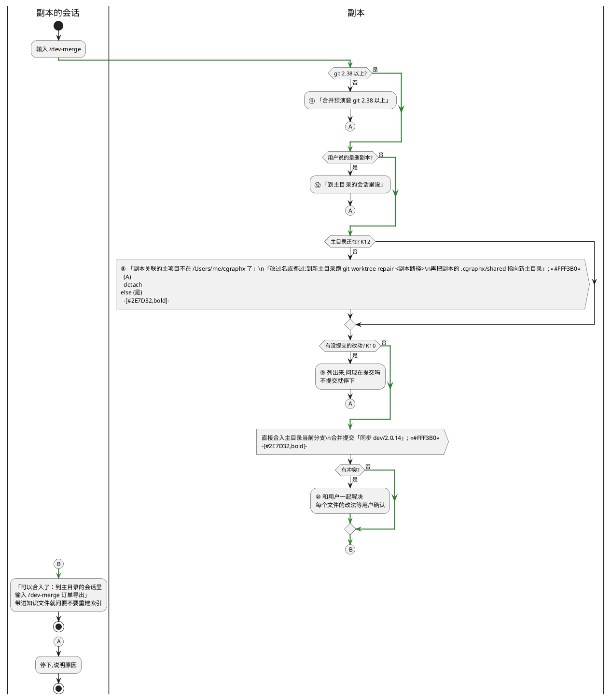
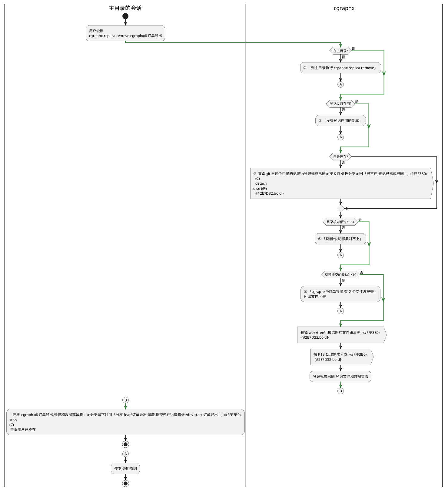

# 规格说明: 副本改用worktree

> 产物: spec
> feature-id: 2026-11-06-副本改用worktree
> 负责人: liulongfei
> 日期: 2026-11-06

## 功能方案

> 原样收录 clarify 终确认的功能方案(讨论稿 v3);业务要变,回 clarify 改,再同步这一节。

**一句话**:原来开副本要把整个主目录写时复制一份,受文件系统限制,合入还要跨仓库取分支;这次副本改成 git worktree,只带 agent 工作必须的配置和项目清单里写的文件,依赖默认不带,合入直接用需求分支,命令和用法不变。

**功能清单**

| 编号 | 功能点 | 类别 | 从哪进 → 到哪去 | 一句话 |
|---|---|---|---|---|
| F1 | 开副本 | 核心 | 主目录 `/dev-start <需求>` → 到副本开新会话 | 开 worktree 和需求分支,带上 agent 配置和项目清单里写的文件,登记到主目录 |
| F2 | 同步和合入 | 核心 | F1 的副本里做完 → 副本 `/dev-merge` 同步 → 主目录 `/dev-merge <需求>` 合入 → F3、F4 | 不再从副本路径取分支,其余和现在一样 |
| F3 | 查看和删除副本 | 核心 | 主目录「删副本 <需求>」、F2 合完、F4 发版后 → 目录删掉 | 删目录和删分支分开处理,没合入的提交留在分支上 |
| F4 | 发版审核和清理 | 支撑 | 版本分支 `/release-review` → F3 | 流程不变,只改没合入的需求和清理时的说法 |
| — | 带依赖的开关 | 建议新增 ✂️ | — | 不做:依赖默认不带;项目真要带可以写进 K16 的清单 |
| — | 主目录改名后一键修复 | 建议新增 ✂️ | — | 不做:报错里给修复办法就够了 |
| — | 兼容旧版写时复制副本 | 边界外 | — | 不做:本地清理完才升级 |
| — | 几个副本同时启动的端口、数据库隔离 | 边界外 | — | 不做:配置带过去后还是同一个端口、同一个库,要并行启动自己改 |
| — | 认 agent 自己开的 worktree | 边界外 | — | 放到「agent看板」一起定 |
| — | Windows、子模块的完整支持 | 边界外 | — | 没有测试条件,这次不扩 |

### F1 开副本(核心)

现在:写时复制整个主目录,再删掉不要的,磁盘不支持时要问整份复制;主目录有没提交的改动就拦下。

改后:开 worktree,放在主目录旁边,目录名不变,哪家 agent 都能在里面开会话;只带 agent 配置和项目清单里写的文件。不再有「不能写时复制」这一步,主目录有改动也能开,只提示一句。F3 留下的分支,重开同一个需求时接上。副本登记和 F2、F3 共用。

```plantuml
@startuml
skinparam backgroundColor #FFFFFF
skinparam Activity {
  BackgroundColor #F1F1F1
  BorderColor #181818
  FontColor #000000
}
skinparam Swimlane {
  BorderColor #181818
  TitleBackgroundColor #FFFFFF
  TitleFontColor #000000
}
skinparam ArrowColor #181818

|主目录的会话|
start
:输入 /dev-start 订单导出\n确认需求目录名和分支;
|cgraphx|
-[#2E7D32,bold]->
:开副本\ncgraphx replica create;
note right
  开 worktree 之后、删主目录那份之前
  任何一步失败 → ⑧ 删掉 worktree 和新建的分支
  接上的分支留着,主目录不动,报错原话
end note
-[#2E7D32,bold]->
if (macOS 或 Linux?) then (否)
  :① 「副本只支持 macOS 和 Linux」;
  (A)
  detach
else (是)
  -[#2E7D32,bold]->
endif
if (在主目录? K1) then (否)
  :② 说明原因\n「到主目录的会话里开」;
  (A)
  detach
else (是)
  -[#2E7D32,bold]->
endif
if (需求分支已存在?) then (是)
  if (这个需求删副本时留下的? K15) then (否) <<#FFF3B0>>
    :③ 「主目录已有本地分支 feat/订单导出\n换个分支名再开副本」;
    (A)
    detach
  else (是)
    -[#2E7D32,bold]->
  endif
else (否)
  -[#2E7D32,bold]->
endif
-[#2E7D32,bold]->
:其余 3 个判断不变,不过就说明原因停下\n④ 这个需求已有在用的副本 K2\n⑤ 目录名已登记给别的需求 K2  ⑥ 目标目录已存在;
-[#2E7D32,bold]->
:开 worktree,放在主目录旁边\n新分支从主目录当前分支的最新提交拉出 K3\n留下的分支直接接上 K15; <<#FFF3B0>>
-[#2E7D32,bold]->
if (开成了?) then (否) <<#FFF3B0>>
  :⑦ 报 git 的原话\n什么都不留; <<#FFF3B0>>
  (A)
  detach
else (是)
  -[#2E7D32,bold]->
endif
:带上 agent 配置 K4 和清单里写的文件 K16\n清单里的文件主目录没有就跳过\n提示 ⑩「清单里的 X 主目录没有,没带」; <<#FFF3B0>>
-[#2E7D32,bold]->
:建副本自己的 cgraphx 目录 K5\n登记到主目录;
-[#2E7D32,bold]->
:把这个需求目录里\n没被跟踪的文件拷进副本 K6; <<#FFF3B0>>
-[#2E7D32,bold]->
:最后删掉主目录那份 K6\n删不掉不回滚,提示 ⑨「主目录里 X 没删掉\n副本里已有一份,手动删掉」; <<#FFF3B0>>
-[#2E7D32,bold]->
if (主目录有没提交的改动? K7) then (是) <<#FFF3B0>>
  -[#2E7D32,bold]->
  :提示「主目录有 3 个文件没提交,没带进副本」; <<#FFF3B0>>
  -[#2E7D32,bold]->
else (否)
  -[#2E7D32,bold]->
endif
-[#2E7D32,bold]->
(B)
detach

|主目录的会话|
(B)
-[#2E7D32,bold]->
:建副本的知识库索引和「我的需求」索引;
-[#2E7D32,bold]->
:给启动语,并提示:\n「依赖和构建产物没带过来,第一次要在副本里安装、构建一次」\n「启动要用的本地配置写进要带的文件清单,下次开副本自动带」\n「副本里不要用 git stash,几个副本共用一份」\n接上留下的分支时加「接上了 feat/订单导出,先 /dev-merge 同步」; <<#FFF3B0>>
stop
(A)
:停下,说明原因;
stop
@enduml
```

| 编号 | 哪一步 | 怎么判定 | 算 / 不算(例子) | 依据 |
|---|---|---|---|---|
| K1 | ② 在主目录 | 已装过 cgraphx、不是副本,在独立 git 仓库的根目录,而且在某个分支上 | 算:`cgraphx` 在 `dev/2.0.14` 上;不算:副本里、自己 `git worktree add` 开的目录、子模块、detached HEAD | `src/core/replica/create.ts:115`;沿用 |
| K2 | ④⑤ 副本和目录名 | 一个需求只开一个在用的副本;目录名 `<主目录名>@<文件前缀>`,登记过别的需求就不能再用,副本删了也算 | 算已有副本:`订单导出` 的副本目录还在;不算:删了的、目录已不在的,可以重开 | 主目录 `.cgraphx/replicas/*.json`;沿用 |
| K3 | 开 worktree · 从哪拉 | 主目录当前分支的最新提交 | 开了版本是 `dev/2.0.14`,没开是 `main` | 登记的 `baseBranch`、`baseCommit`;沿用 |
| K4 | 带上 agent 配置 | 每家已登记的 agent:配置目录和指引文件,只带没被 git 跟踪的部分;MCP 配置同样处理。新增一家 agent 时登记上就一起带 | 算:`.claude/settings.local.json`、`.codebuddy/`、没提交的 `CLAUDE.md`、被忽略的 `.mcp.json`;不算:已被跟踪的 `.claude/commands/`(worktree 本来就有)、这个仓库开过的 worktree(不管在哪家 agent 的目录里,如 `.claude/worktrees/a`、`.codebuddy/worktrees/b`)、`node_modules`、`dist`、`.env` | `src/core/agents/profiles.ts` 的 `configDirName`、`instructionsFileName`;`.mcp.json` 新定 |
| K16 | 带上清单里写的文件 | 项目自己写一份「要带的文件」清单,路径相对项目根,文件或目录都行,从主目录拷到副本;没写清单就什么都不带。清单只写路径,不写文件内容 | 算:`.env`、`src/main/resources/application-local.yml`。不算:项目外的路径和绝对路径,提示后不带;已被 git 跟踪的文件,worktree 本来就有,跳过 | 新数据,存哪由 spec 定;新定 |
| K5 | 建 cgraphx 目录 | 副本建自己的空目录和指回主目录的链接,不复制数据;知识库索引自己建;时间线和数据库连接配置按项目名共用,项目名在共用的 git 配置里 | 算:副本里能查时间线、能连主目录配好的库;不算:主目录的知识库库文件、副本登记、`my-features.md` 不进副本 | `src/core/replica/create.ts:358`;沿用 |
| K6 | 拷进副本、删主目录那份 | 这个需求目录下没被跟踪的文件先拷进副本,其他步骤都成功后,最后才删主目录那份;不提交到主目录的分支 | 算:`docs/features/2026-11-06-订单导出/` 下的讨论稿;不算:别的需求目录、这个目录里被忽略的文件(留在主目录)。拷到一半失败:主目录那份还在;最后删不掉:两边都有,提示手动删 | `src/core/replica/create.ts:433`;沿用,顺序新定 |
| K7 | 主目录有没提交的改动 | 改了没提交的已跟踪文件才提示;不拦,也不带进副本 | 算:改了 `src/a.ts` 没提交;不算:新建没被跟踪的文件 | 新定(原来拦下,因为整目录复制会带走改动) |

| K15 | ③ 接上留下的分支 | 这个需求的副本登记过这个分支(副本已删或目录已不在);接上后「自己做的提交」(K9)仍从第一次开副本时的提交算 | 算:删 `订单导出` 副本时差 2 笔、留下的 `feat/订单导出`,重开后仍显示差 2 笔;不算:别的需求登记的同名分支、手动建的同名分支,停在 ③ | 主目录 `.cgraphx/replicas/*.json` 的 `branch`、`baseCommit`;新定 |

🎭 体验决策:依赖默认不带,开副本是秒级的;代价是每个副本第一次要跑一次安装或构建。用 Maven、Gradle、pnpm 的项目基本不用重新下载依赖。本仓库实测 `npm ci`:没缓存 42 秒,有缓存 1 秒。启动要用的本地配置由项目写进 K16 的清单,开副本时自动带上;没写进清单的要自己拷。

### F2 同步和合入(核心)

现在:合入和同步都要跨仓库取分支。改后:同一个仓库,直接用分支名;用法、提示和合并说明都不变。和 F3 共用「已合入」的口径。

**图 1 主目录合入**

```plantuml
@startuml
skinparam backgroundColor #FFFFFF
skinparam Activity {
  BackgroundColor #F1F1F1
  BorderColor #181818
  FontColor #000000
}
skinparam Swimlane {
  BorderColor #181818
  TitleBackgroundColor #FFFFFF
  TitleFontColor #000000
}
skinparam ArrowColor #181818

|主目录的会话|
start
:F1 的副本做完、过了 /code-review\n输入 /dev-merge 订单导出;
|主目录|
-[#2E7D32,bold]->
if (git 2.38 以上?) then (否)
  :① 「合并预演要 git 2.38 以上」;
  (A)
  detach
else (是)
  -[#2E7D32,bold]->
endif
if (找到这个需求的副本? K8) then (否)
  :② 列出在用的副本,问合哪个;
  (A)
  detach
else (是)
  -[#2E7D32,bold]->
endif
if (有可合入的提交? K9) then (没有)
  :③ 「已经合入过了」或「还没有提交」\n或「副本已不在,要接着做:/dev-start 订单导出」; <<#FFF3B0>>
  (A)
  detach
else (有,或判断不了)
  -[#2E7D32,bold]->
endif
if (在主干上,而且按版本走过?) then (是)
  :④ 停下问:先 /release-start、\n这次合进 main、还是不再按版本走;
  (A)
  detach
else (否)
  -[#2E7D32,bold]->
endif
if (主目录和副本都没有没提交的改动? K10) then (否)
  :⑤ 列出文件,提示先提交或收好;
  (A)
  detach
else (是)
  -[#2E7D32,bold]->
endif
if (主目录里有 feat/订单导出?) then (否) <<#FFF3B0>>
  :⑥ 「主目录没有分支 feat/订单导出,合不了\n核对分支是不是被改名或删掉了」; <<#FFF3B0>>
  (A)
  detach
else (是)
  -[#2E7D32,bold]->
endif
:直接拿需求分支预演合并\n不动工作区; <<#FFF3B0>>
-[#2E7D32,bold]->
if (有冲突?) then (是)
  :⑦ 列出冲突文件和撞上的需求\n「到副本会话里输入 /dev-merge」;
  (A)
  detach
else (否)
  -[#2E7D32,bold]->
endif
:合并提交\n「合入需求：订单导出」K11;
-[#2E7D32,bold]->
(B)
detach

|主目录的会话|
(B)
-[#2E7D32,bold]->
:「已合入：3 个提交，改了 7 个文件」\n带进知识文件就问要不要重建索引\n没开版本就问删不删,见 F3;
stop
(A)
:停下,分支不动;
stop
@enduml
```

**图 2 副本同步**



| 编号 | 哪一步 | 怎么判定 | 算 / 不算(例子) | 依据 |
|---|---|---|---|---|
| K8 | ② 找副本 | 按副本目录名、需求目录名或标题找 | 算:`cgraphx@订单导出`、`2026-11-06-订单导出`、`订单导出` | `cgraphx replica list`;沿用 |
| K9 | ③ 有可合入的提交 | 需求分支自己做过提交,而且有还不在主目录当前分支里的;同步进来的别人的提交不算自己做的 | 算:做了 3 笔、合入过 2 笔,差 1 笔;不算:合入后只同步过、刚开还没提交。判断不了时说一句「判断不了合没合入」,照常往下走 | 知识库「需求副本」K3;`src/core/replica/status.ts:151`;沿用 |
| K10 | ⑤⑨ 没提交的改动 | 副本:改了没提交的已跟踪文件,加上新建没被跟踪的文件;F1 带来的 agent 配置和清单文件、被忽略的文件不算。主目录:只看改了没提交的已跟踪文件 | 算:副本里新建的 `src/x.ts`;不算:`.claude/settings.local.json`、清单带来的 `.env`、`node_modules` | 知识库「需求副本」K9;沿用 |
| K11 | 合并说明 | 第 2 次起带次数,按这个版本里同标题的合入数算 | 「合入需求：订单导出」「合入需求：订单导出(第 2 次)」 | `/dev-merge`;沿用 |
| K12 | ⑧ 主目录还在 | 副本里指回主目录的链接能打开 | 不算:主目录改过名或挪过 | `src/core/replica/main-dir.ts:37`;沿用,提示新定 |

### F3 查看和删除副本(核心)

现在:删目录,需求分支和没合入的提交跟着一起没了。改后:目录删掉,分支看合入情况;合入判断和 F2 共用 K9。

行为链:主目录说「删副本 订单导出」→ 按 K9、K10 说清情况,问删不删(差提交的说「cgraphx@订单导出 还差 2 个提交没合入;目录删了,提交留在分支 feat/订单导出 上,/dev-start 订单导出 能接着做」;判断不了合没合入的不删,请用户先在副本里确认提交都已合入)→ 用户说删,执行下图。查看 `cgraphx replica list` 的显示不变。



| 编号 | 哪一步 | 怎么判定 | 算 / 不算(例子) | 依据 |
|---|---|---|---|---|
| K13 | ③ 和删完后 · 处理需求分支 | 用 K9 判断:已合入的删;还没有提交的删;差提交的留着;判断不了的留着(正常流程这时不删目录,只有目录已不在或直接跑命令才走到这里) | 删:全部合入过;刚开没提交。留:做了 3 笔差 1 笔,回报分支名 | 新定(原来分支跟目录一起没了) |
| K14 | ④ 目录核对 | 目录就是登记的路径,不是主目录或它的上级,名字以 `<主目录名>@` 开头,里面的链接指回本主目录,而且确实是这个仓库的 worktree | 不算:登记路径被改错的目录;不是这个仓库 worktree 的目录,提示「这个目录不是本仓库的 worktree,没删」 | `src/core/replica/remove.ts:49`;沿用,加最后一条 |

🎭 体验决策:没合入的提交留在分支上,目录删了也不丢,重开同一个需求就接上(F1 K15);代价是不再接着做的分支要自己清理。

### F4 发版审核和清理(支撑)

和 F3 共用清理规则;审核报告的其他内容不变。

行为链:版本分支 `/release-review` → 「不在本版本的需求」照旧列在用、没合入的副本(`差 2 个提交`、`还没有提交`)→ 用户说「发」合入主干 → 列出已合入、可以删的副本,问删不删 → 说删按 F3 删;差提交的留着,跟到下个版本。

边界:① 跨版本没做完的副本留着,下个版本 `/release-start` 之后照样 `/dev-merge`,合进那时主目录所在的分支 ② 副本里需求分支正在用,版本分支和主干的操作不受影响

## 怎么实现

### 细节方案:F1 开副本

| # | 决策 | 选择 | 没选的(为什么) | 理由(依据) | 影响面 |
|---|---|---|---|---|---|
| D1 | 开目录的机制(K3) | `git worktree add -q -b <分支> <目标目录> HEAD`,目标目录和命名照旧;`baseCommit` 照旧开之前读。去掉 `copyTree`、`dropUntracked`、`venvWarnings`,`--full-copy` 和错误码 `no_cow`、`dirty_main` 一起删;新增错误码 `worktree_failed`,带 git 的原话(⑦) | 留写时复制带依赖——体验决策已定不带 | 实测开 worktree 0.12 秒;`src/core/replica/create.ts:274,332,409` | `create.ts`、`cli.ts`、`errors.ts`、`types.ts`;`assertMainDir`、`assertFeatureHasNoReplica`、`assertNameFree`、`assertTargetFree` 不动 |
| D2 | 带 agent 配置(K4) | 从 `listAgentProfiles()` 取路径:`configDirName`、`instructionsFileName`,加新字段 `extraConfigFiles`(Claude Code 填 `.mcp.json`,CodeBuddy 留空);在主目录跑 `git ls-files -z --others --directory -- <路径>` 列出没跟踪的项,用 `fs.cpSync(recursive, verbatimSymlinks)` 拷过去。`filter` 跳过 `listWorktreeRoots` 列出的目录,比 realpath,所以不分 agent | 只认 `.claude/worktrees/`——别家放哪不知道;只拷 skills、settings 这类白名单——agent 自己的新目录会漏 | 实测 `--directory` 把 `.claude/` 收成一项、里面含嵌套 worktree,所以要在拷的时候过滤;`.claude`、`.codebuddy/worktrees` 都列得出;`src/core/repo-projects.ts:43`(要导出) | `agents/types.ts`、`profiles.ts` 加字段;`repo-projects.ts` 导出函数 |
| D3 🔒 | 清单文件(K16) | 主目录根下的 `.worktreeinclude`,gitignore 语法,`#` 开头是注释。用 `git ls-files -z --others --ignored --exclude-from=.worktreeinclude` 取要带的文件,去掉 `.cgraphx/` 下的;每行再单独用 `--exclude=<行>` 查,没跟踪和已跟踪的都是 0 个就算主目录没有,提示 ⑩。cgraphx 不创建、不提交这个文件,项目自己决定要不要提交:提交了团队共用,不提交只影响本机 | `.cgraphx/replica-include`——目录被忽略,团队共用不了;Claude Code 自己开 worktree 时又不认,要写两份。一行一个字面路径——用户照 Claude Code 的写法写了通配就会报没有 | Claude Code 2.1.204 读同名文件,也是 gitignore 语法,所以两边共用一份;区别:它只拷被忽略的文件、跳过链接,这里没被忽略的也拷、链接保留。git 匹配实测:`.env`、`big/`、`*.txt` 都能取到,已跟踪的取不到,`none.txt`、`../out` 是 0 | `create.ts`;`/dev-start` 提示和文档写这个文件名 |
| D4 🔒 | 带来的文件对 git 隐藏 | 拷完在副本里跑 `git ls-files --others --exclude-standard --directory -- <K4 和 K16 的路径>`,有看得见的才处理:主仓库开 `extensions.worktreeConfig`,副本写 `core.excludesFile` 指向 `<副本>/.cgraphx/replica-exclude`,内容是用户级忽略文件的内容加这些路径。都已被忽略的项目什么配置都不改。`cgraphx uninstall` 不还原这个开关 | 写主仓库 `info/exclude`——worktree 共用,实测主目录也被盖住,没被忽略的 `.claude/` 从 `git status` 消失;不隐藏——K10 拦删除,`git add -A` 可能把密钥提交进去 | 实测:副本 `git status` 和 `add -A` 都是 0 项,主目录照常看得到,`.DS_Store` 这类用户级规则还生效,`git worktree remove` 成功。用户级文件后来改了,已开的副本不跟 | 用户仓库的 `.git/config` 多一行;文件放副本里,主目录改名后路径还有效 |
| D5 | cgraphx 目录(K5)和「在副本里」 | `createDirectory`、建空本地库、建 `shared` 链接,复用 `resetDataDir` 去掉清空那段;`replicaLinkOf` 和 skill 里的 `test -L .cgraphx/shared` 不动 | 改看 `git rev-parse --git-common-dir`——skill 和程序都要改,而且分不出自己开的 worktree,违反 K1 | `src/core/replica/main-dir.ts:47`;`directory.ts:187`;`.cgraphx/.gitignore` 忽略目录里全部内容 | 无 |
| D6 | 拷讨论稿(K6)和失败回滚(⑧) | 按 `untrackedFiles(main)` 取这个需求目录下的文件拷进副本,登记写在拷完之后,图上这两步的先后用户看不出来;失败就 `git worktree remove --force`,新建的分支 `git branch -D`,接上的分支留着。全部成功后才删主目录那份,删不掉进 `warnings`(⑨),不回滚 | 先删主目录再出错——两边都可能没有 | `create.ts:433` 已是最后一步 | `movedFiles` 含义不变 |
| D7 | 接上留下的分支(K15) | `assertBranchFree` 改成:分支已存在时,在 `listReplicas(includeRemoved)` 里找 `featureId`、`branch` 都相同,且已删或目录不在的最新一条;找到就跑 `git worktree prune`,再 `git worktree add -q <目标目录> <分支>`,`baseCommit` 沿用那一条,结果多 `reattached: true`。那条登记名字不同时标成已删 | 重开时把 `baseCommit` 换成当前提交——K9 数不到以前的提交,会显示「还没有提交」 | 实测目录被手动删后直接接会报 `missing but already registered`,prune 后成功;`src/core/replica/registry.ts:131` | `create.ts`、`types.ts` |
| D8 | 钩子 | 开完在副本里调一次 `repairHookSnippets(target)`,补不上的进 `warnings` | 等第一条 cgraphx 命令再补——`/dev-start` 的命令都在主目录跑,第一笔提交前可能没有门禁 | 实测 `core.hooksPath=.husky/_` 时副本里没有这个目录,钩子不跑;补回后片段能跑、`git status` 干净。默认钩子目录本来就共用 | `create.ts` 用基础层 `git-hooks.ts`;依赖装好时 husky 重写目录,靠现有的补回时机 |
| D9 | 主目录有改动(K7) | `assertCleanMain` 改成读 `trackedChanges`,有就写一条 `warnings`:「主目录有 N 个文件没提交,没带进副本」;git 出错不拦 | 照旧拦下——worktree 不带走改动,拦了没意义 | `src/core/replica/status.ts:60` | `dev-start` 去掉 `dirty_main` 那行 |

`cgraphx replica create --json` 的变化:去掉 `--full-copy`,失败不再有 `no_cow`、`dirty_main`,多 `worktree_failed`;成功结果多 `reattached`,其余字段不变。⑨⑩ 和 K7 的提示都放进 `warnings`。

K1、K2 沿用现有实现,无新决策。

### 细节方案:F2 同步和合入

| # | 决策 | 选择 | 没选的(为什么) | 理由(依据) | 影响面 |
|---|---|---|---|---|---|
| D10 | 合入判断(K9) | `replicaBranchTip` 改成主目录 `git rev-parse -q --verify refs/heads/<分支>`,取不到是 `''`;删掉 `mergeState` 里的 fetch。`ownCommitsState` 和 `merged`、`ahead` 的含义不变 | 留着 fetch——同一个仓库,对象本来就有 | `src/core/replica/status.ts:93,122` | `status.ts`;旧版副本的分支不在主目录,得到 `merged: null` |
| D11 | `/dev-merge` 的命令 | 合入:先 `git rev-parse -q --verify refs/heads/feat/订单导出`(⑥),`git merge-tree --write-tree --name-only HEAD refs/heads/feat/订单导出`,`git merge --no-ff -m "合入需求：订单导出" refs/heads/feat/订单导出`。同步:`git merge --no-ff -m "同步 dev/2.0.14" refs/heads/dev/2.0.14`。一律写全 `refs/heads/`。删掉两处 `git fetch` 和红线 1 | 只写分支名——同名 tag 优先,会合错 | `dev-merge/SKILL.md`;`HEAD^1`、`HEAD^2` 的回报命令不变 | `dev-merge/SKILL.md` 流程、范例、停下问用户表 |

K8、K10、K11 沿用现有实现,无新决策;K12 只改 ⑧ 的提示文案。

### 细节方案:F3 查看和删除副本

| # | 决策 | 选择 | 没选的(为什么) | 理由(依据) | 影响面 |
|---|---|---|---|---|---|
| D12 🔒 | 处理需求分支(K13) | 删目录前按 D10 算 K9:`merged` 是 true,或 `merged` 是 false 且 `ahead` 是 0 → `git branch -D`;其余留着。结果多 `branch: { name, state: 'deleted' \| 'kept', tip }`,`tip` 是删之前的提交号,删错了能找回。分支删不掉只进 `warnings` | `git branch -d`——合入后又同步过的分支不是 HEAD 的祖先,会被拒绝,和 K9 不是一个算法;分支一律留着——用户已选删 | K9 只看第一父链上自己做的提交;实测目录在或已 prune 时都能删分支 | `remove.ts`、`types.ts`、`cli.ts` 的 `printRemove` |
| D13 | 删目录(K14) | 五条核对后加一条:realpath 在 `listWorktreeRoots(main)` 里,不在就 `unsafe_target`「这个目录不是本仓库的 worktree,没删」。K10 过了再跑 `git worktree remove --force` | `fs.rmSync`——git 里留下记录,分支还算被占用;不带 `--force`——子模块项目会被拒绝 | 实测只有被忽略文件时不带 force 也能删;`src/core/replica/remove.ts:49,126` | `remove.ts` |
| D14 | 目录已不在(③) | `git worktree prune`,按 D12 处理分支,标成已删 | 不清记录——分支删不掉,重开也接不上 | 审核实测 | `remove.ts` |

查看副本的显示沿用现有实现,无新决策。

### 细节方案:F4 发版审核和清理

沿用现有实现,无新决策。`release-review/SKILL.md` 只改第 7 步和范例的文案:差提交的副本照旧留着;用户说删时,回报里带 `branch` 的结果。

### 文档

| 文件 | 改什么 | 对应 |
|---|---|---|
| `skills/dev-start/SKILL.md` | 定位、返回表、范例、红线去掉写时复制和 `--full-copy`;加 `reattached`、依赖和 `.worktreeinclude`、stash 三条提示 | F1 |
| `skills/dev-merge/SKILL.md` | D11;删副本的说法改成「提交留在分支上」 | F2、F3 |
| `skills/release-review/SKILL.md` | 第 7 步的文案 | F4 |
| `skills/cgraphx-guide/SKILL.md`、`how-to-use.*`、`skills.html`,`FLOW-MAP.md` | 副本是 worktree、带什么、`.worktreeinclude` | 全部 |
| 知识库「需求副本」「版本分支」 | K1 写着 worktree 不算副本,改成「自己开的不算,经 `/dev-start` 开的算」;「开出来的副本里有什么」重写 | 全部 |
| 本仓库 `CLAUDE.md`、`CHANGELOG.md` | 副本实现;破坏性:`--full-copy` 没了,旧版写时复制副本要在升级前清掉 | 全部 |

### 迁移与兼容

不写迁移代码,不兼容旧版写时复制副本。开发阶段副本仍是旧版开的,合入、升级之前用户手动清理本地的 5 个副本。旧副本还在时:`list` 显示 `merged: null`,`/dev-merge` 停在 ⑥,`remove` 停在 D13 的 `unsafe_target`,不会删错。

### 全局约束

- `replica list --json` 的字段、登记文件的格式不变;timeline、features、project 只经门面读登记,不用改。
- K1 不变:自己 `git worktree add` 开的目录不是副本,`replica` 命令不管它。
- 钩子只经基础层 `git-hooks.ts` 写。
- 不推送;需求分支现在就在主目录的仓库里,不再有「主目录不建需求分支」这条限制。
- Windows 仍返回 `unsupported_platform`。

## 设计验收

| # | 对应 | 验收点 | 怎么验 |
|---|---|---|---|
| 1 | D2 | 配置目录里嵌着 worktree 时不带它;`.claude` 是链接时保留链接;没被忽略、被忽略的配置都带上 | 单元测试(真实 git) |
| 2 | D3 | 字面路径、目录、通配都能带;已跟踪的跳过且不提示;`none.txt`、`../out` 提示 ⑩;没有清单什么都不带;`.cgraphx/` 下的不带 | 单元测试 |
| 3 | D4 | 副本的 `git status`、`add -A` 看不到带来的文件,主目录看得到;用户级忽略规则还生效;配置都已被忽略的项目,`.git/config` 没有 `extensions.worktreeConfig` | 单元测试 |
| 4 | D6 | 拷讨论稿时注入失败:worktree、新分支、登记都没了,主目录文件还在;接上的分支留着 | 单元测试 |
| 5 | D7 | 用真实提交:做 3 笔、合入 1 笔、删副本、重开,`ahead` 是 2;别的需求的同名分支停在 ③ | 单元测试 |
| 6 | D8 | husky 式钩子目录:开完副本,真实提交触发提交门禁,有提交记录 | 集成测试 |
| 7 | D12 | 合入后只同步过的分支被删;差提交的留着,结果里有 `tip`;判断不了的留着 | 单元测试 |
| 8 | 并行 | 两个副本同时提交:门禁记号各在各的 git 目录(`src/core/timeline/installer.ts:86`),提交记录的提交号和所属目录对得上 | 集成测试 |
| 9 | D5 | 副本里查时间线、`project show` 和主目录是同一个项目;主目录 `features list` 列出副本里的需求;还有副本时 `uninstall` 主目录,钩子不被删 | 集成测试 |
| 10 | D10、D11 | `replica/` 和 `dev-merge` 里搜不到 fetch;全量测试通过 | grep + `npm test`(`__tests__/core/replica/` 现在没有,新建) |

## 待确认项

- 无
