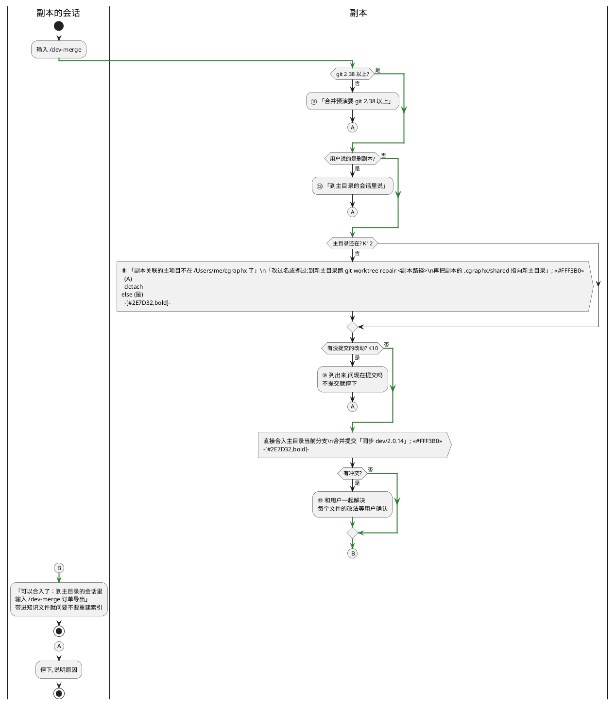
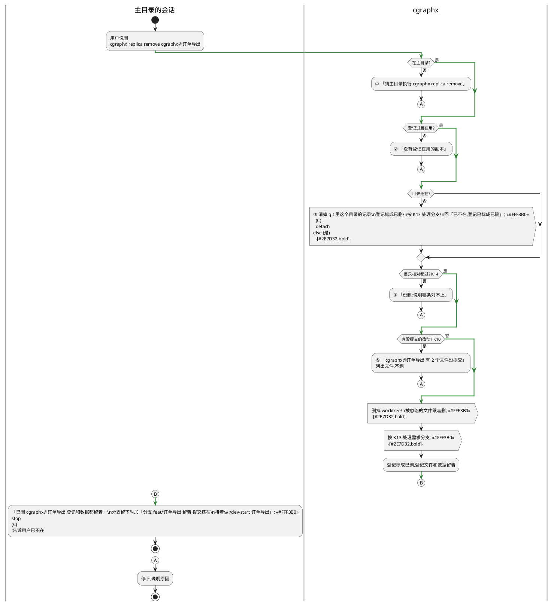

# 功能方案: 副本改用worktree(讨论稿 v2)

> 讨论稿,不是契约:人终确认的那一版由 `/dev-spec` 原样收录为 spec 第一节,之后以 spec 为准,本文件不再维护。

**一句话**:原来开副本要把整个主目录写时复制一份,受文件系统限制,合入还要跨仓库取分支;这次副本改成 git worktree,只带 agent 工作必须的配置,依赖和 `.env` 不带,合入直接用需求分支,命令和用法不变。

**功能清单**

| 编号 | 功能点 | 类别 | 从哪进 → 到哪去 | 一句话 |
|---|---|---|---|---|
| F1 | 开副本 | 核心 | 主目录 `/dev-start <需求>` → 到副本开新会话 | 开 worktree 和需求分支,带上 agent 配置,登记到主目录 |
| F2 | 同步和合入 | 核心 | F1 的副本里做完 → 副本 `/dev-merge` 同步 → 主目录 `/dev-merge <需求>` 合入 → F3、F4 | 不再从副本路径取分支,其余和现在一样 |
| F3 | 查看和删除副本 | 核心 | 主目录「删副本 <需求>」、F2 合完、F4 发版后 → 目录删掉 | 删目录和删分支分开处理,没合入的提交留在分支上 |
| F4 | 发版审核和清理 | 支撑 | 版本分支 `/release-review` → F3 | 流程不变,只改没合入的需求和清理时的说法 |
| — | 带依赖的开关 | 建议新增 ✂️ | — | 不做:用户定了依赖默认不带;基于现有写时复制能力可支撑,以后要再加 |
| — | 主目录改名后一键修复 | 建议新增 ✂️ | — | 不做:报错里给修复办法就够了 |
| — | 兼容旧版写时复制副本 | 边界外 | — | 不做:本地清理完才升级 |
| — | 认 agent 自己开的 worktree | 边界外 | — | 放到「agent看板」一起定 |
| — | Windows、子模块的完整支持 | 边界外 | — | 没有测试条件,这次不扩 |

### F1 开副本(核心)

现在:写时复制整个主目录,再删掉不要的,磁盘不支持时要问整份复制;主目录有没提交的改动就拦下。

改后:开 worktree,放在主目录旁边,目录名不变,哪家 agent 都能在里面开会话;只带 agent 配置。不再有「不能写时复制」这一步,主目录有改动也能开,只提示一句。F3 留下的分支,重开同一个需求时接上。副本登记和 F2、F3 共用。

```plantuml
@startuml
skinparam backgroundColor #FFFFFF
skinparam Activity {
  BackgroundColor #F1F1F1
  BorderColor #181818
  FontColor #000000
}
skinparam Swimlane {
  BorderColor #181818
  TitleBackgroundColor #FFFFFF
  TitleFontColor #000000
}
skinparam ArrowColor #181818

|主目录的会话|
start
:输入 /dev-start 订单导出\n确认需求目录名和分支;
|cgraphx|
-[#2E7D32,bold]->
:开副本\ncgraphx replica create;
note right
  开 worktree 之后、删主目录那份之前
  任何一步失败 → ⑧ 删掉 worktree 和新建的分支
  接上的分支留着,主目录不动,报错原话
end note
-[#2E7D32,bold]->
if (macOS 或 Linux?) then (否)
  :① 「副本只支持 macOS 和 Linux」;
  (A)
  detach
else (是)
  -[#2E7D32,bold]->
endif
if (在主目录? K1) then (否)
  :② 说明原因\n「到主目录的会话里开」;
  (A)
  detach
else (是)
  -[#2E7D32,bold]->
endif
if (需求分支已存在?) then (是)
  if (这个需求删副本时留下的? K15) then (否) <<#FFF3B0>>
    :③ 「主目录已有本地分支 feat/订单导出\n换个分支名再开副本」;
    (A)
    detach
  else (是)
    -[#2E7D32,bold]->
  endif
else (否)
  -[#2E7D32,bold]->
endif
-[#2E7D32,bold]->
:其余 3 个判断不变,不过就说明原因停下\n④ 这个需求已有在用的副本 K2\n⑤ 目录名已登记给别的需求 K2  ⑥ 目标目录已存在;
-[#2E7D32,bold]->
:开 worktree,放在主目录旁边\n新分支从主目录当前分支的最新提交拉出 K3\n留下的分支直接接上 K15; <<#FFF3B0>>
-[#2E7D32,bold]->
if (开成了?) then (否) <<#FFF3B0>>
  :⑦ 报 git 的原话\n什么都不留; <<#FFF3B0>>
  (A)
  detach
else (是)
  -[#2E7D32,bold]->
endif
:带上 agent 配置 K4\n依赖、构建产物、.env 不带; <<#FFF3B0>>
-[#2E7D32,bold]->
:建副本自己的 cgraphx 目录 K5\n登记到主目录;
-[#2E7D32,bold]->
:把这个需求目录里\n没被跟踪的文件拷进副本 K6; <<#FFF3B0>>
-[#2E7D32,bold]->
:最后删掉主目录那份 K6\n删不掉不回滚,提示 ⑨「主目录里 X 没删掉\n副本里已有一份,手动删掉」; <<#FFF3B0>>
-[#2E7D32,bold]->
if (主目录有没提交的改动? K7) then (是) <<#FFF3B0>>
  -[#2E7D32,bold]->
  :提示「主目录有 3 个文件没提交,没带进副本」; <<#FFF3B0>>
  -[#2E7D32,bold]->
else (否)
  -[#2E7D32,bold]->
endif
-[#2E7D32,bold]->
(B)
detach

|主目录的会话|
(B)
-[#2E7D32,bold]->
:建副本的知识库索引和「我的需求」索引;
-[#2E7D32,bold]->
:给启动语,并提示:\n「依赖、构建产物和 .env 没带过来,需要的话在副本里自己装或拷」\n「副本里不要用 git stash,几个副本共用一份」\n接上留下的分支时加「接上了 feat/订单导出,先 /dev-merge 同步」; <<#FFF3B0>>
stop
(A)
:停下,说明原因;
stop
@enduml
```

| 编号 | 哪一步 | 怎么判定 | 算 / 不算(例子) | 依据 |
|---|---|---|---|---|
| K1 | ② 在主目录 | 已装过 cgraphx、不是副本,在独立 git 仓库的根目录,而且在某个分支上 | 算:`cgraphx` 在 `dev/2.0.14` 上;不算:副本里、自己 `git worktree add` 开的目录、子模块、detached HEAD | `src/core/replica/create.ts:115`;沿用 |
| K2 | ④⑤ 副本和目录名 | 一个需求只开一个在用的副本;目录名 `<主目录名>@<文件前缀>`,登记过别的需求就不能再用,副本删了也算 | 算已有副本:`订单导出` 的副本目录还在;不算:删了的、目录已不在的,可以重开 | 主目录 `.cgraphx/replicas/*.json`;沿用 |
| K3 | 开 worktree · 从哪拉 | 主目录当前分支的最新提交 | 开了版本是 `dev/2.0.14`,没开是 `main` | 登记的 `baseBranch`、`baseCommit`;沿用 |
| K4 | 带上 agent 配置 | 每家已登记的 agent:配置目录和指引文件,只带没被 git 跟踪的部分;MCP 配置同样处理。新增一家 agent 时登记上就一起带 | 算:`.claude/settings.local.json`、`.codebuddy/`、没提交的 `CLAUDE.md`、被忽略的 `.mcp.json`;不算:已被跟踪的 `.claude/commands/`(worktree 本来就有)、这个仓库开过的 worktree(不管在哪家 agent 的目录里,如 `.claude/worktrees/a`、`.codebuddy/worktrees/b`)、`node_modules`、`dist`、`.env` | `src/core/agents/profiles.ts` 的 `configDirName`、`instructionsFileName`;`.mcp.json` 新定 |
| K5 | 建 cgraphx 目录 | 副本建自己的空目录和指回主目录的链接,不复制数据;知识库索引自己建;时间线和数据库连接配置按项目名共用,项目名在共用的 git 配置里 | 算:副本里能查时间线、能连主目录配好的库;不算:主目录的知识库库文件、副本登记、`my-features.md` 不进副本 | `src/core/replica/create.ts:358`;沿用 |
| K6 | 拷进副本、删主目录那份 | 这个需求目录下没被跟踪的文件先拷进副本,其他步骤都成功后,最后才删主目录那份;不提交到主目录的分支 | 算:`docs/features/2026-11-06-订单导出/` 下的讨论稿;不算:别的需求目录、这个目录里被忽略的文件(留在主目录)。拷到一半失败:主目录那份还在;最后删不掉:两边都有,提示手动删 | `src/core/replica/create.ts:433`;沿用,顺序新定 |
| K7 | 主目录有没提交的改动 | 改了没提交的已跟踪文件才提示;不拦,也不带进副本 | 算:改了 `src/a.ts` 没提交;不算:新建没被跟踪的文件 | 新定(原来拦下,因为整目录复制会带走改动) |

| K15 | ③ 接上留下的分支 | 这个需求的副本登记过这个分支(副本已删或目录已不在);接上后「自己做的提交」(K9)仍从第一次开副本时的提交算 | 算:删 `订单导出` 副本时差 2 笔、留下的 `feat/订单导出`,重开后仍显示差 2 笔;不算:别的需求登记的同名分支、手动建的同名分支,停在 ③ | 主目录 `.cgraphx/replicas/*.json` 的 `branch`、`baseCommit`;新定 |

🎭 体验决策:依赖默认不带,开副本是秒级的,代价是每个副本要自己装依赖。本仓库实测 `npm ci`:没缓存 42 秒,有缓存 1 秒,之后还要构建。

### F2 同步和合入(核心)

现在:合入和同步都要跨仓库取分支。改后:同一个仓库,直接用分支名;用法、提示和合并说明都不变。和 F3 共用「已合入」的口径。

**图 1 主目录合入**

```plantuml
@startuml
skinparam backgroundColor #FFFFFF
skinparam Activity {
  BackgroundColor #F1F1F1
  BorderColor #181818
  FontColor #000000
}
skinparam Swimlane {
  BorderColor #181818
  TitleBackgroundColor #FFFFFF
  TitleFontColor #000000
}
skinparam ArrowColor #181818

|主目录的会话|
start
:F1 的副本做完、过了 /code-review\n输入 /dev-merge 订单导出;
|主目录|
-[#2E7D32,bold]->
if (git 2.38 以上?) then (否)
  :① 「合并预演要 git 2.38 以上」;
  (A)
  detach
else (是)
  -[#2E7D32,bold]->
endif
if (找到这个需求的副本? K8) then (否)
  :② 列出在用的副本,问合哪个;
  (A)
  detach
else (是)
  -[#2E7D32,bold]->
endif
if (有可合入的提交? K9) then (没有)
  :③ 「已经合入过了」或「还没有提交」\n或「副本已不在,要接着做:/dev-start 订单导出」; <<#FFF3B0>>
  (A)
  detach
else (有,或判断不了)
  -[#2E7D32,bold]->
endif
if (在主干上,而且按版本走过?) then (是)
  :④ 停下问:先 /release-start、\n这次合进 main、还是不再按版本走;
  (A)
  detach
else (否)
  -[#2E7D32,bold]->
endif
if (主目录和副本都没有没提交的改动? K10) then (否)
  :⑤ 列出文件,提示先提交或收好;
  (A)
  detach
else (是)
  -[#2E7D32,bold]->
endif
if (主目录里有 feat/订单导出?) then (否) <<#FFF3B0>>
  :⑥ 「主目录没有分支 feat/订单导出,合不了\n核对分支是不是被改名或删掉了」; <<#FFF3B0>>
  (A)
  detach
else (是)
  -[#2E7D32,bold]->
endif
:直接拿需求分支预演合并\n不动工作区; <<#FFF3B0>>
-[#2E7D32,bold]->
if (有冲突?) then (是)
  :⑦ 列出冲突文件和撞上的需求\n「到副本会话里输入 /dev-merge」;
  (A)
  detach
else (否)
  -[#2E7D32,bold]->
endif
:合并提交\n「合入需求：订单导出」K11;
-[#2E7D32,bold]->
(B)
detach

|主目录的会话|
(B)
-[#2E7D32,bold]->
:「已合入：3 个提交，改了 7 个文件」\n带进知识文件就问要不要重建索引\n没开版本就问删不删,见 F3;
stop
(A)
:停下,分支不动;
stop
@enduml
```

**图 2 副本同步**



| 编号 | 哪一步 | 怎么判定 | 算 / 不算(例子) | 依据 |
|---|---|---|---|---|
| K8 | ② 找副本 | 按副本目录名、需求目录名或标题找 | 算:`cgraphx@订单导出`、`2026-11-06-订单导出`、`订单导出` | `cgraphx replica list`;沿用 |
| K9 | ③ 有可合入的提交 | 需求分支自己做过提交,而且有还不在主目录当前分支里的;同步进来的别人的提交不算自己做的 | 算:做了 3 笔、合入过 2 笔,差 1 笔;不算:合入后只同步过、刚开还没提交。判断不了时说一句「判断不了合没合入」,照常往下走 | 知识库「需求副本」K3;`src/core/replica/status.ts:151`;沿用 |
| K10 | ⑤⑨ 没提交的改动 | 副本:改了没提交的已跟踪文件,加上新建没被跟踪的文件;F1 带来的 agent 配置和被忽略的文件不算。主目录:只看改了没提交的已跟踪文件 | 算:副本里新建的 `src/x.ts`;不算:`.claude/settings.local.json`、`node_modules` | 知识库「需求副本」K9;沿用 |
| K11 | 合并说明 | 第 2 次起带次数,按这个版本里同标题的合入数算 | 「合入需求：订单导出」「合入需求：订单导出(第 2 次)」 | `/dev-merge`;沿用 |
| K12 | ⑧ 主目录还在 | 副本里指回主目录的链接能打开 | 不算:主目录改过名或挪过 | `src/core/replica/main-dir.ts:37`;沿用,提示新定 |

### F3 查看和删除副本(核心)

现在:删目录,需求分支和没合入的提交跟着一起没了。改后:目录删掉,分支看合入情况;合入判断和 F2 共用 K9。

行为链:主目录说「删副本 订单导出」→ 按 K9、K10 说清情况,问删不删(差提交的说「cgraphx@订单导出 还差 2 个提交没合入;目录删了,提交留在分支 feat/订单导出 上,/dev-start 订单导出 能接着做」;判断不了合没合入的不删,请用户先在副本里确认提交都已合入)→ 用户说删,执行下图。查看 `cgraphx replica list` 的显示不变。



| 编号 | 哪一步 | 怎么判定 | 算 / 不算(例子) | 依据 |
|---|---|---|---|---|
| K13 | ③ 和删完后 · 处理需求分支 | 用 K9 判断:已合入的删;还没有提交的删;差提交的留着;判断不了的留着(正常流程这时不删目录,只有目录已不在或直接跑命令才走到这里) | 删:全部合入过;刚开没提交。留:做了 3 笔差 1 笔,回报分支名 | 新定(原来分支跟目录一起没了) |
| K14 | ④ 目录核对 | 目录就是登记的路径,不是主目录或它的上级,名字以 `<主目录名>@` 开头,里面的链接指回本主目录,而且确实是这个仓库的 worktree | 不算:登记路径被改错的目录;不是这个仓库 worktree 的目录,提示「这个目录不是本仓库的 worktree,没删」 | `src/core/replica/remove.ts:49`;沿用,加最后一条 |

🎭 体验决策:没合入的提交留在分支上,目录删了也不丢,重开同一个需求就接上(F1 K15);代价是不再接着做的分支要自己清理。

### F4 发版审核和清理(支撑)

和 F3 共用清理规则;审核报告的其他内容不变。

行为链:版本分支 `/release-review` → 「不在本版本的需求」照旧列在用、没合入的副本(`差 2 个提交`、`还没有提交`)→ 用户说「发」合入主干 → 列出已合入、可以删的副本,问删不删 → 说删按 F3 删;差提交的留着,跟到下个版本。

边界:① 跨版本没做完的副本留着,下个版本 `/release-start` 之后照样 `/dev-merge`,合进那时主目录所在的分支 ② 副本里需求分支正在用,版本分支和主干的操作不受影响

---

以下供 spec 使用,可不细读。

**必须在 spec 前解决的问题**:无

**已锁定技术约束**

- 不兼容旧版写时复制副本:用户本地清理完才升级。本机现有 5 个:`cgraphx@dev-del丢弃副本` 差 24 个提交,其余 4 个已合入。
- 依赖、构建产物、`.env` 默认不带;写时复制和 `--full-copy` 随之去掉。
- 命令 `cgraphx replica`、skill 名、「副本」这个说法不变。
- git 2.38 以上(合并预演),不变。

**留给 spec 的细节决策**

- 带来的 agent 配置怎么对 git 隐藏:worktree 共用 `info/exclude`(实测写进去后主目录也被盖住),没被忽略的 `.claude/` 会从主目录的 `git status` 里消失。候选:`extensions.worktreeConfig` 加单个 worktree 的 `core.excludesFile`(审核实测:副本干净、主目录不受影响、`git worktree remove` 成功);要处理它盖掉用户级忽略文件的问题,本机 `~/.config/git/ignore` 有规则。
- K15 接上分支:重开时沿用旧登记的 `baseCommit`;目录已不在时 git 还记着旧 worktree,要先清记录才能接上分支、才能删分支(审核实测)。
- K4 排除 worktree 按 `git worktree list` 取,不分 agent;这一条还没写过代码。
- `.mcp.json` 要不要进 agent 描述;CodeBuddy 有没有对应文件。
- 「在副本里」继续看 `.cgraphx/shared` 链接,还是改判断;`listReplicas` 的调用方(features、project/merge、timeline ingest、rebuild、project/duplicate)不受影响。
- 删分支的具体做法:K9 的判断和 `git branch -d` 不是同一个算法。
- `src/core/replica/create.ts`、`status.ts` 里写时复制和 fetch 的代码删除范围。
- skill 改动:`dev-start`(去掉 `dirty_main`、`no_cow`)、`dev-merge`、`release-review`、`cgraphx-guide`、`FLOW-MAP`、知识库「需求副本」「版本分支」;知识库现在写着 worktree 不算副本。

**影响半径与风险**

- MEDIUM 钩子路径相对工作区的项目(如 husky 的 `.husky/_`,被忽略的目录):worktree 里开始没有钩子。从代码看第一条 cgraphx 命令会补回(`repairHookSnippets`),在那之前提交门禁和提交记录不生效。审核实跑时 `dist` 是旧构建,没跑通,spec 要实测。
- MEDIUM 开了沙箱的 agent:worktree 的 git 目录在工作区外面,可能提交不了。本机 Claude Code、CodeBuddy 的配置都没开沙箱,没实测。
- LOW 子模块项目:副本里子模块目录是空的,`git worktree remove` 要加 `--force`(git 文档,没实测)。
- LOW stash、tag 共用(实测),只靠启动语提醒。
- LOW 主目录改名后副本的 git 立刻报错,`git worktree repair` 能修(实测)。

**现实约束清单**

- 版本分支只放行合并提交和 `chore(release):` 开头的提交(`src/core/release/guard.ts`),所以讨论稿不能先提交到主目录的分支再开副本。
- 实测:`.claude/worktrees/a`、`.codebuddy/worktrees/b` 这样开的 worktree,`git worktree list` 都列得出;本机两个配置目录各约 1 MB 上下,大头是 skills,里面没有 worktree。
- 实测(本机 macOS,临时克隆):worktree 开出来 0.12 秒、工作区 6.5 MB;钩子目录、本地 git 配置、stash、tag、`info/exclude` 共用;主目录在用的分支在 worktree 里切不过去、删不掉;只有被忽略文件时 `git worktree remove` 直接删;有改动或没跟踪的文件时拒绝;删后分支还在。
- 本仓库 `npm ci`:没缓存 42 秒(不跑安装脚本),worktree 里有缓存 1 秒,`node_modules` 约 55 MB。第一次实验失败过一次(117 秒,带 `--prefer-offline`),之后没复现,原因没查到。
- 入口:`src/core/replica/create.ts:472`(开)、`remove.ts:78`(删)、`status.ts:117`(合入判断,含 fetch)、`main-dir.ts:47`(是不是副本);`assets/claude-template/skills/dev-start/SKILL.md`、`dev-merge/SKILL.md`、`release-review/SKILL.md`。
- agent 描述:`src/core/agents/profiles.ts`,字段 `configDirName`(`.claude`、`.codebuddy`)、`instructionsFileName`(`CLAUDE.md`、`CODEBUDDY.md`)。
- 项目级数据库连接配置在 `~/.cgraphx/projects/<目录名>/db-profiles.json`(`src/core/dbquery/config.ts:84`),不用带。
