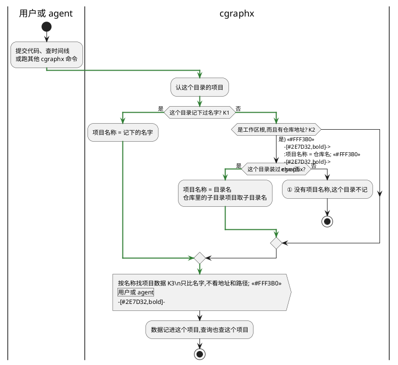

# 规格说明: 项目按名称认

> 产物: spec
> feature-id: 2026-11-06-项目按名称认
> 负责人: liulongfei
> 日期: 2026-11-06

## 功能方案

> 原样收录 clarify 终确认的功能方案(讨论稿 v2);业务要变,回 clarify 改,再同步这一节。

**一句话**:原来有仓库地址的项目按地址认,地址一变或同一份代码有多个地址,数据就分成几份;这次不论目录在哪、地址是什么,都按项目名称记,名字相同就是一个项目,在新目录碰上重名时提示一句。

**功能清单**

| 编号 | 功能点 | 类别 | 从哪进 → 到哪去 | 一句话 |
|---|---|---|---|---|
| F1 | 只按名称认项目 | 核心 | 记提交、查时间线、其他 cgraphx 命令 → 这个目录算哪个项目 → 项目数据 | 记下的名字优先,没记的取仓库名,再取目录名;地址和路径都不参与比较 |
| F2 | install 记下项目名称 | 支撑 | `cgraphx install` → 问名字 → 记下 → F1 | 所有项目 install 时都问一次名字并记下,之后地址再变也不换项目 |
| F3 | 重名提示 | 支撑 | 这个目录第一次跑 cgraphx 命令或 install → 提示 → 用户改名或不管 | 新目录的名字已有数据、地址又对不上时提示一次,数据照样记进去 |
| — | 按名称合并、搬动已记下的数据 | 边界外排除 | — | 不做:改名后已经记下的数据不挪,和现在一样 |
| — | 同名时阻止记录或要求确认 | 边界外排除 | — | 不做:重名也记成一个项目,只提示 |

### F1 只按名称认项目(核心)

现在:有仓库地址的按地址认,地址变了、fork 和上游、GitHub 和内网镜像都算不同项目。这次地址只用来取默认名字,不再参与比较。一个目录算哪个项目由这里决定,F2 记下的名字最优先;项目数据放在 `~/.cgraphx/projects/<名字>/`,时间线和项目级的数据库连接配置都跟着名字共用。记不记(没装过的目录、没有数据的项目)、路径怎么换算、提交记到哪、改名后旧数据不挪,都和现在一样。



边界:② 还没记下名字的目录,仓库改了名,默认名字跟着变,算新项目,已经记下的不挪;跑一次 `cgraphx install` 记下名字就不再变 ③ 两个仓库里都有 `server/` 子目录项目,都叫 `server`,算一个项目。

| 编号 | 哪一步 | 怎么判定 | 算 / 不算(例子) | 依据 |
|---|---|---|---|---|
| K1 | 这个目录记下过名字? | 在这个目录记过,或者从记过的目录开 worktree、复制出来的;别的 clone 不算 | 算:主目录记过 `cgraphx`,它的 worktree、之后开的副本;不算:另一份 clone,它按 K2 取默认名字 | git 本地配置 `cgraphx.projectName`,子目录项目 `cgraphx.<子目录>.projectName`;不在 git 仓库的 `.cgraphx/project.json` 的 `name`;沿用「数据按项目放用户目录」K6 |
| K2 | 是工作区根,而且有仓库地址? | 仓库名取 `origin` 地址的最后一段,去掉 `.git`;只看 `origin`,其他 remote 不看;子目录项目不用仓库名 | `git@github.com:smdnkB/cgraphx.git`、`https://gitlab.com/x/cgraphx` 都是 `cgraphx`;目录 `cgraphx@下掉web与平台同步`、`cgraphx-2` 也都是 `cgraphx`;没有 `origin` 的 `workflow` 走目录名 | git 配置 `remote.origin.url`;取默认名字是新定,推翻「数据按项目放用户目录」K1 的按地址认 |
| K3 | 按名称找项目数据 | 名字一字不差才算同一个,大小写算不同;项目目录名就是名字,不能做文件名的字符换成 `-`;同一个项目共用时间线和数据库连接配置 | 算一个:公司 A 和公司 B 的 `api`、fork 和上游的 `cgraphx`;B 的 `api` 跑 `cgraphx db query`,用的是 A 配的连接;不算一个:`api` 和 `API` | 项目目录里的 `identity.json`;目录名 `~/.cgraphx/projects/cgraphx`,不再是 `github.com-smdnkB-cgraphx`;新定,推翻 K7 |

### F2 install 记下项目名称(支撑)

现在:只有没地址的项目 install 时才问名字。这次都问,记下以后 F1 就不再看地址。

行为链:跑 `cgraphx install` → 问「项目名称(这个项目按名字认,同名的目录记进同一个项目)」,默认填 F1 的默认名字,已经记过的填记下的名字 → 确认后记下 → 按 F3 判断要不要提示重名 → 继续安装。带 `-y`(`cgraphx upgrade` 顺带装的也是)不问,用默认名字。

边界:① 名字为空、有换行或超过 100 个字,提示原因后重新输入,规则和现在一样 ② 不在 git 仓库的目录,名字记在本地配置里,规则和现在一样。

### F3 重名提示(支撑)

新目录记进一个已有数据的项目时,可能是同一个项目,也可能只是碰巧同名。这里只提示,数据照样记进去。worktree、副本、同地址的 clone 是同一个项目,不提示。和 F2 的关系:install 和普通命令用同一套判断,判断过一次,这个目录就不再判断。查知识库的子 agent 常常是新目录里第一个跑 cgraphx 的,它要把提示原样带回主会话,否则提示会被吞掉;「skill 版本落后」这类命令输出的提示也同样带回。

```plantuml
@startuml
skinparam backgroundColor #FFFFFF
skinparam Activity {
  BackgroundColor #F1F1F1
  BorderColor #181818
  FontColor #000000
}
skinparam Swimlane {
  BorderColor #181818
  TitleBackgroundColor #FFFFFF
  TitleFontColor #000000
}
skinparam ArrowColor #181818

|用户或 agent|
start
:在一个目录跑 cgraphx 命令\n隐藏命令和 git 钩子调起的不算;
|cgraphx|
-[#2E7D32,bold]->
:命令照常执行;
note right
  判断出错 → ② 不提示,命令结果不受影响
end note
-[#2E7D32,bold]->
if (这个目录判断过了? K4) then (否) <<#FFF3B0>>
  -[#2E7D32,bold]->
  if (这个项目已经有别的目录的数据? K5) then (是) <<#FFF3B0>>
    -[#2E7D32,bold]->
    if (是重名? K6) then (是) <<#FFF3B0>>
      -[#2E7D32,bold]->
      :输出末尾提示\n「[cgraphx] api 已经有数据(在 /Users/me/work/公司A/api 记的),\n这个目录也记进去,数据库连接配置也共用;\n不是同一个项目的话,运行 cgraphx project name 新名字」; <<#FFF3B0>>
      -[#2E7D32,bold]->
    else (否)
      -[#2E7D32,bold]->
    endif
    -[#2E7D32,bold]->
  else (否)
    -[#2E7D32,bold]->
  endif
  -[#2E7D32,bold]->
  :记下这个目录判断过了; <<#FFF3B0>>
  -[#2E7D32,bold]->
else (是)
  -[#2E7D32,bold]->
endif
|用户或 agent|
-[#2E7D32,bold]->
:看到结果和提示\n数据照样记进这个项目;
stop
@enduml
```

边界:① 提示写到错误输出,不混进 `--json` 的结果 ③ 这个目录没跑过 cgraphx 命令,在里面开的会话照样补录进项目(F1),只是看不到提示。

| 编号 | 哪一步 | 怎么判定 | 算 / 不算(例子) | 依据 |
|---|---|---|---|---|
| K4 | 这个目录判断过了? | 每个目录只判断一次,单独记,和事件有没有先记进项目无关 | 算:同一目录第二条命令不再判断;不算:新 clone 的目录,第一条命令是查时间线、事件已经先补录进去,照样判断一次 | 判断过的记录是新数据,存哪由 spec 定;新定 |
| K5 | 这个项目已经有别的目录的数据? | 项目里记过其他目录的事件;项目还是空的、只记过这个目录的,都不算 | 算:`api` 已有 `~/work/公司A/api` 的记录,现在在 `~/work/公司B/api`;不算:第一次记这个名字;升级前一直在记的主目录 | `timeline_roots.root`;新定(原来 install 时只看这个目录记没记过) |
| K6 | 是重名? | 这个目录是项目的 worktree 或登记过的副本,不算;项目还没记过地址的,先记下这个目录的地址,不算;其余情况,这个目录的地址和项目记下过的都不一样,或者这个目录没有地址,才算。ssh 和 https 写法算一样 | 提示:公司 B 的 `api`;fork 的 `cgraphx`;没有地址、复制出来的 `workflow-2`;不提示:worktree、副本(没有地址的也不提示)、同地址的另一份 clone;在已判断过的目录里改地址(K4 已经跳过) | git 工作区关系、副本登记、git 配置 `remote.origin.url`;项目记下的地址是新数据,存哪由 spec 定;新定 |

## 怎么实现

### 细节方案:F1 只按名称认项目

| # | 决策 | 选择 | 没选的(为什么) | 理由(依据) | 影响面 |
|---|---|---|---|---|---|
| D1 🔒 | 项目标识的形状(K3) | `ProjectIdentity` 只留 `name: string`,`sameIdentity` 只比名字;`identity.json` 升到版本 2:`{version, name, origins, createdAt}`。读取时版本 1 带 `name` 的按这个名字算,只有 `origin` 的算读不出,`project list` 照现有规则标「标识读不出」,不再被匹配 | 留 `origin` 字段不比较——所有调用方还得传它,以后容易又被拿来比;版本 1 的只有地址的自动取仓库名接上——那就是迁移代码,用户定了不写 | `src/core/project-identity.ts`;`src/core/user-data-dir.ts:71,89,197`;讨论稿已锁定约束 | 调用方 `repo-projects.ts:82`、`project/name.ts:94-97`、`project/show.ts`、`project/list.ts`、`project/cli.ts:42`、`session-index.ts:65`、`timeline/ingest/ingest.ts`;`project show --json` 去掉 `kind`、`origin` |
| D2 | 名字的来源(K1、K2) | `readRootIdentity` 改成:记下的名字 → 工作区根有 `origin` 取仓库名 → 装过取目录名(子目录项目取子目录名)→ 没有标识。仓库名照现在先应用 `insteadOf`、规整,再取最后一段;取出来是空的或过不了 `validateProjectName`,往下走目录名。`nameSource` 取 `recorded`、`repo`、`default`;`needsName`、`identityKind` 删掉 | 不规整直接截字符串——`git@host:a/b.git/` 这类写法要各写一遍;子目录项目也取仓库名——一个仓库几个项目就都成一个了 | `project-identity.ts:190,306-324`;`validateProjectName` | 没装过、有地址的目录现在就有标识,记不记仍由 `ensureDataDirAtRoot`、`findProjectDir` 按「项目有数据」判断,K3 的做法不变 |
| D3 | 项目目录名(K3) | `projectDirBaseName` 取名字本身,不能做文件名的字符换成 `-`;`findProjectDir` 的 `-<n>` 后缀只在换字符、文件系统不分大小写撞名时才用到,照旧按 `identity.json` 比 | 名字直接当路径——名字可能带 `/`;撞名报错——`api` 和 `API` 在 macOS 默认文件系统上是同一个路径,K3 要算两个项目 | `user-data-dir.ts:71-85,128-142,210-240` | 目录名从 `github.com-smdnkB-cgraphx` 变成 `cgraphx` |
| D4 | 归属缓存(F1 ②) | `classifyStartDir`:开始目录还在就现认(同一进程按根记住,只跑一次 git),不信缓存;目录不在了才用 `start_dirs` 缓存,再退到 `timeline_roots` 和副本登记匹配。`start_dirs.origin` 不再写,`removed_projects` 的键改成名字 | 只靠 `project name` 清缓存——没记名字的目录仓库改名后,会话会一直归旧项目,新项目里查不到,也没有提示 | `timeline/ingest/ingest.ts:317,491-520`;补录只处理变了的文件,`identity` 按根记忆,多出来的 git 调用限在有新内容的目录 | 顺带修掉改地址后补录断更;本机 sessions.db 是开发版建的,多出来的 `origin` 列留着不读 |
| D5 | 新项目第一次重建不重读别家的文件(F2「改名旧数据不挪」) | `rebuild.ts` 全量解析时,`session_files` 里已记到别的项目、偏移大于 0 的文件不从头读,保持偏移,交给增量;只有从没记过的文件从头读 | 沿用一律从头——改名后新项目没有 `rebuilt_at`,会把这个目录的历史再解析一遍,事件同时出现在新旧两个项目,违反已记下的不挪 | `timeline/ingest/rebuild.ts` 第 4 步和第 343 行之后的「全量:一律从头」;读代码得出,实现时加用例确认 | 全新项目的历史补录(K3)不受影响 |

沿用现有实现,无新决策:K3 记不记、路径换算、提交按工作区根认项目和一个仓库几个项目按改到的文件分(`repo-projects.ts`,只是标识换成名字);改名不挪旧数据(`project/name.ts`,提示里「别的 clone 照旧记在那里」改成不依赖地址的说法)。

### 细节方案:F2 install 记下项目名称

| # | 决策 | 选择 | 没选的(为什么) | 理由(依据) | 影响面 |
|---|---|---|---|---|---|
| D6 | 什么时候问、什么时候写 | `planInstallName` 去掉 `needsName`:有根、git 没出错就问;默认值是记下的名字,否则按 D2。`-y` 不问,没记过就写默认名字。写入沿用 `writeProjectName`:工作区根写 `cgraphx.projectName`,子目录写 `[cgraphx "<子目录>"] projectName`,不在 git 仓库写 `.cgraphx/project.json` | `-y` 不写、只靠现算——`cgraphx upgrade` 走 `install -y`,大多数项目永远记不下名字,仓库改名就分家 | `src/cli/installer/project-steps.ts:51-78`;`project/name.ts:197-205,240`;`project-identity.ts:413` | 所有装过的项目多一条本地 git 配置;不进仓库 |

### 细节方案:F3 重名提示

| # | 决策 | 选择 | 没选的(为什么) | 理由(依据) | 影响面 |
|---|---|---|---|---|---|
| D7 🔒 | 判断过的记录(K4) | `~/.cgraphx/sessions.db` 新表 `dirs_checked(root 主键, checked_at)`,`root` 存 realpath,不过期;只有走完判断才写,项目目录不在、git 出错不写,下次再判断 | 放 `notices_shown`——它 30 天清一次,过期又判断一次;放项目目录——`project remove` 后再回来又提示一次,而且判断前先要打开项目库 | `session-index.ts:26-61` | `sessions.db` 多一张表;`CREATE TABLE IF NOT EXISTS`,开发版的库能直接升 |
| D8 🔒 | 项目记下的地址(K6) | 放进项目目录的 `identity.json` 的 `origins`,存规整后的地址(规整已去掉用户名和密码),写临时文件再改名;这个目录判断完,它有地址且不在列表里就加进去 | 放 `timeline_roots` 加列——这是目录表,地址要按项目比;放 `sessions.db`——`project remove` 后地址还留着,新项目一上来就比旧地址 | `user-data-dir.ts:197`;`project-identity.ts:190` | 并发写最多丢一条地址,后果是多提示一次 |
| D9 | 判断流程(K4–K6) | project 子系统新文件,门面导出 `checkDuplicateName(start)`,返回提示文字或 null:根为空、旧库模式、项目目录不在 → null 且不记;`dirs_checked` 有 → null。K5:读项目库 `timeline_roots`,去掉这个目录自己的 realpath,剩下的为空就不算重名。K6 依次:① `listSiblingRoots` 和项目的根有交集(worktree),或 `replicaLinkOf` 是 replica → 不算;② 这个目录有地址、项目 `origins` 为空 → 不算;③ 这个目录有地址且在 `origins` 里 → 不算;④ 其余(地址不在列表里,或这个目录没有地址)→ 算。走完把地址加进 `origins`、写 `dirs_checked`。「在哪记的」取其余根里 `last_ts` 最新的 | 用 `timeline_roots` 判断判断过没有——`timeline/cli.ts:173` 在 action 里先补录,新目录已经写进根,提示就永远不出 | `timeline/roots.ts:36`;`repo-projects.ts:93`;`replica/main-dir.ts`;`project/name.ts:209-220` | `replicaLinkOf` 的使用方多一个 project,`project` 已依赖 replica 门面;CLAUDE.md 那句「只给版本流程和 features 用」要改 |
| D10 | 挂点(F2、F3 ②) | CLI 的 `postAction` 在 `emitSessionNotices` 之后调,沿用 `NON_SESSION_COMMAND_NAMES`,整体 try/catch,提示写 stderr、带 `[cgraphx] `;install 的 `recordProjectName` 记下名字后调同一个函数,用 `clack.log.info` 输出,取代现在的 `installNotice`,判断过就写记录,`postAction` 不会再提示 | 并进 `emitSessionNotices`——它按会话一次,这里按目录一次,会被「这个会话提示过了」跳过 | `src/cli/index.ts:327-350`;`session-notices.ts:133`;`project-steps.ts:75` | 每条命令多查一行 `dirs_checked` |
| D11 | 提示送达 | `agents/knowledge-recall.md`:命令输出不返回的规则加例外,以 `[cgraphx]` 开头的行原样放在结论最前面。`emitSessionNotices` 的提示已经都带这个前缀,所以 skill 版本落后也一起带回 | 改成每个会话都提示——用户选了只提示一次 | `assets/claude-template/agents/knowledge-recall.md:9,114` | 只改这一个子 agent;其他子 agent 跑 cgraphx 时可能仍然吞掉提示,只有它是常见的第一条命令 |

提示原文照 F3 的图;项目还没有其余根时不会走到这里,不会出现「在 — 记的」。

### 迁移与兼容

- 不写迁移代码。`dev/2.0.14` 没发版,版本 1 的按地址目录只有本机一份。
- 本机一次性操作,不进代码,合入并装上新版后做:把 `~/.cgraphx/projects/github.com-smdnkB-cgraphx` 改名成 `cgraphx`,`identity.json` 改成版本 2 的 `name: "cgraphx"`、`origins: ["github.com/smdnkB/cgraphx"]`,主目录记下 `cgraphx.projectName`;之后在主目录跑一条 `cgraphx timeline recent`、`cgraphx project show` 确认。
- `dirs_checked` 空表起步:升级前就在记的目录第一条命令会判断一次,项目 `origins` 为空、这个目录有地址的,按 K6 ② 记下地址,不提示。

### 文档

| 文件 | 改什么 | 对应 |
|---|---|---|
| 知识库 `项目`、`并旧数据` | K1、K7 改成按名称,加默认名字、重名提示、连接配置共用 | F1、F3 |
| 本仓库 `CLAUDE.md` | 基础层项目定位那段、`replicaLinkOf` 的使用范围 | F1、F3 |
| `skills/cgraphx-guide/SKILL.md`、`how-to-use.*` | 同一项目的目录怎么认 | F1 |
| `skills/db-query/SKILL.md` | 项目级连接配置按项目名称共用 | F1 |
| `CHANGELOG.md` | 2.0.14 这一条:按名称认项目 | 全部 |

### 全局约束

- 地址只用于取默认名字和 F3 的提示,不得再参与「是不是同一个项目」的判断。
- 提示和判断都不能影响命令本身的结果和退出码。
- `sessions.db`、`identity.json` 是基础设施,不走 `docs/guides/data-standards.md`「Schema 变更约定」。
- 分层不变:基础层 `project-identity.ts`、`user-data-dir.ts` 不 import 子系统;F3 放 project 子系统。

## 设计验收

| # | 对应 | 验收点 | 怎么验 |
|---|---|---|---|
| 1 | D1 | `git remote set-url` 之后,已记名字的目录提交记录和会话事件都留在原项目,不新建目录 | 临时仓库集成测试 |
| 2 | D1 | 版本 1 的 `identity.json`:带 `name` 的认得出,只有 `origin` 的不匹配、`project list` 标读不出 | 单元测试 |
| 3 | D3 | `api` 和 `API` 在不分大小写的文件系统上是两个项目目录;带 `/` 的名字能建目录 | 单元测试 |
| 4 | D4 | 没记名字的目录仓库改名后,新会话进新项目;开始目录删掉后,旧会话仍按缓存和根匹配归属 | 单元测试 |
| 5 | D5 | 改名后第一次查时间线,新项目里没有改名前的事件,改名后的事件在新项目 | 单元测试 |
| 6 | D6 | `install -y` 写下名字,再跑不改已记的名字;worktree、之后开的副本读到同一个名字 | 临时仓库集成测试 |
| 7 | D7、D9 | 新 clone 第一条命令是 `timeline query`,事件先补录进去,照样判断一次;同一目录第二条命令不再判断 | 单元测试 |
| 8 | D9 | 没有地址的项目开 worktree、副本不提示;复制出来的目录提示一次;项目目录不在时不写判断记录 | 单元测试 |
| 9 | D10 | 重名提示只进 stderr,`--json` 的 stdout 能解析;install 提示过,同一次 `postAction` 不再提示;判断出错命令退出码不变 | 单元测试 |
| 10 | 全局 | 全量测试通过;`src/core` 里除取默认名字和 F3 外搜不到按 `origin` 比较的代码 | `npm test` + grep |

## 待确认项

- 无
