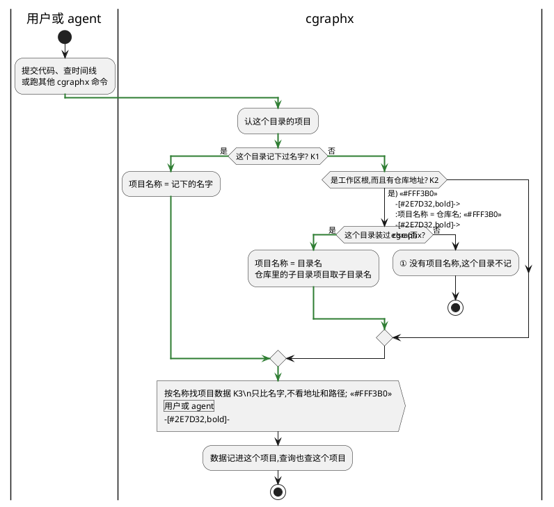

# 功能方案: 项目按名称认(讨论稿 v2)

> 讨论稿,不是契约:人终确认的那一版由 `/dev-spec` 原样收录为 spec 第一节,之后以 spec 为准,本文件不再维护。
> 图用支持 PlantUML 的 Markdown 预览打开(IDEA:设置 → 语言和框架 → Markdown → 启用 PlantUML)。

**一句话**:原来有仓库地址的项目按地址认,地址一变或同一份代码有多个地址,数据就分成几份;这次不论目录在哪、地址是什么,都按项目名称记,名字相同就是一个项目,在新目录碰上重名时提示一句。

**功能清单**

| 编号 | 功能点 | 类别 | 从哪进 → 到哪去 | 一句话 |
|---|---|---|---|---|
| F1 | 只按名称认项目 | 核心 | 记提交、查时间线、其他 cgraphx 命令 → 这个目录算哪个项目 → 项目数据 | 记下的名字优先,没记的取仓库名,再取目录名;地址和路径都不参与比较 |
| F2 | install 记下项目名称 | 支撑 | `cgraphx install` → 问名字 → 记下 → F1 | 所有项目 install 时都问一次名字并记下,之后地址再变也不换项目 |
| F3 | 重名提示 | 支撑 | 这个目录第一次跑 cgraphx 命令或 install → 提示 → 用户改名或不管 | 新目录的名字已有数据、地址又对不上时提示一次,数据照样记进去 |
| — | 按名称合并、搬动已记下的数据 | 边界外排除 | — | 不做:改名后已经记下的数据不挪,和现在一样 |
| — | 同名时阻止记录或要求确认 | 边界外排除 | — | 不做:重名也记成一个项目,只提示 |

### F1 只按名称认项目(核心)

现在:有仓库地址的按地址认,地址变了、fork 和上游、GitHub 和内网镜像都算不同项目。这次地址只用来取默认名字,不再参与比较。一个目录算哪个项目由这里决定,F2 记下的名字最优先;项目数据放在 `~/.cgraphx/projects/<名字>/`,时间线和项目级的数据库连接配置都跟着名字共用。记不记(没装过的目录、没有数据的项目)、路径怎么换算、提交记到哪、改名后旧数据不挪,都和现在一样。



边界:② 还没记下名字的目录,仓库改了名,默认名字跟着变,算新项目,已经记下的不挪;跑一次 `cgraphx install` 记下名字就不再变 ③ 两个仓库里都有 `server/` 子目录项目,都叫 `server`,算一个项目。

| 编号 | 哪一步 | 怎么判定 | 算 / 不算(例子) | 依据 |
|---|---|---|---|---|
| K1 | 这个目录记下过名字? | 在这个目录记过,或者从记过的目录开 worktree、复制出来的;别的 clone 不算 | 算:主目录记过 `cgraphx`,它的 worktree、之后开的副本;不算:另一份 clone,它按 K2 取默认名字 | git 本地配置 `cgraphx.projectName`,子目录项目 `cgraphx.<子目录>.projectName`;不在 git 仓库的 `.cgraphx/project.json` 的 `name`;沿用「数据按项目放用户目录」K6 |
| K2 | 是工作区根,而且有仓库地址? | 仓库名取 `origin` 地址的最后一段,去掉 `.git`;只看 `origin`,其他 remote 不看;子目录项目不用仓库名 | `git@github.com:smdnkB/cgraphx.git`、`https://gitlab.com/x/cgraphx` 都是 `cgraphx`;目录 `cgraphx@下掉web与平台同步`、`cgraphx-2` 也都是 `cgraphx`;没有 `origin` 的 `workflow` 走目录名 | git 配置 `remote.origin.url`;取默认名字是新定,推翻「数据按项目放用户目录」K1 的按地址认 |
| K3 | 按名称找项目数据 | 名字一字不差才算同一个,大小写算不同;项目目录名就是名字,不能做文件名的字符换成 `-`;同一个项目共用时间线和数据库连接配置 | 算一个:公司 A 和公司 B 的 `api`、fork 和上游的 `cgraphx`;B 的 `api` 跑 `cgraphx db query`,用的是 A 配的连接;不算一个:`api` 和 `API` | 项目目录里的 `identity.json`;目录名 `~/.cgraphx/projects/cgraphx`,不再是 `github.com-smdnkB-cgraphx`;新定,推翻 K7 |

### F2 install 记下项目名称(支撑)

现在:只有没地址的项目 install 时才问名字。这次都问,记下以后 F1 就不再看地址。

行为链:跑 `cgraphx install` → 问「项目名称(这个项目按名字认,同名的目录记进同一个项目)」,默认填 F1 的默认名字,已经记过的填记下的名字 → 确认后记下 → 按 F3 判断要不要提示重名 → 继续安装。带 `-y`(`cgraphx upgrade` 顺带装的也是)不问,用默认名字。

边界:① 名字为空、有换行或超过 100 个字,提示原因后重新输入,规则和现在一样 ② 不在 git 仓库的目录,名字记在本地配置里,规则和现在一样。

### F3 重名提示(支撑)

新目录记进一个已有数据的项目时,可能是同一个项目,也可能只是碰巧同名。这里只提示,数据照样记进去。worktree、副本、同地址的 clone 是同一个项目,不提示。和 F2 的关系:install 和普通命令用同一套判断,判断过一次,这个目录就不再判断。查知识库的子 agent 常常是新目录里第一个跑 cgraphx 的,它要把提示原样带回主会话,否则提示会被吞掉;「skill 版本落后」这类命令输出的提示也同样带回。

```plantuml
@startuml
skinparam backgroundColor #FFFFFF
skinparam Activity {
  BackgroundColor #F1F1F1
  BorderColor #181818
  FontColor #000000
}
skinparam Swimlane {
  BorderColor #181818
  TitleBackgroundColor #FFFFFF
  TitleFontColor #000000
}
skinparam ArrowColor #181818

|用户或 agent|
start
:在一个目录跑 cgraphx 命令\n隐藏命令和 git 钩子调起的不算;
|cgraphx|
-[#2E7D32,bold]->
:命令照常执行;
note right
  判断出错 → ② 不提示,命令结果不受影响
end note
-[#2E7D32,bold]->
if (这个目录判断过了? K4) then (否) <<#FFF3B0>>
  -[#2E7D32,bold]->
  if (这个项目已经有别的目录的数据? K5) then (是) <<#FFF3B0>>
    -[#2E7D32,bold]->
    if (是重名? K6) then (是) <<#FFF3B0>>
      -[#2E7D32,bold]->
      :输出末尾提示\n「[cgraphx] api 已经有数据(在 /Users/me/work/公司A/api 记的),\n这个目录也记进去,数据库连接配置也共用;\n不是同一个项目的话,运行 cgraphx project name 新名字」; <<#FFF3B0>>
      -[#2E7D32,bold]->
    else (否)
      -[#2E7D32,bold]->
    endif
    -[#2E7D32,bold]->
  else (否)
    -[#2E7D32,bold]->
  endif
  -[#2E7D32,bold]->
  :记下这个目录判断过了; <<#FFF3B0>>
  -[#2E7D32,bold]->
else (是)
  -[#2E7D32,bold]->
endif
|用户或 agent|
-[#2E7D32,bold]->
:看到结果和提示\n数据照样记进这个项目;
stop
@enduml
```

边界:① 提示写到错误输出,不混进 `--json` 的结果 ③ 这个目录没跑过 cgraphx 命令,在里面开的会话照样补录进项目(F1),只是看不到提示。

| 编号 | 哪一步 | 怎么判定 | 算 / 不算(例子) | 依据 |
|---|---|---|---|---|
| K4 | 这个目录判断过了? | 每个目录只判断一次,单独记,和事件有没有先记进项目无关 | 算:同一目录第二条命令不再判断;不算:新 clone 的目录,第一条命令是查时间线、事件已经先补录进去,照样判断一次 | 判断过的记录是新数据,存哪由 spec 定;新定 |
| K5 | 这个项目已经有别的目录的数据? | 项目里记过其他目录的事件;项目还是空的、只记过这个目录的,都不算 | 算:`api` 已有 `~/work/公司A/api` 的记录,现在在 `~/work/公司B/api`;不算:第一次记这个名字;升级前一直在记的主目录 | `timeline_roots.root`;新定(原来 install 时只看这个目录记没记过) |
| K6 | 是重名? | 这个目录是项目的 worktree 或登记过的副本,不算;项目还没记过地址的,先记下这个目录的地址,不算;其余情况,这个目录的地址和项目记下过的都不一样,或者这个目录没有地址,才算。ssh 和 https 写法算一样 | 提示:公司 B 的 `api`;fork 的 `cgraphx`;没有地址、复制出来的 `workflow-2`;不提示:worktree、副本(没有地址的也不提示)、同地址的另一份 clone;在已判断过的目录里改地址(K4 已经跳过) | git 工作区关系、副本登记、git 配置 `remote.origin.url`;项目记下的地址是新数据,存哪由 spec 定;新定 |

---

以下供 spec 使用,可不细读

**必须在 spec 前解决的问题**:无

**已锁定技术约束**:
- 不论物理路径和地址都按名称记,重名也记成一个项目,不阻止、不确认(用户 11-06 定);新目录碰上重名只提示(用户 11-06 定)。
- 重名时数据库连接配置也跟着名字共用,靠提示说明(用户 11-06 定);查知识库的子 agent 把 `[cgraphx]`、`cgraphx 提示` 开头的行原样带回主会话(用户 11-06 定)。
- 不写按地址建的项目目录的迁移代码:按项目放用户目录还在 dev/2.0.14,没发版、没有 v2.0.14 tag、版本号还是 2.0.13;用户确认按此做。本机那一份由开发时手动改名。
- 推翻「数据按项目放用户目录」K1(按地址认)、K7(目录名按地址);沿用它的 K3(记不记)、K4(路径换算)、K6(改名管哪些目录、旧数据不挪)、K18(提交记到哪)。

**留给 spec 的细节决策**:
- `ProjectIdentity` 的形状:去掉 `origin`,`sameIdentity`、`identityKey`、`identityKind`、`projectDirBaseName`、`identity.json` 跟着改;`needsName` 恒为真或删掉。
- 子目录项目现在的标识是地址加名字,改成只有名字。
- 项目记下的地址(K6)存哪:`timeline_roots` 加列还是项目目录里单放;什么时候写;「提示过」的记录复用 `sessions.db` 的 `notices_shown` 还是另起。
- F3 接在 `emitSessionNotices` 的 `postAction` 上,但它每个会话只出一次;F3 的判断要按目录,不能被「这个会话提示过了」跳过。
- `start_dirs` 缓存里有 `origin`、`project_dir`:没记下名字的目录仓库改名后要能重认(F1 ②),也修掉改地址后补录断更的问题。
- `agents/knowledge-recall.md` 第 114 行「命令输出都不要」加上提示行例外;`project/name.ts:209` 的 `installNotice` 改走 K5、K6,判断过的记录和普通命令共用,没有根时不再写「在 — 记的」;K4 的判断要在补录之前读或不依赖 `timeline_roots`(`timeline/cli.ts:173` 在 action 里先补录,`postAction` 在之后)。
- `repo-projects.ts` 一个仓库几个项目时的标识;`project show`、`project list` 显示地址的地方;`renameLines` 里「别的 clone 照旧记在那里」的提示。
- 知识库「项目」「并旧数据」、本仓库 CLAUDE.md(项目定位一段)、`cgraphx-guide` 跟着改。

**影响半径与风险**:MEDIUM。认项目是基础层,时间线补录、提交记录、并旧数据、`project` 命令都依赖它,但只改认法,不改数据格式以外的流程。最大的风险是重名把不相干项目的时间线混在一起,事后拆不开,数据库连接配置也会共用,可能查错库(工具只读,不会改数据);这是用户接受的代价,靠 F3 提示缓解。

**现实约束清单**

| 表 / 现有实现 | 事实 |
|---|---|
| 认标识 | `src/core/project-identity.ts`:`readRootIdentity`(工作区根:记的名字 → origin → 装过才用目录名;子目录:记的名字 → 装过才用子目录名,标识带 origin);`needsNameOf` 决定 install 问不问;一次 `git config -z --get-regexp` 取齐 origin、`insteadOf`、`cgraphx.*` |
| 名字存放 | 工作区根 `cgraphx.projectName`,子目录 `[cgraphx "<子目录>"] projectName`,都是本地 git 配置,worktree 共用、`cp -R` 带着、新 clone 没有;不在 git 仓库的存 `.cgraphx/project.json` |
| 项目目录 | `src/core/user-data-dir.ts`:`projectDirBaseName`(按 origin 转成 `github.com-demo-app`)、`findProjectDir` 按 `identity.json` 比标识、`ensureProjectDir` 建目录,同名不同标识加 `-2` |
| 用到 origin 的代码 | `user-data-dir.ts`、`session-index.ts`(`identityKey`、`start_dirs`、`removed_projects`)、`repo-projects.ts:82`、`project/name.ts`、`project/show.ts`、`timeline/ingest/ingest.ts`(`classifyStartDir`);`__tests__` 里 6 个文件提到 origin |
| install 问名字 | `src/cli/installer/project-steps.ts` 的 `recordProjectName` 看 `planInstallName().needsName`;提示「项目名称(这个项目按名字认,同名的目录记进同一个项目)」;`project/name.ts` 的 `installNotice` 已有「已经有数据(在 … 记的)」 |
| 命令输出提示 | `src/core/session-notices.ts` 的 `emitSessionNotices`,由 `src/cli/index.ts:346` 的 `postAction` 调;写 stderr;按会话或按天只出一次 |
| 改地址后的断更 | `timeline/ingest/ingest.ts` 的 `classifyStartDir`:认到过项目的直接用 `start_dirs` 缓存,只有 `project name` 会清;读代码得出,没实测 |
| 数据库连接配置 | `src/core/dbquery/config.ts`:项目级 `db-profiles.json` 放在数据目录,同名配置覆盖用户级 |
| 查知识库的子 agent | `assets/claude-template/agents/knowledge-recall.md`:先跑 `cgraphx docs concepts --json`,规定命令输出不返回 |
| 项目出现过的目录 | `timeline_roots.root`,记事件时 upsert;`timeline/roots.ts` |
| 本机数据 | `~/.cgraphx/projects/github.com-smdnkB-cgraphx`,78MB,是目前唯一一个项目目录 |
| 发布状态 | `package.json` 版本 2.0.13,最新 tag v2.0.13,按项目放用户目录(5b0a344)不在 main |
