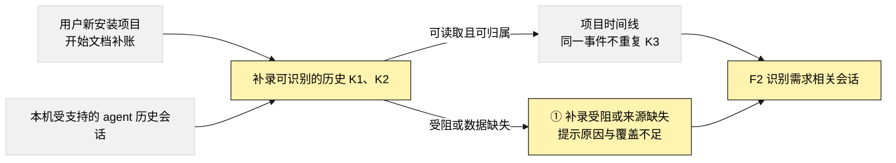
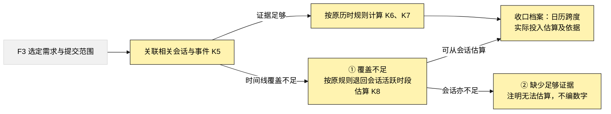
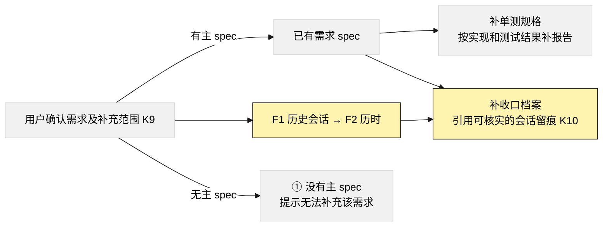

# 规格说明：Codex 历史会话补录

> 产物: spec
> feature-id: 2026-11-16-Codex历史会话补录
> 负责人: liulongfei
> 日期: 2026-11-16

## 功能方案

> 原样收录功能方案 v5；业务变更回 clarify 确认。

**一句话**：开发者使用受支持的 AI 编程工具一段时间后才安装 cgraphx，也能在补充需求收口文档时，利用可获得的历史会话还原该需求的实际投入和开发留痕。

**功能清单**

| 编号 | 功能点 | 类别 | 从哪进 → 到哪去 | 一句话 |
|---|---|---|---|---|
| F1 | 历史会话可用 | 核心 | 新安装项目 → 查询历史 → 需求收口 | 安装前保存在本机且可识别项目归属的受支持 agent 会话可用于后续收口 |
| F2 | 需求实际投入与开发历史 | 核心 | 文档补账 → 选定需求 → 收口档案「历时」 | 保留原有日历跨度和小时级实际投入估算要求，基于需求相关会话与提交证据，注明证据覆盖情况 |
| F3 | 按既有规范补文档 | 支撑 | 选定已有 spec 的需求 → 单测规格、报告或收口档案 | 沿用文档补账范围；有会话证据时用于收口中可查证的历史，缺失时说明并按原规则补充 |
| — | 重新建设平台同步或旧版开发任务系统 | 边界外排除 | — | 不把恢复旧系统作为前提 |

**已由用户明确**：后续改造不能降低原 `dev-end` 对「历时」的要求。历史会话数据是否存在或能否归属，会影响估算覆盖，不能把日历跨度当成实际投入。

### F1 历史会话可用（核心）

用户在项目新安装 cgraphx 后进入文档补账：先让安装前保存在本机的受支持 agent 会话进入项目时间线，再交给 F2 按需求筛选。事件不全或来源缺失时必须让用户知道，不能把没采到当作没有发生。

| 编号 | 哪一步 | 怎么判定 | 算 / 不算（例子） | 依据 |
|---|---|---|---|---|
| K1 | 找会话 | 读取本机仍存在、符合现有项目数据删除边界的受支持 agent 会话，不按安装时间截断；Codex 只读取未归档会话 | 未删除过项目数据时，安装前三个月的文件仍在且归属项目则纳入；主动删除项目数据前的事件不自动补回；已删除或仅在另一台机器上的文件无法纳入 | 现有 agent 会话来源；Codex 不覆盖归档会话 |
| K2 | 认项目 | 依据会话开始目录和已有项目识别规则；无法确认归属的不强行归入 | 属于当前项目的主目录或可识别副本可纳入；其他项目或无法识别的目录不算 | 会话头中的开始目录；沿用现有项目归属 |
| K3 | 记事件 | 沿用现有事件种类、去重及项目数据删除边界；事件保留原发生时间 | 同一提问补录两次只记一次，安装前发生的仍显示原日期 | `timeline_events.source_key`、`timeline_events.ts`；沿用现有时间线 |
| K4 | 缺失及失败 | 无文件、无法归属、读取失败或项目数据尚未就绪时说明原因；已成功部分仍可作为有限证据 | 读取 10 个文件中 1 个失败时提示覆盖不足，不报完整 | 补录结果及会话文件可用性；新增反馈，具体存储由 spec 定 |

🎭 体验决策：运行文档补账时自动检查并补录，再继续收口。

### F2 需求实际投入与开发历史（核心）

沿用用户恢复的 `dev-end` 历时要求：收口同时写日历跨度和到小时的实际投入估算；历史会话、需求证据和提交记录共同用于还原。原规则中的 `task-history` 已移除，具体怎样接回新链路留给 spec；用户看到的历时口径不降低。

| 编号 | 哪一步 | 怎么判定 | 算 / 不算（例子） | 依据 |
|---|---|---|---|---|
| K5 | 关联会话 | 结合需求名称、提交、独占文件及会话内容判断；可明确归属的先算，混合会话结合证据估算所属范围 | 会话只做该需求且有证据则算；同一会话做两个需求时不把整段无条件算给其中一个 | 旧版 `task-history` 四类锚点；现有看板关联有定挂与可能相关，等价性未核实 |
| K6 | 日历跨度 | 需求范围内首末提交日期，首尾两天都算 | 11 月 1 日到 11 月 3 日为 3 天；同日为 1 天 | 用户恢复的 `dev-end` 规则；沿用 |
| K7 | 实际投入 | 严格沿用 task-history：先筛选与需求相关的事件，再按本地日期分组、每组按时间排序；相邻事件间隔超过 1 小时则断开，累计各段首末时间差，结合归属证据给出投入小时范围；提交时间作佐证 | 同一天 09:00、10:00、13:00、14:00 为两段合计 2 小时；整 1 小时不断开，超过 1 小时断开；跨午夜按本地日期分开；混合会话给小时范围 | Git 历史中的 `task-history` 活跃时长规则与用户恢复的 `dev-end` 规则；沿用 |
| K8 | 覆盖不足 | 同一相关活跃段至少有两个有时间的事件才可计算该段；时间线不足而原始会话有可计算时段时，按原规则回退估算并标为非时间线实测；仍不足时写无法估算 | 只找到一个事件时不能计算该段，不写「0 小时」；会话有可计算时段可回退；均不足时写无法估算 | 用户恢复的 `dev-end` 覆盖不足回退规则；无法估算为新定边界 |

🎭 体验决策：混合会话直接给出投入小时范围，不要求用户逐时段确认，也不额外标注不确定性。

### F3 按既有规范补文档（支撑）

补账仍先核实有提交记录的需求、已有主 spec 和用户选择的产物范围。F1 的历史会话供 F2 使用，也可为收口档案提供可核实的会话留痕；单测规格仍按 spec 生成，单测报告仍以真实测试结果为准。

| 编号 | 哪一步 | 怎么判定 | 算 / 不算（例子） | 依据 |
|---|---|---|---|---|
| K9 | 选需求和产物 | 有本人提交记录的需求列为候选，用户确认需要补的需求和单测规格、报告、收口档案范围；已有产物不覆盖 | 有 spec 和缺失收口档案可补；无主 spec 提示无法补充 | `doc-backfill` 现有规则；沿用 |
| K10 | 引用会话 | 标为会话来源的内容必须能在原始会话中核实；取不到原文时标明来源不足，不能把推断冒充会话记录 | 找到会话中实际提过的问题可附会话定位；仅凭提交推断不能标「AI 会话」 | 用户恢复的 `dev-end` 会话来源规则；沿用 |

## 怎么实现

### 细节方案：F1 历史会话可用

| # | 决策 | 选择 | 没选的（为什么） | 理由（依据） | 影响面 |
|---|---|---|---|---|---|
| D1 | 统一补录边界 | 在既有 `ensureTimelineUpToDate` 中实现所有已登记来源的完整补录；`board`、时间线查询和安装共用这一入口。历史完整性按结果定义：未删除项目数据时首次从头读，以后按安全偏移增量读；项目主动删除后的事件过滤及重建行为沿用现状。 | 专用 `backfill-codex` 或每次重读所有文件——重复入口或无谓重复解析 | `board/compute.ts:89`、`timeline/ingest/ingest.ts:75`、`session-index.ts:8`；K1–K3 | 所有 agent 的通用补录；删除时间过滤及删除后的行为不变 |
| D2 | 来源、归属与去重 | 通过 `listSessionSources` 和来源自己的适配器枚举及读取；按现有开始目录识别项目，从不将其他项目会话强行归入。Codex 仍只读取 `CODEX_HOME/sessions`，不读归档；其他来源使用各自已支持的位置与格式。事件复用 `source_key` 去重。新注册来源自动复用通用补录，无需另设 agent 专用命令。 | 固定写死来源列表或修改原始会话文件 | `agents/profiles.ts:98`、`ingest.ts:480`、`schema.sql:47`；K1–K3 | 适配器、项目数据库及归属；保持原始会话只读 |
| D3 | 全量恢复与增量 | 未删除项目数据时，新安装或重建先完整读取可归属历史；正常补录保留增量与去重；项目主动删除后沿用现有删除记录、偏移和重建逻辑，文件事务提交后再更新对应进度；不清空其他项目进度，不删除既有 Git 提交或其他事件。 | 修改所有文件偏移为 0 后全库重建——影响其他项目及已有数据 | `ingest.ts:477`、`rebuild.ts:330`、`session-index.ts:8`；K1、K3 | 用户级索引与项目库；不新增表，不依赖每次全量扫描 |
| D4 | 补账调用与状态 | `$doc-backfill` 在生成收口档案前调用现有时间线查询触发共享补录，读取共享补录的完成/失败提示；`board` 继续按项目调用同一入口。锁竞争、来源不可读、目录无法归属、关闭采集和旧数据未合并时明确提示，已成功事件保留并按 F2 使用；无数据不能视为 0 小时。 | 新增 `backfill-codex` 或启动 `board` 网页作为补账前置——前者重复通用功能，后者启动与补账无关的服务 | `board/compute.ts:89`、`timeline/cli.ts:171`、`ingest.ts:113`；K4 | 通用补录结果与提示、doc-backfill；原 CLI 的标准输出保持兼容 |

**补录状态契约（D4）**：沿用 `timeline query` 的 stdout 和退出码；每次查询前的补录在 stderr 输出 `[timeline] 补录状态: complete`、`[timeline] 补录状态: partial` 或 `[timeline] 补录状态: blocked` 一行，并继续输出现有具体原因提示。`complete` 表示已完成本次已安装、可用来源的处理；单文件失败、已探测到的来源无法读取或无法归属为 `partial`；锁竞争、采集关闭、旧库未合并、项目库不可用或全局失败为 `blocked`。未安装或不存在会话目录的来源不单独判失败；所有来源都没有文件时为 `partial` 并说明无来源。`doc-backfill` 捕获该状态和原因，传给 filler；缺少状态、命令出错时按覆盖不足处理。`board` 可继续使用原状态和提示，不改变对外 JSON 格式。

**并发和持久化**：共用既有项目 ingest 锁；逐文件提交事件后更新安全偏移。读取失败单文件隔离并留待下次重试，不能推进失败文件的偏移；部分成功不能报为完整。中断、重复补录和旧数据残留依来源键幂等。保留 `CGRAPHX_NO_TIMELINE`；不自动安装或合并旧库。保持原 `removed_projects` 删除时间过滤、旧偏移和重建分支原有行为。

### 细节方案：F2 需求实际投入与开发历史

| # | 决策 | 选择 | 没选的（为什么） | 理由（依据） | 影响面 |
|---|---|---|---|---|---|
| D5 🔒 | 收口与历史分析入口 | 恢复原 task-history 方法并以各受支持宿主可调用的 skill 形式提供；dev-end 使用它生成收口档案，doc-backfill 的 filler 沿用既有调用链。不恢复已退役的平台和任务表。 | 只恢复 `.claude/agents/task-history.md`——Codex 安装仅部署 skills | `agents/profiles.ts:69`、Git 历史中的 task-history、`doc-backfill/filler-prompt.md`；F2、F3 | 安装资产和 skill 调用边界，废弃清理规则需兼容新入口 |
| D6 | 需求关联 | 用需求提交、独占文件、提问关键词、时间窗识别关联会话，混合会话结合内容划分相关事件。看板命中可供参考，不将会话首末跨度直接当成工作时长。独占及明确归属的事件算下界，混合会话有依据的候选事件合并计算上界。 | 把项目全部事件或混合会话全部时长直接计入需求 | 旧 task-history 的四类锚点；`board/match.ts:134`、`:227`；K5 | 收口时的关联与事件筛选 |
| D7 | 活跃时长 | 对需求相关事件按本地日期分组、时间升序，相邻间隔超过 1 小时断开，累计每段首末时间差；每段至少两个有时间的事件。下界、上界分别按同一算法计算，输出小时范围；不要求用户确认混合时段，不额外标注不确定性。 | 直接取会话首末差或项目总活跃时长 | 原 task-history 算法、K7；`timeline/store.ts:291` 不等价 | task-history 结果及收口档案；不新增时间统计持久化 |
| D8 | 覆盖不足 | 时间线不足而原始会话有可计算时段时，按原规则估算并标记非 timeline 实测；仍不足则写「无法估算」，不将单条事件或无数据写成 0。 | 以日历跨度或提交间隔代替工作时长 | 用户确认的 K8；原 dev-end 规则 | 结果及异常提示 |
| D9 🔒 | 完整读取 | 复用 timeline 查询及本地事件数据；针对现有查询单次最多 10000 条的限制，在既有 `timeline query` 增加可选分页模式，以 `(ts,id)` 升序游标和首次查询时的最大 id 为快照上界；后续页带回游标及上界，保证同时间戳不漏不重，原查询默认输出兼容。计算直接使用本地数据，不新增 `history-events` 专用命令。 | 静默截断为最近 10000 条，或为算时长单独引入一个新事件查询接口 | `timeline/store.ts:246`、`:265`；K5–K8 | 既有查询能力，分页模式返回事件、快照上界与下一游标，直到下一游标为空 |

**分页接口契约（D9）**：在现有 `cgraphx timeline query` 增加 `--paged` 和 `--cursor <token>`。首次用 `--paged --format json`，可结合既有 `--since`、`--until`、`--type`、`--tool`、`--file`、`--session`、`--turn` 和 `--limit`；后续同样使用 `--paged --format json --cursor <token>`，游标保留首次已规范化的筛选条件与快照边界，后续不得附加筛选或改变每页大小。分页输出 `{ "events": [...], "next_cursor": "..." | null }`，按 `(ts,id)` 升序；游标采用 base64url 编码的 UTF-8 JSON，含上一条事件的 `ts`、`id`、首次读取的 `snapshot_max_id`、数据库文件设备号与 inode、规范化筛选条件及页大小。首页在同一只读连接取得最大 id 和数据，续页约束 `id <= snapshot_max_id` 且 `(ts,id)` 严格大于游标；空页或最后一页的 `next_cursor` 为 null。游标损坏、参数冲突、非 JSON 分页返回参数错误（沿用 timeline ArgError 退出码 3）；查询错误沿用现有错误映射。未使用 `--paged` 时原参数、倒序 JSON 数组 / table 输出及行为保持不变。分页快照只隔离后续新增事件，数据库被删除或设备号 / inode 改变时必须返回参数错误并要求重新查询。

**计算契约**：先收集全部相关事件并对同一事件去重，再分别对下界和包含候选事件的上界计算，避免简单相加重叠会话。按本地自然日切分；1 小时整不断开、超过 1 小时断开；不能形成任何可计算段时为「无法估算」。原始会话定位由现有会话索引提供；获取不到或无法确认内容时不可冒充已读原文。

### 细节方案：F3 按既有规范补文档

| # | 决策 | 选择 | 没选的（为什么） | 理由（依据） | 影响面 |
|---|---|---|---|---|---|
| D10 | 补账编排 | 保留本人 Git 作者筛选、用户选择产物及确认清单、逐需求串行 filler、已有文档不覆盖；补录状态作为上下文传给 filler。 | 每个需求单独另起一套补录流程 | `doc-backfill/SKILL.md`；K9 | doc-backfill、filler 模板 |
| D11 | 会话来源与文档 | 收口从 task-history 取得历时；知识命中/缺口/新确认必须读原会话确证并能定位；无原文不能标为会话来源。单测规格取 spec，单测报告以真实执行结果为准。 | 使用 timeline 摘要冒充会话原文 | 原 dev-end 和单测 skill；K10 | 收口文档与测试产物 |

### 全局约束

- 全量指符合现有项目数据删除边界的所有受支持来源的可识别项目事件都可查询，不要求每次重新解析已经安全入库的所有文件；相同来源事实去重。
- 项目数据主动删除后沿用现有规则，不自动补回删除前历史；不同项目数据隔离。Codex 归档会话不纳入。
- 采集开关关闭或旧库未合并时明确提示，不绕过关闭开关，不自动迁移旧库。
- 不以 Git 日历跨度或单个事件替代实际投入；不恢复旧平台和任务表。不新增数据库表；若需要调整 schema，按 `docs/guides/data-standards.md` 执行。

## 设计验收

| # | 对应 | 验收点 | 怎么验 |
|---|---|---|---|
| 1 | D1–D3 | 各受支持来源的新安装历史进入所属项目；删除项目数据后的旧偏移、删除时间过滤及重建行为与现有版本一致 | 隔离用户目录集成测试 |
| 2 | D2–D4 | 重复补录不重复，失败重试、锁竞争、文件追加不丢数据，不污染其他项目；board、查询、补账共享结果 | 故障注入及跨入口集成测试 |
| 3 | D4 | 关闭、读取失败、旧库未合并和无来源有明确反馈；部分成功不称完整 | CLI 和补账流程验证 |
| 4 | D5、D10 | 各支持宿主能运行 doc-backfill → dev-end → task-history，旧资产清理不删除新入口 | 安装与工作流测试 |
| 5 | D6–D8 | 独占和混合会话、1 小时边界、跨午夜、单事件和原会话回退符合 K5–K8 | 固定时区事件样本验证 |
| 6 | D9 | 超过 10000 事件及相同时间跨页时不漏不重，原查询默认格式不变 | 查询集成测试 |
| 7 | D11 | 无原始会话不能宣称会话来源；测试未执行或失败如实报告 | 文档工作流样本验证 |

## 待确认项

- 无。
