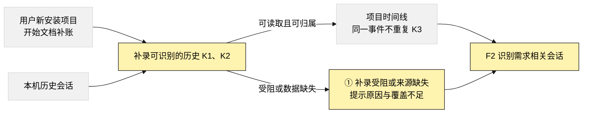
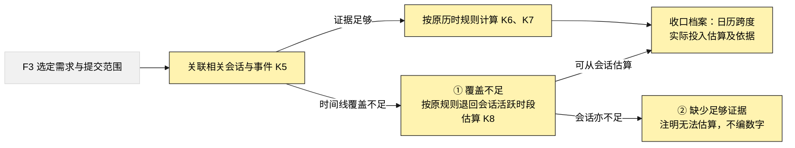
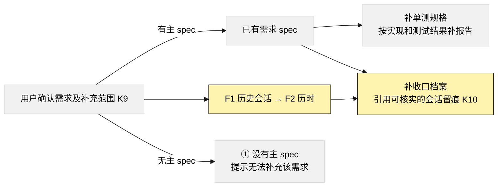

# 功能方案：Codex 历史会话补录（讨论稿 v2）

> 讨论稿，不是契约；功能清单、图和口径供最终确认。

**一句话**：开发者使用 Codex 一段时间后才安装 cgraphx，也能在补充需求收口文档时，利用可获得的历史会话还原该需求的实际投入和开发留痕。

**功能清单**

| 编号 | 功能点 | 类别 | 从哪进 → 到哪去 | 一句话 |
|---|---|---|---|---|
| F1 | 历史会话可用 | 核心 | 新安装项目 → 查询历史 → 需求收口 | 安装前保存在本机且可识别项目归属的 Codex 会话可用于后续收口 |
| F2 | 需求实际投入与开发历史 | 核心 | 文档补账 → 选定需求 → 收口档案「历时」 | 保留原有日历跨度和小时级实际投入估算要求，基于需求相关会话与提交证据，注明证据覆盖情况 |
| F3 | 按既有规范补文档 | 支撑 | 选定已有 spec 的需求 → 单测规格、报告或收口档案 | 沿用文档补账范围；有会话证据时用于收口中可查证的历史，缺失时说明并按原规则补充 |
| — | 重新建设平台同步或旧版开发任务系统 | 边界外排除 | — | 不把恢复旧系统作为前提 |

**已由用户明确**：后续改造不能降低原 `dev-end` 对「历时」的要求。历史会话数据是否存在或能否归属，会影响估算覆盖，不能把日历跨度当成实际投入。

### F1 历史会话可用（核心）

用户在项目新安装 cgraphx 后进入文档补账：先让安装前保存在本机的 Codex 会话进入项目时间线，再交给 F2 按需求筛选。事件不全或来源缺失时必须让用户知道，不能把没采到当作没有发生。

| 编号 | 哪一步 | 怎么判定 | 算 / 不算（例子） | 依据 |
|---|---|---|---|---|
| K1 | 找会话 | 读取本机仍存在的 Codex 未归档会话；项目曾主动删除数据时，只补删除之后的事件 | 安装前三个月的文件仍在且事件发生在项目数据删除之后则纳入；删除之前的事件不补回；已删除或仅在另一台机器上的文件无法纳入 | Codex 会话文件；现有来源 `CODEX_HOME/sessions`；不覆盖归档会话 |
| K2 | 认项目 | 依据会话开始目录和已有项目识别规则；无法确认归属的不强行归入 | 属于当前项目的主目录或可识别副本可纳入；其他项目或无法识别的目录不算 | 会话头中的开始目录；沿用现有项目归属 |
| K3 | 记事件 | 沿用现有事件范围和去重；事件保留原发生时间 | 同一提问补录两次只记一次，安装前发生的仍显示原日期 | `timeline_events.source_key`、`timeline_events.ts`；沿用现有时间线 |
| K4 | 缺失及失败 | 无文件、无法归属、读取失败或项目数据尚未就绪时说明原因；已成功部分仍可作为有限证据 | 读取 10 个文件中 1 个失败时提示覆盖不足，不报完整 | 补录结果及会话文件可用性；新增反馈，具体存储由 spec 定 |

🎭 体验决策：运行文档补账时自动检查并补录，再继续收口。

### F2 需求实际投入与开发历史（核心）

沿用用户恢复的 `dev-end` 历时要求：收口同时写日历跨度和到小时的实际投入估算；历史会话、需求证据和提交记录共同用于还原。原规则中的 `task-history` 已移除，具体怎样接回新链路留给 spec；用户看到的历时口径不降低。

| 编号 | 哪一步 | 怎么判定 | 算 / 不算（例子） | 依据 |
|---|---|---|---|---|
| K5 | 关联会话 | 结合需求名称、提交、独占文件及会话内容判断；可明确归属的先算，混合会话结合证据估算所属范围 | 会话只做该需求且有证据则算；同一会话做两个需求时不把整段无条件算给其中一个 | 旧版 `task-history` 四类锚点；现有看板关联有定挂与可能相关，等价性未核实 |
| K6 | 日历跨度 | 需求范围内首末提交日期，首尾两天都算 | 11 月 1 日到 11 月 3 日为 3 天；同日为 1 天 | 用户恢复的 `dev-end` 规则；沿用 |
| K7 | 实际投入 | 严格沿用 task-history：先筛选与需求相关的事件，再按本地日期分组、每组按时间排序；相邻事件间隔超过 1 小时则断开，累计各段首末时间差，结合归属证据给出投入小时范围；提交时间作佐证 | 同一天 09:00、10:00、13:00、14:00 为两段合计 2 小时；整 1 小时不断开，超过 1 小时断开；跨午夜按本地日期分开；混合会话给小时范围 | Git 历史中的 `task-history` 活跃时长规则与用户恢复的 `dev-end` 规则；沿用 |
| K8 | 覆盖不足 | 同一相关活跃段至少有两个有时间的事件才可计算该段；时间线不足而原始会话有可计算时段时，按原规则回退估算并标为非时间线实测；仍不足时写无法估算 | 只找到一个事件时不能计算该段，不写「0 小时」；会话有可计算时段可回退；均不足时写无法估算 | 用户恢复的 `dev-end` 覆盖不足回退规则；无法估算为新定边界 |

🎭 体验决策：混合会话直接给出投入小时范围，不要求用户逐时段确认，也不额外标注不确定性。

### F3 按既有规范补文档（支撑）

补账仍先核实有提交记录的需求、已有主 spec 和用户选择的产物范围。F1 的历史会话供 F2 使用，也可为收口档案提供可核实的会话留痕；单测规格仍按 spec 生成，单测报告仍以真实测试结果为准。

| 编号 | 哪一步 | 怎么判定 | 算 / 不算（例子） | 依据 |
|---|---|---|---|---|
| K9 | 选需求和产物 | 有本人提交记录的需求列为候选，用户确认需要补的需求和单测规格、报告、收口档案范围；已有产物不覆盖 | 有 spec 和缺失收口档案可补；无主 spec 提示无法补充 | `doc-backfill` 现有规则；沿用 |
| K10 | 引用会话 | 标为会话来源的内容必须能在原始会话中核实；取不到原文时标明来源不足，不能把推断冒充会话记录 | 找到会话中实际提过的问题可附会话定位；仅凭提交推断不能标「AI 会话」 | 用户恢复的 `dev-end` 会话来源规则；沿用 |

---

以下供 spec 使用，可不细读。

**现实约束清单**

- 已核实：安装的 cgraphx 2.0.16 包含 Codex 会话读取器；本机 cgraphx 主目录的 14 个历史会话文件可由已安装读取器解析出会话头、提问、工具调用和轮次结束事实。尚未核实实际入库及需求归属。
- 已核实：需求副本 `cgraphx project show --json` 当前报告 legacy 模式；旧数据尚未合并时补录入口返回 skipped-legacy（`src/core/timeline/ingest/ingest.ts:82`）。
- 已核实：需求副本现有 `assets/claude-template/commands/dev-end.md` 只要求日期跨度；用户恢复的两层历时规则位于主目录同路径，尚未出现在此副本。用户恢复内容要求按小时估算实际投入，派 task-history 从 timeline 取工作量结论，覆盖不足时回退到会话活跃时段估算，注明局限。
- 已核实：旧版 task-history 模板可由 Git 历史 `7189124^:assets/claude-template/agents/task-history.md` 读取；它按提交、文件、提问和时间窗口推断需求关联，使用相邻事件间隔超过 1 小时切段，明确混合会话和覆盖不足造成的不确定性。
- 已核实：旧版 task-history 已随改造下线，并被列入 `assets/claude-template/deprecated-assets.json` 的安装清理清单；直接恢复调用指令不等于恢复可用依赖。
- 已核实：`src/core/board/compute.ts` 已有需求与会话的定挂、可能相关等关联结果；是否能完整支撑历史工作量，尚未逐条验证。
- 已核实：`doc-backfill` 的测试规格基于 spec；测试报告依赖现有实现和真实测试；收口档案由 dev-end 流程补充。

**高风险断言**：历史会话都可归属到需求；本机历史数据足以估算所有投入；新看板关联规则与旧工作量口径等价。以上均未核实，需在逐点澄清中明确边界。

**必须在 spec 前解决的问题**：无。

**审核回修**：沿用项目主动删除数据后的边界；至少两个有时间的相关事件才计算活跃段，证据不足时不写 0；活跃时长按原 task-history 分段累计。

**已锁定技术约束**：保留原有历时要求；不覆盖归档会话。

**影响半径与风险**：MEDIUM；历史资料缺失或需求归属不清会影响估算覆盖。

**后续阶段的决策**：task-history 原样恢复还是适配新的数据链路，属于实现机制；但最终可见的历时口径、证据覆盖及缺失提示必须在功能方案阶段确定。
