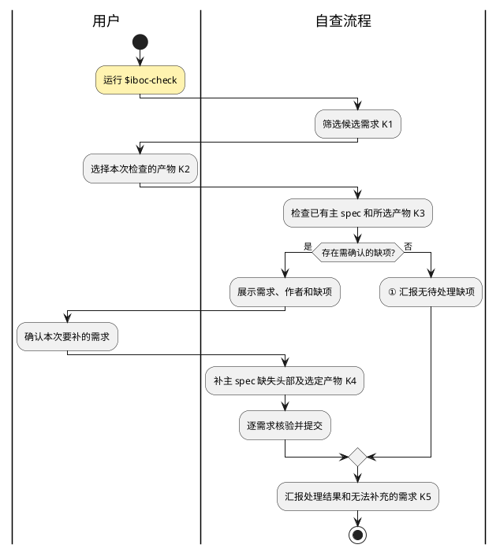

# 规格说明：补账流程优化

> 产物: spec
> feature-id: 2026-11-16-补账流程优化
> 负责人: liulongfei
> 日期: 2026-11-17

## 功能方案

> 原样收录用户终确认的功能方案 v2。业务行为变更须先回到澄清阶段。

送检前通过 IBOC 自查发现文档缺项，经确认后补齐，并保持需求收口和历史分析可用。

| 编号 | 功能点 | 分类 | 从哪进 → 到哪去 |
|---|---|---|---|
| F1 | IBOC 送检前自查与补齐 | 核心 | 运行 `$iboc-check` → 查看缺项并确认 → 补齐选定产物 → 汇报 |
| F2 | 收口与历史分析定义统一 | 支撑 | 需求收口 → 历史分析 → 收口档案 |
| — | 不自动覆盖已有产物或推送提交 | 边界外排除 | — |

### F1 IBOC 送检前自查与补齐（核心）

现在通过 `$doc-backfill` 进入文档补账；改后入口叫 `$iboc-check`，定位为 IBOC 送检前自查。原有选择产物、确认缺项后补齐的行为沿用。

| 编号 | 哪一步 | 怎么判定 | 例子 | 依据 |
|---|---|---|---|---|
| K1 | 筛选候选需求 | 需求目录有提交，且作者包含当前 Git 用户 | 有本人提交的需求进入候选；目录无提交则不进入 | 沿用现有文档补账规则 |
| K2 | 选择产物 | 可选单测规格、单测报告、收口档案，默认全选；未选的不检查、不补 | 只选收口档案时，不把缺单测报告列为缺项 | 沿用现有文档补账规则 |
| K3 | 检查缺项 | 检查主 spec 头部三项及所选产物；无主 spec 的列为无法补充 | 头部齐全且所选产物均存在则跳过 | 沿用现有文档补账规则 |
| K4 | 补齐 | 只处理用户确认的需求，已有头部行和产物不覆盖；每个需求独立核验后提交 | 已有测试报告不重写 | 沿用现有文档补账规则 |
| K5 | 汇报 | 汇报所选范围、处理结果、无法补充项和测试未执行或失败情况 | 无主 spec 的需求提示无法补充 | 沿用现有文档补账规则 |

### F2 收口与历史分析定义统一（支撑）

需求收口和历史分析都保留 skill 定义，不再保留同名 agent 定义，收口时仍取得历史分析结果。既有支持的宿主都应能完成需求收口；用户看到的历时及覆盖说明沿用现有规则。

行为链：补收口档案 → 分析需求历史和实际投入 → 写入日历跨度、投入范围及覆盖情况 → 返回补账结果。

边界：① 证据不足时写明无法估算，不把无数据写成零小时；② 已有收口档案不重写；③ 移除独立的 dev-end 和 my-query 指令文件，安装升级时清理旧文件，需求收口仍由 dev-end skill 提供。

| 编号 | 哪一步 | 怎么判定 | 例子 | 依据 |
|---|---|---|---|---|
| K6 | 历史分析 | 结合需求相关提交和会话证据估算；覆盖不足时注明或无法估算 | 找不到可计算的会话时段时写无法估算 | 沿用现有需求收口和历史分析规则 |

## 怎么实现

### 细节方案：F1 IBOC 送检前自查与补齐

| # | 决策 | 选择 | 没选的（为什么） | 理由（依据） | 影响面 |
|---|---|---|---|---|---|
| D1 🔒 | 对外入口与定位 | 将发布模板 `skills/doc-backfill/` 更名为 `skills/iboc-check/`，frontmatter `name` 为 `iboc-check`，保留 `disable-model-invocation: true`；标题为「IBOC 送检前自查与补齐」。升级后以新名称作为唯一入口，不保留同名旧逻辑或旧名包装入口 | 同时保留两个入口：旧名称持续传播且安装中出现两套入口 | F1；现有 `assets/claude-template/skills/doc-backfill/SKILL.md` 的手动触发和目录组织 | 用户调用名称、已安装项目升级、活动说明文档 |
| D2 | 检查范围与执行口径 | K1—K5 沿用当前发布模板；更名不扩张为新的内容质量评审或外部送检服务。保留现有 filler 模板、状态协议、串行补全、核验和逐需求提交约束 | 仅检查不补齐：与 F1 冲突；顺便新增 IBOC 检查项：本次未确认新的规范条款 | 已确认功能方案；现有 `skills/doc-backfill/{SKILL.md,filler-prompt.md}` | 指令、提示与介绍文字，现有业务行为 |
| D3 | 升级清理 | 从废弃清单移除 `skills/iboc-check`，加入 `skills/doc-backfill`；沿用安装器复制新资产后清理旧路径的机制，不增加存储迁移或旧名 CLI | 只改目录不改清理清单：会删除刚部署的新 skill；靠用户手删旧目录：不能消除双入口 | `src/cli/installer/claude-assets.ts:164` 的清理顺序；`assets/claude-template/deprecated-assets.json` | Claude Code、CodeBuddy、Codex 的安装、升级、卸载 |
| D4 | 指令适配与引用 | Codex 的现有斜线指令转换前缀增加 `iboc`，使活动模板内 `/iboc-check` 转为 `$iboc-check`。同步活动流程地图、指南及其 HTML、仍在使用的 skill 交叉引用；历史需求方案、spec 和历史报告保留原名称 | 机械替换全仓库历史：会篡改历史契约；只改标题：留下不可用指令 | `src/core/agents/profiles.ts:72`；`src/core/agents/index.ts:128`；`assets/claude-template/FLOW-MAP.md` 及 `skills/cgraphx-guide/` | 各宿主的用户指令与使用说明 |

K1—K5 的落地规则：

- K1：在目标项目执行 `git config user.name`；对需求目录执行 `git log --format='%an' -- docs/features/<目录>`，按作者显示名完全相等判断候选。有提交但未命中当前用户的不自动进入待办。
- K2、K3：继续调用 `cgraphx features show <feature-id>` 读取 `spec`、`unit_test_spec`、`unit_test_report`、`closure_record`；主 spec 的 `feature-id`、`负责人`、`日期` 三行仍读取原文件核实。产物范围控制齐全判断与补全，两处共用同一次用户选择。无主 spec 的需求不创建替代 spec。
- K4：按已确认清单补缺头部，值依次来自需求目录名、当前 Git 作者、目录中的日期；沿用原模板删除多余头部字段的处理，保持已有三项取值及正文不变。已有产物由 filler 开工前复核后跳过；补全仍由 `unit-spec`、`unit-code`、`dev-end` 承担。
- K4、K5：缺项/归属确认、按依赖顺序补全、状态报告和每需求独立提交沿用原模板。仅缺头部不派 filler。真实测试失败、未执行和受阻状态照实汇报，不把产物生成等同于测试通过。
- 沿用原发布模板的项目级预补录：待办非空且所选范围含收口档案时，执行一次 `cgraphx timeline query --limit 1`，丢弃 stdout、保存 stderr 状态及原因；不将此最小查询结果拿来估算时长。状态与提交线索经 filler 传入 D7；命令失败或状态缺失时继续按覆盖不足处理。

迁移与兼容：

| 对象 | 升级后要求 |
|---|---|
| 首次安装 | 只有 `skills/iboc-check/SKILL.md` 和其 `filler-prompt.md`，无 `skills/doc-backfill` |
| 已装旧 `doc-backfill` | 部署新目录并按废弃清单清理包自带旧目录；已有需求文档、测试和收口档案不迁移、不改名 |
| 更早版本遗留的 `iboc-check` | 新发布资产同名覆盖为当前规范，之后不得再被废弃清单删除 |
| 未经安装/升级的项目 | 现有文件不会因仓库模板改名自动更新；以正常安装/升级刷新，不在本需求里运行真实自查或补账 |

用户文案统一为「IBOC 送检前自查」「缺项清单」「确认后补齐」；检查结果仍区分齐全跳过、无法补充、已处理和受阻。命名不代表已通过 IBOC 送检，检查仍限定在 K1—K5 已确认范围。

### 细节方案：F2 收口与历史分析定义统一

| # | 决策 | 选择 | 没选的（为什么） | 理由（依据） | 影响面 |
|---|---|---|---|---|---|
| D5 🔒 | 唯一职责定义与依赖方向 | `skills/dev-end/SKILL.md` 是收口唯一规则；`skills/task-history/SKILL.md` 是历史分析唯一规则。删除 `agents/task-history.md`；dev-end 调用 task-history skill，不再派发同名 agent | skill 加 agent 包装：用户禁止重复定义；保留 agent：用户于 2026-11-17 明确改为 skill | 用户最新指令；现有历史分析 skill 与收口 skill | 收口调用关系、历史定义、升级清理 |
| D6 | 跨宿主分发与调用 | 三宿主全部沿用既有 skills 部署和目录替换；不增加额外 agent 路径、配置字段或安装过滤例外。Codex 与其他宿主一样读取并遵循历史分析 skill | 为 Codex 增加 agent 特例：当前只保留 skill，已无必要 | `src/core/agents/profiles.ts`；`src/cli/installer/claude-assets.ts` | 既有分发机制保持，撤回本次未提交的 agent 特例 |
| D7 | 调用输入、输出和失败 | 使用下述 skill 调用契约；filler 在自身上下文按顺序执行 dev-end、task-history skill，不为历史分析额外注册/派发同名 agent。dev-end 消费工作量结论，不重复检索计算 | 在 dev-end 复制算法：口径分叉；借 agent 包装执行：用户已指定只保留 skill | 现有两份 skill 规则；K6 | filler → 收口 skill → 历史分析 skill |
| D8 | 旧定义与命令清理 | 删除 `commands/dev-end.md`、`commands/my-query.md`、`agents/task-history.md` 并加入废弃清单；有效 `skills/task-history` 不在清理清单。同步删除 my-query 指南入口，将 dev-end 列入 skill 清单 | 保留无独立职责的命令文件或历史 agent：用户明确要求删除并自动清理 | 用户最新指令；现有 deprecated-assets 安装清理机制 | 发布模板、各宿主升级/卸载、活动文档 |

分发契约：

| 宿主 | 收口定义 | 历史分析定义 | 调用方式 |
|---|---|---|---|
| Claude Code | `.claude/skills/dev-end/SKILL.md` | `.claude/skills/task-history/SKILL.md` | 依次执行 skill |
| CodeBuddy | `.codebuddy/skills/dev-end/SKILL.md` | `.codebuddy/skills/task-history/SKILL.md` | 依次执行 skill，沿用目录替换 |
| Codex | `.agents/skills/dev-end/SKILL.md` | `.agents/skills/task-history/SKILL.md` | 依次执行 skill，沿用目录替换与指令转换 |

skill 调用契约（D7）：

| 项 | 内容 |
|---|---|
| 输入 | 需求标识；目标项目绝对路径；已有主 spec 路径；提交和相关代码线索；可核实范围或时间窗；补录状态及原因；关注点「工作量/活跃时长」 |
| 归属 | 沿用现有完整四锚点规则，不仅用需求目录提交截断实际开发范围，不将混合会话整段归于单个需求 |
| 查询 | `timeline query --paged --format json` 翻页至 next_cursor=null；续页只传游标。引用会话时读取真实 transcript 并保留定位 |
| 计算 | K6：事件按 ID 去重；明确归属下界、含有依据候选的上界；按本地日期分组；间隔大于 1 小时断段，整 1 小时不断；每段至少两个带时间事件才累计首末差，返回小时范围 |
| 输出 | 现有工作量结论、git_range、日历跨度、小时范围、口径、补录状态及覆盖说明；不回传原始全量事件 |
| 覆盖不足 | 沿用原始会话回退规则，回退标「非 timeline 实测」；证据不足写「无法估算」，不写 0 或以日历跨度凑投入 |
| skill 不可读或工具不可用 | 如实报告执行受阻、缺失结论；filler 返回 BLOCKED 或 DONE_WITH_CONCERNS，不把调用失败当作已分析 |

完整历史算法只在 task-history skill，收口 schema、真实性与发布确认只在 dev-end skill。iboc-check 的 filler 继续将结果交主 agent 核验，不提交。

### 全局约束

- F1、F2 仅调整入口、定义和废弃清理；K1—K6、收口格式与历史算法沿用。第一节以用户更新确认的 v2 为准。
- 发布源为 `assets/claude-template/`，构建沿用 `scripts/copy-assets.cjs` 清空重建 dist 模板；不修改本副本已安装的 `.agents/`。
- 不新增 API、数据库字段、持久化格式或安装配置字段；不修改现有 CLI 参数、stdout、stderr 与游标协议。
- 仅按清单删除本包曾发布的旧资产，保留用户其他文件；不删除整个 commands 或 agents 分类目录。
- 历史需求文档保留原名；本次功能方案 v1 保留为历史版本，当前契约更新为 v2。
- 不扩张 IBOC 新检查条目或将产物存在视为送检通过。

## 设计验收

| # | 对应 | 验收点 | 验证方式 |
|---|---|---|---|
| A1 | D1、D3 | 全新安装、从旧 doc-backfill 或早期 iboc-check 升级后，新入口保留、旧入口移除，重复安装幂等 | 三宿主临时目录安装检查 |
| A2 | D4 | Codex 使用 $iboc-check，其他宿主使用 /iboc-check；活动指南无旧入口或 my-query，历史文档保留 | 内容转换与引用核查 |
| A3 | D5、D8 | 两个 skill 均存在；task-history agent 与两个 command 在发布源/升级结果中都不存在；其他 agent 和用户命令保留 | 既有模板安装测试与旧版本 fixture |
| A4 | D6 | 不残留 additionalAssetPaths 或 agent 分发特例；三宿主 skill 安装与卸载沿用原机制 | 源码差异与临时安装/卸载检查 |
| A5 | D7 | dev-end 引用唯一 task-history skill，部署后的引用能解析到正确文件；filler 不需嵌套 agent 调用；受阻如实报告 | 逐宿主部署后的调用指引和路径核对；真实宿主执行有证据才标通过，环境不足注明未验证 |
| A6 | D5、D7 | 历史 skill 完整规则及算法不因定义调整变化 | 对照原 skill 与算法边界检查 |
| A7 | D2 | 选择范围、用户确认、无主 spec、仅缺头部、已有产物、失败和受阻报告、串行及独立提交规则完整保留 | skill 行为审阅 |
| A8 | D3—D8 | 构建不残留已删 agent/command；既有安装器测试通过 | 正常构建、相关既有测试 |

## 覆盖核对

| 已确认项 | 设计落点 |
|---|---|
| F1、F1①、K1—K5 | D1—D4 |
| F2、F2①②③、K6 | D5—D8 |
| 唯一 skill 定义和旧资产自动清理 | D5、D8；A3 |
| 跨宿主沿用 skill 能力 | D6、D7；A4、A5 |

## 待确认项

无。D1 已于此前确认；D5、D8 按 2026-11-17 用户指令修订：task-history 改为 skill，两个 command 删除并自动清理。负责人 liulongfei。原 agent 调用冒烟的超时/500 不作为 skill 调用验收的通过证据。
