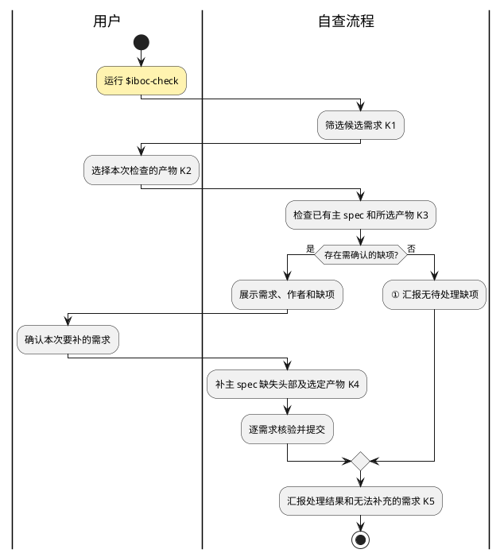

# 补账流程优化：功能方案 v2

> 阶段：需求澄清
> 状态：待审阅

送检前通过 IBOC 自查发现文档缺项，经确认后补齐，并保持需求收口和历史分析可用。

| 编号 | 功能点 | 分类 | 从哪进 → 到哪去 |
|---|---|---|---|
| F1 | IBOC 送检前自查与补齐 | 核心 | 运行 `$iboc-check` → 查看缺项并确认 → 补齐选定产物 → 汇报 |
| F2 | 收口与历史分析定义统一 | 支撑 | 需求收口 → 历史分析 → 收口档案 |
| — | 不自动覆盖已有产物或推送提交 | 边界外排除 | — |

### F1 IBOC 送检前自查与补齐（核心）

现在通过 `$doc-backfill` 进入文档补账；改后入口叫 `$iboc-check`，定位为 IBOC 送检前自查。原有选择产物、确认缺项后补齐的行为沿用。

| 编号 | 哪一步 | 怎么判定 | 例子 | 依据 |
|---|---|---|---|---|
| K1 | 筛选候选需求 | 需求目录有提交，且作者包含当前 Git 用户 | 有本人提交的需求进入候选；目录无提交则不进入 | 沿用现有文档补账规则 |
| K2 | 选择产物 | 可选单测规格、单测报告、收口档案，默认全选；未选的不检查、不补 | 只选收口档案时，不把缺单测报告列为缺项 | 沿用现有文档补账规则 |
| K3 | 检查缺项 | 检查主 spec 头部三项及所选产物；无主 spec 的列为无法补充 | 头部齐全且所选产物均存在则跳过 | 沿用现有文档补账规则 |
| K4 | 补齐 | 只处理用户确认的需求，已有头部行和产物不覆盖；每个需求独立核验后提交 | 已有测试报告不重写 | 沿用现有文档补账规则 |
| K5 | 汇报 | 汇报所选范围、处理结果、无法补充项和测试未执行或失败情况 | 无主 spec 的需求提示无法补充 | 沿用现有文档补账规则 |

### F2 收口与历史分析定义统一（支撑）

需求收口和历史分析都保留 skill 定义，不再保留同名 agent 定义，收口时仍取得历史分析结果。既有支持的宿主都应能完成需求收口；用户看到的历时及覆盖说明沿用现有规则。

行为链：补收口档案 → 分析需求历史和实际投入 → 写入日历跨度、投入范围及覆盖情况 → 返回补账结果。

边界：① 证据不足时写明无法估算，不把无数据写成零小时；② 已有收口档案不重写；③ 移除独立的 dev-end 和 my-query 指令文件，安装升级时清理旧文件，需求收口仍由 dev-end skill 提供。

| 编号 | 哪一步 | 怎么判定 | 例子 | 依据 |
|---|---|---|---|---|
| K6 | 历史分析 | 结合需求相关提交和会话证据估算；覆盖不足时注明或无法估算 | 找不到可计算的会话时段时写无法估算 | 沿用现有需求收口和历史分析规则 |

---
以下供 spec 使用，可不细读。

- 必须在 spec 前解决的问题：无；2026-11-17 用户明确将 task-history 调整为 skill，并删除两个 command。
- 已锁定技术约束：iboc-check、dev-end、task-history 都以 skill 提供；删除 commands/dev-end.md、commands/my-query.md 与 agents/task-history.md，安装时自动清理。
- 留给 spec 的细节决策：沿用各宿主已有 skill 分发，不扩展 agent 安装机制。
- 现实约束（已核实）：原命令仅转发或提示补上下文；三种宿主均已分发 skills；废弃清单由安装器在复制后执行。
- 高风险断言：无新的跨宿主 agent 调用假设。
